::: cover
institution: ISABELA STATE UNIVERSITY
office: Office of Student Affairs and Services
address: Echague, Isabela
doc_type: System Development Portfolio
title: ISU OSAS Hub
subtitle: Integrated Student Affairs and Services Management System
program: Software Engineering I
author: Macarilay, Jake Ace | Address: [to be supplied] | Email: [to be supplied]
author: Alindayu, Fortunato Jr. | Address: [to be supplied] | Email: [to be supplied]
author: Lucas, John Lawrence | Address: [to be supplied] | Email: [to be supplied]
date: November 2026
:::

**Document control**

<!-- widths: 1.35,5.15 -->

| Item | Details |
| --- | --- |
| Document | System Development Portfolio |
| Project | ISU OSAS Hub — Integrated Student Affairs and Services Management System |
| Course | Software Engineering I |
| Institution | Isabela State University — Office of Student Affairs and Services |
| Developers | Macarilay, Jake Ace; Alindayu, Fortunato Jr.; Lucas, John Lawrence |
| Document version | 1.0 |
| Date | November 2026 |
| System version | Git commit 8270c54, 8 November 2026 |
| Prepared from | The running application, its source code, and the accompanying SRS, UML, wireframe, mockup and traceability deliverables |
| Status | For submission |

**How to read this document**

- The five sections follow the numbering required by the portfolio instructions. Every figure and every table carries a number that is scoped to its chapter and is referred to in the text.
- Requirements keep the identifiers used by the Software Requirements Specification (`FR-<group>-nn`, `NFR-<group>-nn`), so a row in Section 2 can be traced to a UML artefact, a wireframe and a mockup through the accompanying traceability matrix.
- Implementation status is used with a fixed meaning. *Implemented* means the behaviour exists and is reachable in the delivered code, *Partially implemented* means part of the behaviour is present but a required entry point or guard is missing, and *Proposed* means the capability is absent and is recorded only so that the gap stays visible.
- Text in square brackets, such as `[to be supplied]`, marks information that the group must complete before submission. No personal detail and no external link has been invented to fill a gap.
- Every screenshot in Section 4 was captured from the running application against its own database during the preparation of this document; none is a wireframe, a mockup or a reconstruction.

<!-- pagebreak -->

**Table of contents**

::: toc
1|1. System Proposal|4
2|1.1 Introduction|4
3|1.1.1 Background and context|4
3|1.1.2 Existing situation and processes|4
3|1.1.3 Importance and benefits|4
2|1.2 Problem Statement|5
2|1.3 Project Description|5
3|1.3.1 Purpose and scope|5
3|1.3.2 Major system modules|6
3|1.3.3 Key capabilities and scale|7
2|1.4 Target Users|8
3|1.4.1 Roles that are not implemented|8
1|2. Software Requirements Specification|9
2|2.1 Functional Requirements|9
3|2.1.1 M01 — Authentication and Account Lifecycle|9
3|2.1.2 M02 — Access Control|10
3|2.1.3 M03 — Student Profiles and User Management|11
3|2.1.4 M04 — Profile Security|11
3|2.1.5 M05 — Enrollment Verification|12
3|2.1.6 M06 — Scholarship Management|12
3|2.1.7 M07 — Eligibility Evaluation|13
3|2.1.8 M08 — Matching and Recommendations|13
3|2.1.9 M09 — Application Workflow|14
3|2.1.10 M10 — Document Management|15
3|2.1.11 M11 — Guidance and Counseling|15
3|2.1.12 M12 — Student Services|16
3|2.1.13 M13 — Notifications|17
3|2.1.14 M14 — Analytics and Reporting|17
3|2.1.15 M15 — Audit Logging|18
3|2.1.16 M16 — Search and Navigation|18
2|2.2 Non-Functional Requirements|19
3|2.2.1 Security|19
3|2.2.2 Performance|20
3|2.2.3 Usability|20
3|2.2.4 Reliability|21
3|2.2.5 Maintainability|21
3|2.2.6 Compatibility|21
3|2.2.7 Portability|22
3|2.2.8 Accessibility|22
3|2.2.9 Data|23
2|2.3 User Roles and Access Permissions|23
1|3. Methodology|24
2|3.1 System Development Life Cycle (SDLC) Model Used|25
2|3.2 Tools, Frameworks, and Technologies Used|26
2|3.3 System Architecture and Design|27
3|3.3.1 Overall System Architecture|27
3|3.3.2 UML Deployment Diagram|29
2|3.4 System Interface Design (Wireframes)|33
2|3.5 System Mockup (Figma)|37
1|4. System Implementation|42
2|4.1 System Core Feature Interfaces|42
3|4.1.1 Login and Authentication Interface|42
3|4.1.2 Dashboard Interface|44
3|4.1.3 Core Functional Modules|47
3|4.1.4 Reports and Other Essential Features|79
1|5. Project Resources and Repository Links|86
2|5.1 Figma Design Link|87
2|5.2 GitHub Repository Link|87
2|5.3 Deployed System Link|88
:::

<!-- pagebreak -->

## 1. System Proposal

### 1.1 Introduction

#### 1.1.1 Background and context

The Office of Student Affairs and Services (OSAS) of Isabela State University is responsible for the non-academic side of student life. Its work includes administering scholarship programmes and their application cycles, providing guidance and counseling services, and processing the routine student services that students request during a term, from certificates and clearances to inquiries about financial assistance.

Each of these functions produces records that two parties depend on: students, who need to know what is available and what has happened to a request, and OSAS personnel, who need to decide, verify and report. ISU OSAS Hub is a web-based information system that keeps those records in a single authenticated portal. It was developed as the Software Engineering I project of Macarilay, Jake Ace; Alindayu, Fortunato Jr.; and Lucas, John Lawrence, and the project repository records development between 6 October and 8 November 2026.

The delivered system is a server-rendered Laravel 12 application backed by MariaDB. It recognises three roles — student, counselor and administrator — and sixteen functional modules covering authentication, access control, profiles, enrollment verification, scholarships, eligibility, matching, applications, documents, guidance, student services, notifications, analytics, audit logging and search.

#### 1.1.2 Existing situation and processes

Before the system, OSAS transactions were handled through paper forms, shared spreadsheets and office walk-ins. Scholarship announcements depended on bulletin boards and informal channels, so information reached students late and unevenly. Eligibility was screened by hand, which meant that two staff members could reach different conclusions from the same profile and that no decision could be reconstructed afterwards. Application documents were kept in physical folders, so verifying one applicant required locating a folder and remembering which pages had already been checked.

Guidance appointments and student-service requests were arranged verbally. A student asked for a slot, a counselor wrote it down or did not, and nothing in the process prevented two students from being promised the same hour. Service requests were recorded in notebooks or in conversation, so a student had no way to prove what had been requested and the office had no way to show who had handled it.

The consequence was not only delay. It was the absence of a record: the office could not answer a simple question — how many applications were pending, how many appointments were confirmed, which requests were still open — without assembling the answer by hand from several files.

#### 1.1.3 Importance and benefits

The system replaces that arrangement with a single portal in which every privileged action is recorded. Its benefits follow directly from the modules that implement them.

- **One authoritative catalogue.** Scholarships live in one table with an explicit status and an application window, so a student sees the same information as the office.
- **Screening that can be explained.** Eligibility is computed from five criteria and each criterion reports its own result and reason, so a student learns why a scholarship is out of reach instead of being told that it is.
- **Controlled document handling.** Uploads are validated, stored privately, verified one by one and served only to authorised users.
- **Scheduling that cannot double-book.** Bookable slots are generated from published availability and checked for conflicts on both sides before an appointment exists.
- **Status that students can see.** Applications, appointments and service requests each carry a status, a history and a numbered reference.
- **Accountability by default.** Authentication events and business decisions produce audit entries that cannot be edited through the interface.
- **Evidence for management.** Three analytical views and a CSV export answer the questions that previously required manual assembly.

### 1.2 Problem Statement

Six problems motivated the system. Each is stated below with its effect on students, its effect on OSAS personnel, and the module that responds to it. The table is a summary; the requirement statements that make each response testable are given in Section 2.

<!-- caption: Table 1.1 — Problems addressed by the system and the module that responds to each -->

<!-- widths: 1.5,1.6,1.6,1.8 -->

| Problem | Effect on students | Effect on OSAS personnel | Response in the system |
| --- | --- | --- | --- |
| Scholarship information is announced late and unevenly | Deadlines are missed because the announcement never reached the student | The same questions are answered repeatedly and inconsistently | M06 — one catalogue with status, window and announcement notifications |
| Eligibility is screened by hand | Two students with comparable profiles can receive different answers | Rules are re-checked per applicant and decisions cannot be audited | M07 and M08 — five-criterion engine with per-criterion reasons and weighted ranking |
| Documents are held in physical folders | Documents are resubmitted because the office cannot confirm receipt | Verification state is remembered rather than recorded | M10 and M09 — validated upload, per-document verification, authorised download |
| Appointments are arranged verbally | A student can be given a slot that was already promised to someone else | Counselor schedules live outside any system and are easily contradicted | M11 — published availability, generated slots, conflict checks, status workflow |
| Service requests leave no reliable trace | A student cannot prove what was requested, when, or by whom it was handled | No record of ownership, progress or completion | M12 — numbered request, assigned handler, status history |
| Management reporting is manual | Indirect: slow answers to legitimate questions about the office | Figures are assembled by hand from several files and cannot be reconciled | M14 — three analytical views, period filters and CSV export |

Two limits are stated deliberately. First, the system supports a decision; it does not replace it. An application is approved by an administrator, not by the software, and the matching score ranks scholarships without granting them. Second, the hub does not integrate with the university student information system, so GWA, family income and enrollment status are supplied by the student or by an administrator and are checked against uploaded documents rather than against academic records of record.

### 1.3 Project Description

#### 1.3.1 Purpose and scope

The purpose of ISU OSAS Hub is to give the office and its students one system of record for scholarships, guidance appointments and student-service requests, and to make the state of every record visible to the people entitled to see it.

**In scope.** The delivered system covers the following.

- Account registration, one-time-passcode verification, login, logout and session handling.
- Role-based access control through route middleware, gates and record policies.
- Student profiles, self-service editing of four fields, and administrative maintenance.
- Profile passcode protection with lock, unlock and administrative reset.
- Per-term enrollment verification records and gating of enrollment-dependent actions.
- Scholarship authoring, lifecycle, document requirements, publication and announcement.
- Eligibility evaluation with a per-criterion explanation.
- Weighted matching, recommendation categories and a full ranked match list.
- Application submission, document upload, review, verification, approval and history.
- Guidance availability, slot generation, booking, confirmation, completion and reminders.
- Student-service catalogue, request submission, assignment, processing and history.
- In-application notifications with queued email delivery.
- Analytics over the three workflows, with period filters and CSV export.
- Audit logging of authentication and business events, exposed read-only.
- Role-scoped search and a shared application shell.

**Out of scope.** The following are deliberately excluded from this version.

- Disbursement or payroll of scholarship funds.
- Grade management or any academic record of record.
- Integration with the registrar or the student information system.
- SMS messaging and native mobile applications.
- Multi-campus tenancy and biometric identity verification.
- Optical character recognition of uploaded documents.
- Self-service password reset and rescheduling of confirmed appointments.
- Counselor-authored session notes and counselor-side processing of service requests.

#### 1.3.2 Major system modules

The sixteen modules below are the unit of delivery and the unit of verification. Each module owns a set of requirements with its own identifier prefix, and each is reachable from the interface of at least one role.

<!-- caption: Table 1.2 — Functional modules of the delivered system -->

<!-- widths: 0.5,1.65,3.35,1.0 -->

| ID | Module | What it provides | Status |
| --- | --- | --- | --- |
| M01 | Authentication and Account Lifecycle | Registration, login, logout, one-time-passcode email verification, throttling and rejection of deactivated accounts | Implemented |
| M02 | Access Control | Role middleware, named gates and record policies enforced on the server | Implemented |
| M03 | Student Profiles and User Management | Profile maintenance, self-service editing of four fields, administrative maintenance and account activation | Implemented |
| M04 | Profile Security | Student-set profile passcode, session lock, unlock and administrative recovery | Implemented |
| M05 | Enrollment Verification | Per-term verification records, staff decisions and gating of enrollment-dependent student actions | Partially implemented |
| M06 | Scholarship Management | Scholarship authoring, lifecycle, document requirements, publication and announcement | Implemented |
| M07 | Eligibility Evaluation | Five-criterion rule engine that explains each criterion and derives the verdict | Implemented |
| M08 | Matching and Recommendations | Weighted scoring under administrator-controlled weights, recommendations and full match list | Implemented |
| M09 | Application Workflow | Draft creation, submission, review, state machine, approval guard and status history | Implemented |
| M10 | Document Management | Validated upload, deletion while in draft, per-document verification and authorised download | Implemented |
| M11 | Guidance and Counseling | Availability, slot generation, booking, confirmation, completion and reminders | Implemented |
| M12 | Student Services | Service catalogue, request submission, assignment, processing and status history | Partially implemented |
| M13 | Notifications | In-application notification centre with duplicate suppression and queued email | Implemented |
| M14 | Analytics and Reporting | Operational metrics, three analytical views, period filtering and CSV export | Implemented |
| M15 | Audit Logging | Capture of authentication and business events, search, detail view and read-only policy | Implemented |
| M16 | Search and Navigation | Role-scoped typeahead, scholarship search and the shared application shell | Implemented |

#### 1.3.3 Key capabilities and scale

Three workflows account for most of the system and are the ones a reader should follow first. In the **scholarship workflow** an administrator authors a scholarship with its thresholds, required documents and window, announces it, and later reviews applications whose documents have been uploaded and verified. In the **guidance workflow** a counselor publishes weekly availability, a student books one of the generated slots, and the counselor confirms, rejects or completes the appointment. In the **student-service workflow** a student submits a numbered request from a catalogue that an administrator maintains, and an assigned handler moves it through processing to completion.

The size of the delivered system is summarised below. The figures are counts taken from the repository and the database of the verified build, not estimates.

<!-- caption: Table 1.3 — Scale of the delivered system -->

<!-- widths: 2.0,4.5 -->

| Measure | Value |
| --- | --- |
| Functional requirements | 113, of which 106 implemented, 1 partially implemented and 6 proposed |
| Non-functional requirements | 40, all implemented in the delivered build |
| Functional modules | 16, of which 14 implemented and 2 partially implemented |
| User roles | 3 — student, counselor, administrator |
| Application routes | 129, excluding vendor packages |
| Database tables | 30 |
| Eloquent models | 22 |
| Service classes | 19 |
| Controllers | 31 |
| Blade view templates | 91 |
| Automated test suite | PHPUnit 11 test suite in tests/ |

### 1.4 Target Users

The system recognises exactly three human roles, stored in a `roles` table with one role per account; every restricted route re-checks the role or a named gate on the server. A fourth, non-human actor exists: scheduled commands and a queue worker deliver appointment reminders and notification email.

<!-- caption: Table 1.4 — Verified user roles, responsibilities and benefits -->

<!-- widths: 0.95,1.55,2.5,1.5 -->

| Role | Who holds it | Responsibilities in the system | Expected benefit |
| --- | --- | --- | --- |
| Student | Any enrolled ISU student with a verified account | Maintains a profile, browses and searches scholarships, checks eligibility, applies and uploads documents, books and cancels guidance appointments, submits and tracks service requests | One place to find opportunities and to see the state of every request |
| Counselor | Guidance personnel whose account is created by an administrator | Publishes weekly availability, confirms, rejects or completes appointments assigned to them, and records enrollment-verification decisions | A schedule that the system maintains and a queue that cannot be double-booked |
| Administrator | OSAS staff authorised to operate the office workflow | Manages accounts and profiles, authors scholarships and requirements, reviews applications and verifies documents, configures guidance and service settings, monitors analytics and reads the audit log | One console for the whole office, with evidence of who did what |

#### 1.4.1 Roles that are not implemented

The earlier documentation brief named four actors: Student, Adviser, OSAS Staff and Super Admin. Verification of the schema, seeders, routes and interface found only the three roles above; the remaining names are recorded here so the discrepancy cannot be mistaken for a delivered feature.

<!-- caption: Table 1.5 — Actors named in the brief that the delivered system does not implement -->

<!-- widths: 1.3,1.4,3.8 -->

| Requested actor | Present in the system | Closest implemented construct |
| --- | --- | --- |
| Student | Yes | `student` role |
| Adviser | No | No endorsement step exists anywhere in the application workflow |
| OSAS Staff | No, not as a role | The label appears in interface copy only, so treating it as an actor in a use case diagram would misrepresent the system; the duties are performed by the administrator and counselor roles |
| Super Admin | No | `admin` is a single flat role with no hierarchy and no impersonation |

<!-- pagebreak -->

## 2. Software Requirements Specification

This section restates the requirement baseline against which the system was built and verified: 113 functional requirements and 40 non-functional requirements. Each requirement has a unique identifier, a priority, an implementation status and a traceable artefact in the accompanying UML, wireframe, mockup and traceability deliverables. The full statements, acceptance criteria and data requirements are in the Software Requirements Specification; the tables here are the same requirements, grouped so that they can be read next to the modules they belong to.

Priority is used consistently. **High** requirements are essential to the operational purpose of the module, **Medium** requirements improve efficiency or governance, and **Low** requirements are desirable refinements. Status uses the three values defined in the front matter.

### 2.1 Functional Requirements

Functional requirements are organised by module and, within a module, by the user task they support. Each statement is written so that it can be tested: it names the actor, the action and the observable result.

<!-- caption: Table 2.1 — Functional requirements by module -->

<!-- widths: 2.3,0.9,1.1,1.05,0.6,0.75 -->

| Module | Prefix | Requirements | Implemented | Partial | Proposed |
| --- | --- | --- | --- | --- | --- |
| M01 — Authentication and Account Lifecycle | AUTH | 10 | 9 | 0 | 1 |
| M02 — Access Control | RBAC | 6 | 6 | 0 | 0 |
| M03 — Student Profiles and User Management | PROF | 8 | 8 | 0 | 0 |
| M04 — Profile Security | PASS | 4 | 4 | 0 | 0 |
| M05 — Enrollment Verification | ENR | 6 | 4 | 1 | 1 |
| M06 — Scholarship Management | SCH | 9 | 9 | 0 | 0 |
| M07 — Eligibility Evaluation | ELIG | 4 | 4 | 0 | 0 |
| M08 — Matching and Recommendations | MATCH | 6 | 6 | 0 | 0 |
| M09 — Application Workflow | APP | 11 | 10 | 0 | 1 |
| M10 — Document Management | DOC | 5 | 5 | 0 | 0 |
| M11 — Guidance and Counseling | GUID | 14 | 12 | 0 | 2 |
| M12 — Student Services | SVC | 10 | 9 | 0 | 1 |
| M13 — Notifications | NOTIF | 6 | 6 | 0 | 0 |
| M14 — Analytics and Reporting | ANLYT | 6 | 6 | 0 | 0 |
| M15 — Audit Logging | AUDIT | 5 | 5 | 0 | 0 |
| M16 — Search and Navigation | SEARCH | 3 | 3 | 0 | 0 |

#### 2.1.1 M01 — Authentication and Account Lifecycle

Authentication is implemented without a starter kit. The application provides its own login, registration and verification screens, and verifies an address with a six-digit one-time passcode rather than a signed link. Login and registration are throttled, failed attempts are audited without recording the attempted password, and deactivated accounts are refused at authentication and again by middleware.

<!-- caption: Table 2.2 — Authentication and Account Lifecycle requirements -->

<!-- widths: 0.62,4.15,0.7,1.03 -->

| ID | Requirement | Priority | Status |
| --- | --- | --- | --- |
| FR-AUTH-01 | **Email and password login.** The system shall authenticate a user against their email and password using a server-side session, rejecting invalid credentials with a non-revealing error message. | High | Implemented |
| FR-AUTH-02 | **Remember-me sessions.** The system shall persist an authenticated session across browser restarts when the user selects the remember option at login. | Medium | Implemented |
| FR-AUTH-03 | **Logout.** The system shall invalidate the active session and regenerate the session token when the user logs out. | High | Implemented |
| FR-AUTH-04 | **Student self-registration.** The system shall allow a guest to register a student account by supplying student number, name, email, password, college, program, contact number, GWA, family income, address, and privacy consent. | High | Implemented |
| FR-AUTH-05 | **Email OTP verification.** The system shall issue a six-digit one-time passcode by email and require the user to enter it before accessing role-protected pages. | High | Implemented |
| FR-AUTH-06 | **OTP resend with cooldown.** The system shall permit the user to request a replacement passcode only after a configured cooldown, and shall invalidate the previous unconsumed code. | Medium | Implemented |
| FR-AUTH-07 | **Authentication rate limiting.** The system shall throttle login attempts to five per minute, registrations to three per minute, OTP submissions to ten per minute, and OTP resends to six per minute. | Medium | Implemented |
| FR-AUTH-08 | **Inactive account rejection.** The system shall deny authentication to an account whose active flag is false and shall terminate any session belonging to a deactivated account. | High | Implemented |
| FR-AUTH-09 | **Legacy account verification backfill.** The system shall treat accounts created before the OTP feature as already email-verified so that administrator-created users are not locked out. | Medium | Implemented |
| FR-AUTH-10 | **Self-service password reset.** The system should allow a user to reset a forgotten password through an emailed single-use token; only administrator-initiated reset is implemented. | Medium | Proposed |

#### 2.1.2 M02 — Access Control

Authorization is layered: route groups carry role middleware, named gates express shared capabilities, and record policies compare the owner of a record with the signed-in user. A student cannot reach an administrator page by typing its address, and cannot open another student's document by guessing an identifier.

<!-- caption: Table 2.3 — Access Control requirements -->

<!-- widths: 0.62,4.15,0.7,1.03 -->

| ID | Requirement | Priority | Status |
| --- | --- | --- | --- |
| FR-RBAC-01 | **Role assignment.** The system shall assign exactly one role to each user account, drawn from student, counselor, or administrator. | High | Implemented |
| FR-RBAC-02 | **Route-level role enforcement.** The system shall reject requests from an authenticated user whose role does not match the route group prefix with an HTTP 403 response. | High | Implemented |
| FR-RBAC-03 | **Panel access gates.** The system shall expose access-admin-panel, access-counselor-panel, and access-student-panel gates that require both the correct role and an active account. | High | Implemented |
| FR-RBAC-04 | **Shared staff gate.** The system shall expose a manage-enrollment-verifications gate satisfied by an active administrator or an active counselor. | High | Implemented |
| FR-RBAC-05 | **Record ownership policies.** The system shall authorize document, appointment, and notification access through policies that compare the record owner with the authenticated user. | High | Implemented |
| FR-RBAC-06 | **Role-aware landing page.** The system shall redirect an authenticated user from the site root to the dashboard of their role, and return HTTP 403 when no dashboard is configured. | Medium | Implemented |

#### 2.1.3 M03 — Student Profiles and User Management

A student profile is a separate record joined one-to-one to the user account. Students may correct only the four fields over which they hold authoritative knowledge — contact number, address, GWA and family income. Academic identity fields and enrollment status remain administrator-controlled.

<!-- caption: Table 2.4 — Student Profiles and User Management requirements -->

<!-- widths: 0.62,4.15,0.7,1.03 -->

| ID | Requirement | Priority | Status |
| --- | --- | --- | --- |
| FR-PROF-01 | **Profile creation on registration.** The system shall create exactly one student profile linked to the user account when a student registers or when an administrator creates a student account. | High | Implemented |
| FR-PROF-02 | **View own profile.** The system shall display the authenticated student's profile, enrollment status, and enrollment verification history. | High | Implemented |
| FR-PROF-03 | **Edit own profile fields.** The system shall allow a student to edit contact number, address, GWA, and family income only, and shall reject attempts to change student number, name, year level, college, program, and enrollment status. | High | Implemented |
| FR-PROF-04 | **Search student profiles.** The system shall provide a filtered, paginated list of student profiles searchable by name, student number, college, program, year level, and enrollment status. | High | Implemented |
| FR-PROF-05 | **Maintain student profiles.** The system shall allow an administrator to view and update any student profile, including administrator-only academic fields. | High | Implemented |
| FR-PROF-06 | **Create user accounts.** The system shall allow an administrator to create a user account for any role, creating the linked student profile when the role is student. | High | Implemented |
| FR-PROF-07 | **Activate and deactivate accounts.** The system shall allow an administrator to activate or deactivate a user account without deleting it. | High | Implemented |
| FR-PROF-08 | **Administrator password reset.** The system shall allow an administrator to set a new password for a user account without knowing the existing password. | High | Implemented |

#### 2.1.4 M04 — Profile Security

The profile passcode is a student-controlled privacy measure for shared computers. It is hashed with the same one-way algorithm as an account password, is never returned to the browser, and can be reset by an administrator when it is forgotten.

<!-- caption: Table 2.5 — Profile Security requirements -->

<!-- widths: 0.62,4.15,0.7,1.03 -->

| ID | Requirement | Priority | Status |
| --- | --- | --- | --- |
| FR-PASS-01 | **Set profile passcode.** The system shall allow a student to set a profile passcode that locks the profile view for the current session. | Medium | Implemented |
| FR-PASS-02 | **Passcode hashing.** The system shall store the profile passcode only as a one-way hash and shall never render or transmit the plaintext value. | High | Implemented |
| FR-PASS-03 | **Lock and unlock own profile.** The system shall allow a student to lock or unlock the profile within the current session using the passcode, throttling unlock attempts. | Medium | Implemented |
| FR-PASS-04 | **Administrator passcode recovery.** The system shall allow an administrator to unlock a student profile session lock and to reset a forgotten passcode. | Medium | Implemented |

#### 2.1.5 M05 — Enrollment Verification

Enrollment verification exists so that an application or a booking can be limited to a student who is enrolled in the current term. Records are scoped to an academic year and semester and the current term is read from configuration.

> Observed gap. The application can list, display and decide enrollment-verification records, but no route or interface creates them, and the enrollment gate permits access while no record exists for a student. The module is therefore classified as partially implemented and the intake requirement is recorded as proposed.

<!-- caption: Table 2.6 — Enrollment Verification requirements -->

<!-- widths: 0.62,4.15,0.7,1.03 -->

| ID | Requirement | Priority | Status |
| --- | --- | --- | --- |
| FR-ENR-01 | **Per-term verification records.** The system shall store enrollment verification decisions as discrete records scoped to an academic year and semester for a student profile. | High | Partial |
| FR-ENR-02 | **Verification request intake.** The system should provide a route through which a student's verification request for the current term is created and queued for staff review. | High | Proposed |
| FR-ENR-03 | **Record verification decision.** The system shall allow an authorized staff member to record verified, rejected, or unable-to-verify, requiring a reason for the latter two, and shall update the student profile enrollment status accordingly. | High | Implemented |
| FR-ENR-04 | **Current-term scoping.** The system shall read the current academic year and semester from configuration and treat verification for any other term as insufficient. | High | Implemented |
| FR-ENR-05 | **Enrollment-gated services.** The system shall block application submission, document upload, appointment booking, and service request submission until the student's enrollment is verified for the current term. | High | Implemented |
| FR-ENR-06 | **Legacy account exemption.** The system shall grant enrollment-gated access to students who have no verification records at all, preserving pre-existing access until the first record is created. | Medium | Implemented |

#### 2.1.6 M06 — Scholarship Management

A scholarship carries eligibility thresholds, a set of document requirements and an application window. It is visible to students only when its status is open and the current date falls inside the window, so an administrator can prepare a scholarship in draft without exposing it.

<!-- caption: Table 2.7 — Scholarship Management requirements -->

<!-- widths: 0.62,4.15,0.7,1.03 -->

| ID | Requirement | Priority | Status |
| --- | --- | --- | --- |
| FR-SCH-01 | **Create scholarship.** The system shall allow an administrator to create a scholarship with title, description, provider, type, eligibility thresholds, eligible programs, eligible year levels, required enrollment status, and application window. | High | Implemented |
| FR-SCH-02 | **Edit scholarship.** The system shall allow an administrator to update any scholarship attribute while preserving its identifier and applications. | High | Implemented |
| FR-SCH-03 | **Scholarship status lifecycle.** The system shall restrict scholarship status to draft, open, closed, or archived. | High | Implemented |
| FR-SCH-04 | **Activate and deactivate scholarship.** The system shall allow an administrator to move a scholarship between open and closed with a single action. | High | Implemented |
| FR-SCH-05 | **Manage requirements.** The system shall allow an administrator to add, edit, reorder, mark optional, and delete the document requirements of a scholarship. | High | Implemented |
| FR-SCH-06 | **Browse open scholarships.** The system shall list only scholarships whose status is open and whose application window contains the current date to students. | High | Implemented |
| FR-SCH-07 | **Filter and sort scholarships.** The system shall allow a student to filter scholarships by type, provider, program, and eligibility, and to sort by deadline, name, newest, or match score. | Medium | Implemented |
| FR-SCH-08 | **Scholarship announcement.** The system shall allow an administrator to broadcast an announcement notification to students who are currently eligible for a scholarship. | Medium | Implemented |
| FR-SCH-09 | **View scholarship detail.** The system shall display the full scholarship record, its requirements, and the student's existing application state, returning not-found for scholarships that are not open. | High | Implemented |

#### 2.1.7 M07 — Eligibility Evaluation

Eligibility is evaluated deterministically. For each criterion the engine returns met, not met or not applicable together with the student's value, the threshold and a plain-language reason. The verdict is derived from the criterion results, which keeps the explanation and the decision consistent.

<!-- caption: Table 2.8 — Eligibility Evaluation requirements -->

<!-- widths: 0.62,4.15,0.7,1.03 -->

| ID | Requirement | Priority | Status |
| --- | --- | --- | --- |
| FR-ELIG-01 | **Evaluate eligibility criteria.** The system shall evaluate a student profile against a scholarship on GWA, family income, program, year level, and enrollment status, producing met, not-met, or not-applicable for each criterion. | High | Implemented |
| FR-ELIG-02 | **Explain criterion outcomes.** The system shall present each criterion outcome with the compared values and a human-readable reason so that the student understands the decision. | High | Implemented |
| FR-ELIG-03 | **Determine overall eligibility.** The system shall return an overall eligible or not-eligible decision derived from all criteria and shall attach a summary reason. | High | Implemented |
| FR-ELIG-04 | **Eligibility preview page.** The system shall provide a per-scholarship eligibility preview for the signed-in student without creating an application. | High | Implemented |

#### 2.1.8 M08 — Matching and Recommendations

Matching ranks scholarships for one student by combining five factors under weights that an administrator controls. Because the weights must total one hundred, a ranking expresses a trade-off rather than an arbitrary scale.

<!-- caption: Table 2.9 — Matching and Recommendations requirements -->

<!-- widths: 0.62,4.15,0.7,1.03 -->

| ID | Requirement | Priority | Status |
| --- | --- | --- | --- |
| FR-MATCH-01 | **Compute weighted match score.** The system shall compute a match score for a student-scholarship pair from academic, financial, program, year-level, and document-readiness factors using the active weights. | High | Implemented |
| FR-MATCH-02 | **Configure matching weights.** The system shall allow an administrator to view and update the five matching weights. | Medium | Implemented |
| FR-MATCH-03 | **Validate weight total.** The system shall reject a weight configuration whose five values do not total exactly 100. | High | Implemented |
| FR-MATCH-04 | **Categorize recommendations.** The system shall classify each scholarship as eligible recommendation, potential match, or not eligible. | High | Implemented |
| FR-MATCH-05 | **Student recommendations view.** The system shall present ranked scholarship recommendations and a full match list to the signed-in student. | High | Implemented |
| FR-MATCH-06 | **Document-readiness factor.** The system shall include the proportion of required documents already uploaded when scoring a match. | Medium | Implemented |

#### 2.1.9 M09 — Application Workflow

The application lifecycle is governed by a finite state machine. A student starts a draft, uploads documents and submits. An administrator moves the record through review and document verification to approval or rejection. Approval is refused unless every required requirement has a document that has itself been verified.

<!-- caption: Table 2.10 — Application Workflow requirements -->

<!-- widths: 0.62,4.15,0.7,1.03 -->

| ID | Requirement | Priority | Status |
| --- | --- | --- | --- |
| FR-APP-01 | **Create draft application.** The system shall create a draft scholarship application for the signed-in student when the student starts an application. | High | Implemented |
| FR-APP-02 | **Generate application number.** The system shall assign a unique human-readable application number to every application, retrying on collision. | High | Implemented |
| FR-APP-03 | **Prevent duplicate applications.** The system shall permit at most one application per student per scholarship for the lifetime of the record. | High | Implemented |
| FR-APP-04 | **Submit application.** The system shall allow a student to submit a draft application, stamping the submission time and moving the record into the review workflow. | High | Implemented |
| FR-APP-05 | **Upload while draft.** The system shall accept document uploads only while the application is in draft status. | High | Implemented |
| FR-APP-06 | **Review queue.** The system shall provide an administrator a searchable, filterable, paginated queue of all applications with student, scholarship, status, and submission date. | High | Implemented |
| FR-APP-07 | **Perform workflow transition.** The system shall apply only transitions permitted by the application state machine and shall reject any other transition with a validation error. | High | Implemented |
| FR-APP-08 | **Approval readiness guard.** The system shall refuse to approve an application unless every required requirement has an uploaded document in verified status. | High | Implemented |
| FR-APP-09 | **Application status history.** The system shall record every status change with previous status, new status, actor, remarks, and timestamp, and display it as a timeline. | Medium | Implemented |
| FR-APP-10 | **Notify on application events.** The system shall notify the student when an application is submitted, placed under review, moved to document verification, approved, or rejected. | High | Implemented |
| FR-APP-11 | **Withdraw application.** The system should allow a student to withdraw a submitted application; the status value is reserved but no transition is implemented. | Low | Proposed |

#### 2.1.10 M10 — Document Management

Documents are stored on a private disk. Authorised download is the only way to read a file, and the policy compares the requesting user with the owner of the application. Uploads accept PDF, JPEG and PNG only, up to five megabytes.

<!-- caption: Table 2.11 — Document Management requirements -->

<!-- widths: 0.62,4.15,0.7,1.03 -->

| ID | Requirement | Priority | Status |
| --- | --- | --- | --- |
| FR-DOC-01 | **Upload document with validation.** The system shall accept only PDF, JPG, JPEG, or PNG files up to 5 MB for each scholarship requirement. | High | Implemented |
| FR-DOC-02 | **Remove own document.** The system shall allow a student to delete a document they uploaded while the application is still in draft. | Medium | Implemented |
| FR-DOC-03 | **Download document.** The system shall stream a stored document to its owner or to an administrator, and to no other user. | High | Implemented |
| FR-DOC-04 | **Verify or reject document.** The system shall allow an administrator to mark a document verified or rejected with remarks, recording the verifier and time. | High | Implemented |
| FR-DOC-05 | **Private file storage.** The system shall store uploaded files on a private disk and expose them only through authorized download routes. | High | Implemented |

#### 2.1.11 M11 — Guidance and Counseling

Guidance scheduling is computed rather than negotiated. Counselor availability, office hours, appointment duration, minimum notice and the booking horizon together determine which slots are offered, and conflicts are checked for both the counselor and the student before an appointment is created.

<!-- caption: Table 2.12 — Guidance and Counseling requirements -->

<!-- widths: 0.62,4.15,0.7,1.03 -->

| ID | Requirement | Priority | Status |
| --- | --- | --- | --- |
| FR-GUID-01 | **Publish weekly availability.** The system shall allow a counselor to publish availability blocks by day of week and time range, rejecting overlapping blocks. | High | Implemented |
| FR-GUID-02 | **Retire availability block.** The system shall allow a counselor to deactivate an availability block without deleting its history. | Medium | Implemented |
| FR-GUID-03 | **Manage appointment types.** The system shall allow an administrator to create, edit, reorder, and toggle appointment types with an optional duration override. | Medium | Implemented |
| FR-GUID-04 | **Configure scheduling settings.** The system shall allow an administrator to set office hours, default duration, minimum booking notice, student cancellation notice, and maximum future booking days. | Medium | Implemented |
| FR-GUID-05 | **Browse counselors.** The system shall list counselors who have active availability so a student can choose a counselor. | High | Implemented |
| FR-GUID-06 | **Generate bookable slots.** The system shall derive bookable slots from counselor availability, office hours, appointment duration, booking notice, and the future booking horizon, excluding slots that conflict with blocking appointments. | High | Implemented |
| FR-GUID-07 | **Book appointment.** The system shall create an appointment in requested status for the selected counselor, date, slot, type, and reason. | High | Implemented |
| FR-GUID-08 | **Prevent scheduling conflicts.** The system shall reject a booking that overlaps another blocking appointment for the same counselor or the same student. | High | Implemented |
| FR-GUID-09 | **Confirm reject or complete appointment.** The system shall allow the assigned counselor to confirm, reject with reason, or complete an appointment in requested or confirmed status respectively. | High | Implemented |
| FR-GUID-10 | **Student cancellation.** The system shall allow a student to cancel a requested or confirmed appointment that is still outside the cancellation notice window. | High | Implemented |
| FR-GUID-11 | **Administrative oversight.** The system shall allow an administrator to view all appointments and the details of any appointment without altering its workflow state. | Medium | Implemented |
| FR-GUID-12 | **Automated reminders.** The system shall send one in-app and email reminder for each confirmed appointment inside the reminder window, never repeating for the same appointment. | Medium | Implemented |
| FR-GUID-13 | **Session notes authoring.** The system should allow counselors to record session notes on an appointment; the fields exist but no authoring interface is implemented. | Low | Proposed |
| FR-GUID-14 | **Rescheduling.** The system should allow a confirmed appointment to be moved to a different slot while preserving its identity. | Low | Proposed |

#### 2.1.12 M12 — Student Services

Service requests are numbered, described and optionally supported by attachments. An administrator assigns a handler and moves the request through processing, possibly asking for further information, to completion or cancellation.

> Observed gap. The workflow service and the policy layer allow a counselor to be the assigned handler of a service request, but no counselor route or screen exists for that purpose. The module is classified as partially implemented on that basis.

<!-- caption: Table 2.13 — Student Services requirements -->

<!-- widths: 0.62,4.15,0.7,1.03 -->

| ID | Requirement | Priority | Status |
| --- | --- | --- | --- |
| FR-SVC-01 | **Service catalog.** The system shall list active service types with their description, instructions, and required attachments. | High | Implemented |
| FR-SVC-02 | **Manage service types.** The system shall allow an administrator to create, edit, reorder, toggle, and define the requirements of a service type. | High | Implemented |
| FR-SVC-03 | **Submit service request.** The system shall create a service request from a description of at least ten characters plus optional supporting documents. | High | Implemented |
| FR-SVC-04 | **Generate request number.** The system shall assign a unique human-readable request number to every service request. | High | Implemented |
| FR-SVC-05 | **Track own requests.** The system shall list the student's service requests with status, service type, submission date, and handler. | High | Implemented |
| FR-SVC-06 | **Process and assign requests.** The system shall allow an administrator to assign a request to a handler and to record student-visible and internal remarks. | High | Implemented |
| FR-SVC-07 | **Service request transitions.** The system shall apply only transitions permitted by the service request state machine and reject all others. | High | Implemented |
| FR-SVC-08 | **Cancel request.** The system shall allow a student to cancel their own request while it is not in a terminal status. | Medium | Implemented |
| FR-SVC-09 | **Upload additional documents.** The system shall allow a student to add supporting documents to an existing non-terminal request. | Medium | Implemented |
| FR-SVC-10 | **Counselor request handling.** The system should allow a counselor to view and process service requests assigned to them; no counselor route exists. | Low | Proposed |

#### 2.1.13 M13 — Notifications

Notifications are written to the database for in-application display and simultaneously queued for email. Duplicate suppression prevents the same unread notification from being created twice, and the mail job stamps the record so that a retry cannot send twice.

<!-- caption: Table 2.14 — Notifications requirements -->

<!-- widths: 0.62,4.15,0.7,1.03 -->

| ID | Requirement | Priority | Status |
| --- | --- | --- | --- |
| FR-NOTIF-01 | **Create in-app notification.** The system shall create a notification record for each user-facing event with type, title, message, related record, and metadata. | High | Implemented |
| FR-NOTIF-02 | **Suppress duplicate notifications.** The system shall not create a second unread notification of the same type for the same related record and user. | Medium | Implemented |
| FR-NOTIF-03 | **Queue email delivery.** The system shall queue a notification email when the originating event requires email, and shall mark the notification as emailed exactly once. | High | Implemented |
| FR-NOTIF-04 | **Notification center.** The system shall list the signed-in user's notifications with category, read state, related reference, and a safe action link. | High | Implemented |
| FR-NOTIF-05 | **Mark read.** The system shall allow the user to mark a single notification or all notifications as read. | High | Implemented |
| FR-NOTIF-06 | **Unread counter.** The system shall display the count of unread notifications in the top bar and sidebar for the signed-in user. | Medium | Implemented |

#### 2.1.14 M14 — Analytics and Reporting

Analytics are descriptive. They report what happened in the scholarship, guidance and service workflows over a chosen period and can be exported so that the office can reuse the figures in its own reports.

<!-- caption: Table 2.15 — Analytics and Reporting requirements -->

<!-- widths: 0.62,4.15,0.7,1.03 -->

| ID | Requirement | Priority | Status |
| --- | --- | --- | --- |
| FR-ANLYT-01 | **Operational summary metrics.** The system shall display summary counts of students, scholarships, applications, appointments, and service requests on the administrator dashboard. | High | Implemented |
| FR-ANLYT-02 | **Scholarship analytics.** The system shall report application volume and outcomes by scholarship, provider, and status for a selected period. | High | Implemented |
| FR-ANLYT-03 | **Guidance analytics.** The system shall report appointment volume by type, counselor, and status for a selected period. | High | Implemented |
| FR-ANLYT-04 | **Student services analytics.** The system shall report service request volume by service type and status for a selected period. | High | Implemented |
| FR-ANLYT-05 | **Period filtering.** The system shall filter every analytics view by an optional start date and end date and shall validate the supplied range. | Medium | Implemented |
| FR-ANLYT-06 | **CSV export.** The system shall stream the filtered analytics dataset as a CSV download for offline reporting. | Medium | Implemented |

#### 2.1.15 M15 — Audit Logging

The audit log records who acted, on which record, when and from which address. It is exposed read-only and no route exists to modify or delete an entry.

<!-- caption: Table 2.16 — Audit Logging requirements -->

<!-- widths: 0.62,4.15,0.7,1.03 -->

| ID | Requirement | Priority | Status |
| --- | --- | --- | --- |
| FR-AUDIT-01 | **Log authentication events.** The system shall record login, failed login, and logout events with actor, address, and user agent. | High | Implemented |
| FR-AUDIT-02 | **Log business actions.** The system shall record administrative and workflow actions with module, record type, record identifier, actor, and description. | High | Implemented |
| FR-AUDIT-03 | **Search and filter audit log.** The system shall allow an administrator to search and filter audit entries by user, module, action, record type, and date range. | Medium | Implemented |
| FR-AUDIT-04 | **View audit entry detail.** The system shall display the full detail of a single audit entry including request metadata. | Medium | Implemented |
| FR-AUDIT-05 | **Audit immutability.** The system shall expose the audit log as read-only; no update or delete route shall exist. | High | Implemented |

#### 2.1.16 M16 — Search and Navigation

Live search returns suggestions only for records that the signed-in role may see. The same normalisation and length bounds apply to every search surface, which keeps query cost predictable.

<!-- caption: Table 2.17 — Search and Navigation requirements -->

<!-- widths: 0.62,4.15,0.7,1.03 -->

| ID | Requirement | Priority | Status |
| --- | --- | --- | --- |
| FR-SEARCH-01 | **Role-scoped live search.** The system shall provide typeahead suggestions scoped to the records the signed-in role is allowed to see. | Medium | Implemented |
| FR-SEARCH-02 | **Scholarship search service.** The system shall provide scholarship search with normalized input, allowed sort keys, and eligibility filtering. | High | Implemented |
| FR-SEARCH-03 | **Input normalization and bounds.** The system shall normalize search terms by trimming, collapsing whitespace, and bounding length before querying. | Medium | Implemented |

### 2.2 Non-Functional Requirements

The forty non-functional requirements are grouped into nine categories. Each statement describes a property of the delivered system that can be checked, and each is marked implemented because the mechanism that satisfies it is present in the code.

<!-- caption: Table 2.18 — Non-functional requirements by category -->

<!-- widths: 1.2,1.0,1.0,3.3 -->

| Category | Requirements | Implemented | Subject |
| --- | --- | --- | --- |
| Security | 8 | 8 | Hashing, sessions, authorisation, private storage, upload validation, throttling, auditability |
| Performance | 4 | 4 | Response time, indexes, pagination, queued email |
| Usability | 6 | 6 | Navigation, validation feedback, empty states, confirmations, badges, printing |
| Reliability | 4 | 4 | Transactions, idempotency, transition safety, referential integrity |
| Maintainability | 4 | 4 | Layering, single source of status values, components, configured term |
| Compatibility | 3 | 3 | Browsers, server platform, no client build step |
| Portability | 3 | 3 | Responsive layout, no proprietary runtime, environment configuration |
| Accessibility | 5 | 5 | Landmarks, keyboard operation, announcements, contrast, reduced motion |
| Data | 3 | 3 | Retained history, consistent timestamps, unique business identifiers |

#### 2.2.1 Security

Security is enforced in the framework rather than in the interface. Passwords and profile passcodes are hashed one way, sessions are server-side and CSRF-protected, every non-public route requires authentication and every restricted route re-checks its role or gate. Uploaded documents sit on a private disk and are released only through a policy-checked download route, and sensitive actions are rate limited per client.

<!-- caption: Table 2.19 — Security requirements -->

<!-- widths: 1.0,3.77,0.7,1.03 -->

| ID | Requirement | Priority | Status |
| --- | --- | --- | --- |
| NFR-SEC-01 | **Password hashing.** All passwords and profile passcodes shall be stored using a one-way hash and never in plaintext. | High | Implemented |
| NFR-SEC-02 | **Session protection.** Sessions shall use server-side storage, CSRF tokens on state-changing requests, and session regeneration on authentication. | High | Implemented |
| NFR-SEC-03 | **Authorization on every route.** Every non-public route shall require authentication, and every role-restricted route shall enforce its role or gate server-side. | High | Implemented |
| NFR-SEC-04 | **Private document storage.** Uploaded documents shall not be web-accessible by direct path and shall be served only through policy-checked download routes. | High | Implemented |
| NFR-SEC-05 | **Sensitive data exposure.** Passcode hashes and password fields shall be excluded from serialization and from every rendered view. | High | Implemented |
| NFR-SEC-06 | **Upload validation.** File uploads shall be validated by MIME type and size on the server before storage. | High | Implemented |
| NFR-SEC-07 | **Throttling of sensitive actions.** Login, registration, OTP submission, OTP resend, and profile unlock shall be rate limited per client. | High | Implemented |
| NFR-SEC-08 | **Auditability of privileged actions.** Every privileged state change shall produce an audit entry identifying the actor and the affected record. | High | Implemented |

#### 2.2.2 Performance

Performance requirements are expressed against the seeded dataset on the reference hardware. The implementation supports them with indexes on the columns that filters and sorts use, pagination on every list view, and a queue for email so that no request waits on the mail transport.

<!-- caption: Table 2.20 — Performance requirements -->

<!-- widths: 1.0,3.77,0.7,1.03 -->

| ID | Requirement | Priority | Status |
| --- | --- | --- | --- |
| NFR-PERF-01 | **Page response time.** Ninety-five percent of authenticated page requests shall complete within two seconds on the reference hardware with the seeded dataset. | High | Implemented |
| NFR-PERF-02 | **Indexed query paths.** Frequent filters and sorts shall be supported by database indexes on status, dates, owner identifiers, and composite application and appointment keys. | Medium | Implemented |
| NFR-PERF-03 | **Pagination.** Every list view shall paginate results rather than loading complete tables. | High | Implemented |
| NFR-PERF-04 | **Asynchronous email.** Email delivery shall be queued so that no user-facing request waits on the mail transport. | High | Implemented |

#### 2.2.3 Usability

Every authenticated page shares one sidebar and one top bar, forms report errors beside the offending field and preserve what was typed, lists and charts describe their empty state, and every workflow status is rendered as a labelled badge rather than a raw database value.

<!-- caption: Table 2.21 — Usability requirements -->

<!-- widths: 1.0,3.77,0.7,1.03 -->

| ID | Requirement | Priority | Status |
| --- | --- | --- | --- |
| NFR-USA-01 | **Consistent navigation.** Every authenticated page shall present the same persistent sidebar and top bar, with role-appropriate entries only. | High | Implemented |
| NFR-USA-02 | **Inline validation feedback.** Forms shall display field-level validation messages adjacent to the offending input and preserve previously entered values. | High | Implemented |
| NFR-USA-03 | **Explicit empty states.** Every list and chart shall display a descriptive empty state instead of a blank region when no data exists. | Medium | Implemented |
| NFR-USA-04 | **Destructive action confirmation.** Any destructive or irreversible action shall require an explicit confirmation step. | Medium | Implemented |
| NFR-USA-05 | **Status legibility.** Every workflow status shall be rendered with a consistent labeled badge and colour rather than a raw database value. | Medium | Implemented |
| NFR-USA-06 | **Print support.** Report and detail pages shall remain legible when printed, suppressing navigation chrome. | Low | Implemented |

#### 2.2.4 Reliability

Multi-record operations run inside transactions, invalid status transitions are rejected without modifying the record, and notification jobs carry idempotency stamps so that a retry cannot duplicate an outbound message. Foreign keys keep ownership relationships intact.

<!-- caption: Table 2.22 — Reliability requirements -->

<!-- widths: 1.0,3.77,0.7,1.03 -->

| ID | Requirement | Priority | Status |
| --- | --- | --- | --- |
| NFR-REL-01 | **Transactional integrity.** Multi-record operations shall execute inside a database transaction so that a partial workflow change cannot persist. | High | Implemented |
| NFR-REL-02 | **Notification idempotency.** Reminder and email jobs shall use idempotency stamps so that retries cannot duplicate outbound messages. | Medium | Implemented |
| NFR-REL-03 | **Workflow transition safety.** An invalid state transition shall be rejected without modifying the record and shall surface a user-readable error. | High | Implemented |
| NFR-REL-04 | **Referential integrity.** Foreign keys shall enforce ownership between users, profiles, applications, appointments, and requests, with restrictive or cascading behaviour matching business intent. | High | Implemented |

#### 2.2.5 Maintainability

Presentation, validation, business rules and persistence are separated into Blade views, form requests, service classes and Eloquent models. Status values are defined once, recurring interface elements are Blade components, and the academic term is read from configuration rather than hard-coded.

<!-- caption: Table 2.23 — Maintainability requirements -->

<!-- widths: 1.0,3.77,0.7,1.03 -->

| ID | Requirement | Priority | Status |
| --- | --- | --- | --- |
| NFR-MAINT-01 | **Layered separation.** Presentation, request validation, business rules, and persistence shall remain separated into Blade, FormRequest, Service, and Eloquent layers. | Medium | Implemented |
| NFR-MAINT-02 | **Single source of status values.** Status values shall be defined once as class constants or enums and reused by services, badges, and filters. | Medium | Implemented |
| NFR-MAINT-03 | **Reusable view components.** Recurring interface elements shall be implemented as Blade components rather than duplicated markup. | Medium | Implemented |
| NFR-MAINT-04 | **Configuration-driven term.** The current academic year and semester shall be supplied by configuration, not hard-coded values. | Medium | Implemented |

#### 2.2.6 Compatibility

The application runs on PHP 8.2 or later with MariaDB or MySQL behind Apache or Nginx, and on current versions of the four major browsers. The delivered pages are served from one stylesheet and one script, so no JavaScript build step is required to use the system.

<!-- caption: Table 2.24 — Compatibility requirements -->

<!-- widths: 1.0,3.77,0.7,1.03 -->

| ID | Requirement | Priority | Status |
| --- | --- | --- | --- |
| NFR-COMPAT-01 | **Browser support.** The system shall operate on current versions of Chrome, Edge, Firefox, and Safari. | Medium | Implemented |
| NFR-COMPAT-02 | **Server platform.** The system shall run on PHP 8.2 or later with a MariaDB or MySQL database and a standard Apache or Nginx web server. | High | Implemented |
| NFR-COMPAT-03 | **No client build step.** The delivered interface shall be usable without a JavaScript bundler, relying on a single stylesheet and a single script. | Medium | Implemented |

#### 2.2.7 Portability

The layout is usable from 360 to 1920 pixels and collapses the sidebar into a drawer below 1024 pixels. The system needs no commercial runtime, and database, mail and academic-term settings are supplied through environment configuration.

<!-- caption: Table 2.25 — Portability requirements -->

<!-- widths: 1.0,3.77,0.7,1.03 -->

| ID | Requirement | Priority | Status |
| --- | --- | --- | --- |
| NFR-PORT-01 | **Responsive layout.** The interface shall remain usable from 360 px through 1920 px, collapsing the sidebar into a drawer below 1024 px. | High | Implemented |
| NFR-PORT-02 | **No proprietary runtime.** The system shall not require a commercial runtime or licence to operate. | Medium | Implemented |
| NFR-PORT-03 | **Environment configuration.** Database, mail, and academic-term settings shall be supplied through environment configuration rather than source edits. | Medium | Implemented |

#### 2.2.8 Accessibility

Pages expose a main landmark, a skip link and labelled navigation; every control is keyboard operable with a visible focus indicator; status and alert regions carry roles that assistive technology can announce; colour pairs meet WCAG 2.1 AA contrast; and animation is suppressed when the user asks for reduced motion.

<!-- caption: Table 2.26 — Accessibility requirements -->

<!-- widths: 1.0,3.77,0.7,1.03 -->

| ID | Requirement | Priority | Status |
| --- | --- | --- | --- |
| NFR-ACC-01 | **Semantic landmarks.** Every page shall expose a main landmark, a skip link, and labelled navigation regions. | Medium | Implemented |
| NFR-ACC-02 | **Keyboard operability.** All interactive controls shall be reachable and operable by keyboard with a visible focus indicator. | High | Implemented |
| NFR-ACC-03 | **Status announcement.** Status and alert regions shall be announced to assistive technology through appropriate roles. | Medium | Implemented |
| NFR-ACC-04 | **Colour contrast.** Text and interactive elements shall meet WCAG 2.1 AA contrast against their backgrounds. | Medium | Implemented |
| NFR-ACC-05 | **Reduced motion.** Animation shall be suppressed when the user requests reduced motion. | Low | Implemented |

#### 2.2.9 Data

Status history, audit entries and verification records are retained rather than overwritten, timestamps are stored in server time and rendered consistently, and the application and request numbers that identify a record are unique and stable for its lifetime.

<!-- caption: Table 2.27 — Data requirements -->

<!-- widths: 1.0,3.77,0.7,1.03 -->

| ID | Requirement | Priority | Status |
| --- | --- | --- | --- |
| NFR-DATA-01 | **Retention of workflow history.** Status history, audit entries, and verification records shall be retained and never overwritten by later transitions. | Medium | Implemented |
| NFR-DATA-02 | **Consistent timestamps.** All records shall store created and updated timestamps in server time and render them in a consistent human-readable format. | Medium | Implemented |
| NFR-DATA-03 | **Unique business identifiers.** Application numbers and request numbers shall be unique and stable for the life of the record. | High | Implemented |

### 2.3 User Roles and Access Permissions

The permission matrix below is the contract between the roles and the interface. A filled entry states what the role may do and under which condition; a dash states that no route, gate or screen exists for that role, which is a stronger statement than a disabled button.

<!-- caption: Table 2.28 — Role and permission matrix -->

<!-- widths: 3.3,1.25,1.05,1.1 -->

| Capability | Student | Counselor | Administrator |
| --- | --- | --- | --- |
| Register an account | Yes | — | — |
| Log in, log out, remember session | Yes | Yes | Yes |
| Verify email by one-time passcode | Yes | Yes | Yes |
| Reset own password without signing in | — | — | — |
| View own profile | Yes | — | Yes, any student |
| Edit own profile | Yes, four fields | — | Yes, any student |
| Set, change or remove profile passcode | Yes | — | Reset for any student |
| Unlock a locked profile | Yes | — | Yes |
| Browse and search open scholarships | Yes | — | Yes, management view |
| View eligibility preview | Yes | — | — |
| View recommendations and match scores | Yes | — | Configure weights only |
| Create, edit, close or archive scholarships | — | — | Yes |
| Manage scholarship document requirements | — | — | Yes |
| Announce a scholarship to eligible students | — | — | Yes |
| Configure matching weights | — | — | Yes |
| Start an application and upload documents | Yes, enrollment-gated | — | — |
| Submit an application | Yes, enrollment-gated | — | — |
| Review applications and change status | — | — | Yes |
| Verify or reject uploaded documents | — | — | Yes |
| View enrollment verification records | Own record only | Yes | Yes |
| Record an enrollment decision | — | Yes | Yes |
| Publish guidance availability | — | Yes, own | — |
| Book a guidance appointment | Yes, enrollment-gated | — | — |
| Cancel a guidance appointment | Yes, own | — | — |
| Confirm, reject or complete an appointment | — | Yes, own appointments | View only |
| Manage appointment types and scheduling settings | — | — | Yes |
| View all appointments | — | Own only | Yes |
| Browse the service catalogue and submit a request | Yes, enrollment-gated | — | — |
| Track and cancel own service requests | Yes | — | — |
| Assign and process service requests | — | — | Yes |
| Manage service types and their requirements | — | — | Yes |
| Receive notifications | Yes | Yes | Yes |
| View analytics and export CSV | — | — | Yes |
| View the audit log | — | — | Yes |
| Create and deactivate user accounts | — | — | Yes |
| Reset another user's password | — | — | Yes |

Four mechanisms cooperate to enforce the matrix. Route middleware rejects a role mismatch with HTTP 403 for a whole route group. Named gates express shared capabilities such as `manage-users` and additionally require the account to be active. Policies compare the owner of a record with the signed-in user, which is what prevents one student from opening another student's document or appointment. The `enrollment.verified` middleware completes the chain by blocking enrollment-dependent student actions until a verification record exists for the current term.

<!-- caption: Table 2.29 — Where each role is enforced -->

<!-- widths: 1.15,5.35 -->

| Role | Enforcement points in the delivered code |
| --- | --- |
| Student | `role:student` route group; `verified.email` middleware; `enrollment.verified` middleware on submission routes; `access-student-panel` gate; student-scoped search endpoints |
| Counselor | `role:counselor` route group; `access-counselor-panel` gate; `manage-enrollment-verifications` gate; `GuidanceAppointmentPolicy` ownership checks |
| Administrator | `role:admin` route group; `manage-users` and `access-admin-panel` gates; `active` middleware on analytics and notifications; `NotificationPolicy` grant |

> Navigation visibility is never the control. Every restricted route independently re-checks the role or gate on the server, so hiding a menu entry changes the interface and not the authorisation.

## 3. Methodology

### 3.1 System Development Life Cycle (SDLC) Model Used

The project followed an **iterative and incremental** process: the system was delivered as a sequence of working slices, each one planned, specified, designed, implemented and walked through before the next slice began. The method was applied informally. It is described here from evidence in the repository and in the documentation set rather than from a methodology document, because no such document was produced.

Four observations support that conclusion.

- **The repository is a sequence of increments, not a single delivery.** Git records eight commits between 6 October and 8 November 2026 (Table 3.1). The messages name module-level work — student profile management, scholarship features, user management — and the application grew one module group at a time rather than arriving complete.
- **The interface was revised after use.** Later commits fix and improve behaviour that the earlier ones introduced, which is the signature of a cycle that returns to design and implementation rather than a single pass through the phases.
- **The requirement set matured with the system.** The clarification register that accompanies the SRS still carries items that were resolved while the screens were being built, which would not happen in a strict waterfall sequence.
- **No formal Scrum artefacts exist.** There is no product backlog, no sprint board, no velocity record and no stand-up log in the project. Calling the process Scrum would overstate it; calling it iterative describes what the evidence shows.

The model suited the project for three reasons. The team was small, so the cost of revisiting a decision was low and the cost of a long sign-off cycle was high. The domain rules — eligibility thresholds, appointment rules, verification steps — were clarified by building the screens that expressed them. And the course calendar required a demonstrable system early, which an increment provides and a phase-gate model does not.

Figure 3.1 shows the cycle that was actually run. Each pass begins by choosing the next module group, restates its requirements as testable statements, designs the screens and the data it needs, implements it in Laravel, walks through the result in the running application, updates the documentation set, and then returns to planning with the defects and the next group.

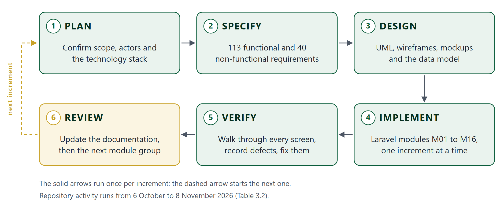

The phases and the artefacts each phase produced are as follows.

- **Plan.** Scope the term's work, fix the technology stack (PHP 8.2, Laravel 12, MariaDB), name the three roles, and enumerate the modules M01 to M16 that become the unit of delivery.
- **Specify.** Restate the chosen module's behaviour as numbered requirements with priorities and acceptance criteria, including the business rules for eligibility thresholds, appointment windows and status transitions.
- **Design.** Model the module in UML (use case, class, sequence and state diagrams), draw its screens as wireframes, and restate them as high-fidelity mockups built from the same design tokens as the application.
- **Implement.** Build the route, middleware, form request, controller, service, model, migration and Blade views for the module, and seed the data the screens need.
- **Verify.** Walk through every screen in the running application, exercise the permitted and forbidden transitions, run the automated test suite, and record defects and gaps instead of hiding them.
- **Review and increment.** Apply the fixes, update the documentation set, and return to planning for the next module group.

<!-- caption: Table 3.1 — Commit history of the delivered system -->

<!-- widths: 1.2,5.3 -->

| Date | Commit subject as recorded by Git |
| --- | --- |
| 2026-10-06 | Initial ISU OSAS Hub system |
| 2026-10-11 | Update ISU OSAS Hub system |
| 2026-10-13 | Update ISU OSAS Hub system |
| 2026-10-18 | Update ISU OSAS Hub system |
| 2026-10-21 | Apply Pint code formatting |
| 2026-11-02 | feat: add student profile management features |
| 2026-11-08 | Fix student profile security and improve scholarship features |
| 2026-11-08 | Improve user management UI and functionality |

The history shows the rhythm of the work rather than its content: five commits in the first two weeks establish the system, one is a formatting pass with Laravel Pint, and the last three add profile management, repair profile security, improve scholarship behaviour and rework user management. The documentation deliverables were produced after the code, which is why they describe the delivered behaviour rather than an intention.

### 3.2 Tools, Frameworks, and Technologies Used

The table below lists every technology that the delivered system depends on, with the role it plays and the evidence for its presence. Documentation tooling is listed separately because it produced this portfolio and not the application.

<!-- caption: Table 3.2 — Technology stack and the role of each technology -->

<!-- widths: 1.15,1.1,2.35,1.9 -->

| Technology | Version or identifier | Role in the project | Evidence in the repository |
| --- | --- | --- | --- |
| PHP | 8.2.12 | Server-side language and runtime | `composer.json` requires `^8.2`; verified with `php -v` |
| Laravel | 12.x | Framework: routing, middleware, validation, Eloquent ORM, sessions, queues, scheduler, Blade | `composer.json`, `app/`, `bootstrap/`, `routes/` |
| MariaDB | 10.4 | Relational database holding every record, with foreign keys and indexes | `DB_CONNECTION=mariadb` in `.env`; 30 tables in `isu_osas_hub` |
| Blade | Laravel 12 templating | Server-rendered views, layout inheritance and reusable components | 91 `.blade.php` files in `resources/views/` |
| HTML5 and CSS3 | `public/css/app.css` | Single stylesheet for the whole interface, including the responsive rules | 69 KB stylesheet linked from the layout; no CSS framework at runtime |
| JavaScript | `public/js/app.js` | Progressive enhancement: password toggle, sidebar drawer, search suggestions | 18.8 KB script linked from the layout |
| Composer | 2.x | PHP dependency management and autoloading | `composer.json`, `composer.lock`, `vendor/` |
| PHPUnit | 11.x | Automated tests of authentication, authorisation and workflows | `phpunit.xml`, `tests/` |
| Laravel Pint | 1.x | Code style enforcement | `composer.json`; commit of 21 October 2026 |
| XAMPP (Apache, MySQL, PHP) | Local installation | Development runtime that supplies Apache and MariaDB on the workstation | Documented in the reference SRS; MariaDB service running locally |
| PHP built-in server | `php artisan serve` | Serves the application during development and during the screenshot session | Used to run the copy from which Section 4 was captured |
| Git and GitHub | Remote `superjynx/ISU-OSAS-Hub` | Version control and the shared repository | `git log`; `git remote -v` |
| Visual Studio Code | Editor | Source editing for PHP, Blade, CSS and JavaScript | Recorded as the development environment in the reference SRS |
| Mermaid | mermaid-cli 12.2 | Documentation tooling: the SDLC, context and deployment diagrams in this portfolio | `documentation/Portfolio/diagrams/` |
| Headless Chrome and Puppeteer | Chrome 141, puppeteer-core | Documentation tooling: renders wireframes and mockups to PNG and captures the implementation screenshots | `documentation/_tools/*.cjs` |
| Python | 3.11 | Documentation tooling: builders that assemble the SRS, UML, wireframe, mockup, traceability and portfolio documents | `documentation/_tools/*.py` |

> `package.json` declares Vite 7 and Tailwind 4 as development dependencies, but the delivered interface does not use them: there is no `public/build` directory and no Blade template references `@vite`. The pages are served by the single stylesheet and the single script listed above, which is why the application runs without a JavaScript build step.

### 3.3 System Architecture and Design

#### 3.3.1 Overall System Architecture

ISU OSAS Hub is a self-contained, server-rendered web application. It does not replace the university student information system and does not consume data from it; the academic attributes a scholarship decision needs are held in the hub's own student profile. There is no single-page front end, no separate API tier and no third-party service other than the SMTP account used for outbound mail.

Figure 3.2 shows the components and the direction of every dependency. A request arrives from a browser over HTTP, is handled by the Laravel application, and leaves as rendered HTML. The application reads and writes MariaDB through PDO, reads and writes uploaded documents on a private disk, and dispatches one job type: the notification email that a queue worker sends through SMTP.

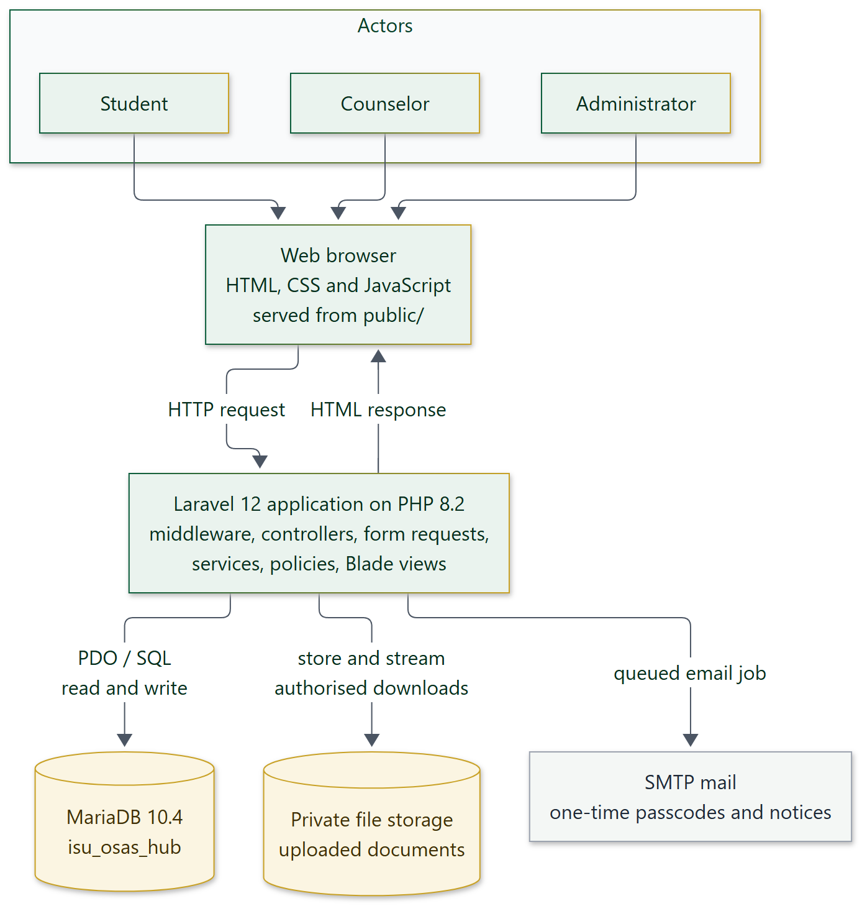

Inside the application the same request passes through a fixed sequence of layers, shown in Figure 3.3. Authentication establishes the session; the active-account middleware rejects deactivated users; a role or gate check authorises the route; the enrollment middleware optionally blocks enrollment-dependent student actions; a form request validates input; a service class applies the business rule; an Eloquent model persists through a policy check; and a Blade view renders the response. Documents are written to the private disk and read back only through an authorisation-checked download route.

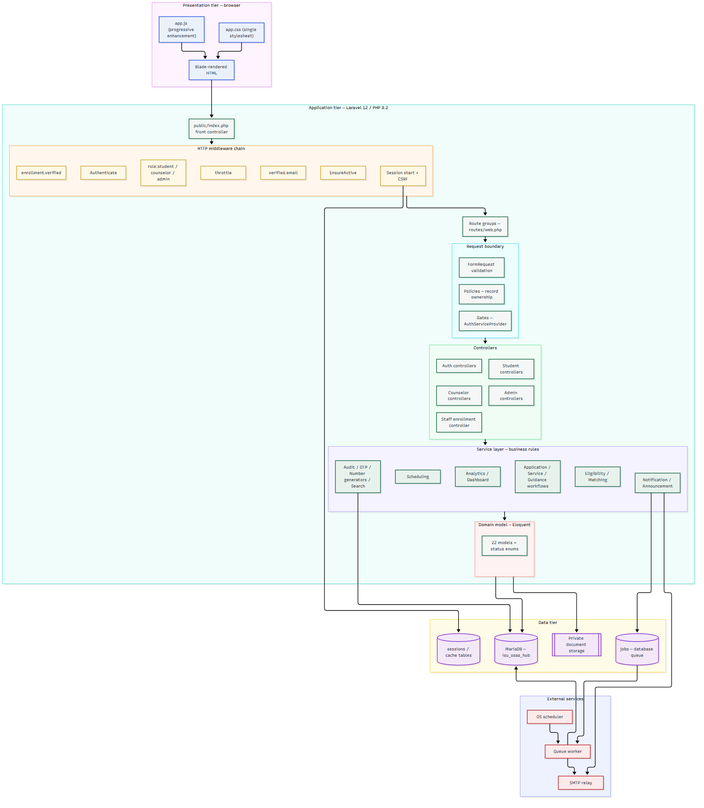

Two consequences of this design are worth stating because they explain later sections. First, authorisation is a property of the route and the record, not of the template, so hiding a menu entry cannot grant or deny access. Second, because rendering happens on the server, every screen in Section 4 is a complete HTML document produced by a controller and a Blade view — which is what makes the screenshots in that section verifiable against the routes listed in Table 4.1.

#### 3.3.2 UML Deployment Diagram

No production deployment of ISU OSAS Hub exists. The system was developed and demonstrated on a single Windows workstation, and that is the only environment that has been verified. Figure 3.4 therefore shows what exists: a client browser, an application server that is the PHP built-in server running Laravel 12, and the three stores the application writes to — the MariaDB database, the private document directory and the application log. All of them reside on the same machine, which is why the figure shows one host rather than three.

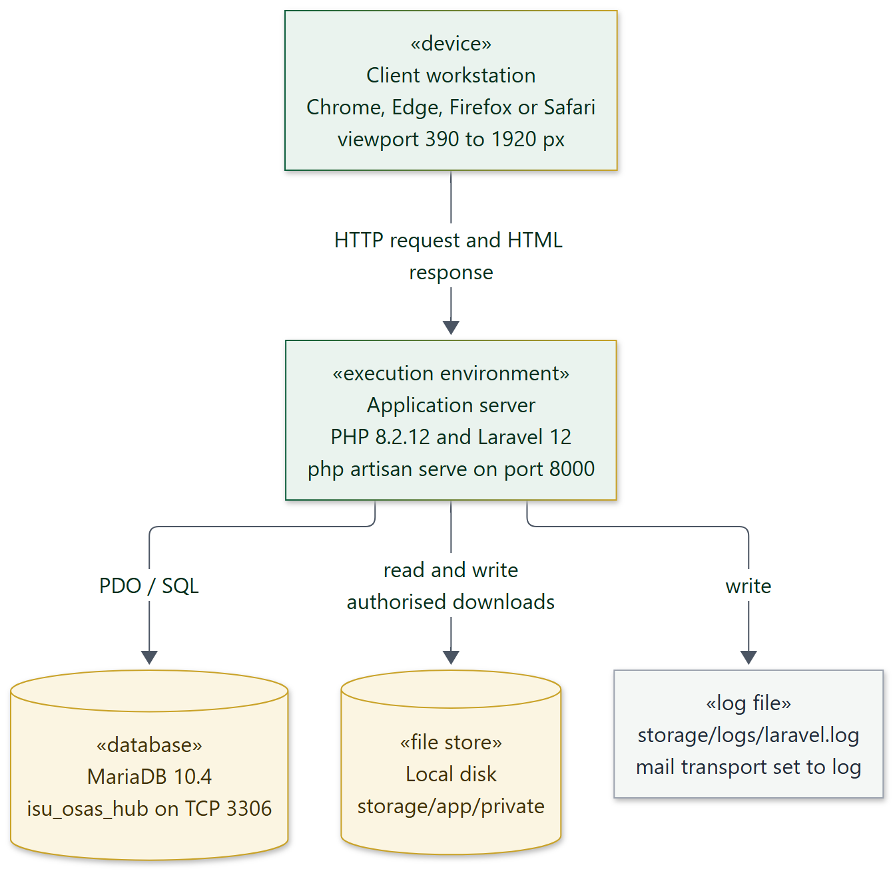

<!-- caption: Table 3.3 — Deployment nodes in the verified environment -->

<!-- widths: 1.3,3.2,2.0 -->

| Node | What it is in the verified environment | Connection |
| --- | --- | --- |
| Client workstation | Any desktop or tablet browser used to reach the system; the screenshots in Section 4 were taken at a 1440 by 980 viewport | HTTP over loopback to 127.0.0.1:8000 |
| Application server | PHP 8.2.12 built-in web server executing Laravel 12 from `public/index.php` | Receives HTTP; opens PDO connections; reads and writes the local disk |
| Database node | MariaDB 10.4 holding the `isu_osas_hub` schema of 30 tables | TCP 3306, PDO driver, credentials from `.env` |
| File store | `storage/app/private` on the server's local disk, holding uploaded documents | Read and written by the application; served only through download routes |
| Log file | `storage/logs/laravel.log`, including mail that the log transport captures | Written by the framework logger |

The UML deliverable also contains a target deployment, reproduced in Figure 3.5, that separates the application server, the database host, private storage, background processing and an SMTP relay, and terminates client traffic with HTTPS on a campus network. It is a design intention and has not been provisioned anywhere. It is included here so that the portfolio and the UML set describe the same design, and it is labelled as planned for exactly that reason.

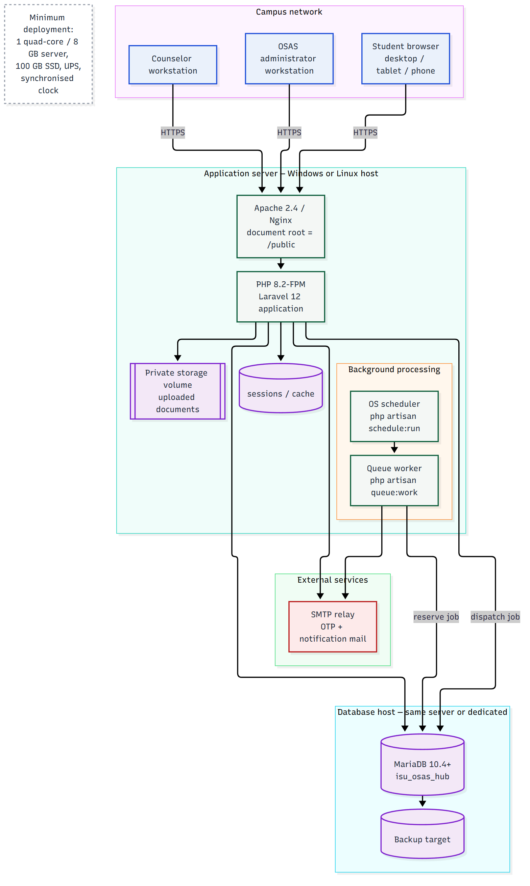

Moving from Figure 3.4 to Figure 3.5 would require five things that do not exist today: an HTTPS virtual host with a certificate, a supervised queue worker, a scheduled task runner for the hourly appointment-reminder command, a backup and retention policy for the database and the document directory, and an SMTP account. Until those are in place, the honest statement is that the system runs on one workstation and that no public address serves it; Section 5.3 repeats that statement for the submission record.

### 3.4 System Interface Design (Wireframes)

The wireframe set contains 58 low-fidelity screens across the four interface groups — four guest screens, twenty-one student screens, six counselor screens and twenty-seven administrator screens — each rendered at 1440, 1024 and 390 pixels. The screens are structural: they fix hierarchy, labelling and control placement without colour, so that layout can be reviewed before visual design begins. Every screen is bound to the routes that exist, and no screen was drawn for a capability the system does not have.

Six screens are reproduced below to show the range: an unauthenticated entry point, the two student tasks that carry the most state (booking a slot and filing a request), the counselor decision screen, and the administrator view that consolidates the three workflows.

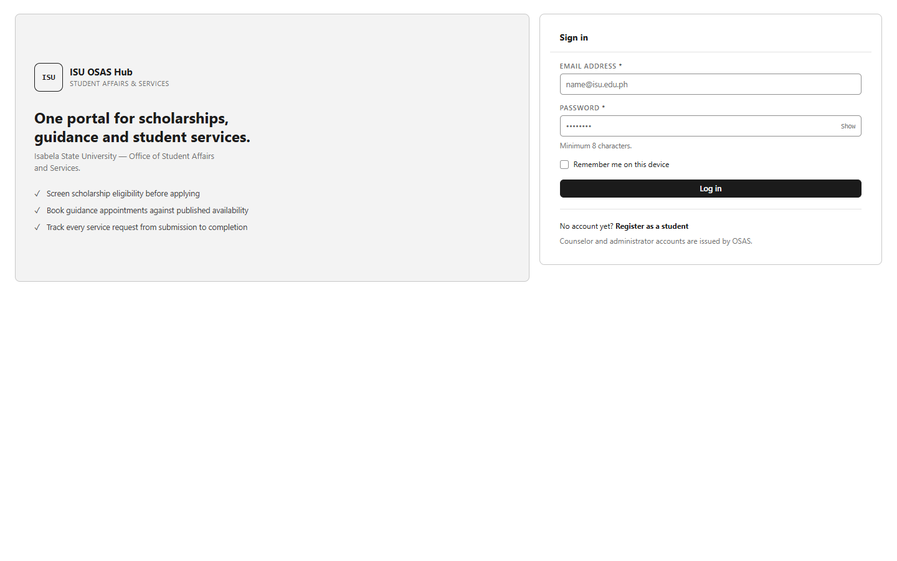

The login screen carries two fields, a password reveal control, a remember-me option and a single primary action, with registration offered as a secondary link. Nothing about the role is chosen here: the destination after sign-in is decided by the account's role.

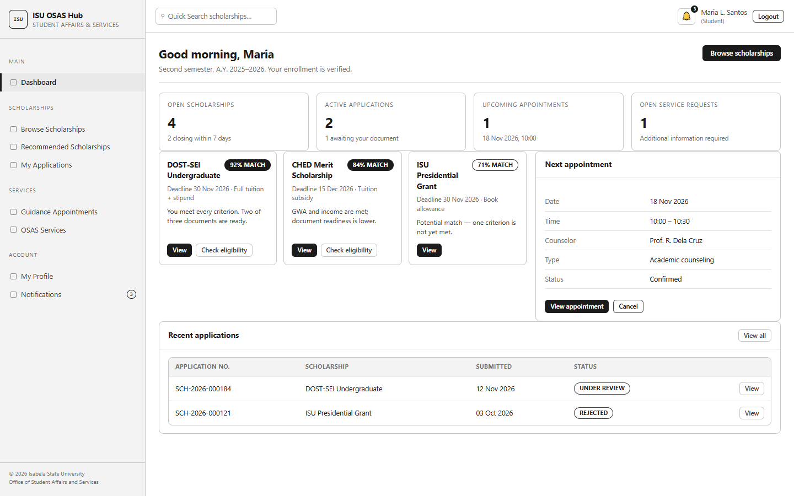

The student dashboard is a summary rather than a workspace: it repeats the state of scholarship applications, appointments and service requests so that a student can see what is waiting on them and what is waiting on the office, and links each block to its detail screen.

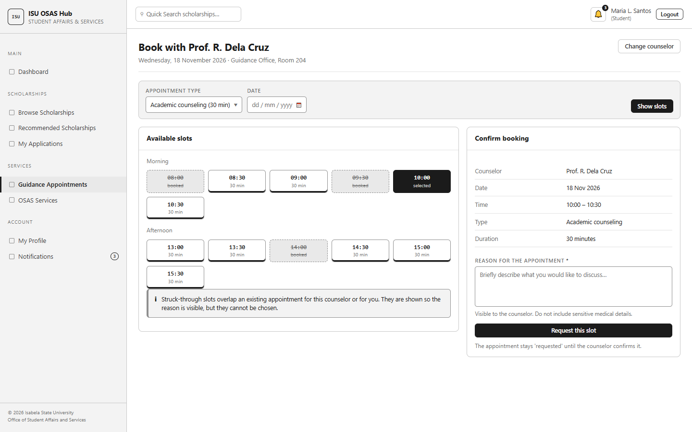

Availability is presented as a date and type filter over generated slots. A slot can be booked only when the counselor's published window, the office hours, the minimum notice and the booking horizon all permit it, which is why the screen shows a slot list rather than a free-form time field.

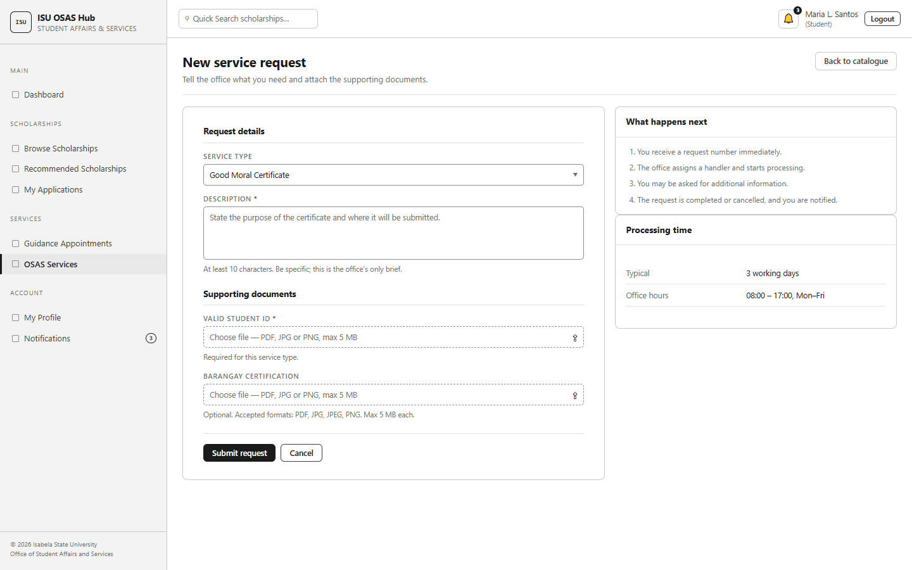

A service request begins with a type chosen from the administrator-maintained catalogue, because the type determines which supporting documents the office will ask for. The description and attachments follow, and the request number is assigned by the system on submission.

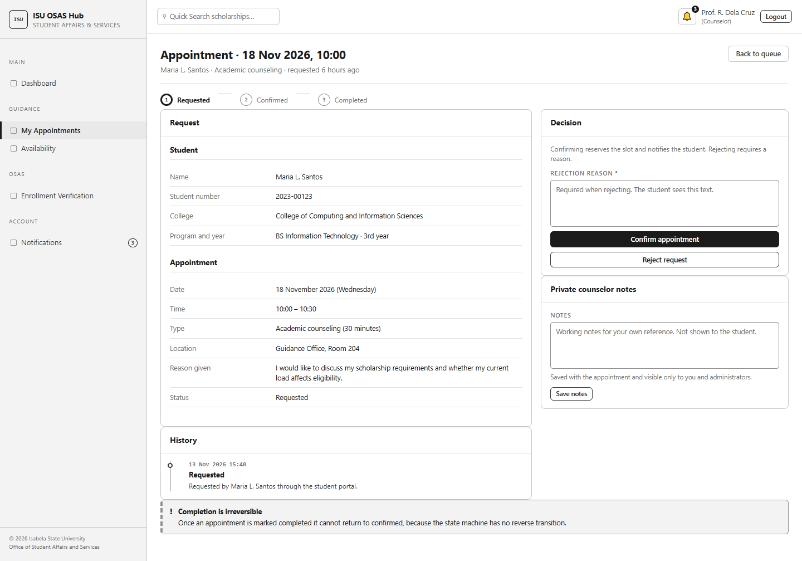

The counselor screen places the request, the student's stated reason and the permitted decisions on one page. Only transitions that the appointment state machine allows are offered, and a rejection requires a reason that the student will see.

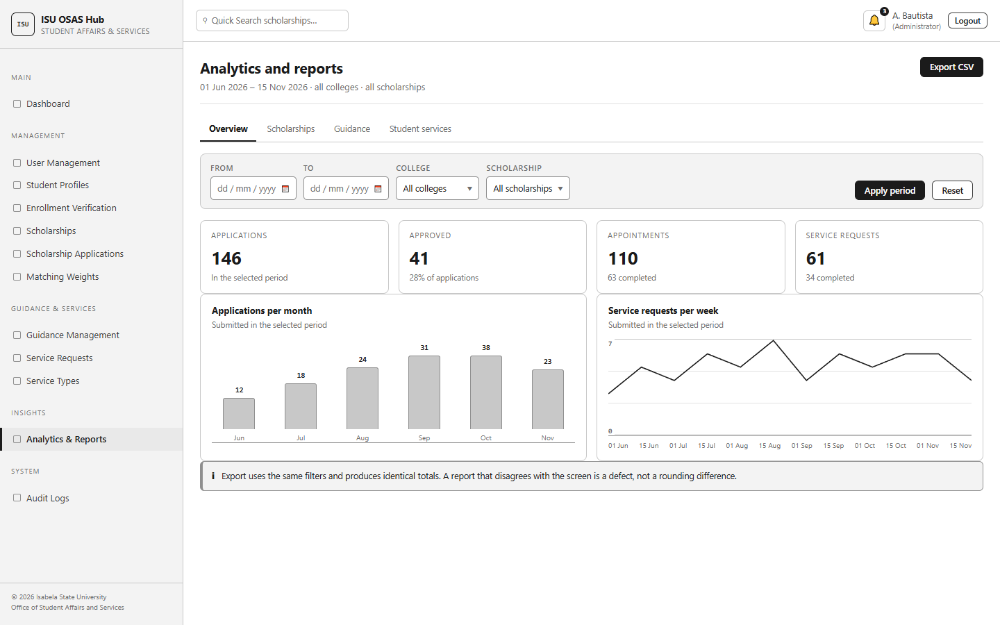

The analytics overview is the administrator's consolidated view of the three workflows over a chosen period. Each figure is a count of records rather than a rate that cannot be traced, and each block links to the tab that explains it.

<!-- caption: Table 3.4 — Wireframes reproduced in this section -->

<!-- widths: 0.9,2.1,1.0,2.5 -->

| Wireframe | Screen | Role | Requirements it expresses |
| --- | --- | --- | --- |
| WF-G-01 | Login | Guest | FR-AUTH-01 to FR-AUTH-03 |
| WF-S-01 | Student dashboard | Student | FR-APP, FR-GUID and FR-SVC summary rows |
| WF-S-13 | Appointment slots and booking | Student | FR-GUID-05 to FR-GUID-08 |
| WF-S-17 | New service request | Student | FR-SVC-02 to FR-SVC-05 |
| WF-C-04 | Appointment detail and decisions | Counselor | FR-GUID-09 to FR-GUID-11 |
| WF-A-24 | Analytics overview | Administrator | FR-ANLYT-01 to FR-ANLYT-03 |

### 3.5 System Mockup (Figma)

The high-fidelity mockup set contains 46 screens derived from the same page specifications as the wireframes: the information architecture is identical and only the shell and the visual tokens change. Every value in the mockup stylesheet is copied from `public/css/app.css`, so the mockups and the running application describe the same interface.

> No Figma file exists for this project, and none is claimed. The mockups were produced as static HTML and CSS generated from declarative page specifications and rendered to PNG with headless Chrome; the design system page in the mockup deliverable documents the tokens the same way a Figma library would. The consequence for Section 5.1 is that no Figma URL can be supplied.

The visual language is institutional rather than decorative. Deep green carries structure and primary action, gold is reserved for emphasis and the active navigation marker, and status never depends on colour alone: every badge pairs a colour role with the stored word. Table 3.4 lists the tokens.

<!-- caption: Table 3.5 — Design tokens shared by the mockups and the application -->

<!-- widths: 1.35,1.75,3.4 -->

| Token | Value | Where it is used |
| --- | --- | --- |
| brand-deep | #062e1d | Sidebar surface, footer, cover of this document |
| brand-dark | #083f28 | Headings, table captions |
| brand | #0b5d3b | Primary buttons, links, focus rings, borders |
| brand-100 | #d5e7dd | Dividers and quiet borders |
| brand-50 | #eaf3ee | Selected rows and informational panels |
| accent | #c9a227 | Active navigation rule, emphasis that is not status |
| canvas | #f4f7f5 | Page background behind cards |
| paper | #ffffff | Cards, tables and forms |
| text | #1f2937 | Body copy |
| muted | #6b7280 | Metadata, helper text and empty states |
| ok / warn / danger / info | #047857 / #b45309 / #b91c1c / #1d4ed8 | Status badges, always accompanied by a word |

Typography uses one family, Segoe UI first because it is present on the university's Windows machines, on a single scale from a 22-pixel page title to 10.5-pixel uppercase labels, with a monospace face reserved for identifiers, times and weights. Spacing follows a 4-pixel unit, radii are 6 pixels for controls, 10 for inputs and notices and 14 for cards, and only two shadows are used: a hairline for resting cards and a larger one for overlays.

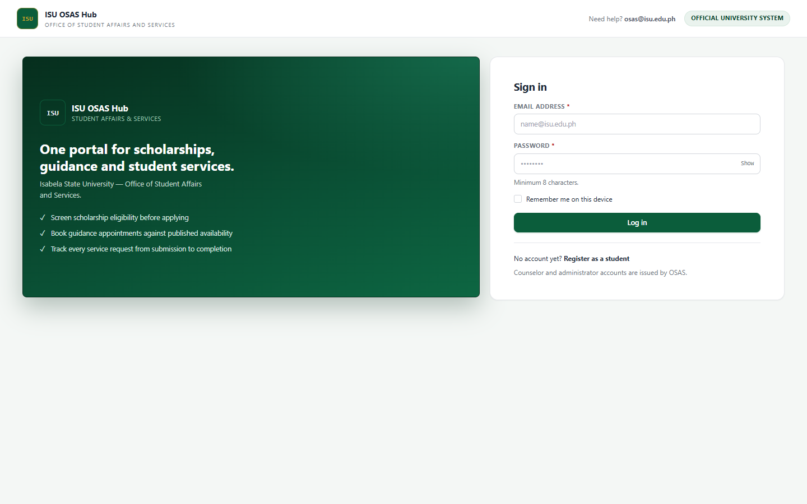

The mockup of the login screen shows how the tokens combine: a quiet canvas, one white card, one primary button, and no decorative imagery that would compete with the form.

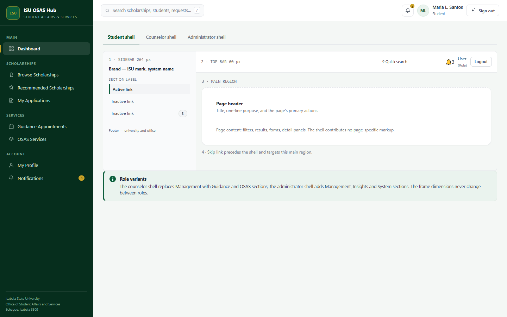

Navigation is fixed and identical on every authenticated screen. The sidebar mirrors the route groups so that a user can predict where a function lives, groups its entries under Main, Management, Guidance and Services, Insights and System, and marks the active entry with a gold rule. The top bar carries the role-scoped search field, the notification count and the account chip; it is the only place where the signed-in identity is shown.

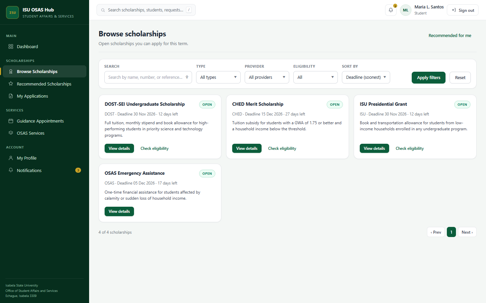

List screens use the same table grammar: a filter row above, a header row that repeats if the table breaks across pages, status as a badge in its own column, and a single row action at the right edge. Numeric columns use tabular figures so that amounts align.

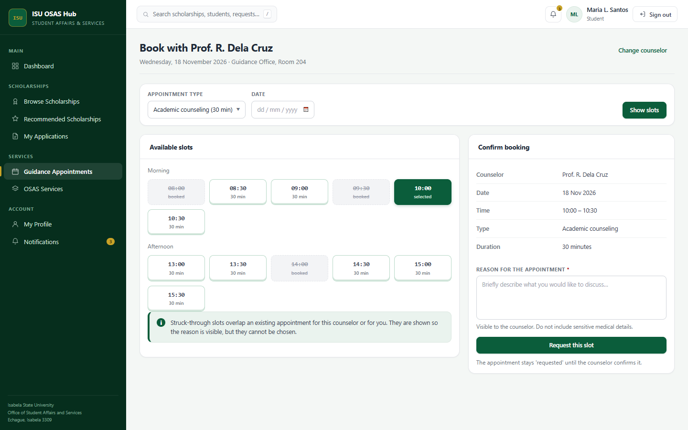

Booking shows the constraint set rather than hiding it: the chosen date and type, the counselor, the generated slots and the reason field that the counselor will read. A slot that is no longer available disappears from the list instead of failing on submit.

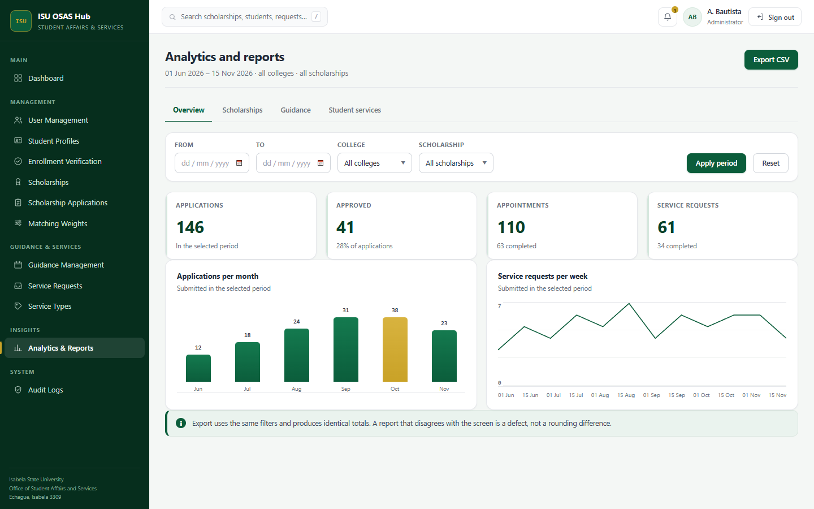

Charts are descriptive and always state their series and period. The four summary tiles reconcile with the series beside them, so a reader can check the arithmetic instead of trusting the layout.

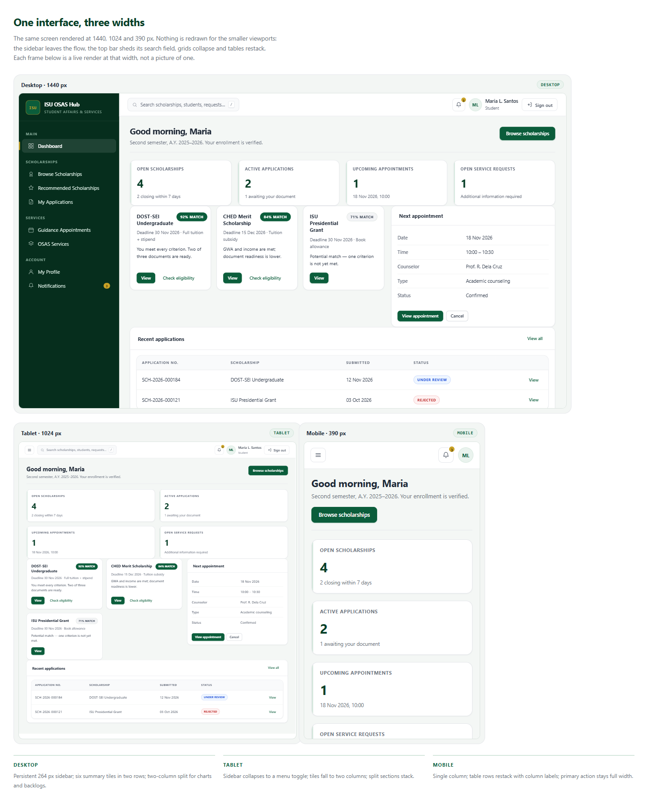

The responsive captures demonstrate the rule the application follows: the sidebar is persistent above 1024 pixels and collapses into a drawer below it, tables restack below 768 pixels, and the search field is dropped at phone width where it would compete with the page title. The delivered application applies the same breakpoints, which Section 4 does not attempt to demonstrate because its screenshots are desktop captures.

## 4. System Implementation

This section presents the delivered interface. Every figure is a screenshot taken from the running application, not from the wireframes or mockups in Section 3. Each screen is a route that exists in the application, reached with an account that holds the role which owns it, and each is explained in terms of what it displays and what the user can do on it. Where the delivered behaviour is incomplete, the gap is stated instead of being hidden behind a screenshot.

The capture session used an unmodified copy of the repository at commit 8270c54 and a clone of the application database, so the working environment of the project was not altered. Table 4.1 records the conditions. The copy existed only to keep the screenshot data separate from the database used for development.

<!-- caption: Table 4.1 — Environment and method used for the implementation screenshots -->

<!-- widths: 1.5,5.0 -->

| Item | Record of the capture session |
| --- | --- |
| Application | ISU OSAS Hub, repository commit 8270c54 (8 November 2026), copied without modification |
| Server | PHP 8.2.12 built-in web server on 127.0.0.1:8123 |
| Database | Clone of the application database, named `isu_osas_hub_shots`, holding the seeded demonstration records |
| Browser and viewport | Headless Chrome 153, viewport 1440 by 980 pixels, device scale 1.5, desktop layout |
| Accounts used | One seeded account per role: student, counselor and administrator. Passwords are not reproduced in this document. |
| Date of capture | 15 November 2026 |
| Output | 57 PNG files in `documentation/Portfolio/figures/screens/`, of which 53 are distinct screens and 4 are full-page variants of long screens |

Two conventions apply throughout. First, each capture is the viewport, not the full page, so content below the fold is described in the explanation rather than shown. Second, the records are the seeded demonstration data: accounts named System Administrator, Dev Counselor and ALINDAYU FORTUNATO JR. H., student number 22-0634, and scholarship titles such as `ched-tdp` and `schooarships for all`. The spelling of the second title is the stored value and is deliberately left as it is; it is not a transcription error in this document.

### 4.1 System Core Feature Interfaces

The interfaces are presented in the order a reader would meet them: the entry point, the three dashboards, then the workflows grouped by the problem they solve. Each figure carries a number and a title, and the paragraph after it explains the purpose of the screen and how the user operates it. Table 4.2 at the end of the section maps every figure to the module it evidences.

#### 4.1.1 Login and Authentication Interface

The application has a single entry point for all three roles. The role is a property of the account, never a choice made on this page, so the same form serves a student, a counselor and an administrator and the destination after sign-in is decided on the server.

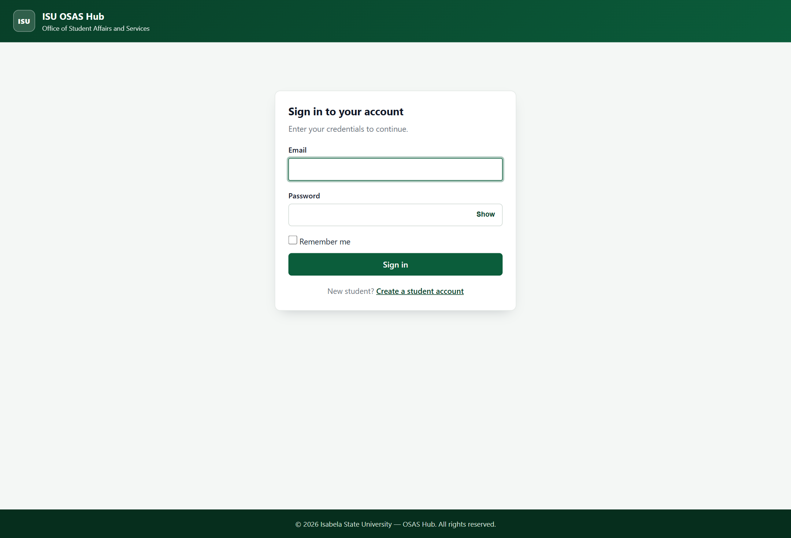

The form takes an email address and a password, offers a reveal control for the password and a remember-me option, and submits to one authentication route. Invalid credentials produce a single non-revealing message, the attempt is throttled per client, and the failed attempt is written to the audit log without the attempted password. A successful sign-in regenerates the session identifier, and an account that has been deactivated is refused here and again by middleware on every protected page. The only secondary action is self-registration.

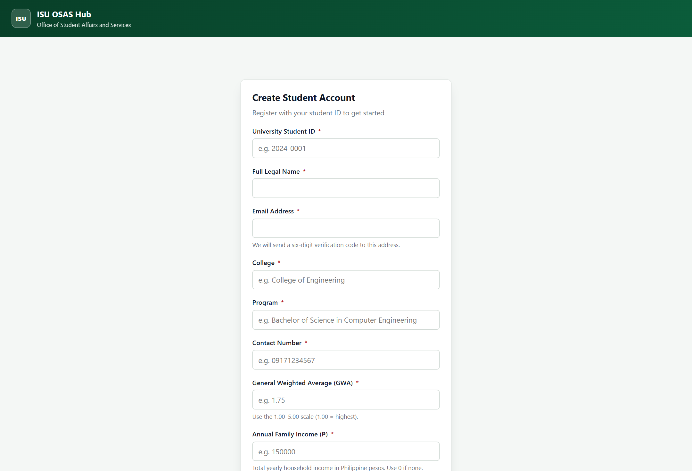

Registration is open to students only. The form collects the student number, full legal name, email address, college, program, contact number, GWA, annual family income, address, password and privacy consent. The email address is verified with a six-digit one-time passcode rather than a signed link, and the academic fields collected here are subsequently maintained by an administrator, not by the student. Counselor and administrator accounts cannot be created from this page; they are created by an administrator, which is why no role selector appears.

Two parts of the authentication flow are not reproduced as figures. The six-digit verification screen follows registration and is a single code field with a resend action, and the shared password-reset screens do not exist because the delivered system has no self-service reset. The login page also cannot show throttling, CSRF protection or session regeneration, because those mechanisms operate on the server; they are described in Sections 2.2.1 and 3.3.1 and are verifiable in the code rather than in a picture.

#### 4.1.2 Dashboard Interface

Each role lands on a dashboard that answers one question: what needs attention now. The three dashboards share the same shell and differ in the records they summarise, because the role determines which workflows the account can see.

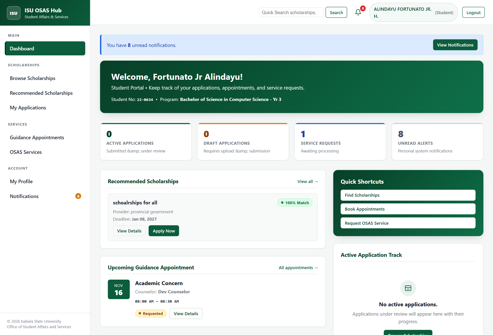

The page opens with the signed-in student's name, student number and program, then four counters for active applications, draft applications, service requests and unread alerts. Below them are the highest-ranked recommendation with its match score, the next guidance appointment with its status, the active application track and three shortcuts into the student workflows. Every block links to the record it summarises, so the dashboard is a starting point rather than a place to act. Two counter captions render the HTML entity literally, as `Submitted &amp; under review` and `Requires upload &amp; submission`; this is a display defect in the view layer, recorded with the submission notes and left uncorrected because the application source was outside the scope of this documentation task.

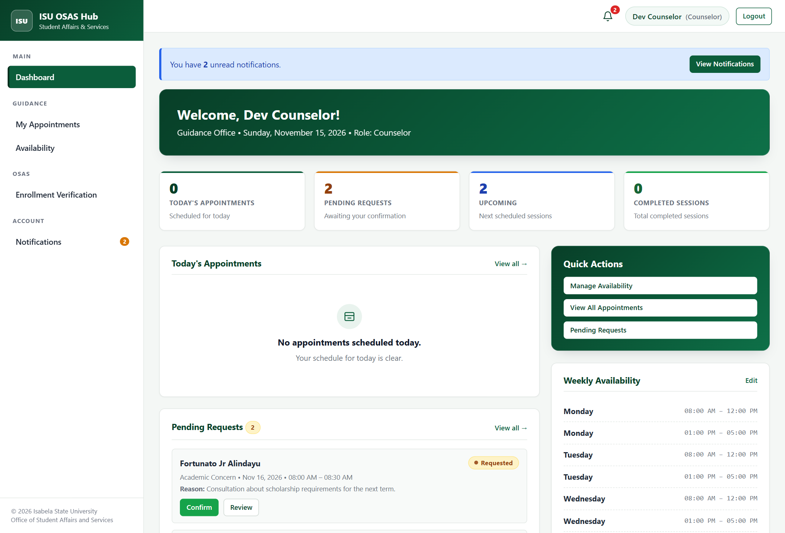

The counselor sees four counters, an empty state for today's appointments, the queue of requests awaiting a decision with Confirm and Review actions, and the weekly availability that generates bookable slots. The empty state is shown as the system renders it: a named condition and a sentence explaining it, not a blank panel. The quick actions repeat the three tasks a counselor performs most often.

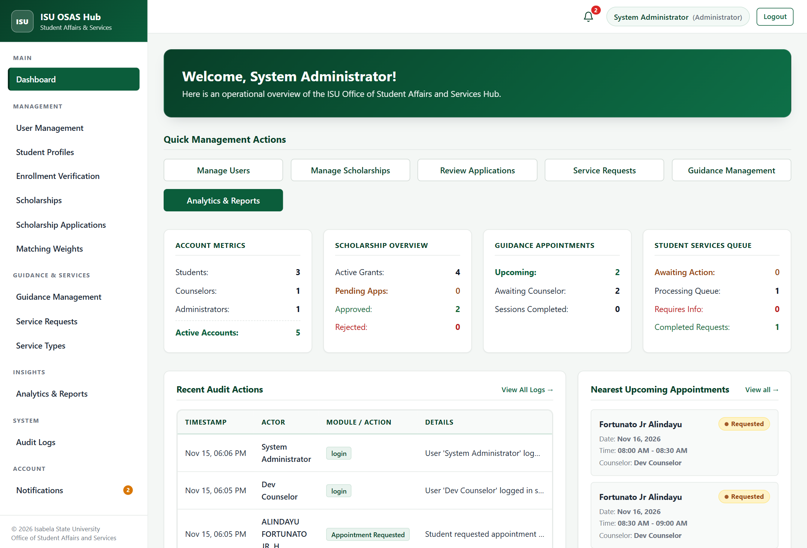

The administrator's dashboard is an operational summary of the whole office. Seven quick actions lead to the management screens; four panels report account counts, scholarship outcomes, the guidance queue and the student-service queue; and the two lower panels show the most recent audit entries and the nearest upcoming appointments. The figures are counts of live records, and each panel links to the list behind it, which is what makes the dashboard usable as a daily check rather than a static report.

#### 4.1.3 Core Functional Modules

The workflows below are grouped by the problem they solve rather than by role, because each one crosses roles: a scholarship passes from administrator to student to administrator again, and an appointment passes from counselor to student to counselor. The order follows the sequence of Section 1.3.2.

##### 4.1.3.1 Scholarship Discovery, Eligibility and Matching

A student begins with the catalogue, narrows it with filters, opens one scholarship and asks the system whether the profile meets its criteria. Matching adds a ranked second opinion without changing the eligibility verdict.

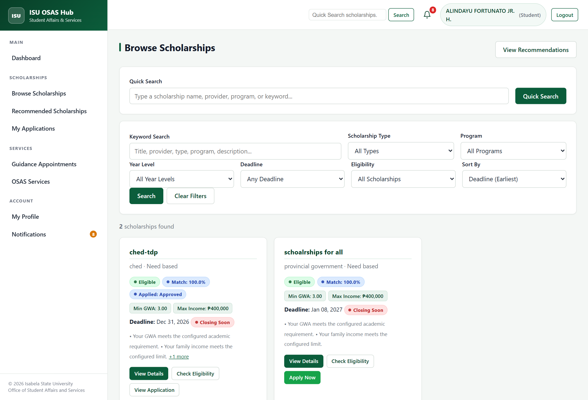

Two open scholarships are shown as cards. Each card states the provider, the type, the eligibility verdict, the match score, the GWA and income thresholds, the deadline with a closing warning, and, when an application already exists, its status. The filter row supports keyword, type, program, year level, deadline, eligibility and sort order, and the result count sits above the list. The student acts through View Details, Check Eligibility and, where the window is open, Apply Now.

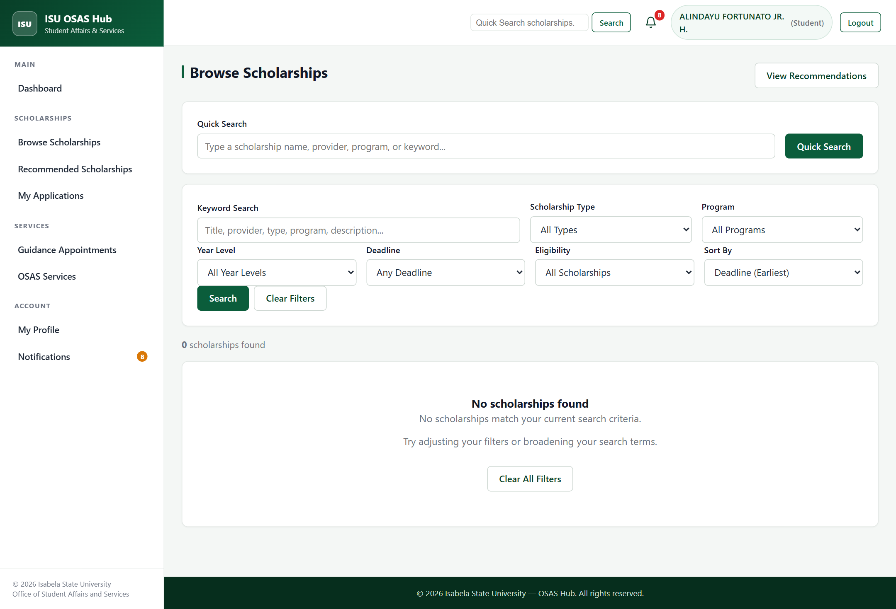

When a query matches nothing, the page keeps the search and filter controls in place and shows a named empty state with a Clear All Filters action. The state is deliberate: it tells the student that the query ran and the result set is empty, rather than leaving a blank region that could be mistaken for a loading failure.

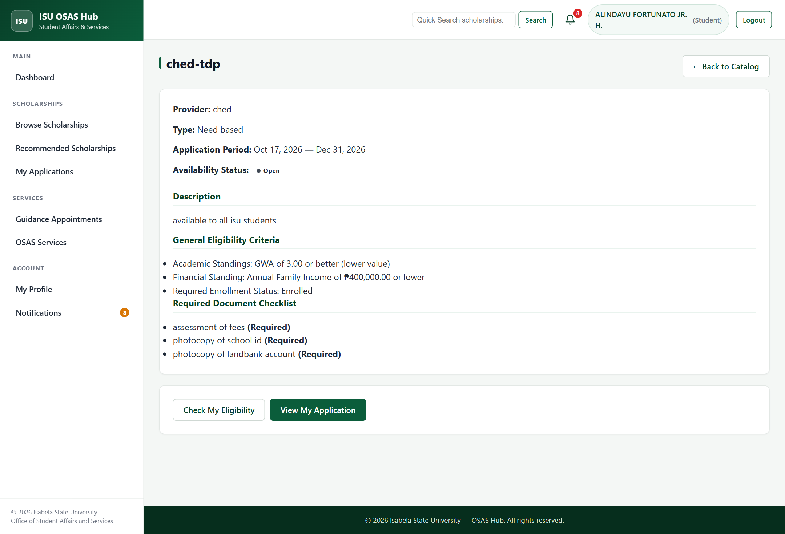

The detail page states the provider, type, application period, availability status and description, then lists the general eligibility criteria and the required document checklist. The criteria are the same values the eligibility engine reads, so the student can compare them with the profile before applying. The two actions lead to the eligibility preview and to the student's own application.

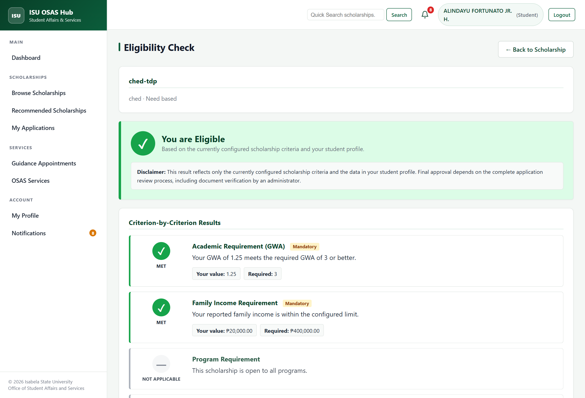

The preview returns a single verdict and then explains it criterion by criterion. Each criterion shows met, not met or not applicable, the student's value, the required value and a sentence that connects them. The disclaimer states that the result reflects the configured criteria and the profile data, and that final approval depends on document verification and administrative review; the screen supports a decision rather than making it.

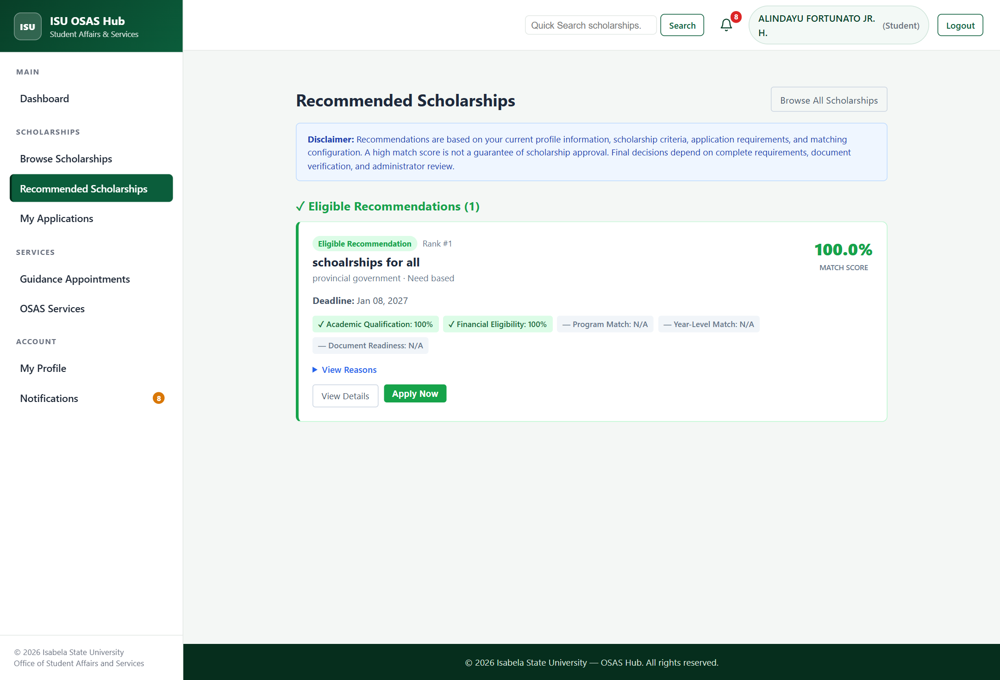

Recommendations are grouped by whether the student is eligible. Each entry shows its rank, the match score, the five factor chips and the deadline, and View Reasons expands the explanation of the score. The disclaimer repeats that a high score is not an approval and that the final decision rests on the complete application. The student can open the scholarship or start an application from the card.

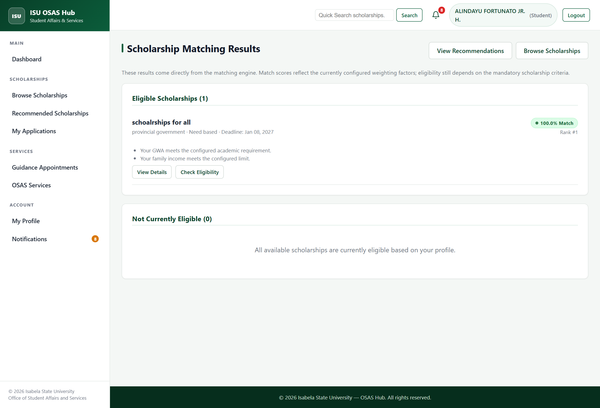

The full list is the unfiltered view behind the recommendation cards. It separates eligible scholarships from those the student cannot currently obtain, repeats the score and rank, and lists the criteria the profile already satisfies so that the reason for the ranking is visible. When every available scholarship is eligible, the second group shows a positive empty state instead of disappearing.

##### 4.1.3.2 Application and Document Workflow

The application is the record that carries a student from an open scholarship to a decision. It has two states that matter to the interface: while it is a draft the student can upload and replace documents, and once it is submitted the documents become read-only while an administrator moves the record through review.

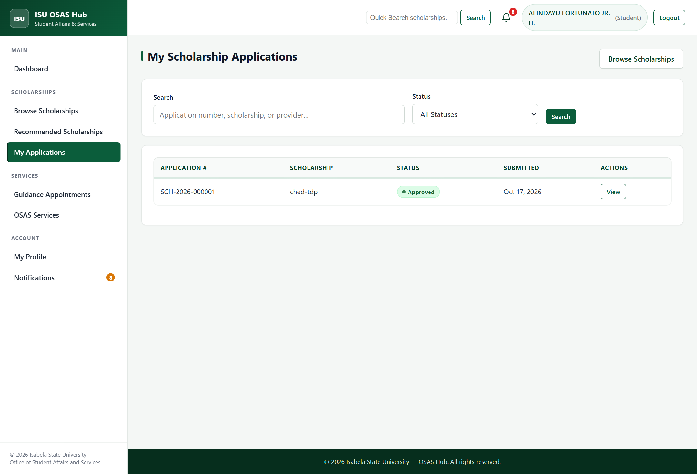

The list shows one row per application with the application number, the scholarship, the current status and the submission date, and a search field and status filter above it. The action opens the application. The number is the identifier the student can quote to the office, and it is stable for the life of the record.

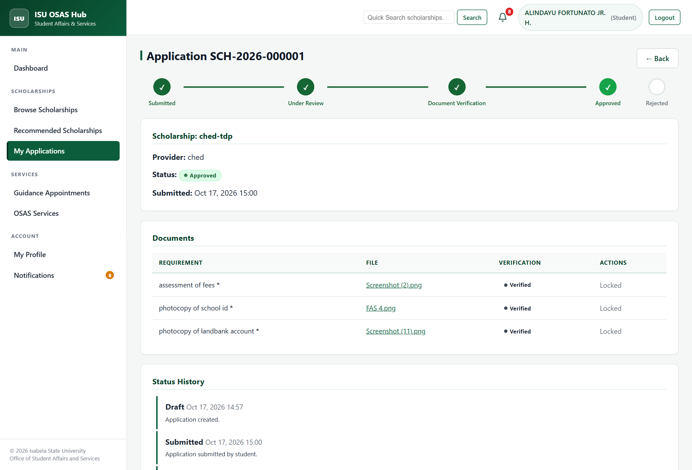

The page shows the application number, a stepper for Submitted, Under Review, Document Verification, Approved and Rejected, the scholarship and provider, and the submission timestamp. The documents table lists each requirement with its file, its verification state and a locked action, because a submitted application no longer accepts replacement files. The status history below records every transition with its timestamp and the sentence that explains it, which is the part of the screen that makes the workflow auditable.

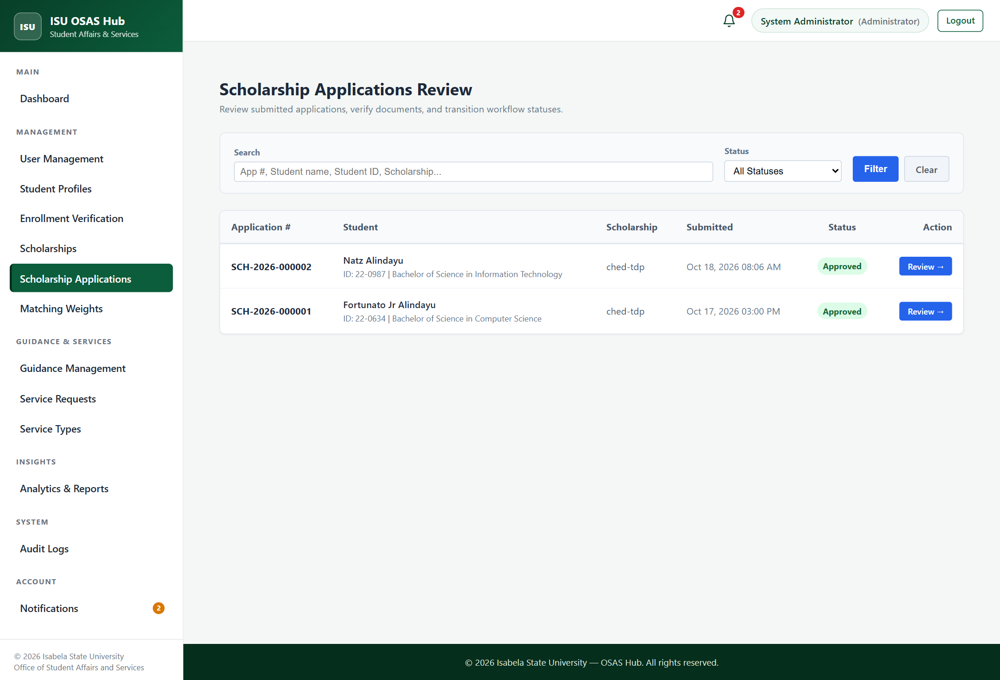

The queue lists applications with their number, the student and student number, the program, the scholarship, the submission timestamp and the status, and it can be filtered by free text and status. Review opens the record. The queue is the administrator's working list: it is ordered so that pending work is reachable without opening each application in turn.

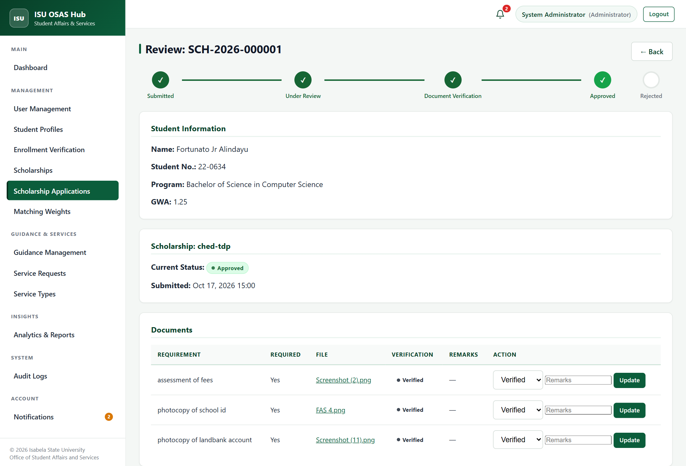

The review screen repeats the student's identity and academic facts, the scholarship and its status, and then the documents table with a verification control, a remarks field and an update action for each row. The workflow control offers the transitions the state machine allows. Approval is refused on the server unless every required document has been verified, so the interface can present the transition without becoming the guard; the rule is enforced in the service layer and recorded in the audit log.

##### 4.1.3.3 Guidance and Counseling

Guidance scheduling is computed rather than negotiated. The counselor publishes the hours that can be booked, the student books one of the slots that result, and the counselor decides the request. Every step is a record with a status, so a promise made in conversation cannot replace the schedule.

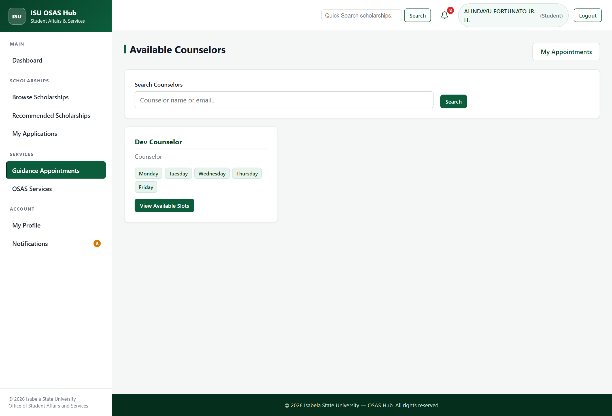

The directory lists the counselors a student may consult, with the days on which each has active availability and a View Available Slots action. The search field narrows the list by name or email address. The page is the entry point to booking; it does not offer a free-form appointment.

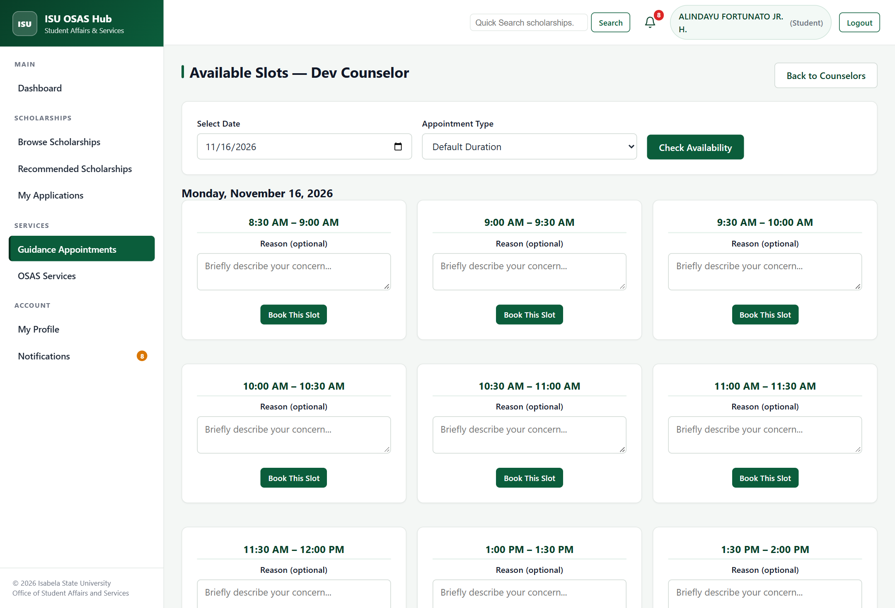

The student chooses a date and an appointment type, and the page returns the slots that the counselor's published availability, the office hours, the minimum notice and the booking horizon allow. Each slot carries an optional reason field and a Book This Slot action. Because the time is chosen from generated slots rather than typed, a student cannot create an appointment outside the published window; a slot that is taken disappears from the list instead of failing on submit.

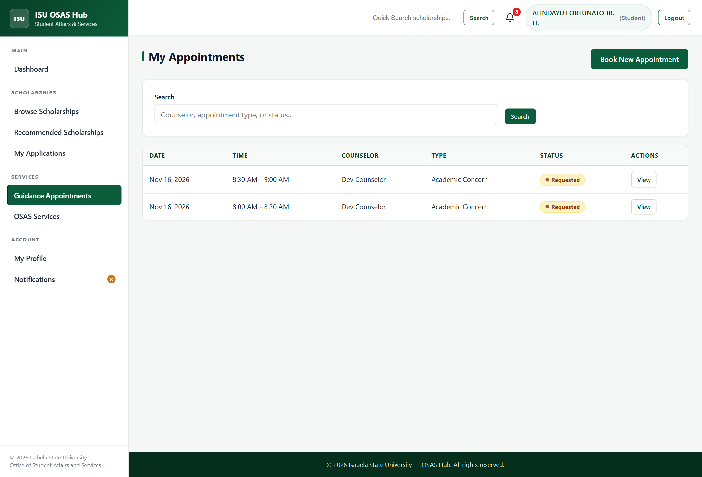

The list shows the date, time, counselor, type and status of every appointment, with a search field and a Book New Appointment action. The status badge is the same vocabulary the counselor and administrator see, so a student and the office cannot describe the same appointment differently.

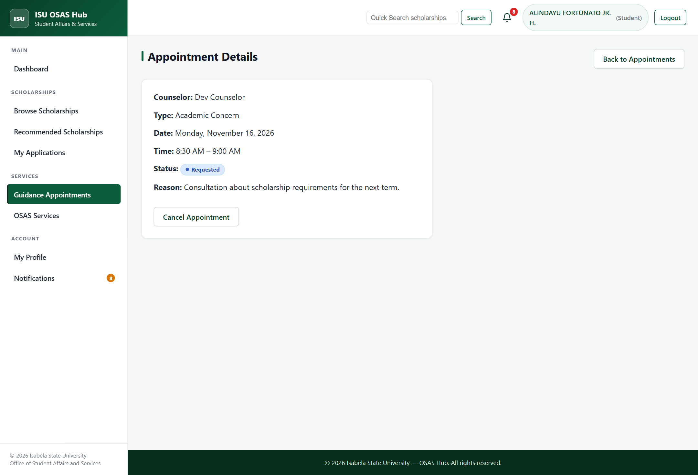

The detail page repeats the counselor, type, date, time and status and shows the reason the student wrote, which is the information the counselor reads before deciding. The Cancel Appointment action is offered only while the appointment can still be cancelled under the configured notice period; after that point the server refuses the transition, so the control is withheld rather than shown and rejected.

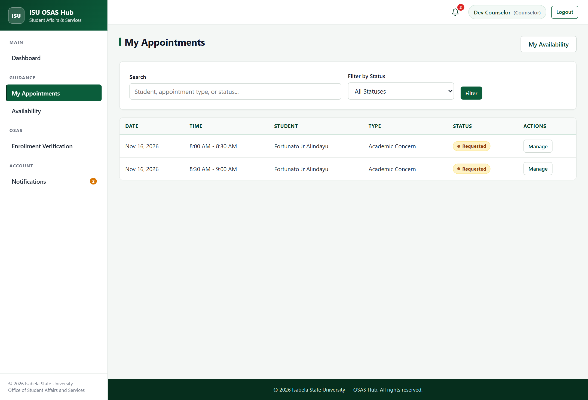

The counselor sees the appointments assigned to them with the date, time, student, type, status and a Manage action, filtered by free text or status. The queue is scoped to the signed-in counselor by the record policy, so another counselor's appointments are neither listed nor reachable by changing the identifier in the address.

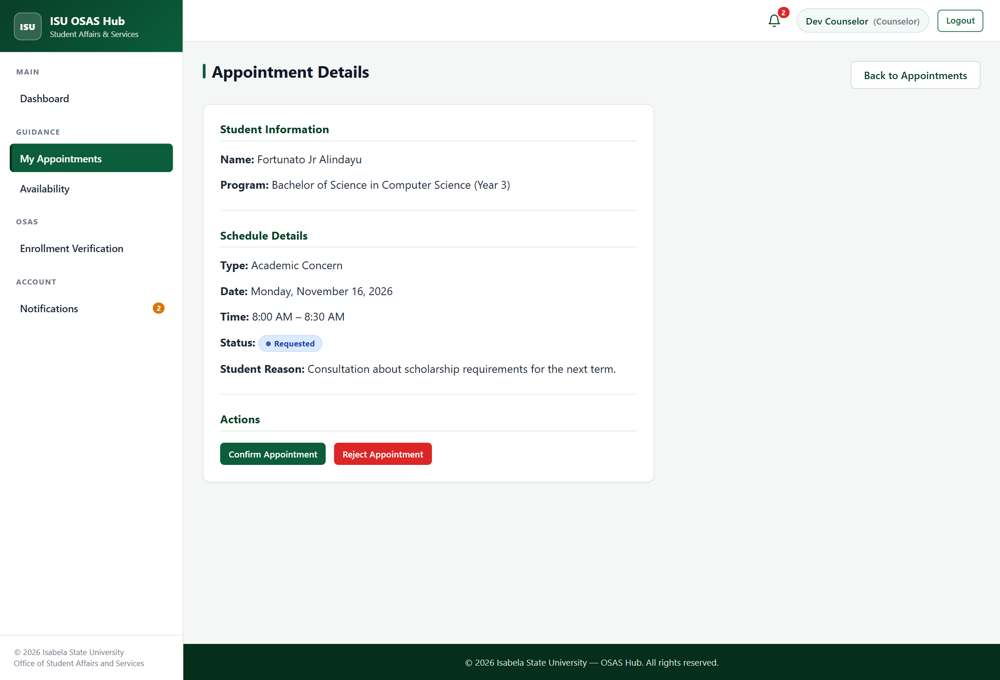

The decision screen places the student's program, the schedule, the type and the student's reason on one page, with a Confirm Appointment and a Reject Appointment action. A rejection requires a reason that the student will read, and only the transitions allowed by the appointment state machine are offered. The decision is written to the audit log and produces a notification for the student.

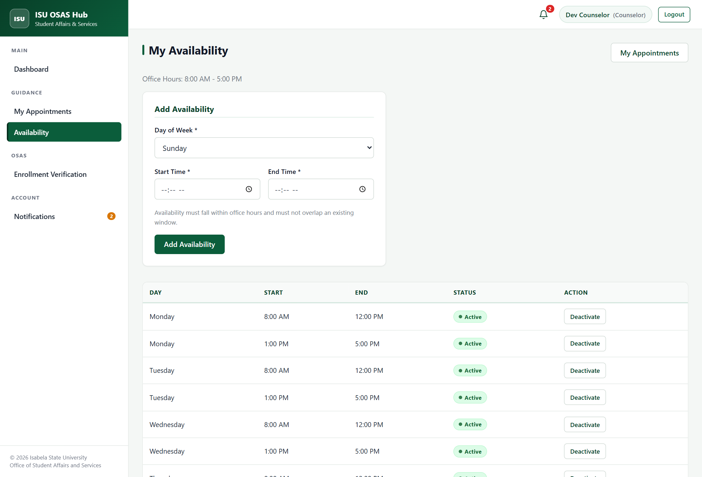

The counselor adds a window by choosing a day, a start time and an end time. The form states the two rules the server enforces: the window must fall inside office hours and must not overlap an existing window. The table lists the active windows and offers Deactivate for each, so availability is withdrawn without deleting the record that explains past bookings.

##### 4.1.3.4 Student Services

The service catalogue is maintained by the office and consumed by students. A request is numbered on submission, assigned to a handler, and moved through a workflow whose history the student can read.

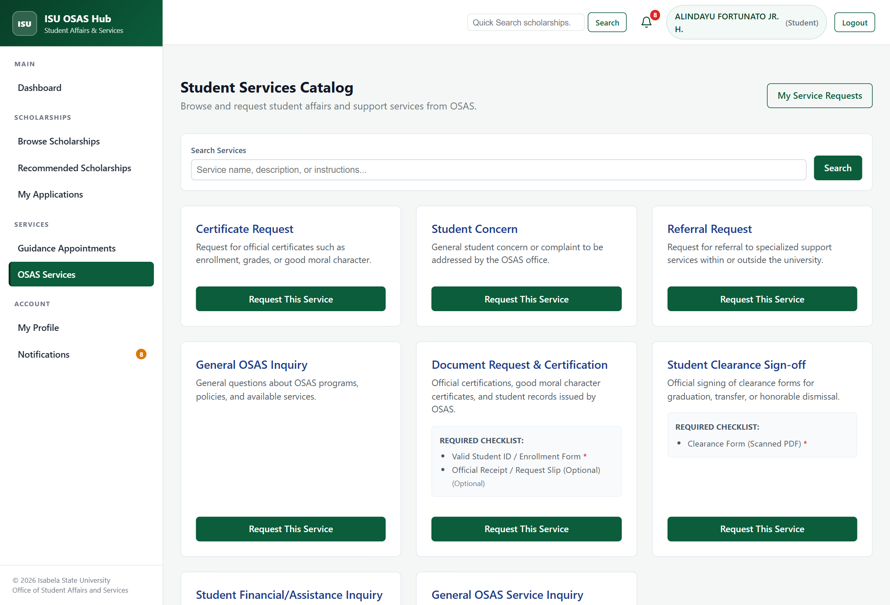

The catalogue presents each service as a card with its description, the documents it requires and a Request This Service action. The checklist is part of the card because the requirement is part of the service definition, not a surprise revealed after submission. The search field filters the catalogue by name, description or instructions.

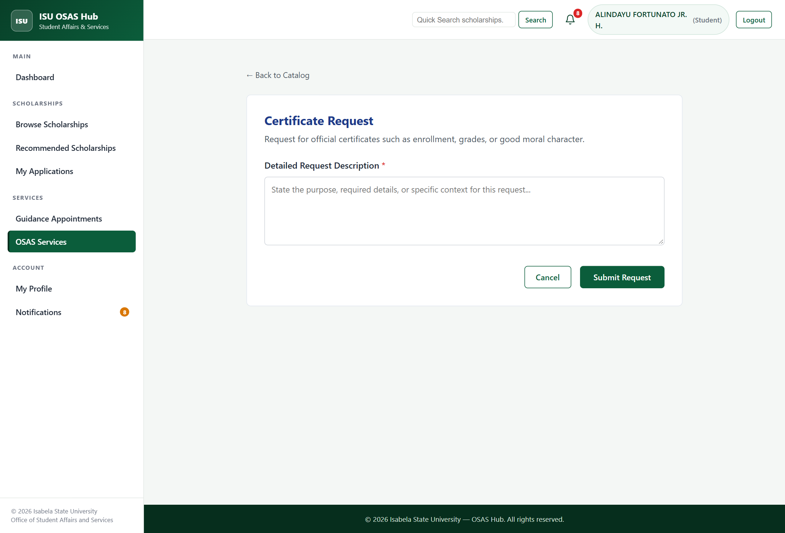

The form is generated from the service type. The description is always required, and a file input appears for every document the type declares; the certificate type shown here declares none, so only the description is requested. Submitting assigns the request number, records the student and the type, and creates the first entry in the status history.

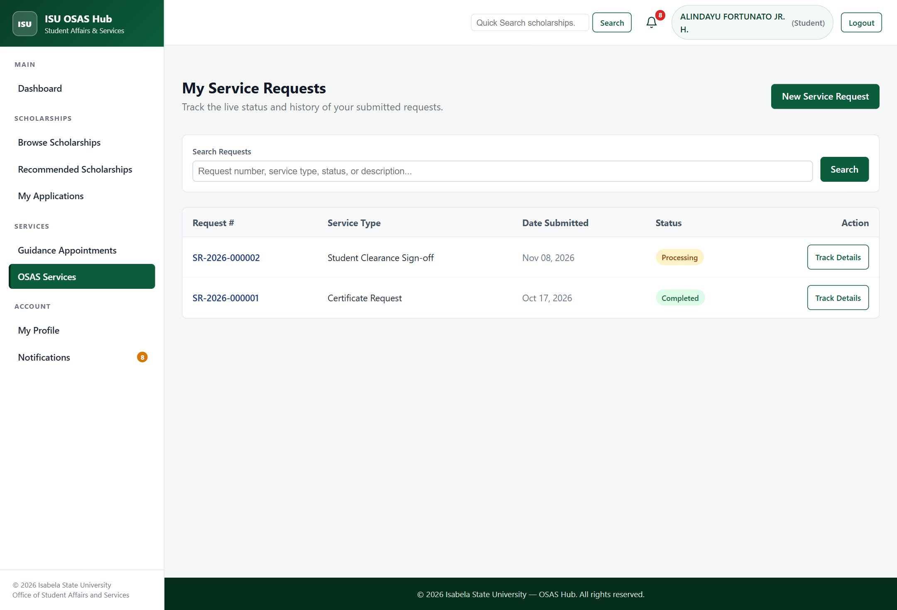

The list shows the request number, the service type, the submission date, the status and a Track Details action, with a search field above it. The request number is the reference the student quotes to the office, and the status is the same value the administrator sees.

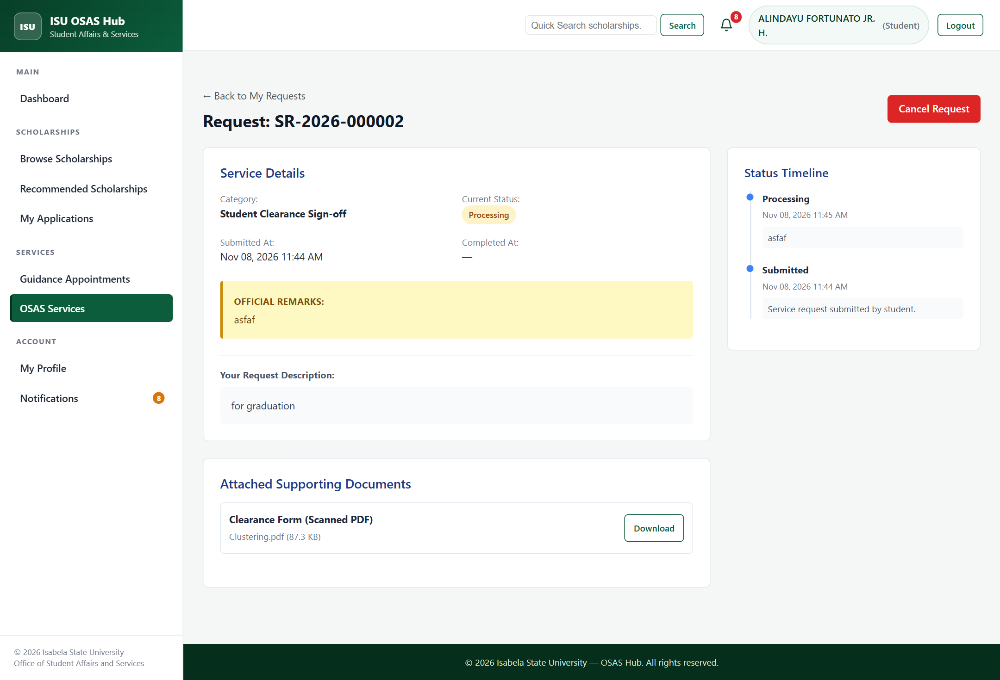

The page states the request number, category, status and timestamps, the remarks the office intended the student to read, the student's own description and an append-only status timeline. Attached documents are listed with a download action that is authorised by policy. Cancel Request is offered while the workflow still permits cancellation; the button is not a substitute for the server-side check.

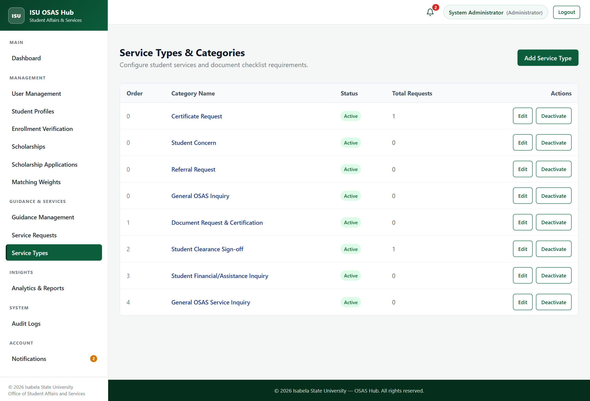

The administrator maintains the catalogue here: order, category name, status and total requests, with Edit and Deactivate actions and a separate Add Service Type form. The request count shows which types are actually used, and deactivation removes a type from the student catalogue without deleting the requests already filed under it.

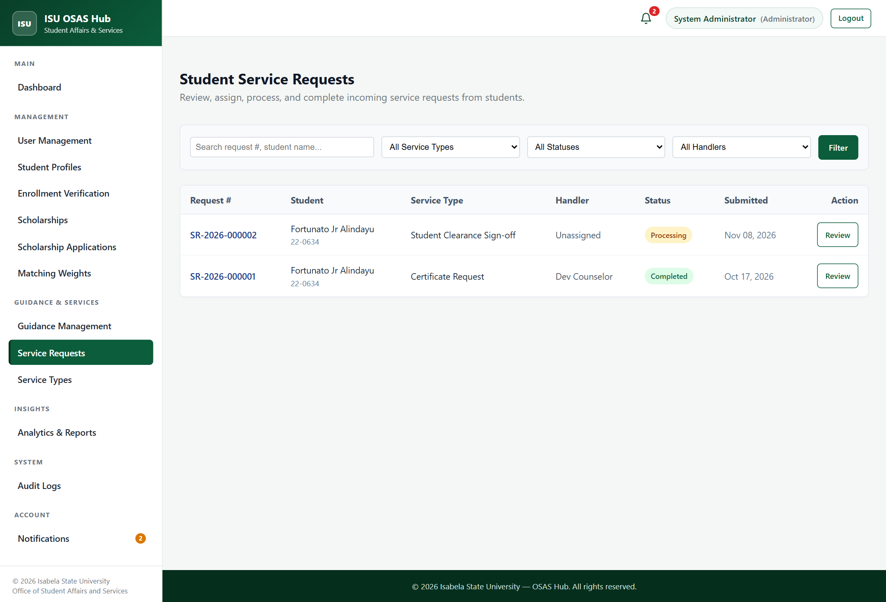

The queue shows the request number, student and student number, service type, assigned handler, status, submission date and a Review action, with filters for text, type, status and handler. It is the office's working list: an unassigned request is visible as unassigned rather than as a request without an owner.

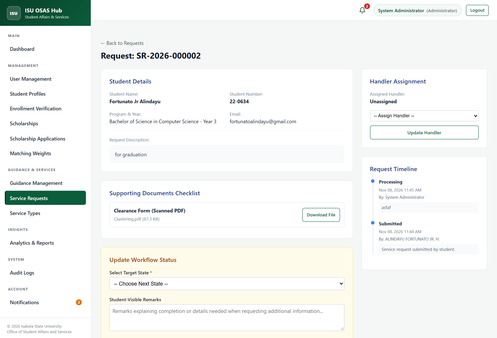

The processing screen repeats the student's details and description, lists the supporting documents with an authorised download, and shows the request timeline with the actor and remarks for each entry. The administrator assigns a handler, which is recorded, and updates the status through a target-state control whose remarks are explicitly labelled as student-visible. The workflow service rejects a transition that the state machine does not allow.

##### 4.1.3.5 Profile and Profile Security

A student profile is a separate record joined one to one with the account. The profile carries the academic, contact and financial facts that eligibility and matching read, which is why the student can correct some of them and not others, and why the sensitive ones can be hidden behind a passcode.

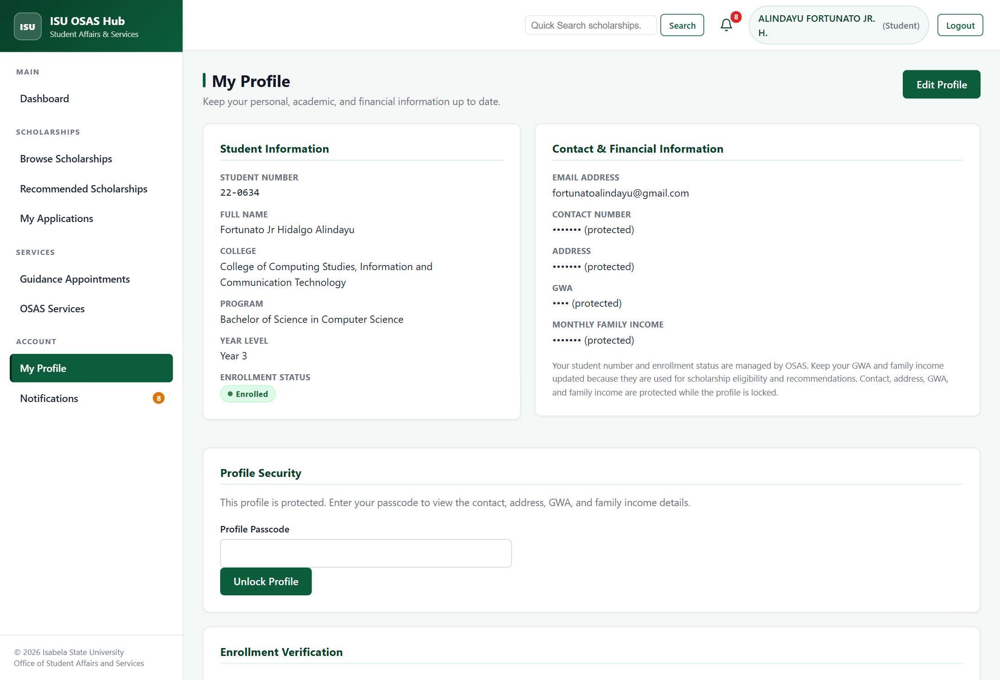

The left card holds the academic identity and the enrollment status; the right card holds the email address and the four protected values, shown masked because the profile is locked. The explanatory text states which fields the student maintains and which the office controls. The Edit Profile action changes only the four student-editable fields, and the security card below unlocks the masked values.

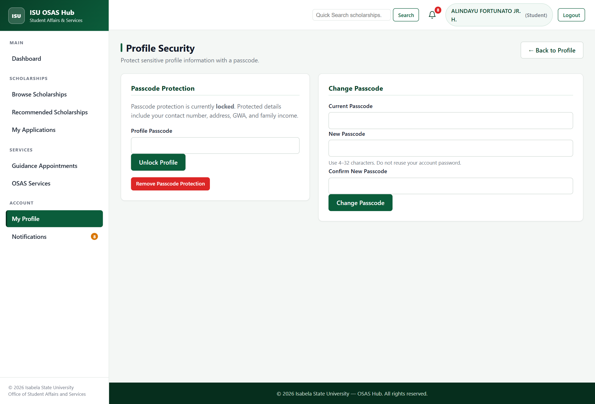

The page separates two operations that are easy to confuse: unlocking a locked profile for the current session, and changing the passcode itself. It states which details the passcode protects, warns that the passcode must not repeat the account password, and offers the removal of protection as a distinct action. The passcode is hashed with a one-way algorithm and is never returned to the browser, so the page can confirm a match but cannot reveal the stored value.

##### 4.1.3.6 User, Profile and Enrollment Administration

The administrator maintains the accounts and profiles that the rest of the system depends on, and decides enrollment verification for the current term. These screens are the only place where a counselor account or an academic identity field can be changed.

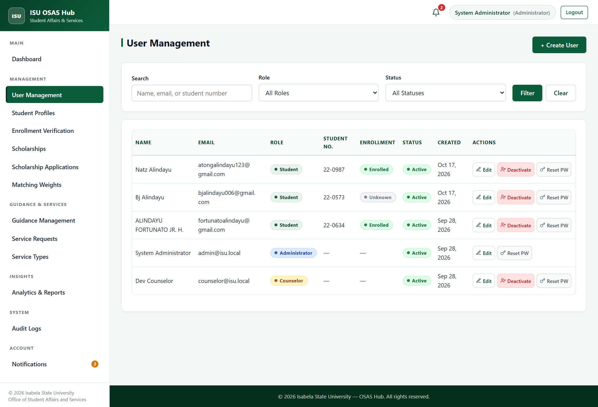

The list shows each account's name, email, role, student number where relevant, enrollment state, account status and creation date, with Edit, Deactivate and Reset PW actions. The role badge is the stored role, and the enrollment badge is a derived state, not a second role. Filters cover name, email, role and status.

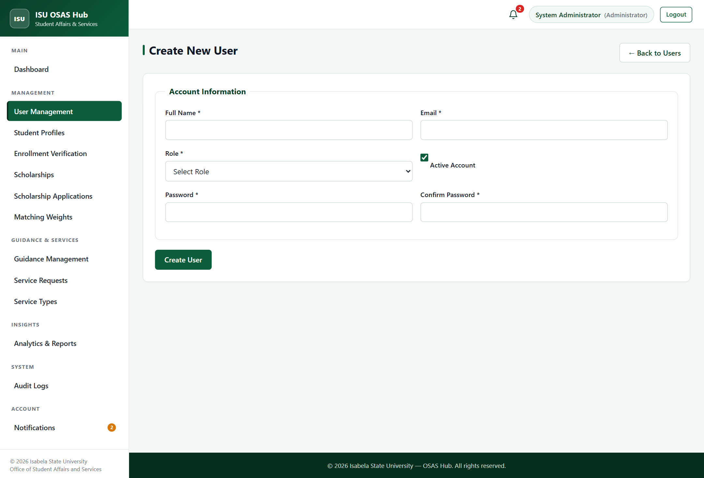

The form collects the full name, email address, role, initial password and the active flag. It is the only route that can create a counselor or administrator account, which is why the role selector exists here and not on the public registration page. The password is hashed on save and the account is subject to the same authentication rules as any other.

The administrator's profile list shows the student number, name, college and program, year level, enrollment state and account state, with View and Edit actions. It is a directory of the student records that scholarships, appointments and service requests refer to, and it is filterable by college, year level and enrollment so that a term's cohort can be reviewed.

The administrator sees the academic identity in full and the protected contact and financial values masked, because the student set a passcode. The page can unlock the values with the student's passcode, or reset the passcode when it has been forgotten; both actions are recorded. This is the mechanism that keeps an administrator from reading private details without a trace, while still allowing recovery.

The queue shows the student number, name, email, academic year, semester, status, submission date and a View or Review action, filtered by text, status, year and semester. The term is part of the record, so a decision applies to a specific enrollment period rather than to the student in general.

The detail page shows the student's identity and current enrollment status, the academic year and semester being verified, a decision control and a notes field. A reason is required when the decision is Rejected or Unable to Verify, and the history table records who decided, when and why. The queue and detail page therefore support the whole decision, including the explanation a student may later ask for.

> Recorded gap. The queue and the decision screen exist, but the delivered build has no route or interface that creates a new enrollment-verification record; the entries shown were created by the seeded data. The module is therefore classified as partially implemented in Sections 1.3.2 and 2.1.5, and no screenshot is presented as evidence of an intake screen that is absent.

##### 4.1.3.7 Scholarship Administration and Matching Configuration

The scholarship screens are where the office defines the rules that the student-facing engine later applies. The thresholds entered here are the values the eligibility preview and the match score read, so the two sides of the system cannot drift.

The list shows each scholarship's title, provider, type, application count, deadline and status, with Edit, Requirements, Notify Eligible and Activate or Deactivate actions. The application count is a live count, and the status badge distinguishes a draft from an open scholarship, which is what keeps an unfinished record out of the student catalogue.

The form is divided into basic information, eligibility criteria and application settings. The criteria section names the engine rules it writes: minimum GWA, maximum family income, eligible programs, eligible year levels and required enrollment status. Leaving programs or year levels blank opens the scholarship to all of them, and the helper text says so, which prevents an empty field from being read as an exclusion.

The administrator adds a requirement by name, order and required flag, with an optional description, and the current list shows how many documents have been filed against each requirement. A required requirement becomes a file input on the student's application and a row in the verification table, so this screen is the source of both.

The five factors that produce a match score are exposed as percentages: academic qualification, financial eligibility, program match, year-level match and document readiness. The current total is recomputed from the fields, and the weights must total exactly 100 before they can be saved. Exposing the weights makes the ranking a stated trade-off rather than an unexplained number.

##### 4.1.3.8 Guidance Administration

Guidance settings and appointment types determine which slots can exist. The administrator configures the frame; the counselor publishes availability inside it; the student books inside that. The administrator's appointment list is an oversight view and carries no decision controls.

The administrator adds an appointment type with a name, optional description, an optional duration override and a display order, and the list shows each type with its effective duration, status and a Deactivate action. The duration override is what allows a type such as Personal Concern to run for 45 minutes while the global default remains 30.

The list shows the date, time, counselor, student, type, status and a View action, with filters for text, counselor and status. It is read-only oversight: the administrator can see the schedule and open a record, but the decision belongs to the counselor, which is why no confirm or reject control appears here.

The detail page repeats the student, counselor, status, appointment type, schedule and the student's reason, with no action controls. It exists so that the office can answer a question about a booking without borrowing the counselor's account, and the absence of controls is consistent with the permission matrix in Section 2.3.

The form sets the office start and end time, the default duration, the minimum booking notice, the student cancellation notice and the maximum future booking period. These five values are the inputs that the slot generator uses, together with the counselor's availability, so changing one of them changes the slots offered on the student side immediately.

#### 4.1.4 Reports and Other Essential Features

The remaining interfaces are the ones that turn the records into management information and accountability: the analytics views and their CSV export, the audit log, and the notification centre. They are grouped here because they read the other modules rather than owning a workflow of their own.

The dashboard reports the three workflows in one view. The filter bar sets a date range and can narrow by scholarship, appointment type and service type; the tabs separate the overview from the scholarship, guidance and student-service detail. The tiles and charts are counts and rates over the filtered period, each chart has a View data table control that exposes the numbers behind it, and the note at the foot of the page states that the metrics are descriptive rather than predictive.

The scholarship tab reports the approval rate, rejection rate, pending count and total decided, then breaks applications down by scholarship and by month. Rates are computed only from decided applications, so pending records do not dilute them. Export CSV writes the figures on the tab, which lets the office reuse them in its own reports without retyping.

The guidance tab reports completed, cancelled and pending appointments, the volume by appointment type split by outcome, and the monthly trend over the selected period. The type breakdown answers a question the appointment queue cannot answer directly: which kind of concern the office is actually seeing.

The service tab reports completed requests, the pending queue and the average processing time in hours and days, then breaks requests down by service type and by month. The processing time is derived from the timestamps on completed records, not from a manually entered figure, and the generation timestamp on the header shows when the view was computed.

The audit log lists 171 records in this dataset with the timestamp, user, action, module, record, description, IP address and a View action, filterable by text, user, module, action, record type and date range. The heading states that the log is append-only and that records cannot be edited or deleted, and no route exists to do either.

The detail page expands one entry into the timestamp, the acting user and email, the action and module, the record type and identifier, the written description, the IP address and the user agent. It is the evidence a reviewer needs to reconstruct who did what, and it is read-only by design.

Notifications are written to the database for in-application display and queued for email. The centre shows the unread count, a Mark All as Read action, a search field and one card per notification with its category, the sentence that explains the event, the related record reference and a link to it. The same unread count appears in the top bar on every page, so the notification is not confined to this screen.

The administrator receives the same notification interface with administrator events, such as a new student registration that is awaiting email and enrollment verification. The category and the wording identify the event, and the link leads to the record the administrator needs to act on. Unread and read states persist per account, which is why the same centre can serve all three roles.

The interface has limits that the figures make visible. The audit list in Figure 4.50 is long and paginated, so the screenshot shows the first page rather than the full history. The analytics figures describe the seeded dataset, which is small; the layout and the calculations are the delivered behaviour, but the values would change with production data. The notification centre shown here is the student and administrator variant; a counselor sees the same interface with guidance events.

> Evidence that is described but not reproduced: the six-digit email verification screen, the document upload control (available only while an application is still a draft), and the administrator's user-edit form. The sampled application in Section 4.1.3.2 had already been approved, so its documents were read-only and no upload control was present to capture. These are not claimed as visual evidence anywhere in this portfolio.

<!-- caption: Table 4.2 — Evidence coverage by functional module -->

<!-- widths: 0.55,1.45,1.65,2.85 -->

| Module | Module name | Figures | What the figures establish |
| --- | --- | --- | --- |
| M01 | Authentication and account lifecycle | 4.1, 4.2 | One role-neutral entry point, student-only self-registration and the fields that seed a student profile |
| M02 | Access control | 4.3, 4.4, 4.5 | Three different shells and navigation sets for the three roles, proving that authorisation is reflected in the interface as well as enforced on the route |
| M03 | Student profiles and user management | 4.30, 4.31, 4.32, 4.33, 4.34, 4.35 | Student-maintained and administrator-maintained fields, account creation and the role badge |
| M04 | Profile security | 4.30, 4.31, 4.35 | Masked protected values, unlock and change-passcode controls, and administrative reset |
| M05 | Enrollment verification | 4.36, 4.37 | Per-term queue and decision screen with history; the missing intake route is stated in the note above |
| M06 | Scholarship management | 4.6, 4.8, 4.38, 4.39, 4.40 | Authoring, lifecycle, window, criteria and document requirements, and the resulting student catalogue |
| M07 | Eligibility evaluation | 4.9 | A verdict plus a criterion-by-criterion explanation with the student's value and the threshold |
| M08 | Matching and recommendations | 4.10, 4.11, 4.41 | Ranked recommendations, the full eligible and ineligible list, and the weights that produce the score |
| M09 | Application workflow | 4.12, 4.13, 4.14, 4.15 | Draft-to-decision states, the submitted record, the review queue and the transition controls |
| M10 | Document management | 4.13, 4.15 | Per-requirement document rows, verification state, locked actions after submission and authorised download |
| M11 | Guidance and counseling | 4.16, 4.17, 4.18, 4.19, 4.20, 4.21, 4.22, 4.42, 4.43, 4.44, 4.45 | Generated slots, booking, counselor decisions, availability and the settings that constrain them |
| M12 | Student services | 4.23, 4.24, 4.25, 4.26, 4.27, 4.28, 4.29 | Catalogue, generated request form, numbered request, timeline, handler assignment and status updates |
| M13 | Notifications | 4.52, 4.53 | Unread state, categories, event wording and deep links for two roles |
| M14 | Analytics and reporting | 4.46, 4.47, 4.48, 4.49 | Descriptive metrics over the three workflows, period filtering, data tables and CSV export |
| M15 | Audit logging | 4.50, 4.51 | Append-only log, filters, actor and record identifiers, address and user agent |
| M16 | Search and navigation | 4.6, 4.7, 4.16, 4.28 | Search fields on the list surfaces, the empty state, and the shared shell that carries the role-scoped search and notification count |

The coverage table is the bridge between this section and the rest of the portfolio. A module that appears with several figures is evidenced at more than one step of its workflow, while a module with a single figure is evidenced at the point where its behaviour is observable. The partial classification of M05 and M12 is repeated here rather than hidden, because a portfolio that overstates coverage is less useful to a reviewer than one that names the gap.

## 5. Project Resources and Repository Links

This section gives the reviewer the means to inspect the design, the source code and the running system. Each item that the portfolio instructions request is listed with its actual status. Where a resource does not exist, the absence is stated and the nearest available substitute is named; no address has been invented to fill a required field.

<!-- caption: Table 5.1 — Project resources and their submission status -->

<!-- widths: 1.5,1.45,3.55 -->

| Requested resource | Status on 15 November 2026 | What the group supplies |
| --- | --- | --- |
| Figma design link | Not available | No Figma project exists. The high-fidelity mockups and the design system are supplied as static HTML with PNG exports (Section 5.1). |
| GitHub repository link | Available | Public web address of the repository and the verified commit (Section 5.2). |
| Deployed system link | Not applicable | No public deployment exists. The verified environment is the development host in Section 3.3.2 (Section 5.3). |
| Demo credentials | Not applicable | No credentials are published, because no hosted environment exists for them to open. |
| Documentation set | Available with this portfolio | SRS, UML, wireframes, mockups and requirements traceability, submitted alongside this document. |

### 5.1 Figma Design Link

The portfolio instructions ask for a Figma URL. No Figma file was produced for this project, and none can be supplied. The interface was designed as static HTML and CSS generated from declarative page specifications and rendered to PNG with headless Chrome; the design system page in the mockup deliverable documents the colour, type, spacing and component tokens in the same way a Figma library would. Presenting the HTML mockups as a Figma project, or supplying a plausible-looking Figma address, would misrepresent both the design process and the evidence.

The substitutes are complete and can be opened without a server or an account.

<!-- caption: Table 5.2 — Design resources supplied in place of a Figma link -->

<!-- widths: 1.35,2.1,3.05 -->

| Substitute | Location | What the reviewer can inspect |
| --- | --- | --- |
| Mockup gallery | `documentation/UI-UX-Mockups/index.html` | All 46 high-fidelity screens, grouped by role, with the page specifications they were generated from |
| Design system | `documentation/UI-UX-Mockups/design-system.html` | The 14-section specification of colour, typography, spacing, components and states, with every token traced to `public/css/app.css` |
| Static exports | `documentation/UI-UX-Mockups/export/` | One PNG per screen, at desktop, tablet and phone widths |
| Wireframe set | `documentation/Wireframes/index.html` | The 58 low-fidelity screens that establish the information architecture and control placement before visual design |
| Design basis | `documentation/UI-UX-Mockups/index.md` | The scope note that states which parts of the interface are delivered and which are proposed |

The reviewer should read the mockups as a restatement of the delivered interface in a consistent visual language, not as a redesign proposal. They use the colour, type and component tokens that the application stylesheet already defines, and Section 4 is the evidence that the running system matches them in structure. If the group creates a Figma file before submission, the URL belongs in this subsection and Table 5.2 should be replaced; until then, this is the accurate record.

### 5.2 GitHub Repository Link

The application source is held in a Git repository whose remote is verified on the development machine. The web address below is the browser address of that remote; it is not a guess and it does not depend on a local path.

<!-- caption: Table 5.3 — Repository facts verified on the development machine -->

<!-- widths: 2.05,4.45 -->

| Repository fact | Verified value |
| --- | --- |
| Web address | https://github.com/superjynx/ISU-OSAS-Hub |
| Remote configured as | `origin` — https://github.com/superjynx/ISU-OSAS-Hub.git (fetch and push) |
| Default branch | `main` |
| Commit reported in this portfolio | `8270c54` — the full identifier is `8270c54ffd4278de49338cb109b6b1da0cffb7ec` |
| Commit date | 8 November 2026, 22:22:20 +0800 |
| Commit subject | Improve user management UI and functionality |
| Application source in the commit | `app/`, `routes/`, `resources/views/`, `database/`, `public/`, `tests/`, `composer.json` |
| Documentation set | Not part of that commit. The portfolio and the accompanying documents are submitted separately and are untracked in the working tree. |

Two access conditions must be confirmed by the group before submission, because this document cannot verify them from the development machine. If the repository is private, the instructor must be added as a collaborator or the repository must be made public; and if the address above differs from the address the instructor is expected to use, the correct one must replace it here. The commit named in Table 5.2 is the state that every statement in Sections 1 to 4 describes, so a reviewer who reads a later commit may find changes that this portfolio does not cover.

### 5.3 Deployed System Link

The system is not deployed on a public address. The only environment that has been verified is the single development host described in Section 3.3.2: the PHP built-in server running Laravel 12 on port 8000, MariaDB on the same machine, private document storage on the local disk and the log transport standing in for SMTP. That host is not reachable from outside the machine, so a URL would either be invalid or would disclose an address that does not serve the system.

<!-- caption: Table 5.4 — Deployment status and the reason for each entry -->

<!-- widths: 1.35,1.55,3.6 -->

| Deployment item | Status | Explanation |
| --- | --- | --- |
| Public URL | None | No virtual host, domain name, certificate or hosting account has been provisioned. |
| Verified environment | One Windows workstation | Application server, database, file store and log on a single host, as drawn in Figure 3.4. |
| HTTPS | Not configured | Traffic is loopback HTTP; the target design in Figure 3.5 places the application behind HTTPS on a campus network. |
| Background worker | Not running as a service | Queued mail and the hourly reminder command require a supervised worker and scheduler, which the development host does not provide. |
| SMTP account | Not configured | Mail is written to the log, which is why verification codes and notifications are visible in `storage/logs/laravel.log` rather than in an inbox. |
| Demo credentials | Not published | The seeded accounts exist only on the development host; publishing their passwords would create a false expectation that a reviewer can sign in. |

Evaluation is therefore a demonstration on the development host rather than a visit to a URL. If a campus deployment is provisioned later, four things must be added to this section: the public address, the deployment commit, a demonstration account that is not a personal account, and a statement of which services — database, queue worker, scheduler and SMTP — are running. The credentials should be issued for the evaluation and rotated afterwards, and they should never be the personal passwords of the developers.

> Nothing in this section is a placeholder for a link that the group has. The Figma and deployment entries are accurate statements of absence, not incomplete fields. Before submission the group should confirm repository visibility, add the author addresses and email addresses requested on the cover, and decide whether to create a Figma file or to submit the HTML mockups as the design record.
