# High-Fidelity UI/UX Mockups

**ISU OSAS Hub — Integrated Student Affairs and Services Management System**

Isabela State University · Office of Student Affairs and Services

| Item | Details |
| --- | --- |
| Deliverable | Final high-fidelity interface set |
| Screens | 46 screens across four role groups |
| Viewports | 1440, 1024 and 390 px; three captures per screen |
| Design system | One 14-section specification page, generated from the same tokens |
| Format | Standalone HTML with one shared stylesheet |
| Source | `documentation/_tools/wf_pages_*.py` (declarative page specs) |
| Renderer | `documentation/_tools/mk_render.py`, `mk_ds.py` |
| Rendered | `documentation/UI-UX-Mockups/screens/{shared,student,counselor,admin}/` |
| Screenshots | `documentation/UI-UX-Mockups/export/` |
| Gallery | `documentation/UI-UX-Mockups/index.html` |
| Basis | Read-only audit of `routes/web.php`, `resources/views/` and `public/css/app.css` |
| Version | 1.0 |
| Date | 15 November 2026 |

> These mockups are not a redesign proposal. They restate the delivered interface in a consistent institutional visual language, using the colour, type and component tokens that `public/css/app.css` already defines. Where the application has no capability, there is no screen.

<!-- pagebreak -->

## Contents

<!-- toc -->

<!-- pagebreak -->

## 1. Purpose and scope

A wireframe answers what is on a screen and in what order. A mockup answers a different question: what will a user actually see, and does the answer hold together across the whole system? A high-fidelity set is only useful if it is consistent, and consistency is the property this deliverable has to demonstrate.

The set contains 46 screens. Every one is built from the same declarative page specification as its wireframe (listed in the metadata of each entry below), so the information architecture is not a second opinion: it is the same object under a second stylesheet. Only the shell and the visual tokens change.

### 1.1 What these mockups assert

| Assertion | How the set supports it |
| --- | --- |
| The interface has one visual language | One stylesheet, one token set, one icon family, one badge vocabulary across all 46 screens. |
| Colour comes from the application | Every value in `mockup.css` is copied from `public/css/app.css`; no new colour is introduced. |
| Status is never carried by colour alone | Every badge pairs a colour role with the stored word, and the pairing is tabulated in section 3.5. |
| The same screen survives three widths | Each screen is a live render at 1440, 1024 and 390 px, captured from the same file. |
| Nothing is claimed that the code cannot do | A control appears only where a route and a handler exist; proposed behaviour is described, never drawn. |

### 1.2 Fidelity of the data

Names, student numbers, application numbers and amounts are representative. They follow the formats the system generates (`2023-00123`, `SCH-2026-000184`, `SR-2026-000042`, `PHP 148,000.00`) and the ranges the validation rules accept, but they are not records from a production database. Nothing in this document should be read as a report of actual student data.

Dates are placed in the 2026 academic year so that deadlines, waiting times and period filters are internally consistent — a scholarship closing in 12 days, an application submitted three days ago, an audit entry at 07:52. Consistency matters because a reviewer will check whether the numbers reconcile: the four summary tiles on the analytics screen equal the sum of the series beside them.

### 1.3 Inventory

| ID | Screen | Role | Base wireframe | Requirements |
| --- | --- | --- | --- | --- |
| MK-01 | Login | Guest | `WF-G-01` | 5 |
| MK-02 | Application shell (sidebar and top bar) | Guest | `WF-G-06` | 10 |
| MK-03 | Student registration | Guest | `WF-G-02` | 3 |
| MK-04 | Email verification (OTP) | Guest | `WF-G-03` | 2 |
| MK-05 | Access denied and not found | Guest | `WF-G-04` | 1 |
| MK-06 | My profile (view) | Student | `WF-S-02` | 3 |
| MK-07 | Edit profile | Student | `WF-S-03` | 1 |
| MK-08 | Profile security and passcode | Student | `WF-S-04` | 2 |
| MK-09 | Application detail and documents | Student | `WF-S-11` | 7 |
| MK-10 | User accounts | Administrator | `WF-A-02` | 1 |
| MK-11 | User create and edit | Administrator | `WF-A-03` | 3 |
| MK-12 | Student profiles | Administrator | `WF-A-05` | 1 |
| MK-13 | Student profile detail | Administrator | `WF-A-06` | 2 |
| MK-14 | Enrollment verification queue | Counselor | `WF-C-05` | 3 |
| MK-15 | Enrollment verification review | Counselor | `WF-C-06` | 1 |
| MK-16 | Scholarship create and edit | Administrator | `WF-A-09` | 2 |
| MK-17 | Scholarships | Administrator | `WF-A-08` | 3 |
| MK-18 | Scholarship requirements manager | Administrator | `WF-A-10` | 1 |
| MK-19 | Browse scholarships | Student | `WF-S-05` | 3 |
| MK-20 | Scholarship detail | Student | `WF-S-06` | 3 |
| MK-21 | Eligibility preview | Student | `WF-S-07` | 4 |
| MK-22 | Full match list | Student | `WF-S-09` | 4 |
| MK-23 | Matching weights | Administrator | `WF-A-11` | 2 |
| MK-24 | My applications | Student | `WF-S-10` | 1 |
| MK-25 | Notification centre | Guest | `WF-G-05` | 7 |
| MK-26 | Application review detail | Administrator | `WF-A-13` | 4 |
| MK-27 | Weekly availability | Counselor | `WF-C-02` | 2 |
| MK-28 | Guidance appointment types | Administrator | `WF-A-14` | 1 |
| MK-29 | Guidance scheduling settings | Administrator | `WF-A-15` | 1 |
| MK-30 | Guidance counselors | Student | `WF-S-12` | 1 |
| MK-31 | Appointment slots and booking | Student | `WF-S-13` | 3 |
| MK-32 | Appointment detail and decisions | Counselor | `WF-C-04` | 1 |
| MK-33 | Appointment detail | Student | `WF-S-15` | 1 |
| MK-34 | Guidance oversight | Administrator | `WF-A-16` | 1 |
| MK-35 | Service catalogue | Student | `WF-S-16` | 1 |
| MK-36 | Service types | Administrator | `WF-A-18` | 1 |
| MK-37 | New service request | Student | `WF-S-17` | 1 |
| MK-38 | Service request detail | Student | `WF-S-19` | 4 |
| MK-39 | Service request detail and assignment | Administrator | `WF-A-21` | 2 |
| MK-40 | Analytics overview | Administrator | `WF-A-24` | 3 |
| MK-41 | Analytics — scholarships | Administrator | `WF-A-25` | 1 |
| MK-42 | Analytics — guidance | Administrator | `WF-A-26` | 1 |
| MK-43 | Analytics — student services | Administrator | `WF-A-27` | 1 |
| MK-44 | Audit log | Administrator | `WF-A-22` | 3 |
| MK-45 | Audit log detail | Administrator | `WF-A-23` | 1 |
| MK-46 | Responsive behaviour across three widths | Student | `WF-S-01` | 1 |

| | **Total** | | | **46 screens, 109 requirements** |

<!-- pagebreak -->

## 2. From wireframe to mockup

### 2.1 What is shared

The page specification is the single source for both deliverables. It names the route, the module, the requirement identifiers, the content blocks, the annotations and the responsive behaviour. Because the mockup renderer consumes the same block list, the two sets cannot disagree about what is on a screen.

The shell is also shared in structure: a 264 px sidebar, a 60 px top bar and one main region, with the same section labels as `components/navigation/sidebar`. A reviewer who has read the wireframes can navigate the mockups without a legend.

### 2.2 What the mockup adds

| Element | Wireframe | Mockup | Why |
| --- | --- | --- | --- |
| Colour | Greyscale | Institutional green, university gold, neutral surfaces | Brand identity and a stable meaning for primary action. |
| Type | One neutral stack | Segoe UI at six roles with fixed sizes and weights | Hierarchy that survives at a glance and on a projector. |
| Shell | Grey sidebar | Deep-green sidebar with a gold active rule | Separates navigation from content without a second accent colour. |
| Icons | Text labels only | One stroke set at 24 px beside every navigation item | Faster scanning in a long sidebar. |
| Status | Outlined label | Colour-coded badge with the stored word | Recognisable at a glance, still readable without colour. |
| Depth | Flat borders | Two shadows: resting card, raised panel | Groups information without heavy lines. |
| Charts | Placeholder geometry | Real counts that reconcile with the tiles | A chart that disagrees with its summary is a defect. |

### 2.3 What the mockup deliberately does not add

High fidelity invites invention, so the restraint is stated explicitly. The mockups add no feature, no route, no metric and no status that the application does not already have:

1. **No new screens.** Every mockup is bound to a wireframe screen and, through it, to a route in `routes/web.php`.
2. **No new status values.** The badge vocabulary is the union of the values the state machines and controllers write (section 3.5).
3. **No invented analytics.** Charts show counts that can be reconciled with the queues they summarise; there is no forecasting, no rate that cannot be traced to records and no comparison with other institutions.
4. **No unimplemented affordance.** A greyed control implying a future feature would misrepresent the delivered system, so absent capabilities are described in section 9 instead.

<!-- pagebreak -->

## 3. Design system

The design system has its own artefact — `design-system.html`, fourteen sections, generated from the same tokens as the screens — because a static document cannot show hover states, focus rings or a live reflow. This section is the printable summary of that page.

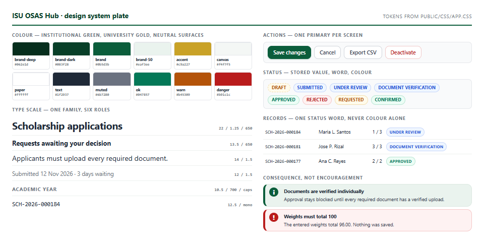

### 3.1 Colour

Two families and a neutral scale. Institutional green carries structure and primary action; university gold is an accent and never a status. Semantic colours exist only inside badges and notices, where they are always accompanied by a word.

| Token | Value | Role |
| --- | --- | --- |
| `--brand-deep` | `#062e1d` | Sidebar surface, hero background |
| `--brand-dark` | `#083f28` | Hover on primary action, headings on light |
| `--brand` | `#0b5d3b` | Primary action, active rule, links |
| `--brand-100` | `#d5e7dd` | Borders and hairlines on brand surfaces |
| `--brand-50` | `#eaf3ee` | Resting tint behind brand content |
| `--accent` | `#c9a227` | Active navigation rule, hero eyebrow; never a status |
| `--canvas` | `#f4f7f5` | Application background |
| `--paper` | `#ffffff` | Cards, tables, panels |
| `--text` | `#1f2937` | Body text |
| `--muted` | `#6b7280` | Secondary text, captions, table headers |
| `--ok` | `#047857` | Success badge text |
| `--warn` | `#b45309` | Warning badge text |
| `--danger` | `#b91c1c` | Destructive action, danger badge text |

### 3.2 Typography

One family with six roles. Segoe UI is first in the stack because it is present on the university's Windows fleet; the stack falls back to the platform UI font elsewhere. Monospace appears only for identifiers, times and weights, where character alignment helps comparison.

| Role | Size / line / weight | Use |
| --- | --- | --- |
| Page title | 22 / 1.25 / 650 | One per screen, in the page header |
| Section title | 13.5 / 650 | Card and panel headings |
| Metric | 30 / 700 / tabular | The number in a summary tile |
| Body | 14 / 1.5 | Descriptions, help text, table cells |
| Small / meta | 12 / 1.5 | Timestamps, qualifiers, captions |
| Label | 10.5 / 700 / uppercase | Field labels and table headers |
| Identifier | 12.5 / mono | Application, request and student numbers |

### 3.3 Space, radius and elevation

A 4 px base unit governs padding and gaps: 4, 8, 12, 16, 20, 24, 32, 40. Body padding is 26 px vertical and 28 px horizontal; card padding is 18 to 20 px; the gap between form fields is 15 px. Radii are 6 px for controls, 10 px for inputs and notices, and 14 px for cards and panels.

Only two shadows are used. A hairline shadow (`0 1px 2px rgba(16,24,40,.05)`) lifts a resting card off the canvas; a larger one (`0 4px 12px rgba(16,24,40,.08)`) is reserved for raised panels, overlays and the device frames in the gallery. Nothing else is elevated, so elevation always means "this sits above the page".

### 3.4 Navigation and the shell

The sidebar is 264 px of deep green and never scrolls with the content. Sections mirror the route groups, so a user can predict where a function lives; the active item is marked by a 3 px gold rule and a lighter surface. The top bar is 60 px of white carrying search, the notification count and the account chip.

Below 1025 px the sidebar leaves the flow and is revealed by the menu toggle. At phone width the search field is dropped rather than squeezed: it would compete with the page title for the same line and would be unusable at 390 px.

### 3.5 Status vocabulary

The system stores snake_case values and displays sentence case. This table is the contract between the database and the interface: a stored value that is not here cannot be displayed, and a colour that is not here cannot be used.

| Stored value | Displayed as | Colour role | Meaning |
| --- | --- | --- | --- |
| `draft` | Draft | Neutral | Not yet visible to students |
| `submitted` | Submitted | Info | Received, no decision yet |
| `under_review` | Under review | Info | Being assessed |
| `document_verification` | Document verification | Info | Waiting on document checks |
| `approved` | Approved | Success | Final, favourable |
| `rejected` | Rejected | Danger | Final, unfavourable; reason required |
| `requested` | Requested | Warning | Appointment awaiting counselor |
| `confirmed` | Confirmed | Success | Slot reserved |
| `completed` | Completed | Success | Session held |
| `cancelled` | Cancelled | Neutral | Withdrawn by either party |
| `pending` | Pending | Warning | Verification not yet decided |
| `verified` | Verified | Success | Enrollment confirmed for the term |
| `unable_to_verify` | Unable to verify | Warning | Evidence insufficient, not a refusal |
| `processing` | Processing | Info | Handler is working on it |
| `requires_information` | Requires information | Warning | Waiting on the student |
| `open` | Open | Success | Accepting applications |
| `closed` | Closed | Neutral | Window passed |
| `archived` | Archived | Neutral | Hidden from students |
| `active` | Active | Success | Account or record usable |
| `inactive` | Inactive | Neutral | Login refused, history retained |

### 3.6 Components

| Component | Treatment | Rule |
| --- | --- | --- |
| Primary action | Solid brand fill, white label, 36 px high | One per screen, last in the action group. |
| Secondary action | White fill, neutral border | Never competes with the primary; sits to its left. |
| Ghost action | No fill, brand label | Navigation and row actions only; gains a border at phone width so the tap target is visible. |
| Destructive action | White fill, red border and label | Separated from the primary path and always confirmed. |
| Field | Label above, 38 px control, help text below | Labels are never placeholders; required fields carry an asterisk; errors appear under the field. |
| Record table | Header in 10.5 px caps, one row per record, actions last | Status is a badge; numbers are right-aligned with tabular figures; below 768 px the header is dropped and each row restacks with its column label. |
| Badge | 20 px pill, uppercase, 10.5 px | Word plus colour; the word is the accessible signal. |
| Notice | Left rule, tinted surface, icon | States a consequence; never used for encouragement or decoration. |
| Summary tile | Label, metric, qualifier | The metric answers one question and the qualifier prevents misreading. |
| Stepper | Four states: done, current, pending | Derived from the workflow state machine, not a generic progress bar. |
| Timeline | Append-only, actor plus timestamp | Newest first; never editable. |
| Chart | Bars, line or donut with a stated series and period | Counts only; a chart must reconcile with the queue it summarises. |
| Pager | Range on the left, navigation on the right | States the visible range and the total; the range becomes its own row at phone width. |

### 3.7 Accessibility

Contrast is measured rather than assumed. The ratios below are computed from the hex values in section 3.1 using the WCAG relative-luminance formula.

| Use | Pair | Ratio | WCAG 2.2 AA |
| --- | --- | --- | --- |
| Body text on white | `#1f2937` on `#ffffff` | 14.68:1 | AAA |
| Muted text on white | `#6b7280` on `#ffffff` | 4.83:1 | AA |
| Brand on white | `#0b5d3b` on `#ffffff` | 7.95:1 | AAA |
| White on brand (primary action) | `#ffffff` on `#0b5d3b` | 7.95:1 | AAA |
| White on sidebar green | `#ffffff` on `#062e1d` | 14.83:1 | AAA |
| Sidebar link on green | `#dcece4` on `#062e1d` | 12.12:1 | AAA |
| Gold accent on green | `#c9a227` on `#062e1d` | 6.13:1 | AA |
| Success badge | `#047857` on `#ecfdf5` | 5.21:1 | AA |
| Warning badge | `#b45309` on `#fffbeb` | 4.84:1 | AA |
| Danger badge | `#b91c1c` on `#fef2f2` | 5.91:1 | AA |
| Info badge | `#1d4ed8` on `#eff6ff` | 6.16:1 | AA |

Three further commitments are visible in the screens themselves: a 3 px focus ring in brand green with a 2 px offset, 44 × 44 px pointer targets in the shell, and no state conveyed by colour alone. Where a badge is the only indicator in a row, the same word appears in the accessible name of the row action.

### 3.8 Governance

| Token group | Defined in | Change process |
| --- | --- | --- |
| Colour, type, radius, spacing | `public/css/app.css` | Change the application first, then regenerate the mockups; the design system follows the code, never the reverse. |
| Component markup | `documentation/_tools/wf_kit.py` | One renderer serves wireframes and mockups, so a component is changed once. |
| Mockup styling | `UI-UX-Mockups/assets/mockup.css` | Values are copied from the application stylesheet; no new colour is introduced. |
| Status vocabulary | `_spec/requirements.csv`, state machines | A new status must reach the workflow, the badge map and the traceability matrix together. |

No Figma file accompanies this deliverable. The design system is implemented in HTML and CSS so that it can be inspected in a browser, reviewed as a diff, and rendered into this document without a second source of truth that would inevitably drift from the code.

<!-- pagebreak -->

## 4. Shared and public screens

Screens a signed-out visitor can reach, plus the notification centre and the shell that every authenticated screen inherits.

6 screens.

### 4.1 MK-01 — Login

| Field | Value |
| --- | --- |
| Role | Guest |
| Base wireframe | `WF-G-01` — Login |
| Route | `login` |
| Module | M01 |
| Requirements | FR-AUTH-01, FR-AUTH-02, FR-AUTH-07, FR-AUTH-08, NFR-ACC-02 |
| File | `screens/shared/MK-01.html` |

**Purpose.** Authenticate a registered account with email and password, with a remember-me option and a single non-revealing failure message.

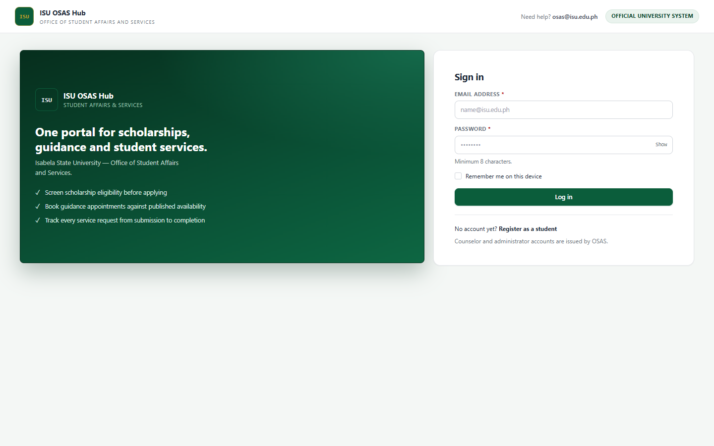

**Composition.** Two-panel split.

**What this screen establishes**

1. Single column form; labels sit above inputs and errors appear under the field.
2. Failure message is generic — it never states whether the email or the password was wrong.
3. Remember-me checkbox is optional and defaults to off.
4. Login is throttled to 5 attempts per minute per client; the throttle message appears here.
5. There is no 'forgot password' link because no self-service reset route exists (GAP-05).
6. Primary action is the last control in the form; keyboard focus reaches it by tabbing.

**Mockup note.** The guest shell replaces the sidebar with a university header bar; the credential panel sits on a deep-green brand field so that the screen reads as an institutional system before a user has signed in.

**Responsive behaviour**

| Viewport | Layout behaviour |
| --- | --- |
| Desktop 1440 | Two columns: brand panel left, form card right, 45/55 split. |
| Tablet 1024 | Brand panel narrows; form card keeps a comfortable 420 px measure. |
| Mobile 390 | Single column; brand panel collapses to a compact banner above the form. |

### 4.2 MK-02 — Application shell (sidebar and top bar)

| Field | Value |
| --- | --- |
| Role | Student |
| Base wireframe | `WF-G-06` — Application shell (sidebar and top bar) |
| Route | `— (layouts/app, components/navigation/*)` |
| Module | M16 |
| Requirements | FR-AUTH-03, FR-RBAC-03, FR-RBAC-06, FR-NOTIF-06, FR-SEARCH-01, NFR-USA-01, NFR-MAINT-03, NFR-PORT-01, NFR-ACC-01, NFR-ACC-04 |
| File | `screens/shared/MK-02.html` |

**Purpose.** Define the persistent frame shared by every authenticated page: a 264 px sidebar, a 60 px top bar, and a single main content region.

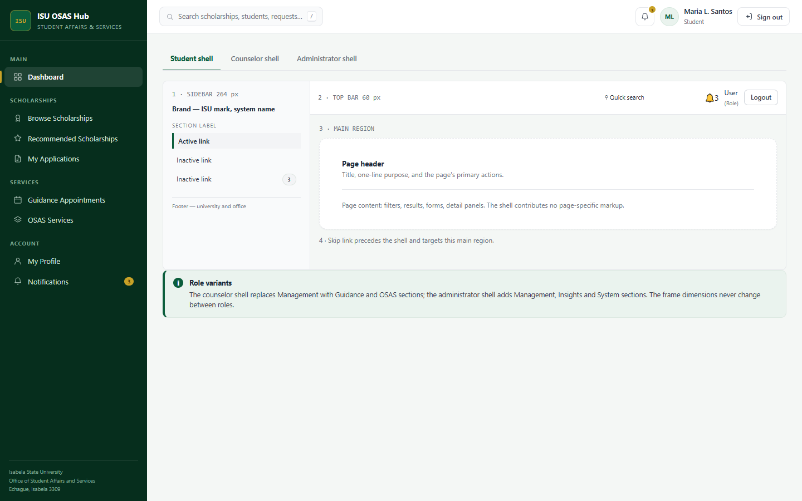

**Composition.** Tabs, hand-composed layout, notice.

**What this screen establishes**

1. Sidebar width is fixed at 264 px on desktop and holds role-appropriate links only.
2. Section labels group links; the active link carries a left rule and a filled background.
3. The notification count appears twice: on the sidebar link and on the top-bar bell.
4. Top bar carries the menu toggle (small screens), quick search, bell, user chip and logout.
5. Below 1024 px the sidebar leaves the flow and the menu toggle reveals it as a drawer.
6. A skip link precedes the shell so keyboard users can jump straight to main content.
7. Main content begins with a page header; the shell never renders page-specific actions.

**Mockup note.** This screen documents the shell itself: the sidebar's section labels, the active-item rule, the top bar's three zones and the way the frame reflows. It is the reference for every authenticated screen.

**Responsive behaviour**

| Viewport | Layout behaviour |
| --- | --- |
| Desktop 1440 | Sidebar fixed at 264 px; content region 1176 px minus padding. |
| Tablet 1024 | Sidebar hidden; menu toggle in the top bar opens it as an overlay drawer. |
| Mobile 390 | Top bar reduces to toggle, bell and user; search moves into the page. |

### 4.3 MK-03 — Student registration

| Field | Value |
| --- | --- |
| Role | Guest |
| Base wireframe | `WF-G-02` — Student registration |
| Route | `register` |
| Module | M01 |
| Requirements | FR-AUTH-04, FR-PROF-01, NFR-USA-02 |
| File | `screens/shared/MK-03.html` |

**Purpose.** Create a student account and its linked student profile in one submission, then require email verification before any student screen opens.

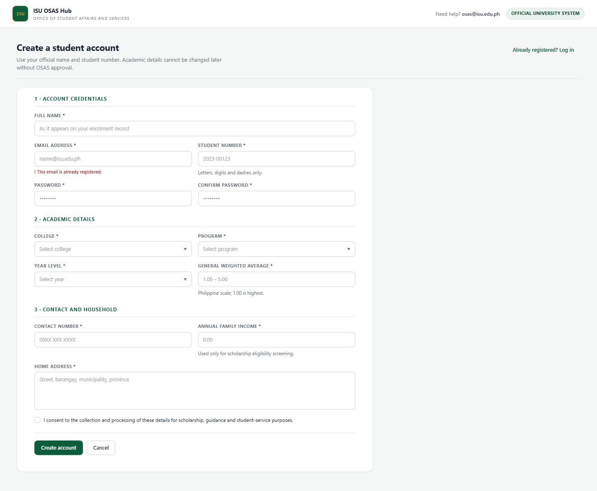

**Composition.** Page header, hand-composed layout.

**What this screen establishes**

1. Three sections: account credentials, academic details, and personal and financial details.
2. Student number is validated as unique, maximum 20 characters, letters/digits/dash only.
3. GWA accepts 1.00–5.00; family income accepts a non-negative amount with two decimals.
4. Password requires a confirmation field and a minimum of eight characters.
5. Privacy consent is mandatory; the submit button stays disabled until it is ticked.
6. Errors are field-level and previously entered values are preserved on redisplay.
7. On success the account is created but unusable until the OTP is verified (WF-G-03).

**Mockup note.** Registration is a single centred column: identity fields first, academic fields second, with the password rules stated before the field rather than after a failure.

**Responsive behaviour**

| Viewport | Layout behaviour |
| --- | --- |
| Desktop 1440 | Two-column field grid inside a single centred form card (max 860 px). |
| Tablet 1024 | Grid remains two columns; card fills the content width. |
| Mobile 390 | Every field is full width and stacked in document order. |

### 4.4 MK-04 — Email verification (OTP)

| Field | Value |
| --- | --- |
| Role | Guest |
| Base wireframe | `WF-G-03` — Email verification (OTP) |
| Route | `verification.notice` |
| Module | M01 |
| Requirements | FR-AUTH-05, FR-AUTH-06 |
| File | `screens/shared/MK-04.html` |

**Purpose.** Require a six-digit one-time passcode sent to the registered address before the student panel becomes reachable.

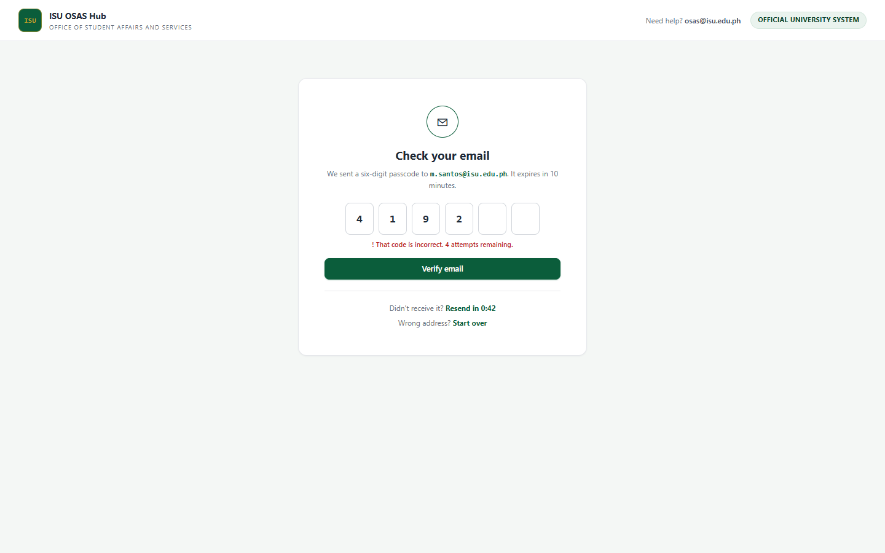

**Composition.** Hand-composed layout.

**What this screen establishes**

1. Six single-character inputs that advance focus automatically and accept a pasted code.
2. The masked email address is shown so the user can confirm the destination.
3. Resend is disabled during the cooldown and shows the remaining seconds.
4. Consuming the code invalidates it; a wrong code increments the attempt counter.
5. After too many attempts the code is invalidated and a new one must be requested.
6. A 'wrong email?' escape hatch returns to registration but does not delete the account.

**Mockup note.** The passcode screen is the smallest layout in the set: one six-cell input, one primary action and a resend affordance that states its cooldown.

**Responsive behaviour**

| Viewport | Layout behaviour |
| --- | --- |
| Desktop 1440 | Centred card, 460 px wide, with the code inputs on one row. |
| Tablet 1024 | Same card, centred; inputs keep a 44 px touch target. |
| Mobile 390 | Card fills the width; inputs shrink but remain 38 px tall. |

### 4.5 MK-05 — Access denied and not found

| Field | Value |
| --- | --- |
| Role | Guest |
| Base wireframe | `WF-G-04` — Access denied and not found |
| Route | `— (errors/403, errors/404)` |
| Module | M02 |
| Requirements | FR-RBAC-02 |
| File | `screens/shared/MK-05.html` |

**Purpose.** Refuse an unauthorised request without disclosing whether the record exists, and explain the refusal in plain language.

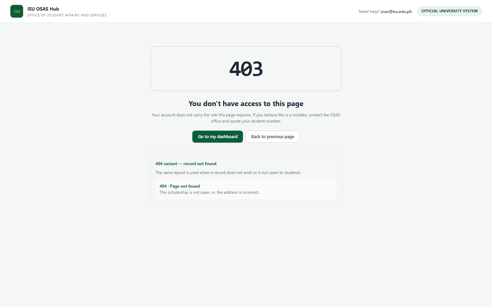

**Composition.** Hand-composed layout.

**What this screen establishes**

1. 403 is returned when an authenticated user requests another role's route.
2. 404 is returned for a missing record and for a scholarship that is not open.
3. No record data is rendered on either page — no titles, identifiers or counts.
4. Recovery actions are limited to safe destinations for the current role.
5. The same template is used for both codes; only the heading and body text differ.

**Mockup note.** Error states reuse the guest shell and keep the same page frame, so a permission failure does not look like a crash. The message is plain and the only action is a way back.

**Responsive behaviour**

| Viewport | Layout behaviour |
| --- | --- |
| Desktop 1440 | Centred block, max 560 px, vertically centred in the content area. |
| Tablet 1024 | Identical layout, slightly reduced type scale. |
| Mobile 390 | Full-width block with stacked actions. |

### 4.6 MK-25 — Notification centre

| Field | Value |
| --- | --- |
| Role | Student |
| Base wireframe | `WF-G-05` — Notification centre |
| Route | `notifications.index` |
| Module | M13 |
| Requirements | FR-APP-06, FR-APP-10, FR-GUID-12, FR-NOTIF-01, FR-NOTIF-03, FR-NOTIF-04, FR-NOTIF-05 |
| File | `screens/shared/MK-25.html` |

**Purpose.** List the signed-in user's notifications with category, read state and a safe link to the related record.

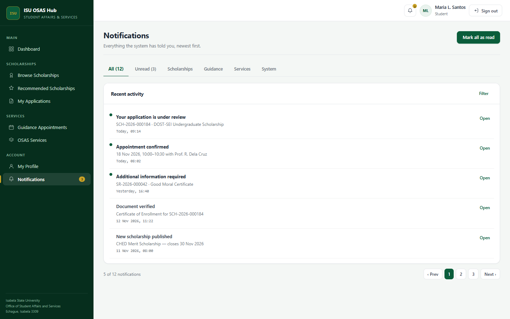

**Composition.** Page header, tabs, panel, notification feed, pagination.

**What this screen establishes**

1. Unread items are marked with a filled dot and bolder title; read items are plain.
2. Category filter separates scholarship, guidance, service and system notifications.
3. Mark-all-read is a single action next to the filter, not per row.
4. Each row links only to a record the user is permitted to open.
5. The top-bar badge and the sidebar counter both reflect the same unread count.
6. Empty state explains which event types will appear here.

**Mockup note.** The notification feed is a student screen inside the authenticated shell, even though its entries are produced by events elsewhere in the system.

**Responsive behaviour**

| Viewport | Layout behaviour |
| --- | --- |
| Desktop 1440 | Single column list at 860 px measure with a right-hand filter rail. |
| Tablet 1024 | Filter rail moves above the list as a horizontal filter bar. |
| Mobile 390 | List is full width; per-row action becomes an icon-sized button. |

<!-- pagebreak -->

## 5. Student screens

The student portal: profile, scholarship discovery, applications, guidance appointments and service requests.

16 screens.

### 5.1 MK-06 — My profile (view)

| Field | Value |
| --- | --- |
| Role | Student |
| Base wireframe | `WF-S-02` — My profile (view) |
| Route | `student.profile.show` |
| Module | M03, M04, M05 |
| Requirements | FR-PROF-02, FR-PASS-03, FR-ENR-05 |
| File | `screens/student/MK-06.html` |

**Purpose.** Show the student's own academic and personal record, the current enrollment verification state, and whether the profile is locked.

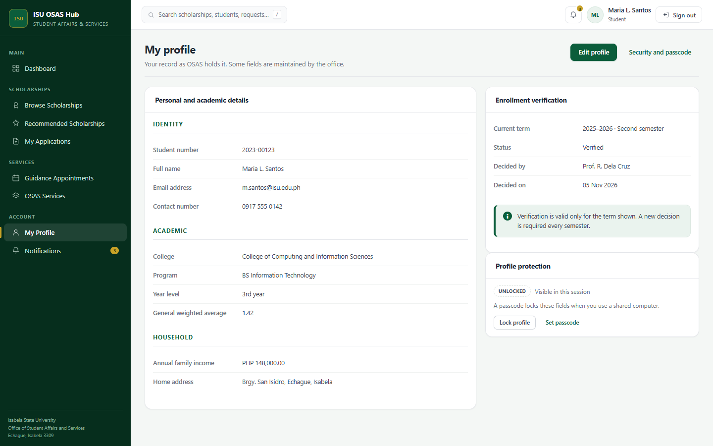

**Composition.** Page header, two-panel split.

**What this screen establishes**

1. Read-only. The only write actions are Edit profile, Lock, and Passcode settings.
2. Student number, college, program, year level and enrollment status are OSAS-managed.
3. Enrollment verification panel shows the latest term decision and its reason.
4. A locked profile hides field values until the passcode is entered.
5. Verification history is a short list; older terms remain visible but are not editable.
6. No passcode hash, password field or internal note is ever rendered here.

**Responsive behaviour**

| Viewport | Layout behaviour |
| --- | --- |
| Desktop 1440 | Two columns: identity and academic detail left, status panels right. |
| Tablet 1024 | Panels stack beneath the detail list. |
| Mobile 390 | Definition lists collapse to label-above-value pairs. |

### 5.2 MK-07 — Edit profile

| Field | Value |
| --- | --- |
| Role | Student |
| Base wireframe | `WF-S-03` — Edit profile |
| Route | `student.profile.edit` |
| Module | M03 |
| Requirements | FR-PROF-03 |
| File | `screens/student/MK-07.html` |

**Purpose.** Let the student correct the four fields they own, while showing the OSAS-managed fields as read-only.

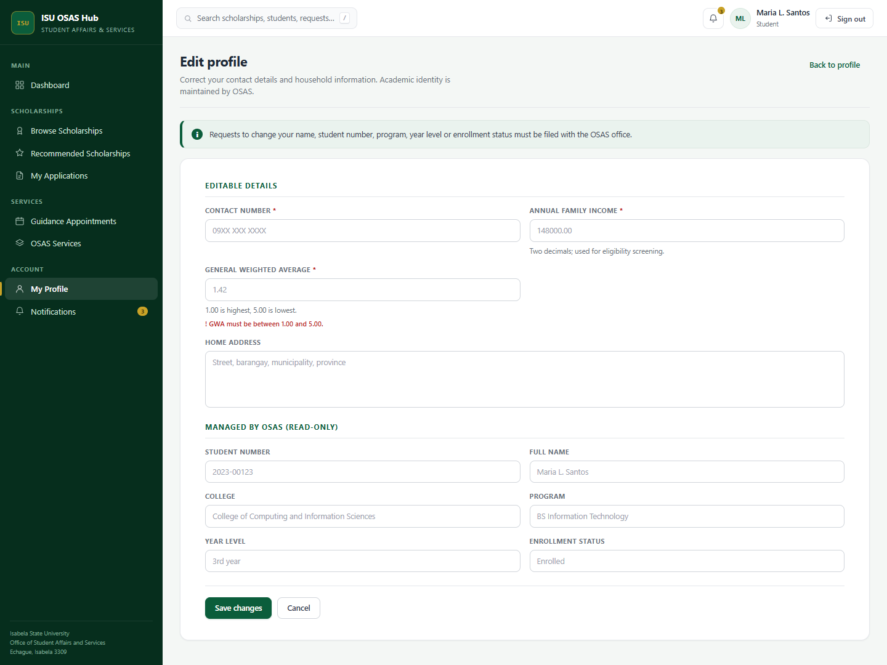

**Composition.** Page header, notice, panel, form sections.

**What this screen establishes**

1. Only contact number, address, GWA and family income are editable.
2. OSAS-managed fields are rendered disabled and labelled 'Managed by OSAS'.
3. Submitting a crafted change to a locked field is rejected server-side as well.
4. GWA is constrained to 1.00–5.00; income must be non-negative.
5. Validation messages appear under the offending field and values are preserved.
6. A passcode-protected profile must be unlocked before this form opens.

**Responsive behaviour**

| Viewport | Layout behaviour |
| --- | --- |
| Desktop 1440 | Two-column field grid in a max-820 px card. |
| Tablet 1024 | Two columns retained; help text wraps under each field. |
| Mobile 390 | Single column; disabled fields remain visually distinct. |

### 5.3 MK-08 — Profile security and passcode

| Field | Value |
| --- | --- |
| Role | Student |
| Base wireframe | `WF-S-04` — Profile security and passcode |
| Route | `student.profile.security` |
| Module | M04 |
| Requirements | FR-PASS-01, FR-PASS-02 |
| File | `screens/student/MK-08.html` |

**Purpose.** Let the student set, change or remove a passcode that locks profile fields for the current session.

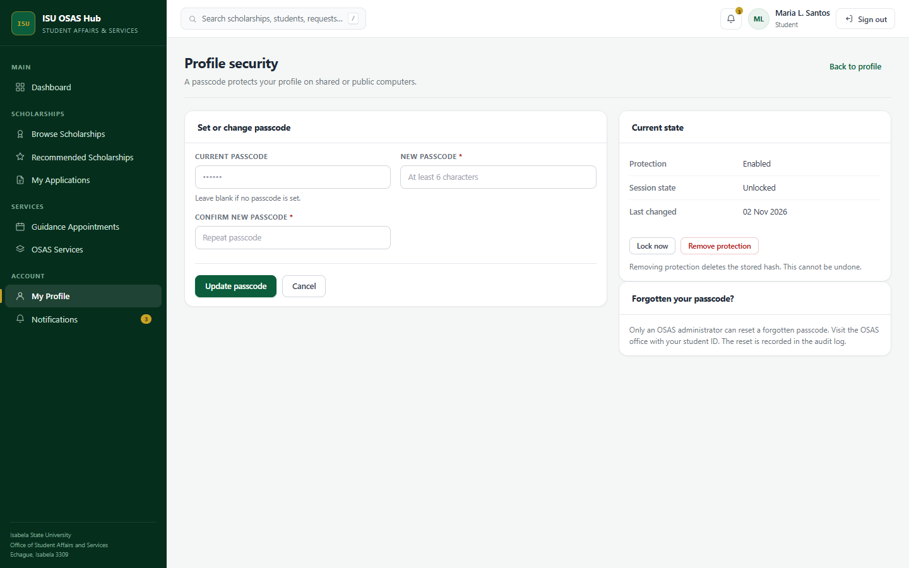

**Composition.** Page header, two-panel split.

**What this screen establishes**

1. Three states are shown: no passcode set, passcode set and unlocked, passcode set and locked.
2. Current passcode is required to change or remove an existing passcode.
3. The stored value is a one-way hash; the plaintext is never displayed or returned.
4. Unlock attempts are throttled and the remaining attempts are shown after a failure.
5. Removing protection is a destructive action and requires confirmation.
6. Losing the passcode requires an OSAS administrator to reset it (WF-A-06).

**Responsive behaviour**

| Viewport | Layout behaviour |
| --- | --- |
| Desktop 1440 | Two cards side by side: passcode form and current state. |
| Tablet 1024 | Cards stack, form first. |
| Mobile 390 | Single column; buttons become full width. |

### 5.4 MK-09 — Application detail and documents

| Field | Value |
| --- | --- |
| Role | Student |
| Base wireframe | `WF-S-11` — Application detail and documents |
| Route | `student.applications.show` |
| Module | M09, M10 |
| Requirements | FR-RBAC-05, FR-APP-04, FR-APP-05, FR-APP-09, FR-DOC-01, FR-DOC-02, FR-DOC-05 |
| File | `screens/student/MK-09.html` |

**Purpose.** Show one application in full: its workflow position, its documents, its history, and the one action the student may take next.

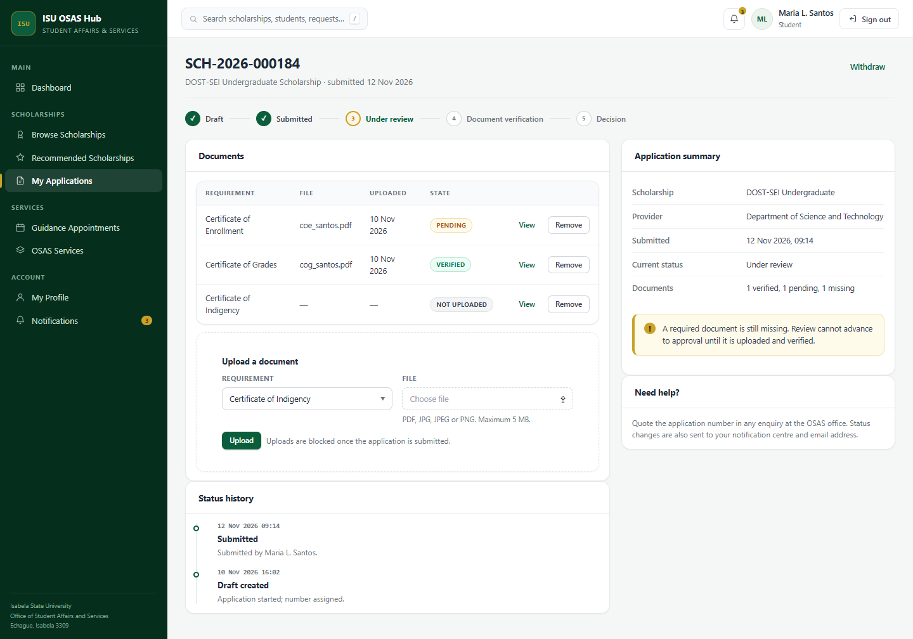

**Composition.** Page header, workflow stepper, two-panel split.

**What this screen establishes**

1. Progress stepper reflects the state machine, not a generic four-step bar.
2. Upload controls are present only while the application is in draft.
3. Each uploaded file shows verification state and any rejection remarks verbatim.
4. Submit is refused while a required document is missing, with the reason listed.
5. Status history is append-only and shows actor, time and remarks.
6. Downloads stream through an authorised route; no direct file path is exposed.

**Responsive behaviour**

| Viewport | Layout behaviour |
| --- | --- |
| Desktop 1440 | Stepper full width, then 2:1 split of documents and sidebar. |
| Tablet 1024 | Stepper wraps to two lines; sidebar moves below documents. |
| Mobile 390 | Stepper becomes a vertical list; document rows become cards. |

### 5.5 MK-19 — Browse scholarships

| Field | Value |
| --- | --- |
| Role | Student |
| Base wireframe | `WF-S-05` — Browse scholarships |
| Route | `student.scholarships.index` |
| Module | M06, M16 |
| Requirements | FR-SCH-06, FR-SCH-07, FR-SEARCH-02 |
| File | `screens/student/MK-19.html` |

**Purpose.** List every scholarship currently open and inside its application window, with filters and a stable sort order.

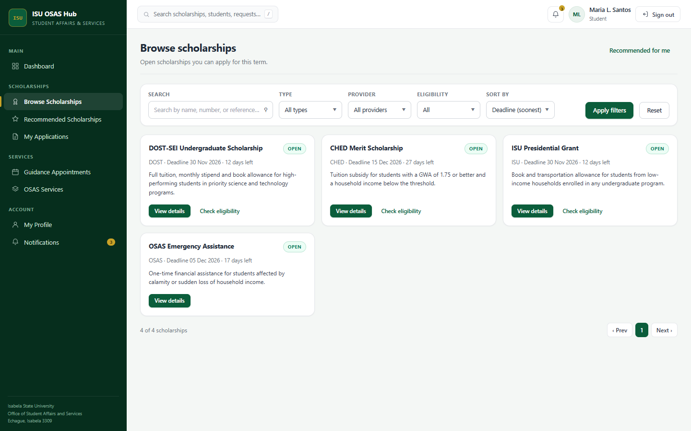

**Composition.** Page header, filter bar, card list, pagination.

**What this screen establishes**

1. Only scholarships with status open and a current date inside the window appear.
2. Filters: search term, scholarship type, provider, program, eligibility, sort order.
3. Sort options are deadline, name, newest and match score, matching the search service.
4. Each card shows deadline, award summary, provider and a match or eligibility hint.
5. Filter state is reflected in the URL so results can be shared or bookmarked.
6. Empty state explains that no scholarship matches and offers a filter reset.
7. Cards are keyboard-focusable and the whole card is one link target.

**Responsive behaviour**

| Viewport | Layout behaviour |
| --- | --- |
| Desktop 1440 | Three cards per row with a full-width filter bar above. |
| Tablet 1024 | Two cards per row; filters wrap onto two lines. |
| Mobile 390 | One card per row; filters collapse to a disclosure panel. |

### 5.6 MK-20 — Scholarship detail

| Field | Value |
| --- | --- |
| Role | Student |
| Base wireframe | `WF-S-06` — Scholarship detail |
| Route | `student.scholarships.show` |
| Module | M06, M09 |
| Requirements | FR-SCH-09, FR-APP-01, FR-APP-03 |
| File | `screens/student/MK-20.html` |

**Purpose.** Present the full scholarship record, its document requirements, the student's eligibility summary, and the single action appropriate to their state.

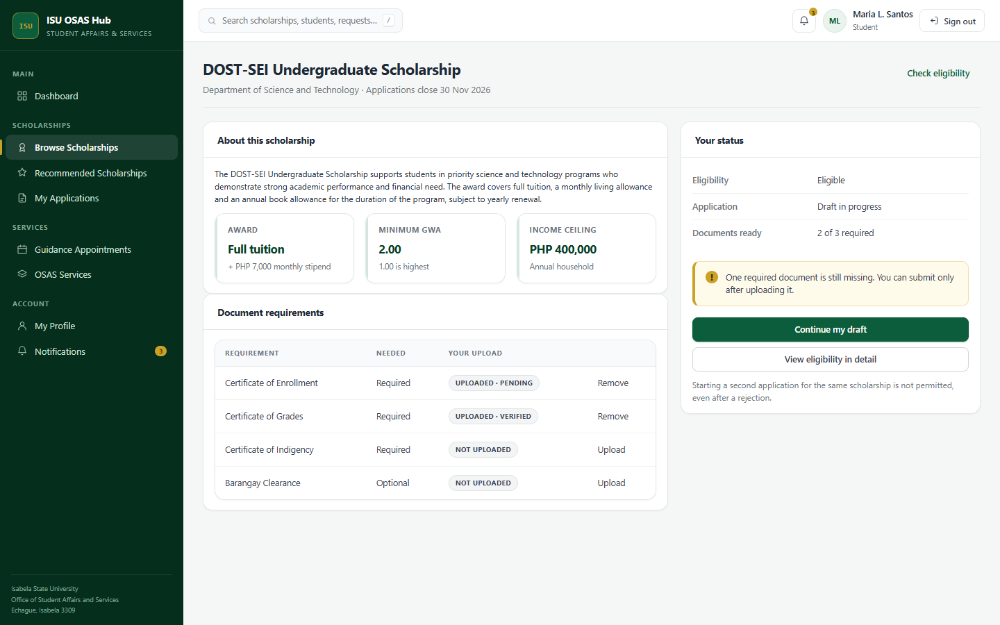

**Composition.** Page header, two-panel split.

**What this screen establishes**

1. A scholarship that is not open returns 404 — there is no draft preview for students.
2. Eligibility summary is a compact three-way verdict with a link to the full explanation.
3. Requirements table distinguishes required from optional and shows upload readiness.
4. The primary action changes with state: Apply, Continue draft, Submitted, Approved, Rejected.
5. Only one application per student per scholarship is ever possible (BR-09).
6. Award amount and provider are stated in full; no figure is illustrative on screen.

**Responsive behaviour**

| Viewport | Layout behaviour |
| --- | --- |
| Desktop 1440 | Two columns: narrative and requirements left, sticky action panel right. |
| Tablet 1024 | Action panel moves above the narrative as a summary strip. |
| Mobile 390 | Single column; requirements table scrolls horizontally. |

### 5.7 MK-21 — Eligibility preview

| Field | Value |
| --- | --- |
| Role | Student |
| Base wireframe | `WF-S-07` — Eligibility preview |
| Route | `student.scholarships.eligibility` |
| Module | M07 |
| Requirements | FR-ELIG-01, FR-ELIG-02, FR-ELIG-03, FR-ELIG-04 |
| File | `screens/student/MK-21.html` |

**Purpose.** Explain, criterion by criterion, why the student is or is not eligible for a particular scholarship, without creating an application.

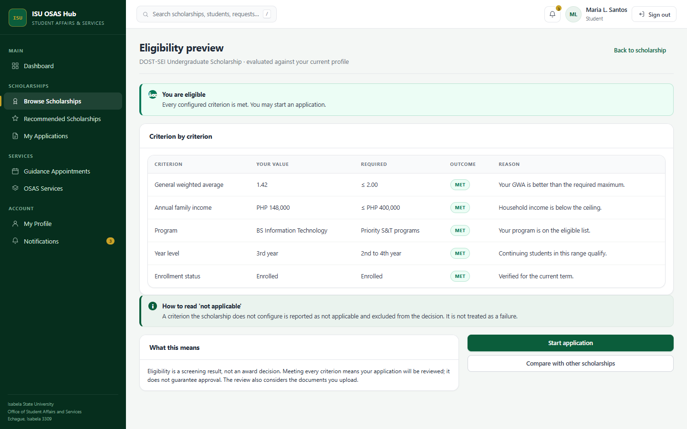

**Composition.** Page header, notice, panel, record table, two-panel split.

**What this screen establishes**

1. One row per criterion: GWA, family income, program, year level, enrollment status.
2. Each row shows the student's value, the required value, the outcome and a reason sentence.
3. Outcomes are met, not met, or not applicable; an unconfigured criterion is never a failure.
4. The overall verdict is derived from the criteria, not computed separately.
5. The page is read-only and creates no record; it can be revisited freely.
6. A failed mandatory criterion states exactly what would need to change.

**Responsive behaviour**

| Viewport | Layout behaviour |
| --- | --- |
| Desktop 1440 | Verdict banner on top, criteria table full width, notes at the side. |
| Tablet 1024 | Criteria table keeps four columns; notes stack below. |
| Mobile 390 | Table becomes a stack of criterion cards, one per rule. |

### 5.8 MK-22 — Full match list

| Field | Value |
| --- | --- |
| Role | Student |
| Base wireframe | `WF-S-09` — Full match list |
| Route | `student.scholarships.matches` |
| Module | M08 |
| Requirements | FR-MATCH-01, FR-MATCH-04, FR-MATCH-05, FR-MATCH-06 |
| File | `screens/student/MK-22.html` |

**Purpose.** Expose every scoring factor behind each recommendation so the ranking is inspectable rather than opaque.

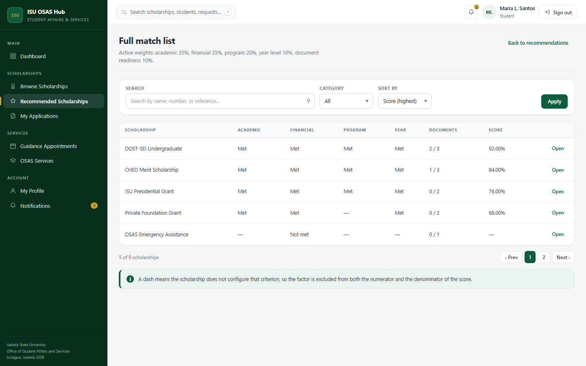

**Composition.** Page header, filter bar, record table, pagination, notice.

**What this screen establishes**

1. Columns mirror the five factors: academic, financial, program, year level, documents.
2. Each factor cell shows met or not met; document readiness shows a fraction.
3. Total score is the weight-renormalised sum, displayed as a percentage.
4. Factors that do not apply are shown as a dash and excluded from the denominator.
5. Sorting by any column is permitted; the default order is score descending.
6. Weights in use are stated in the caption so the percentages are interpretable.

**Responsive behaviour**

| Viewport | Layout behaviour |
| --- | --- |
| Desktop 1440 | Wide table with all factor columns visible. |
| Tablet 1024 | Table scrolls horizontally; score column is pinned first. |
| Mobile 390 | Table becomes a per-scholarship factor card list. |

### 5.9 MK-24 — My applications

| Field | Value |
| --- | --- |
| Role | Student |
| Base wireframe | `WF-S-10` — My applications |
| Route | `student.applications.index` |
| Module | M09 |
| Requirements | FR-APP-02 |
| File | `screens/student/MK-24.html` |

**Purpose.** List every application the student has ever submitted or drafted, with the current status and the next action.

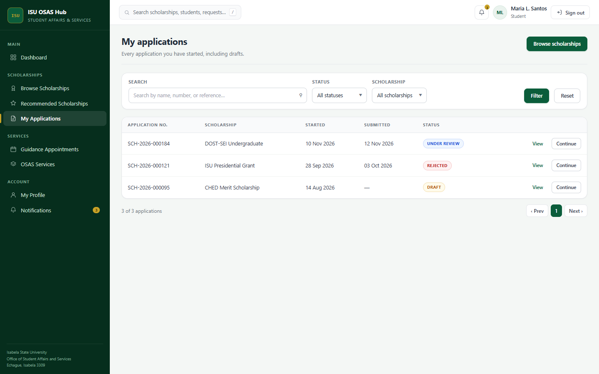

**Composition.** Page header, filter bar, record table, pagination.

**What this screen establishes**

1. Application number is shown in full and is the stable reference for any enquiry.
2. Status badges use the same vocabulary as the review queue and the timeline.
3. Draft rows expose 'Continue draft'; submitted rows expose 'View' only.
4. Rejected rows remain visible permanently because reapplication is blocked.
5. Pagination is server-side; the table never loads the full set.
6. Empty state links to the scholarship catalogue.

**Responsive behaviour**

| Viewport | Layout behaviour |
| --- | --- |
| Desktop 1440 | Full table with six columns and a per-row action. |
| Tablet 1024 | Submitted date column collapses into a secondary line under the scholarship. |
| Mobile 390 | Each application renders as a stacked card with status and action. |

### 5.10 MK-30 — Guidance counselors

| Field | Value |
| --- | --- |
| Role | Student |
| Base wireframe | `WF-S-12` — Guidance counselors |
| Route | `student.guidance.counselors` |
| Module | M11 |
| Requirements | FR-GUID-05 |
| File | `screens/student/MK-30.html` |

**Purpose.** List counselors who have published availability so the student can choose who to book with.

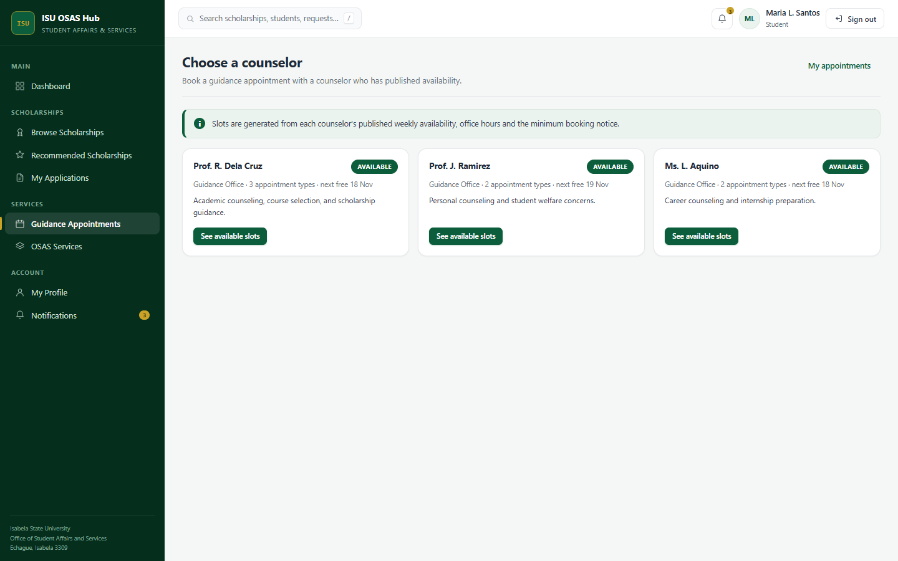

**Composition.** Page header, notice, card list.

**What this screen establishes**

1. Only counselors with at least one active availability block are listed.
2. Each card shows the counselor's name, the appointment types they offer, and next free day.
3. Choosing a counselor leads to slot selection (WF-S-13) with the counselor pre-selected.
4. A counselor with no published availability is omitted rather than shown as unavailable.
5. No counselor notes, caseload or internal remarks appear on this screen.

**Responsive behaviour**

| Viewport | Layout behaviour |
| --- | --- |
| Desktop 1440 | Three cards per row. |
| Tablet 1024 | Two cards per row. |
| Mobile 390 | One card per row; the whole card is one link target. |

### 5.11 MK-31 — Appointment slots and booking

| Field | Value |
| --- | --- |
| Role | Student |
| Base wireframe | `WF-S-13` — Appointment slots and booking |
| Route | `student.guidance.slots` |
| Module | M11 |
| Requirements | FR-GUID-06, FR-GUID-07, FR-GUID-08 |
| File | `screens/student/MK-31.html` |

**Purpose.** Offer only slots that satisfy availability, office hours, booking notice, the booking horizon, and both counselor and student conflict rules.

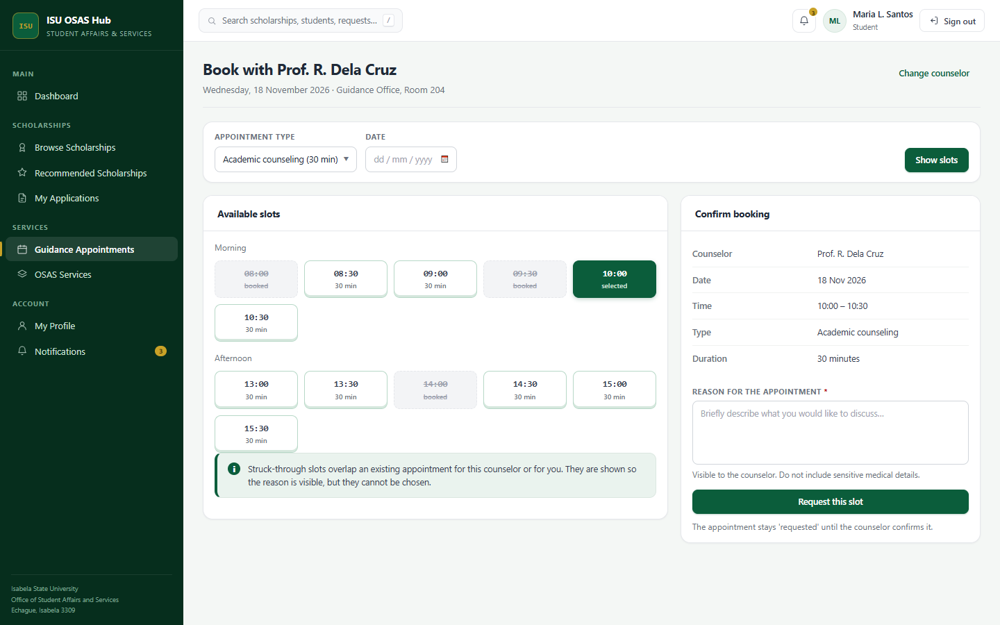

**Composition.** Page header, filter bar, two-panel split.

**What this screen establishes**

1. Date picker is bounded before today and after the maximum future booking day.
2. Appointment type changes the slot duration and therefore the slot grid.
3. Conflicting slots are shown struck through rather than hidden, so the student sees why.
4. Submitting re-validates every rule inside a transaction; the UI is not the guard.
5. The reason field is required and is visible to the counselor.
6. A failed booking returns to this page with the specific conflict stated.

**Responsive behaviour**

| Viewport | Layout behaviour |
| --- | --- |
| Desktop 1440 | Slot grid four to six per row; booking form in a right-hand panel. |
| Tablet 1024 | Grid three per row; form moves below the grid. |
| Mobile 390 | Grid two per row; form stacks with full-width controls. |

### 5.12 MK-33 — Appointment detail

| Field | Value |
| --- | --- |
| Role | Student |
| Base wireframe | `WF-S-15` — Appointment detail |
| Route | `student.guidance.appointments.show` |
| Module | M11 |
| Requirements | FR-GUID-10 |
| File | `screens/student/MK-33.html` |

**Purpose.** Show one appointment in full and offer cancellation only when the notice window still allows it.

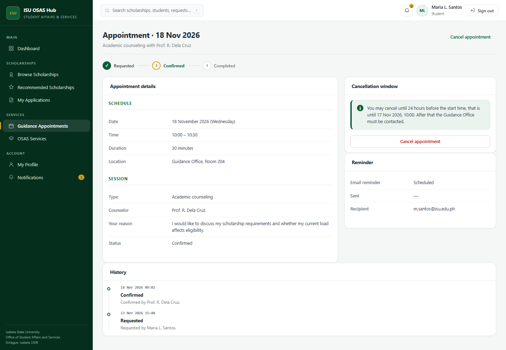

**Composition.** Page header, workflow stepper, two-panel split, panel, status history.

**What this screen establishes**

1. Status stepper shows requested, confirmed, then completed or cancelled.
2. Cancellation notice window is stated in plain language with the exact cut-off time.
3. Rejection reason from the counselor is shown verbatim when present.
4. Student-visible notes only; counselor notes are never rendered to the student.
5. Reminder state is shown so the student knows whether an email was already sent.

**Responsive behaviour**

| Viewport | Layout behaviour |
| --- | --- |
| Desktop 1440 | Detail panel left, status and actions right. |
| Tablet 1024 | Action panel moves below the detail panel. |
| Mobile 390 | Single column with the status banner first. |

### 5.13 MK-35 — Service catalogue

| Field | Value |
| --- | --- |
| Role | Student |
| Base wireframe | `WF-S-16` — Service catalogue |
| Route | `student.services.catalog` |
| Module | M12 |
| Requirements | FR-SVC-01 |
| File | `screens/student/MK-35.html` |

**Purpose.** Present the active OSAS service types with their instructions and required attachments, and start a request.

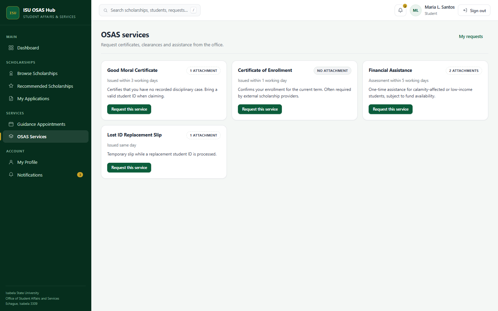

**Composition.** Page header, card list.

**What this screen establishes**

1. Only service types flagged active are listed, in administrator-defined display order.
2. Each card states what the student must prepare before starting the request.
3. Required attachments are counted so the student knows the effort involved.
4. Starting a request opens the form with the service type pre-selected.
5. Instructions are shown in full; there is no hidden policy text.

**Responsive behaviour**

| Viewport | Layout behaviour |
| --- | --- |
| Desktop 1440 | Three cards per row. |
| Tablet 1024 | Two cards per row. |
| Mobile 390 | One card per row with the action pinned to the bottom. |

### 5.14 MK-37 — New service request

| Field | Value |
| --- | --- |
| Role | Student |
| Base wireframe | `WF-S-17` — New service request |
| Route | `student.services.create` |
| Module | M12 |
| Requirements | FR-SVC-03 |
| File | `screens/student/MK-37.html` |

**Purpose.** Collect the service type, a description of at least ten characters, and the supporting documents required by that service.

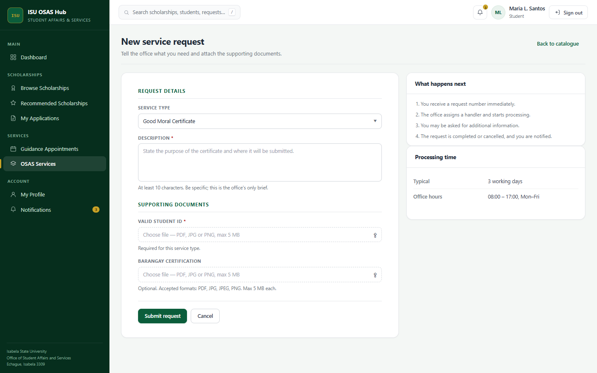

**Composition.** Page header, two-panel split.

**What this screen establishes**

1. Service type is pre-selected when arriving from the catalogue.
2. Description requires at least ten characters; the counter shows the remaining minimum.
3. Attachments are limited to PDF, JPG, JPEG and PNG at 5 MB each.
4. Required attachments are listed per the chosen service type's requirements.
5. Submitting generates a request number in the form SR-YYYY-NNNNNN.
6. The request is created with status submitted and the student is returned to detail.

**Responsive behaviour**

| Viewport | Layout behaviour |
| --- | --- |
| Desktop 1440 | Single form card at 860 px with a two-column field grid. |
| Tablet 1024 | Two columns retained; attachment rows wrap. |
| Mobile 390 | Single column; file pickers become full width. |

### 5.15 MK-38 — Service request detail

| Field | Value |
| --- | --- |
| Role | Student |
| Base wireframe | `WF-S-19` — Service request detail |
| Route | `student.services.show` |
| Module | M12 |
| Requirements | FR-SVC-04, FR-SVC-05, FR-SVC-08, FR-SVC-09 |
| File | `screens/student/MK-38.html` |

**Purpose.** Show one request, its documents, its status history, and any information the office still needs from the student.

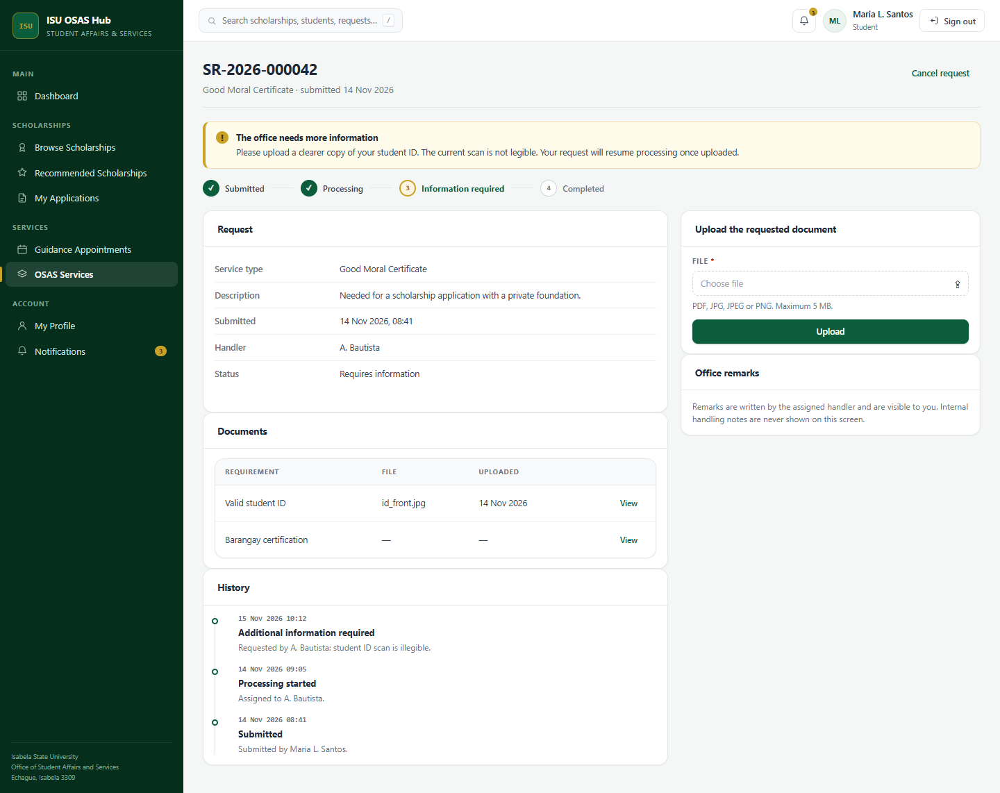

**Composition.** Page header, notice, workflow stepper, two-panel split.

**What this screen establishes**

1. An outstanding information request is surfaced as a prominent banner, not a hidden status.
2. Office remarks and internal remarks are separated; only the former is shown here.
3. Additional documents can be attached only while the request is non-terminal.
4. Status history is append-only with actor and timestamp.
5. Cancellation is offered only when the state machine still permits it.

**Responsive behaviour**

| Viewport | Layout behaviour |
| --- | --- |
| Desktop 1440 | Two-column layout: details and history left, actions right. |
| Tablet 1024 | Actions move under the details block. |
| Mobile 390 | Single column; the outstanding-action banner appears first. |

### 5.16 MK-46 — Responsive behaviour across three widths

| Field | Value |
| --- | --- |
| Role | Student |
| Base wireframe | `WF-S-01` — Student dashboard |
| Route | `student.dashboard` |
| Module | M03, M09, M11, M12 |
| Requirements | NFR-PORT-01 |
| File | `screens/student/MK-46.html` |

**Purpose.** The student dashboard shown at all three supported widths, so the reflow rules can be compared side by side.

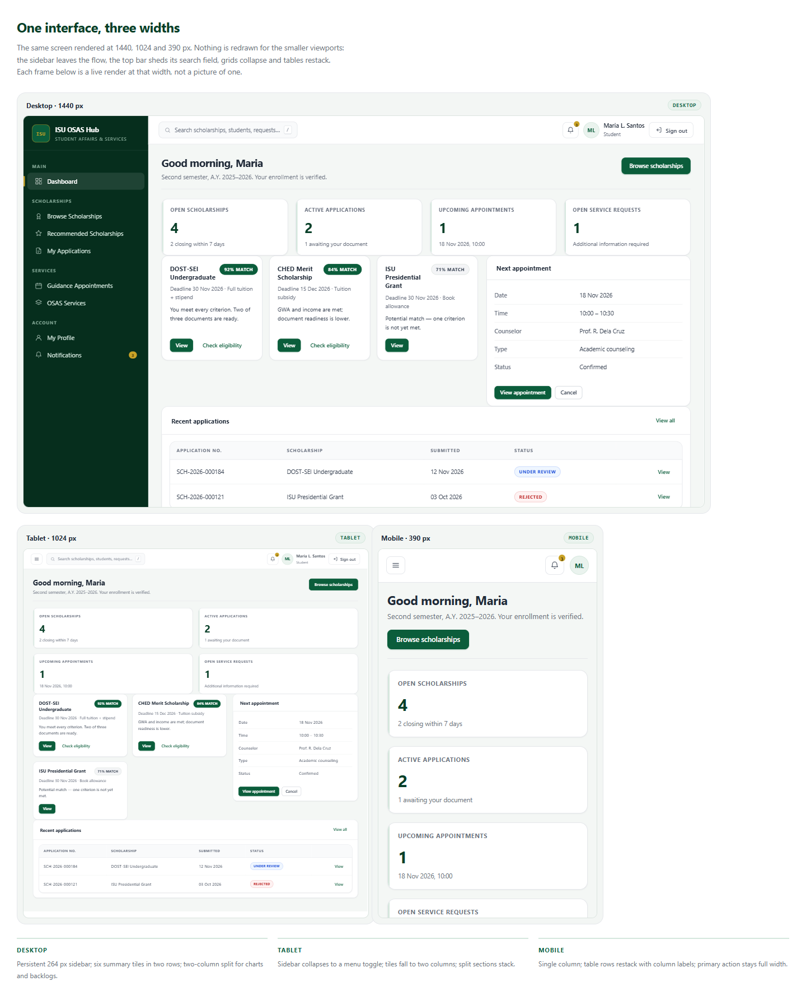

**Composition.** Page header, summary tiles, two-panel split, panel, record table.

**What this screen establishes**

1. Four summary tiles: open scholarships, active applications, upcoming appointments, open requests.
2. Enrollment banner appears only when verification is missing for the current term.
3. Recommended scholarships are ranked by match score and capped at three cards.
4. Upcoming appointments show date, time, counselor and status — never counselor notes.
5. Recent applications table carries the human-readable application number, not the database id.
6. Every tile and row links to the full screen; the dashboard itself is read-only.

**Mockup note.** A showcase rather than a new screen: the student dashboard is rendered three times at the three supported widths so the reflow rules can be reviewed side by side. The structure is WF-S-01 throughout.

**Responsive behaviour**

| Viewport | Layout behaviour |
| --- | --- |
| Desktop 1440 | Tiles in four columns; content grid of 2:1 with recommendations left. |
| Tablet 1024 | Tiles in two columns; the 2:1 split becomes stacked regions. |
| Mobile 390 | Single column; tiles stack; tables scroll horizontally inside their wrapper. |

<!-- pagebreak -->

## 6. Counselor screens

The guidance caseload and the enrollment verification decisions a counselor is permitted to make.

4 screens.

### 6.1 MK-14 — Enrollment verification queue

| Field | Value |
| --- | --- |
| Role | Counselor |
| Base wireframe | `WF-C-05` — Enrollment verification queue |
| Route | `enrollment-verifications.index` |
| Module | M05 |
| Requirements | FR-RBAC-04, FR-ENR-01, FR-ENR-04 |
| File | `screens/counselor/MK-14.html` |

**Purpose.** Review the enrollment-verification records for the current term and open any record to record a decision.

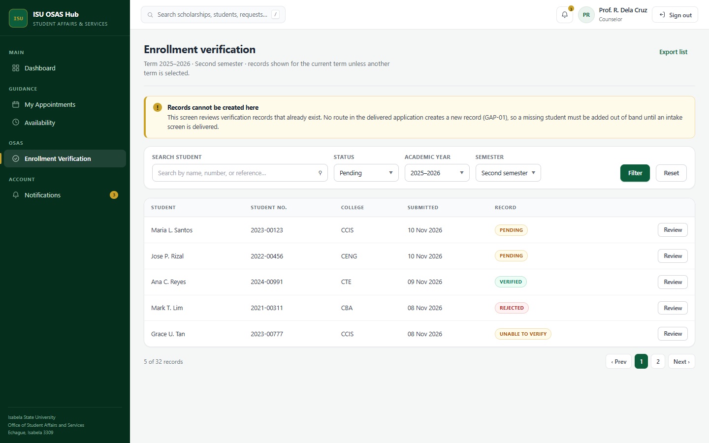

**Composition.** Page header, notice, filter bar, record table, pagination.

**What this screen establishes**

1. Both counselors and administrators reach this screen; the queue is not scoped to the counselor's own students because no such relationship exists in the schema.
2. Status filter defaults to pending, because decided records need no action.
3. Current term is highlighted from configuration; other terms remain visible but are not actionable for the current gate.
4. The student's profile enrollment status is shown alongside the record status so a mismatch is visible.
5. GAP-01: no screen in the application creates these records. This queue reviews records that exist; it cannot create them.
6. Pagination is server-side with 20 rows per page.

**Responsive behaviour**

| Viewport | Layout behaviour |
| --- | --- |
| Desktop 1440 | Filter bar plus a six-column table. |
| Tablet 1024 | Term column folds into the student cell as a secondary line. |
| Mobile 390 | Rows become cards with the status badge in the header. |

### 6.2 MK-15 — Enrollment verification review

| Field | Value |
| --- | --- |
| Role | Counselor |
| Base wireframe | `WF-C-06` — Enrollment verification review |
| Route | `enrollment-verifications.show` |
| Module | M05 |
| Requirements | FR-ENR-03 |
| File | `screens/counselor/MK-15.html` |

**Purpose.** Record the enrollment decision for one student and term, with the reason that the student will act on.

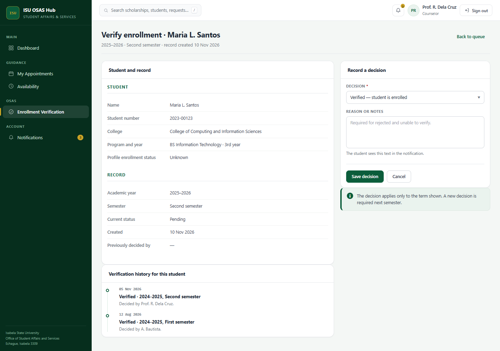

**Composition.** Page header, two-panel split.

**What this screen establishes**

1. Three outcomes: verified, rejected, unable to verify.
2. Notes are mandatory for rejected and unable to verify, and optional for verified.
3. Saving updates the record and the student's profile enrollment status in one transaction.
4. The decision is attributed to the signed-in user and stamped with a timestamp.
5. Verification is term-scoped: it satisfies the enrollment gate only for the configured academic year and semester.
6. The student is notified of the outcome, so the reason text is written for them.

**Responsive behaviour**

| Viewport | Layout behaviour |
| --- | --- |
| Desktop 1440 | Record summary left, decision form right. |
| Tablet 1024 | Decision form moves under the summary. |
| Mobile 390 | Single column with the student summary first. |

### 6.3 MK-27 — Weekly availability

| Field | Value |
| --- | --- |
| Role | Counselor |
| Base wireframe | `WF-C-02` — Weekly availability |
| Route | `counselor.guidance.availability` |
| Module | M11 |
| Requirements | FR-GUID-01, FR-GUID-02 |
| File | `screens/counselor/MK-27.html` |

**Purpose.** Publish the recurring weekly blocks from which bookable appointment slots are generated, and mark a day unavailable without deleting its history.

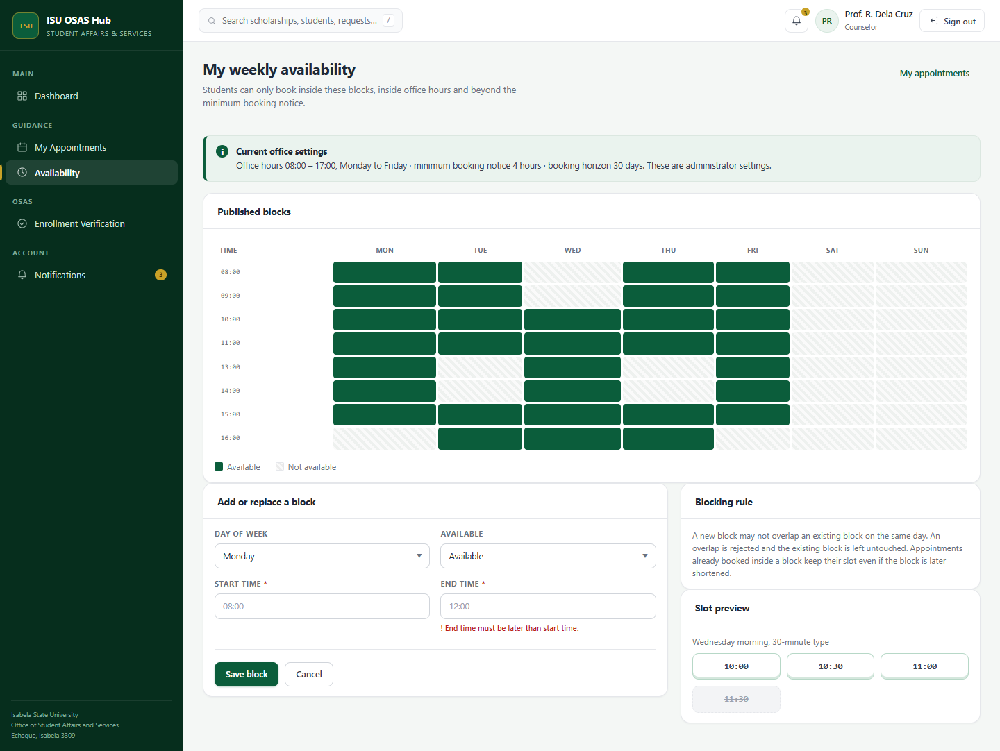

**Composition.** Page header, notice, panel, weekly availability grid, hand-composed layout, two-panel split.

**What this screen establishes**

1. One row per day of week (1 = Monday … 7 = Sunday), with a start time, an end time and an available flag.
2. Saving a block that overlaps another block for the same counselor is rejected with a field-level error.
3. End time must be later than start time; the pair is validated server-side too.
4. The preview column shows the resulting bookable slots so the effect of a change is visible before saving.
5. Office hours and minimum booking notice are administrator settings and cannot be changed here; they are shown as context.
6. Marking a day unavailable stops new bookings without deleting past appointments.

**Responsive behaviour**

| Viewport | Layout behaviour |
| --- | --- |
| Desktop 1440 | Seven-column grid with the editor form in a right-hand panel. |
| Tablet 1024 | Grid scrolls horizontally; editor moves above the grid. |
| Mobile 390 | Each day becomes a stacked row with its own start and end controls. |

### 6.4 MK-32 — Appointment detail and decisions

| Field | Value |
| --- | --- |
| Role | Counselor |
| Base wireframe | `WF-C-04` — Appointment detail and decisions |
| Route | `counselor.guidance.appointments.show` |
| Module | M11 |
| Requirements | FR-GUID-09 |
| File | `screens/counselor/MK-32.html` |

**Purpose.** Review one appointment request with the student's stated reason, then confirm, reject with a required reason, or complete a confirmed session.

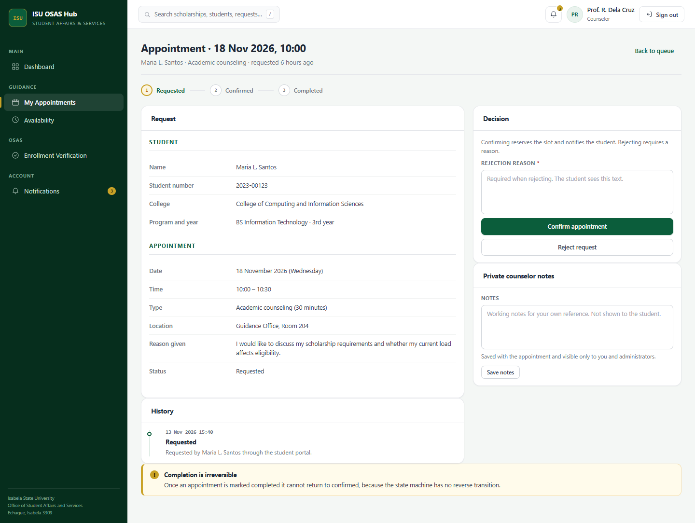

**Composition.** Page header, workflow stepper, two-panel split, notice.

**What this screen establishes**

1. Only transitions permitted by the state machine are rendered as actions.
2. Reject requires a written reason; the reason is shown to the student verbatim.
3. Confirm re-checks the slot for conflict before committing, so a stale page cannot double-book.
4. Complete is available only from confirmed, and stamps the completion in history.
5. Counselor notes are private working notes and are not visible to the student.
6. The student's submitted reason is read-only here.

**Responsive behaviour**

| Viewport | Layout behaviour |
| --- | --- |
| Desktop 1440 | Details left, decision panel and private notes right. |
| Tablet 1024 | Decision panel moves directly under the details. |
| Mobile 390 | Single column; decision buttons stack and stay full width. |

<!-- pagebreak -->

## 7. Administrator screens

Configuration, review queues, analytics and the audit log.

20 screens.

### 7.1 MK-10 — User accounts

| Field | Value |
| --- | --- |
| Role | Administrator |
| Base wireframe | `WF-A-02` — User accounts |
| Route | `admin.users.index` |
| Module | M03 |
| Requirements | FR-PROF-07 |
| File | `screens/admin/MK-10.html` |

**Purpose.** List every account with its role and active state so the administrator can suspend, restore or edit access.

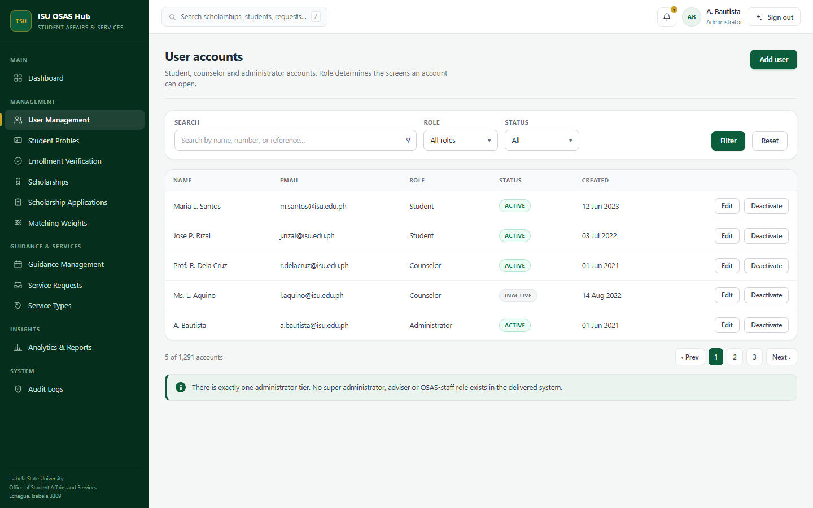

**Composition.** Page header, filter bar, record table, pagination, notice.

**What this screen establishes**

1. Role filter is the primary control, because role determines which screens a user can reach.
2. Active state is a first-class column: an inactive account is refused at login even with correct credentials.
3. Only three roles exist — student, counselor and administrator. There is no super administrator tier.
4. Deactivation is a toggle, not a delete, so historical records keep a valid owner.
5. A user's own account cannot be deactivated from this screen (self-lockout guard).
6. Email addresses are shown in full here because this is an administrator-only screen.

**Responsive behaviour**

| Viewport | Layout behaviour |
| --- | --- |
| Desktop 1440 | Filter bar plus a six-column table with row actions. |
| Tablet 1024 | Created column folds into a secondary line under the email address. |
| Mobile 390 | Rows become cards; status and role badges share the header row. |

### 7.2 MK-11 — User create and edit

| Field | Value |
| --- | --- |
| Role | Administrator |
| Base wireframe | `WF-A-03` — User create and edit |
| Route | `admin.users.create / admin.users.edit` |
| Module | M03 |
| Requirements | FR-RBAC-01, FR-PROF-06, FR-PROF-08 |
| File | `screens/admin/MK-11.html` |

**Purpose.** Create an account with an explicit role, or change an existing account's name, email, role and active state.

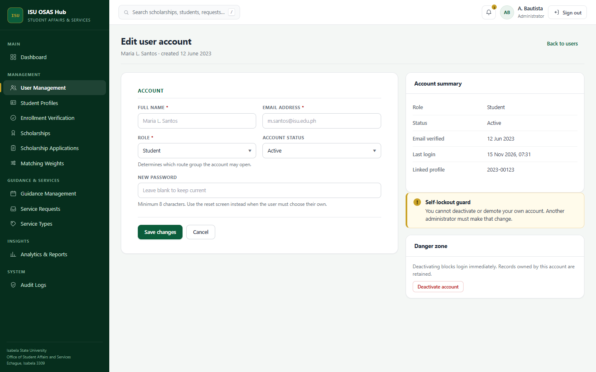

**Composition.** Page header, two-panel split.

**What this screen establishes**

1. Role is a required, explicit choice — it is never inferred from the email address.
2. Email must be unique across all accounts; the field reports a duplicate inline.
3. On create, an initial password is required and must be confirmed.
4. On edit, the password field is left blank and only replaced when filled, so editing a role does not silently reset a password.
5. Deactivating an account keeps every historical foreign-key reference intact.
6. Changing a student's role does not create or delete a student profile; that is done on the student profile screens.

**Responsive behaviour**

| Viewport | Layout behaviour |
| --- | --- |
| Desktop 1440 | Two-column field grid inside an 840 px card. |
| Tablet 1024 | Two columns retained. |
| Mobile 390 | Single column; the role and status controls stack last. |

### 7.3 MK-12 — Student profiles

| Field | Value |
| --- | --- |
| Role | Administrator |
| Base wireframe | `WF-A-05` — Student profiles |
| Route | `admin.student-profiles.index` |
| Module | M03, M05 |
| Requirements | FR-PROF-04 |
| File | `screens/admin/MK-12.html` |

**Purpose.** List every student profile with academic identity, GWA, income and current enrollment status so records can be corrected and audited.

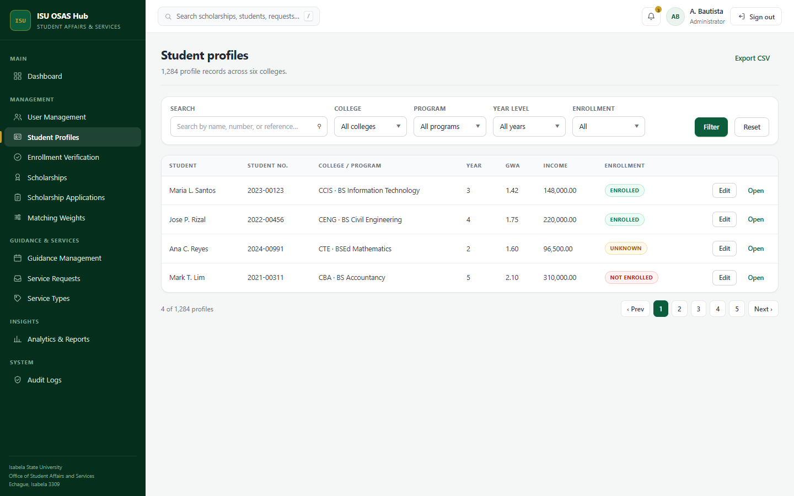

**Composition.** Page header, filter bar, record table, pagination.

**What this screen establishes**

1. Students are filtered by college, program, year level and enrollment status — the same facets used by eligibility rules.
2. Enrollment status is the profile-level mirror of the latest verification decision.
3. GWA and family income are shown because they drive eligibility; both are administrator-editable.
4. A student with no verification record is distinguishable from one with a pending record.
5. The list is read-only except for the per-row Edit action.
6. Bulk export is offered because colleges request roster extracts.

**Responsive behaviour**

| Viewport | Layout behaviour |
| --- | --- |
| Desktop 1440 | Filter bar with five controls, then a seven-column table. |
| Tablet 1024 | Program folds under college; income column is hidden. |
| Mobile 390 | Cards with name, program, GWA, income and status. |

### 7.4 MK-13 — Student profile detail

| Field | Value |
| --- | --- |
| Role | Administrator |
| Base wireframe | `WF-A-06` — Student profile detail |
| Route | `admin.student-profiles.show` |
| Module | M03, M04, M05, M07 |
| Requirements | FR-PROF-05, FR-PASS-04 |
| File | `screens/admin/MK-13.html` |

**Purpose.** Show one student's complete record, including enrollment outcome, passcode state and the eligibility inputs the system actually uses.

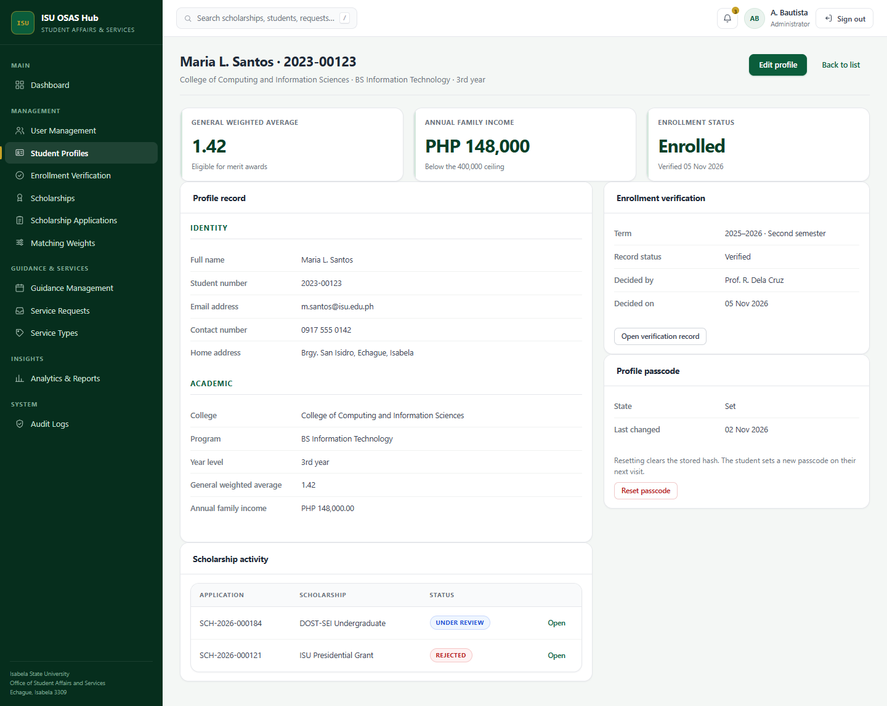

**Composition.** Page header, summary tiles, two-panel split.

**What this screen establishes**

1. Contact and household details are shown only to administrators; a counselor never reaches this screen.
2. Passcode state is shown as set or not set; the hash is never displayed.
3. Resetting a forgotten passcode clears the hash and requires the student to set a new one; the action is audited.
4. The enrollment panel links to the verification record for the current term.
5. Eligibility inputs are labelled so an administrator can see exactly which fields feed scholarship screening.
6. Every change is made through the edit screen, not inline, so validation is shared.

**Responsive behaviour**

| Viewport | Layout behaviour |
| --- | --- |
| Desktop 1440 | Three-column summary strip, then a 2:1 split of details and status. |
| Tablet 1024 | Status panels stack under the detail sections. |
| Mobile 390 | Definition lists collapse to label above value. |

### 7.5 MK-16 — Scholarship create and edit

| Field | Value |
| --- | --- |
| Role | Administrator |
| Base wireframe | `WF-A-09` — Scholarship create and edit |
| Route | `admin.scholarships.create / admin.scholarships.edit` |
| Module | M06 |
| Requirements | FR-SCH-01, FR-SCH-02 |
| File | `screens/admin/MK-16.html` |

**Purpose.** Define a scholarship's identity, its eligibility thresholds, its eligible programs and year levels, and its application window.

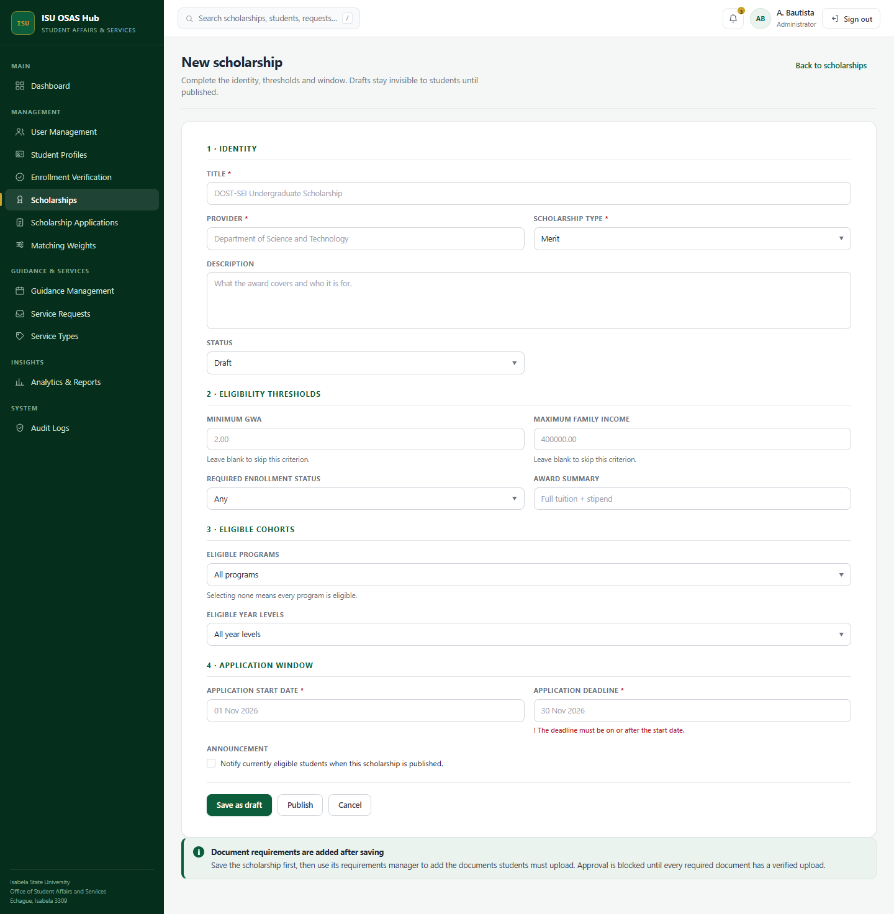

**Composition.** Page header, panel, form sections, notice.

**What this screen establishes**

1. Four sections: identity, eligibility thresholds, eligible cohorts, and schedule.
2. Every threshold is optional; a blank threshold means that criterion is not applied and is reported to students as not applicable.
3. Deadline must be on or after the start date, validated on both fields.
4. Programs and year levels are multi-selects; selecting none means all are eligible.
5. Status is chosen explicitly — saving as draft keeps the scholarship invisible to students.
6. Saving never publishes automatically; publication is a separate, audited action.

**Responsive behaviour**

| Viewport | Layout behaviour |
| --- | --- |
| Desktop 1440 | Two-column grid, sections separated by rules, sticky save bar. |
| Tablet 1024 | Two columns retained; multi-selects become full width. |
| Mobile 390 | Single column; save and cancel become a fixed bottom bar. |

### 7.6 MK-17 — Scholarships

| Field | Value |
| --- | --- |
| Role | Administrator |
| Base wireframe | `WF-A-08` — Scholarships |
| Route | `admin.scholarships.index` |
| Module | M06 |
| Requirements | FR-SCH-03, FR-SCH-04, FR-SCH-08 |
| File | `screens/admin/MK-17.html` |

**Purpose.** Manage the scholarship catalogue: create, publish, close, archive and announce a scholarship, and reach its document requirements.

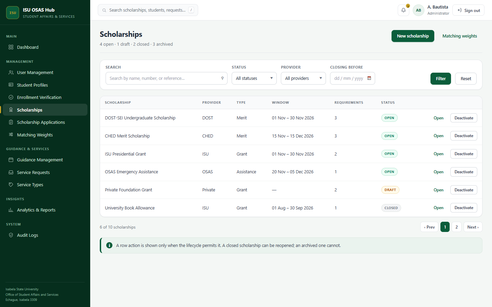

**Composition.** Page header, filter bar, record table, pagination, notice.

**What this screen establishes**

1. Status is grouped into draft, open, closed and archived, matching the lifecycle constants.
2. An open scholarship is visible to students only while today sits inside the application window; the window is shown next to the status.
3. Publish, deactivate and archive are row actions, each guarded by the lifecycle rules in force.
4. Announcement sends a notification only to students currently eligible for that scholarship.
5. The requirements count links to the requirements manager for that scholarship.
6. Archiving hides the scholarship from students but leaves historical applications intact.

**Responsive behaviour**

| Viewport | Layout behaviour |
| --- | --- |
| Desktop 1440 | Filter bar plus a seven-column table. |
| Tablet 1024 | Provider folds under the title; window becomes a secondary line. |
| Mobile 390 | Cards grouped by status with a status-coloured edge. |

### 7.7 MK-18 — Scholarship requirements manager

| Field | Value |
| --- | --- |
| Role | Administrator |
| Base wireframe | `WF-A-10` — Scholarship requirements manager |
| Route | `admin.scholarships.requirements.index` |
| Module | M06, M10 |
| Requirements | FR-SCH-05 |
| File | `screens/admin/MK-18.html` |

**Purpose.** Maintain the ordered list of documents a scholarship demands, and whether each one is required or optional.

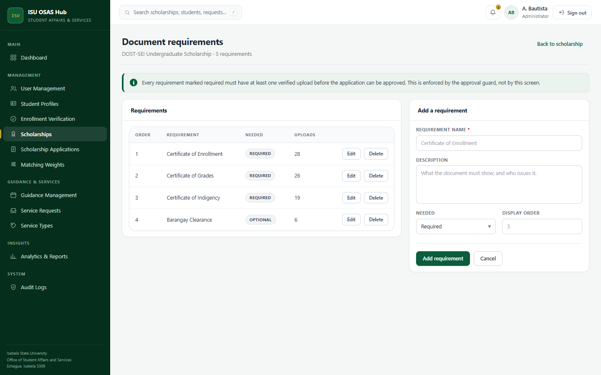

**Composition.** Page header, notice, two-panel split.

**What this screen establishes**

1. Each requirement has a name, an optional description, a required flag and a display order.
2. Display order controls the order students see on the application and the upload form.
3. A requirement marked required participates in the approval guard; an optional one never blocks approval.
4. Requirements can be edited while the scholarship is draft or open, but removing one that already has uploads warns first.
5. The count of uploaded documents per requirement is shown so the effect of removal is visible.
6. Deleting a requirement does not delete the scholarship; it only removes the demand.

**Responsive behaviour**

| Viewport | Layout behaviour |
| --- | --- |
| Desktop 1440 | Requirements table left, add form right. |
| Tablet 1024 | Add form moves above the table. |
| Mobile 390 | Each requirement becomes a card with reorder and delete actions. |

### 7.8 MK-23 — Matching weights

| Field | Value |
| --- | --- |
| Role | Administrator |
| Base wireframe | `WF-A-11` — Matching weights |
| Route | `admin.scholarship-matching.weights.edit` |
| Module | M08 |
| Requirements | FR-MATCH-02, FR-MATCH-03 |
| File | `screens/admin/MK-23.html` |

**Purpose.** Set the five weights that drive recommendation ranking, with a hard requirement that they total 100.

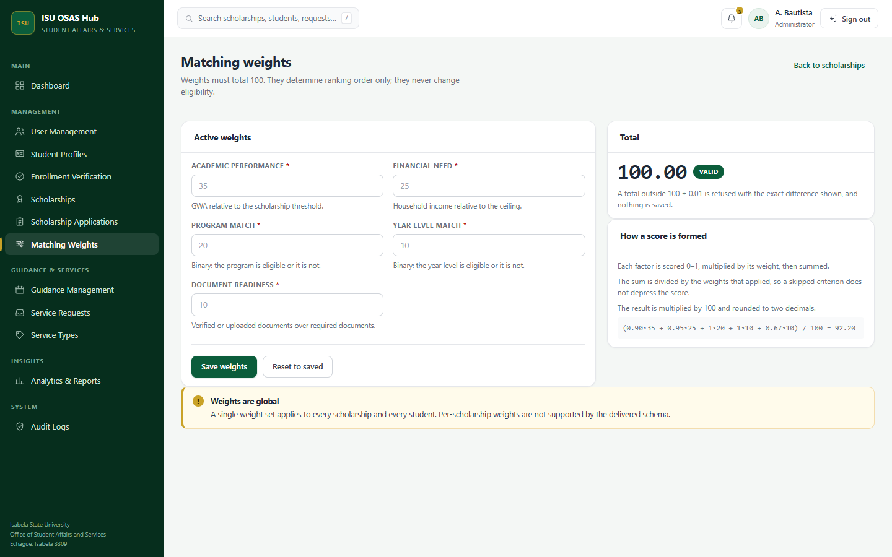

**Composition.** Page header, two-panel split, notice.

**What this screen establishes**

1. Five weights: academic, financial, program, year level and document readiness.
2. The live total is displayed and must equal 100, with a tolerance of 0.01; otherwise saving is refused.
3. Only one weight set is active at a time; saving supersedes the previous set.
4. The change is attributed to the signed-in administrator and time-stamped.
5. Weights affect ranking order, never eligibility — an ineligible scholarship stays ineligible whatever the weights.
6. A worked example shows how a 92% score is produced from the entered weights.

**Responsive behaviour**

| Viewport | Layout behaviour |
| --- | --- |
| Desktop 1440 | Weight form left with a live total badge, explanation right. |
| Tablet 1024 | Explanation stack moves below the form. |
| Mobile 390 | Weights become full-width rows with numeric steppers. |

### 7.9 MK-26 — Application review detail

| Field | Value |
| --- | --- |
| Role | Administrator |
| Base wireframe | `WF-A-13` — Application review detail |
| Route | `admin.scholarship-applications.show` |
| Module | M09, M10 |
| Requirements | FR-APP-07, FR-APP-08, FR-DOC-03, FR-DOC-04 |
| File | `screens/admin/MK-26.html` |

**Purpose.** Review one application, verify or reject each document, and advance the workflow only along transitions the state machine permits.

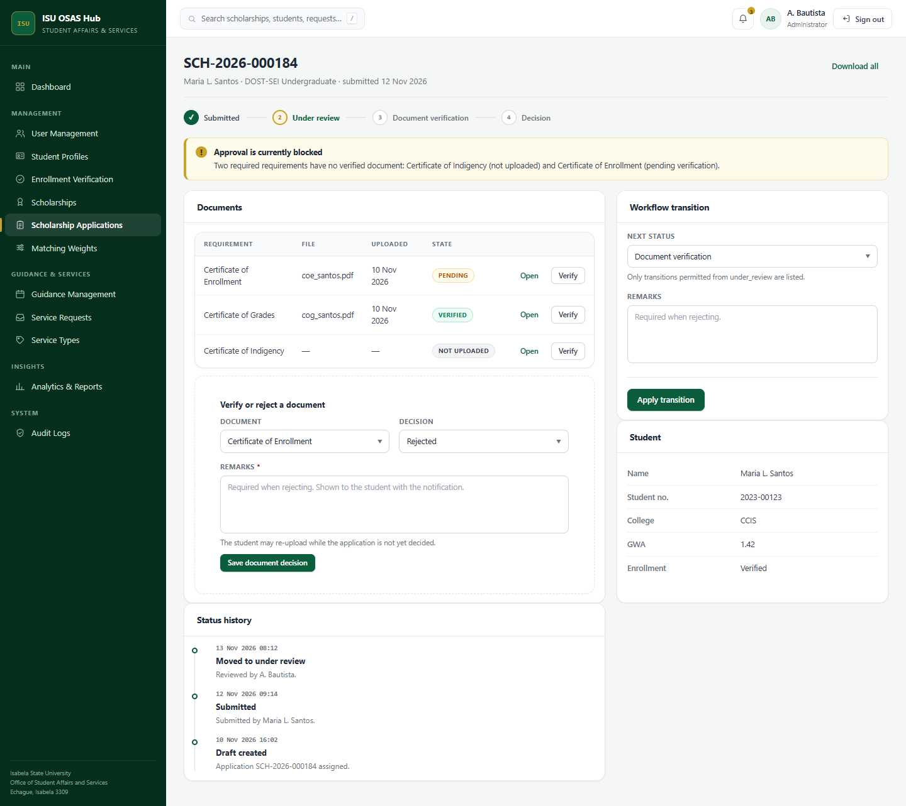

**Composition.** Page header, workflow stepper, notice, two-panel split.

**What this screen establishes**

1. The transition control offers only the targets allowed from the current state.
2. Approval is refused while any required requirement lacks a verified document, and the refusal lists each blocking requirement.
3. Document actions are verify and reject; rejection requires remarks that the student sees.
4. Documents are opened through an authorised stream, never a direct storage path.
5. Rejection of the application requires remarks; the requirement is enforced server-side as well.
6. The history panel is append-only and is the audit record for the decision.

**Responsive behaviour**

| Viewport | Layout behaviour |
| --- | --- |
| Desktop 1440 | Stepper and header, then a 2:1 split of documents and decision panel. |
| Tablet 1024 | Decision panel moves under the documents table. |
| Mobile 390 | Single column; each document becomes a card with verify and reject. |

### 7.10 MK-28 — Guidance appointment types

| Field | Value |
| --- | --- |
| Role | Administrator |
| Base wireframe | `WF-A-14` — Guidance appointment types |
| Route | `admin.guidance.types` |
| Module | M11 |
| Requirements | FR-GUID-03 |
| File | `screens/admin/MK-28.html` |

**Purpose.** Maintain the catalogue of appointment types, their default duration and the order in which students see them.

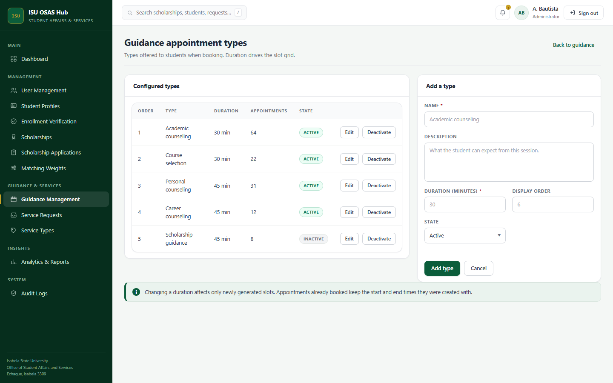

**Composition.** Page header, two-panel split, notice.

**What this screen establishes**

1. Each type has a name, a description, a duration in minutes, an active flag and a display order.
2. Duration is what the slot generator uses; changing it changes future slot grids but not existing appointments.
3. An inactive type disappears from the student booking form but remains on historical appointments.
4. Display order controls the order in the type selector, not the slot order.
5. A type with existing appointments cannot be deleted, only deactivated.
6. Duration must be a positive number of minutes within the office day.

**Responsive behaviour**

| Viewport | Layout behaviour |
| --- | --- |
| Desktop 1440 | Table left, create form right. |
| Tablet 1024 | Form moves above the table. |
| Mobile 390 | Each type becomes a card with edit and deactivate actions. |

### 7.11 MK-29 — Guidance scheduling settings

| Field | Value |
| --- | --- |
| Role | Administrator |
| Base wireframe | `WF-A-15` — Guidance scheduling settings |
| Route | `admin.guidance.settings` |
| Module | M11 |
| Requirements | FR-GUID-04 |
| File | `screens/admin/MK-29.html` |

**Purpose.** Set the office hours, default duration, minimum booking notice, cancellation notice and booking horizon used by the slot generator.

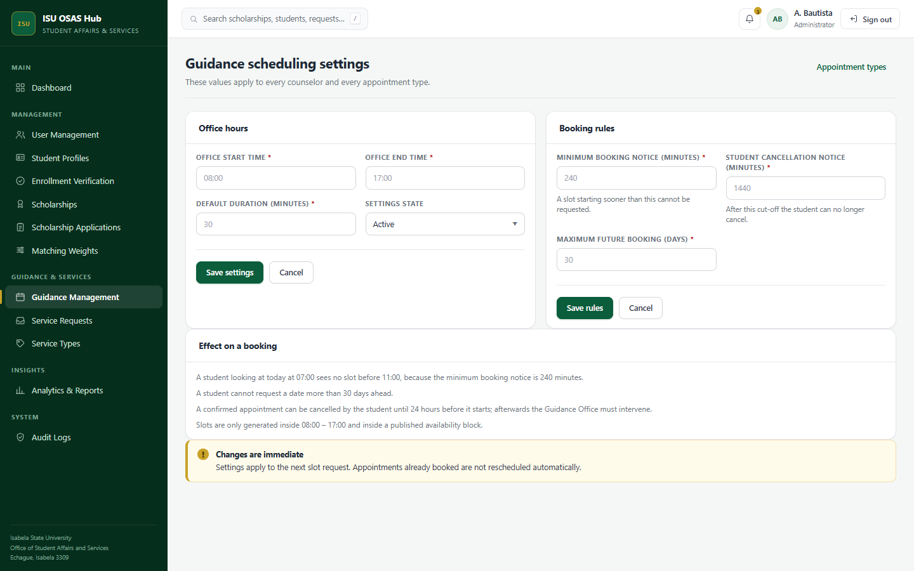

**Composition.** Page header, grid, panel, form sections, hand-composed layout, notice.

**What this screen establishes**

1. Office start must precede office end; both are time values on a 24-hour clock.
2. Default duration applies when an appointment type does not specify one.
3. Minimum booking notice prevents a student booking a slot a few minutes ahead.
4. Cancellation notice is the cut-off after which the student must contact the office.
5. Booking horizon caps how far ahead a slot can be requested.
6. Only one active settings row applies; saving supersedes the previous configuration.

**Responsive behaviour**

| Viewport | Layout behaviour |
| --- | --- |
| Desktop 1440 | Two setting cards side by side, save bar beneath. |
| Tablet 1024 | Cards stack vertically in the order they affect a booking. |
| Mobile 390 | Single column with the derived effect shown under each field. |

### 7.12 MK-34 — Guidance oversight

| Field | Value |
| --- | --- |
| Role | Administrator |
| Base wireframe | `WF-A-16` — Guidance oversight |
| Route | `admin.guidance.appointments` |
| Module | M11 |
| Requirements | FR-GUID-11 |
| File | `screens/admin/MK-34.html` |

**Purpose.** Give the administrator a read-only view of every appointment across all counselors for monitoring and reporting.

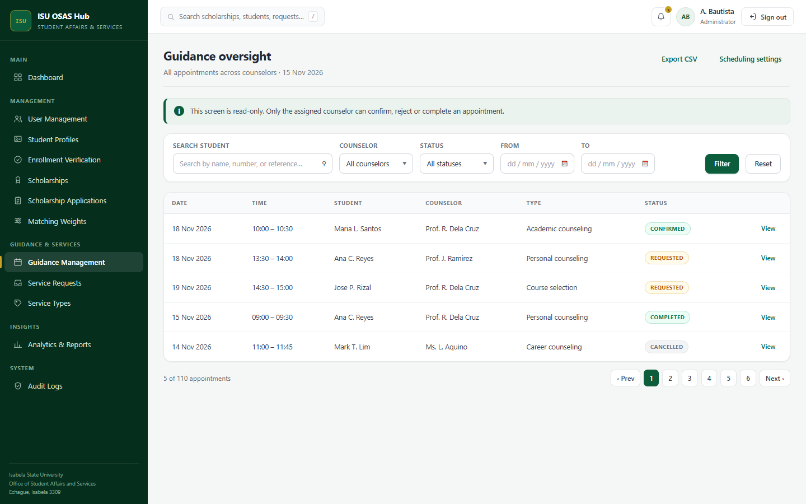

**Composition.** Page header, notice, filter bar, record table, pagination.

**What this screen establishes**

1. Unlike the counselor queue, this list is not scoped to one counselor.
2. Filters cover counselor, status, appointment type and date range.
3. The administrator does not confirm, reject or complete appointments; those decisions belong to the assigned counselor (GAP-08: administrative view is read-only).
4. Counselor notes are not rendered here; they remain private to the counselor.
5. Volume and no-show patterns are visible through status counts, not per-student commentary.
6. Export is offered for reporting; the export uses the same filters as the view.

**Responsive behaviour**

| Viewport | Layout behaviour |
| --- | --- |
| Desktop 1440 | Filter bar plus a seven-column table. |
| Tablet 1024 | Type folds under the counselor name. |
| Mobile 390 | Cards ordered by date, with status and counselor in the header. |

### 7.13 MK-36 — Service types

| Field | Value |
| --- | --- |
| Role | Administrator |
| Base wireframe | `WF-A-18` — Service types |
| Route | `admin.service-types.index` |
| Module | M12 |
| Requirements | FR-SVC-02 |
| File | `screens/admin/MK-36.html` |

**Purpose.** Maintain the OSAS service catalogue: what students can request, the instructions they see, and the attachments each service demands.

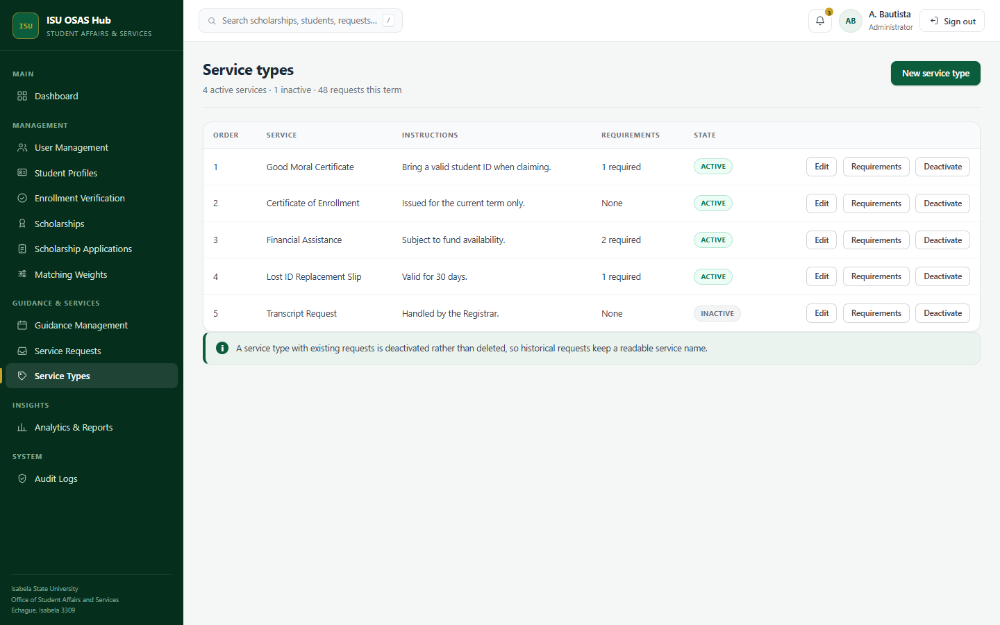

**Composition.** Page header, record table, notice.

**What this screen establishes**

1. Each type has a name, description, instructions, active flag, display order and a set of requirements.
2. Only active types appear in the student catalogue, ordered by display order.
3. The instructions field is shown verbatim to students, so it is written for them.
4. Requirement count is shown per type so the attachment burden is visible.
5. A type with existing requests cannot be deleted, only deactivated.
6. Display order is edited here, not by drag and drop, so the order is explicit and auditable.

**Responsive behaviour**

| Viewport | Layout behaviour |
| --- | --- |
| Desktop 1440 | Table with a requirements column and row actions. |
| Tablet 1024 | Instructions preview folds into a tooltip-style secondary line. |
| Mobile 390 | Cards with the requirement count as a badge. |

### 7.14 MK-39 — Service request detail and assignment

| Field | Value |
| --- | --- |
| Role | Administrator |
| Base wireframe | `WF-A-21` — Service request detail and assignment |
| Route | `admin.student-service-requests.show` |
| Module | M12 |
| Requirements | FR-SVC-06, FR-SVC-07 |
| File | `screens/admin/MK-39.html` |

**Purpose.** Process one request: assign a handler, read the student's documents, record remarks and advance the request along a permitted transition.

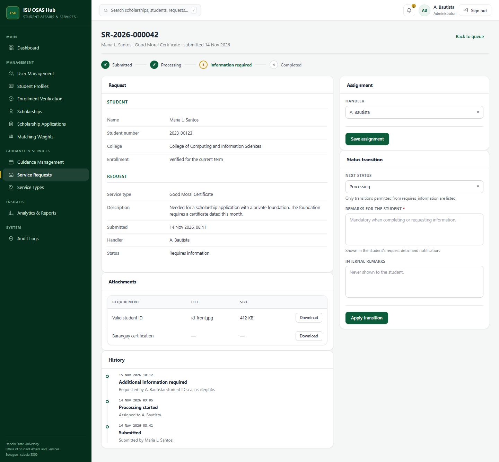

**Composition.** Page header, workflow stepper, two-panel split.

**What this screen establishes**

1. Assigning a handler and changing status are separate controls because they are separate decisions.
2. Remarks are mandatory when moving to requires_information or completed; the form states this before submission.
3. Student-visible remarks and internal remarks are separate fields; the student never sees the internal field.
4. Only transitions permitted by the request state machine are listed.
5. Attachments are downloadable through an authorised route; no storage path is shown.
6. Completion and cancellation stamp a timestamp and the acting user.

**Responsive behaviour**

| Viewport | Layout behaviour |
| --- | --- |
| Desktop 1440 | Details and documents left, processing panel right. |
| Tablet 1024 | Processing panel moves below the documents. |
| Mobile 390 | Single column; status and handler actions come first. |

### 7.15 MK-40 — Analytics overview

| Field | Value |
| --- | --- |
| Role | Administrator |
| Base wireframe | `WF-A-24` — Analytics overview |
| Route | `admin.analytics.index` |
| Module | M14 |
| Requirements | FR-ANLYT-01, FR-ANLYT-05, FR-ANLYT-06 |
| File | `screens/admin/MK-40.html` |

**Purpose.** Present volume and outcome metrics across scholarships, guidance and services for a chosen period, with an export of the same filtered dataset.

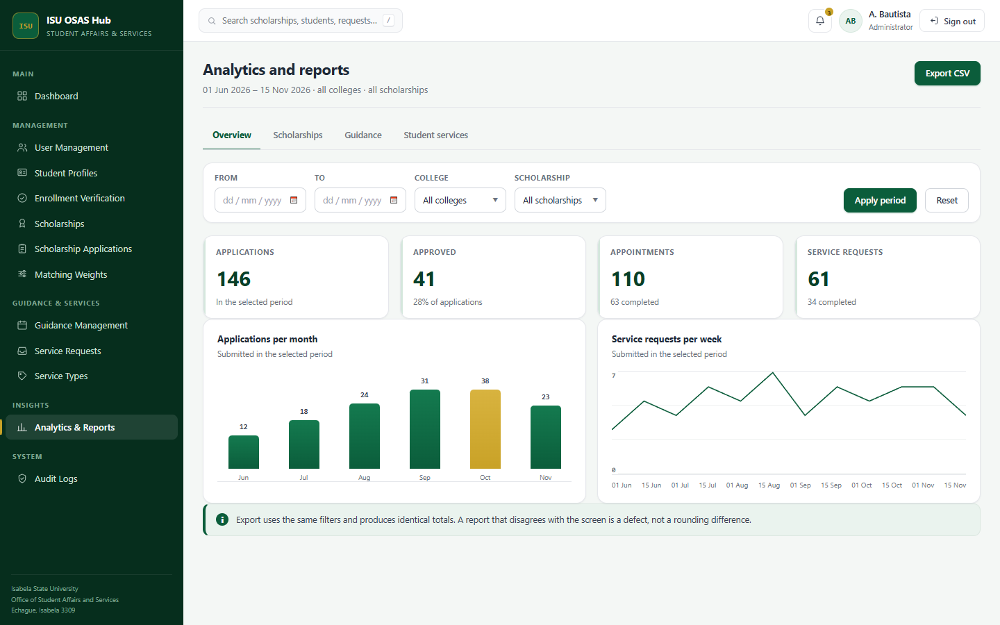

**Composition.** Page header, tabs, filter bar, summary tiles, grid, charts, notice.

**What this screen establishes**

1. The period filter is the primary control and applies to every figure on the screen.
2. Summary cards are counts, not rates, so they can be reconciled with the queues.
3. Tabs switch between the three analytical views without losing the period filter.
4. Export produces exactly the dataset on screen for the active period and tab.
5. Charts are descriptive only; no forecasting is claimed.
6. An invalid range is refused with an explicit message rather than silently defaulting.

**Responsive behaviour**

| Viewport | Layout behaviour |
| --- | --- |
| Desktop 1440 | Period filter bar, four cards, then two charts side by side. |
| Tablet 1024 | Cards in two columns; charts stack. |
| Mobile 390 | Single column; charts scroll horizontally where a series is dense. |

### 7.16 MK-41 — Analytics — scholarships

| Field | Value |
| --- | --- |
| Role | Administrator |
| Base wireframe | `WF-A-25` — Analytics — scholarships |
| Route | `admin.analytics.scholarships` |
| Module | M14 |
| Requirements | FR-ANLYT-02 |
| File | `screens/admin/MK-41.html` |

**Purpose.** Break application volume and outcomes down by scholarship, provider and status for the selected period.

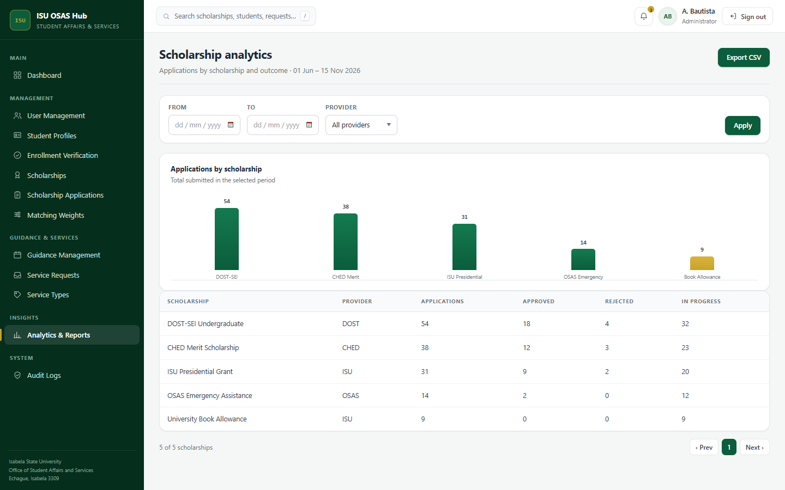

**Composition.** Page header, filter bar, charts, record table, pagination.

**What this screen establishes**

1. The same period filter as the overview applies and is carried in the URL.
2. Table rows are scholarships; columns are volume, and counts per status.
3. Counts per status sum to the volume for that scholarship.
4. Provider grouping is available because providers request their own reports.
5. No student-level data appears on this screen; it is aggregate only.
6. Export matches the table exactly.

**Responsive behaviour**

| Viewport | Layout behaviour |
| --- | --- |
| Desktop 1440 | Chart above, full-width table below. |
| Tablet 1024 | Table scrolls horizontally; scholarship column pinned. |
| Mobile 390 | One card per scholarship with status counts as a compact grid. |

### 7.17 MK-42 — Analytics — guidance

| Field | Value |
| --- | --- |
| Role | Administrator |
| Base wireframe | `WF-A-26` — Analytics — guidance |
| Route | `admin.analytics.guidance` |
| Module | M14 |
| Requirements | FR-ANLYT-03 |
| File | `screens/admin/MK-42.html` |

**Purpose.** Show appointment volume and outcomes by type, counselor and status for the selected period.

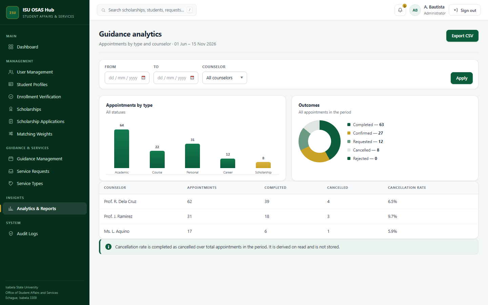

**Composition.** Page header, filter bar, grid, charts, record table, notice.

**What this screen establishes**

1. Outcome split reflects the appointment state machine: requested, confirmed, completed, rejected, cancelled.
2. Counselor breakdown supports workload review; it contains no per-student detail.
3. Type breakdown shows which services students actually use.
4. Cancellation rate is derived and labelled as derived, not stored.
5. The period filter is shared with the other analytics tabs.
6. Export matches the on-screen table.

**Responsive behaviour**

| Viewport | Layout behaviour |
| --- | --- |
| Desktop 1440 | Two charts side by side, then a counselor table. |
| Tablet 1024 | Charts stack; table scrolls horizontally. |
| Mobile 390 | One chart at a time with the table rendered as cards. |

### 7.18 MK-43 — Analytics — student services

| Field | Value |
| --- | --- |
| Role | Administrator |
| Base wireframe | `WF-A-27` — Analytics — student services |
| Route | `admin.analytics.services` |
| Module | M14 |
| Requirements | FR-ANLYT-04 |
| File | `screens/admin/MK-43.html` |

**Purpose.** Show service-request volume by service type and status, including the proportion that needed further information.

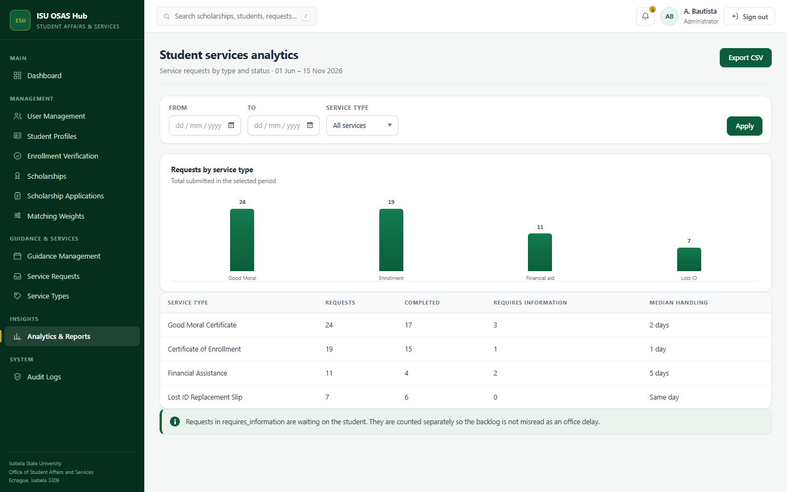

**Composition.** Page header, filter bar, charts, record table, notice.

**What this screen establishes**

1. Volume is grouped by service type, then split by current status.
2. The requires_information count is highlighted because it represents work waiting on a student, not on the office.
3. Median handling time is shown only where the sample is large enough to be meaningful.
4. The period filter is shared with the other analytics tabs.
5. No handler-level performance ranking is produced; the data is operational, not evaluative.
6. Export matches the on-screen table.

**Responsive behaviour**

| Viewport | Layout behaviour |
| --- | --- |
| Desktop 1440 | Bar chart above a five-column table. |
| Tablet 1024 | Table scrolls horizontally. |
| Mobile 390 | One card per service type with status counts. |

### 7.19 MK-44 — Audit log

| Field | Value |
| --- | --- |
| Role | Administrator |
| Base wireframe | `WF-A-22` — Audit log |
| Route | `admin.audit-logs.index` |
| Module | M15 |
| Requirements | FR-AUDIT-01, FR-AUDIT-02, FR-AUDIT-03 |
| File | `screens/admin/MK-44.html` |

**Purpose.** Provide a searchable, append-only record of security-relevant and state-changing actions, filterable by actor, action and module.

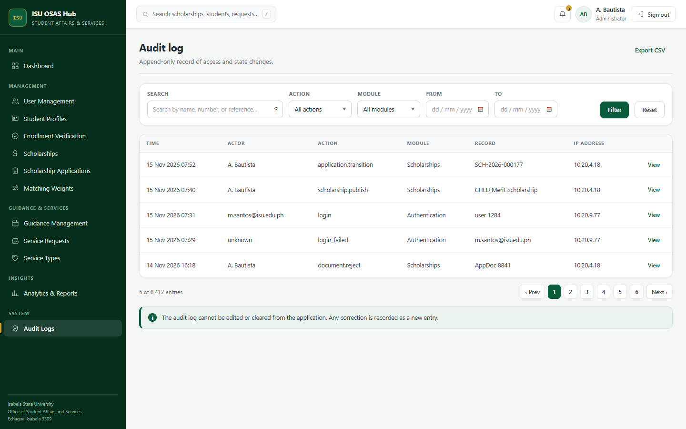

**Composition.** Page header, filter bar, record table, pagination, notice.

**What this screen establishes**

1. Columns are time, actor, action, module, record and IP address.
2. Filters cover date range, actor, action and module; the search box matches the record description.
3. The log is read-only: no row can be edited or deleted from any screen.
4. Login failures, blocked inactive logins, password resets and workflow transitions are all recorded.
5. Record identifiers are shown but are not links, because the target may since have been deleted or moved out of scope.
6. Retention is a database concern; the screen does not offer pruning.

**Responsive behaviour**

| Viewport | Layout behaviour |
| --- | --- |
| Desktop 1440 | Filter bar plus a six-column table. |
| Tablet 1024 | IP address folds under the actor. |
| Mobile 390 | Cards with action, actor and timestamp; description wraps. |

### 7.20 MK-45 — Audit log detail

| Field | Value |
| --- | --- |
| Role | Administrator |
| Base wireframe | `WF-A-23` — Audit log detail |
| Route | `admin.audit-logs.show` |
| Module | M15 |
| Requirements | FR-AUDIT-04 |
| File | `screens/admin/MK-45.html` |

**Purpose.** Show one audit entry in full, including the request context captured with it.

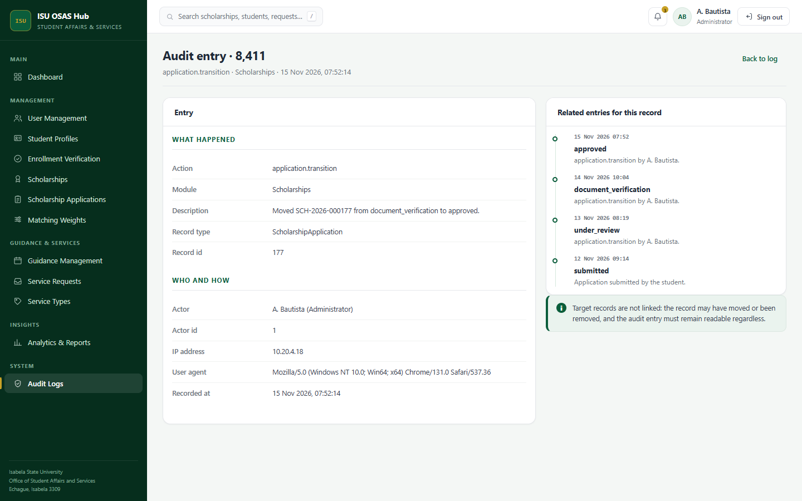

**Composition.** Page header, two-panel split.

**What this screen establishes**

1. All captured context is shown: actor, action, module, record type and id, description, IP address, user agent and timestamp.
2. The description is displayed as stored, without interpretation.
3. The entry cannot be modified or deleted; there are no actions on this screen.
4. Related entries for the same record can be listed to reconstruct a sequence.
5. A missing or deleted target record is stated plainly rather than shown as an error.
6. IP address and user agent are shown because they are part of the security record.

**Responsive behaviour**

| Viewport | Layout behaviour |
| --- | --- |
| Desktop 1440 | Definition list left, related entries right. |
| Tablet 1024 | Related entries move below. |
| Mobile 390 | Single column, label above value. |

<!-- pagebreak -->

## 8. Responsive behaviour and evidence

### 8.1 Rules, not variants

Every screen is one HTML file with a container query. The three widths are three renders of the same document, so a change to a structure is a change at every width by construction. The rules are:

| At | What changes | What never changes |
| --- | --- | --- |
| 1440 px | Two- and three-column grids; six tiles in two rows; persistent sidebar. | Everything else in the layout. |
| 1024 px | Sidebar leaves the flow behind a menu toggle; grids of three fall to two; split panels stack. | Column order, labels, statuses, actions. |
| 390 px | Single column; the search field is dropped; tables restack with column labels; the pager range takes its own row; page actions move under the title. | The information itself — every field still present. |

### 8.2 Evidence

### 8.3 MK-46 at 1440 px

The showcase: the student dashboard rendered at 1440, 1024 and 390 px in one frame. The desktop column keeps six tiles in two rows; the tablet column drops the sidebar and halves the grid; the phone column is a single stack.

### 8.4 MK-01 at 390 px

Login at 390 px: the brand panel moves above the form, the primary action becomes full width, and the failure message — if present — sits under the field it belongs to.

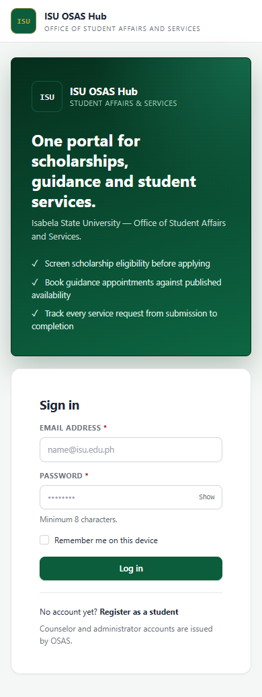

### 8.5 MK-09 at 390 px

An application with documents at 390 px: the identity block, the document checklist and the status history stack in reading order, and no control is lost with the columns.

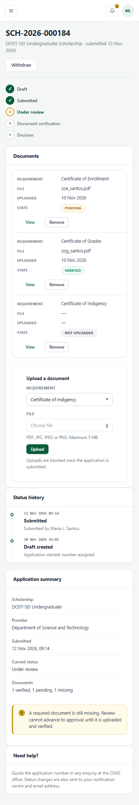

### 8.6 MK-44 at 390 px

The audit log at 390 px: the densest table in the set restacks into one labelled block per entry, keeping actor, action, module, record and address together.

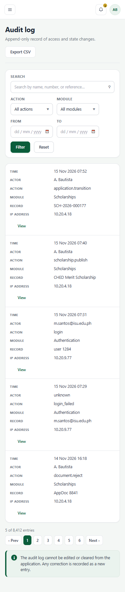

### 8.7 MK-31 at 1024 px

Slot booking at 1024 px: the counselor list becomes a two-column grid and the booking panel sits beneath it rather than beside it.

<!-- pagebreak -->

## 9. Coverage, omissions and open items

### 9.1 Traceability summary

| Measure | Count |
| --- | --- |
| Requirements in the register | 153 |
| Requirements traced to at least one mockup | 109 |
| Functional requirements without a mockup | 11 |
| Non-functional requirements without a mockup | 33 |
| Screens | 46 |

Of the 153 requirements, 146 are implemented, 1 are partially implemented and 6 are proposed. No proposed requirement is drawn; the mockups show only what the delivered code does.

### 9.2 Functional requirements without a mockup

A screen was deliberately not drawn in each of the following cases. Six are proposed capabilities with no route; five are implemented but have no interface of their own, because they are a rule, a backfill or a guard rather than a place a user visits.

| ID | Requirement | Status | Why there is no screen |
| --- | --- | --- | --- |
| FR-AUTH-09 | Legacy account verification backfill | Implemented | A data backfill performed at deployment; nothing is displayed. |
| FR-AUTH-10 | Self-service password reset | Proposed | Proposed. The login screen omits a reset link because no self-service route exists (GAP-05). |
| FR-ENR-02 | Verification request intake | Proposed | Proposed. The queue and decision screens exist, but nothing creates the record (GAP-01). |
| FR-ENR-06 | Legacy account exemption | Implemented | A gate that passes silently for legacy accounts; no visible state. |
| FR-APP-11 | Withdraw application | Proposed | Proposed. The status value is reserved but no transition exists (GAP-10). |
| FR-GUID-13 | Session notes authoring | Proposed | Proposed. Notes are displayed where they exist; no authoring form exists (GAP-04). |
| FR-GUID-14 | Rescheduling | Proposed | Proposed. A confirmed appointment cannot be moved. |
| FR-SVC-10 | Counselor request handling | Proposed | Proposed. Counselor service-request routes do not exist (GAP-03). |
| FR-NOTIF-02 | Suppress duplicate notifications | Implemented | A duplicate-suppression rule applied before a notification is created; it has no screen. |
| FR-AUDIT-05 | Audit immutability | Implemented | An absence of routes. The audit log screen shows no edit or delete control, which is the visible form of the requirement. |
| FR-SEARCH-03 | Input normalization and bounds | Implemented | Input normalisation performed on submit; the only visible effect is an ordinary result set. |

### 9.3 Non-functional requirements

The 33 non-functional requirements are not drawn because a single frame cannot evidence a runtime property. Their verification method is inspection or test, and the traceability matrix names the test for each.

| Group | Count | What the mockups do contribute |
| --- | --- | --- |
| Performance (`NFR-PERF`) | 4 | Pagination, server-side filters and a pager range on every list screen. |
| Security (`NFR-SEC`) | 8 | No screen offers an action the authorisation layer would refuse; destructive actions are separated and confirmed. |
| Usability (`NFR-USA`) | 4 | Consistent navigation, labels and status vocabulary across all 46 screens. |
| Reliability (`NFR-REL`) | 4 | Notices state what happened after a failed operation and what to do next. |
| Maintainability (`NFR-MAINT`) | 3 | One renderer and one stylesheet; a component is changed in one place. |
| Compatibility (`NFR-COMPAT`) | 3 | Container-based layout, no fixed pixel canvas; renders in the supported browsers. |
| Portability (`NFR-PORT`) | 2 | The three captured widths are the portability evidence. |
| Accessibility (`NFR-ACC`) | 2 | Measured contrast, visible focus, word-plus-colour status, labelled controls. |
| Data integrity (`NFR-DATA`) | 3 | Status badges are bound to stored values; no screen displays a status the workflow cannot produce. |

### 9.4 Gaps carried from the audit

The read-only audit recorded twelve gaps between intent and implementation. The mockups neither hide nor repair them: a gap that would change what a user sees is described here and left out of the screens.

| Gap | Finding | Effect on this deliverable |
| --- | --- | --- |
| GAP-01 | No intake for enrollment verification records | The counselor queue and decision screen are drawn (MK-14, MK-15); no screen creates the record, so none is drawn. |
| GAP-02 | Students with no verification record bypass the gate | Invisible in a design: the gate passes silently, so no screen state would reveal it. |
| GAP-03 | Counselors cannot process service requests | The administrator request queue (MK-39) is drawn; the counselor counterpart does not exist and is not drawn. |
| GAP-04 | Session and student notes cannot be authored | Notes are displayed where they exist; no authoring form is drawn because no route accepts one. |
| GAP-05 | No self-service password reset | The login screen deliberately omits a reset link (MK-01); the administrator reset is drawn instead (MK-06). |
| GAP-06 | Guidance seeder is not registered | Data seeding, not interface: no screen is affected. |
| GAP-07 | Seeded scholarship dates have expired | Mockup data uses current dates; the seeding defect is recorded in the SRS, not designed around. |
| GAP-08 | Administrator guidance screens are read-only | Admin appointment oversight (MK-34) shows no decision controls, which is what the code permits. |
| GAP-09 | A rejected application blocks re-application | The student application list (MK-24) shows no re-apply action. |
| GAP-10 | 'Withdrawn' exists in the badge map but not in the workflow | The badge is defined in the design system; no mockup shows a withdrawal action. |
| GAP-11 | Dual appointment-type schema | Schema, not interface: the screens show one label. |
| GAP-12 | Duplicate search-index migrations | Schema: no interface consequence. |

### 9.5 Assumptions and confirmations needed

| # | Assumption or question | Consequence if wrong |
| --- | --- | --- |
| A1 | The three roles in the code — student, counselor, administrator — are the complete role set. No adviser, OSAS staff or super-administrator role exists. | Any screen for a fourth role would have to be designed and built, not restyled. |
| A2 | Institutional green and university gold are the correct brand colours for the office. | The palette is one token block; a change is mechanical. |
| A3 | Segoe UI is acceptable as the primary face. | The stack falls back to the platform UI font with no layout change. |
| A4 | A 1024 px viewport is treated as tablet, so the sidebar collapses there. | At exactly 1024 px the delivered stylesheet may still show the sidebar; the 1 px difference is documented in the wireframe set. |
| A5 | Representative data is acceptable in a defence document. | Real records would require a data-handling agreement and redaction. |
| A6 | No Figma file is expected. | The HTML and CSS set is the authoritative source; a Figma file would become a second source of truth. |

### 9.6 Deliberate differences from the delivered interface

Three differences are intentional and are not defects:

1. **Table restacking.** The delivered tables scroll horizontally at narrow widths. The mockups restack each row with its column label so that every field is visible in a static capture. The wireframes use the same device, which keeps the two sets comparable.
2. **The 1024 px sidebar.** The mockups treat 1024 px as tablet and collapse the sidebar. The delivered stylesheet switches at 1024 px, so a browser at exactly that width may still show it.
3. **Representative content.** Names, amounts and dates are illustrative and internally consistent, not production records.

<!-- pagebreak -->

## 10. Reproduction

1. `python documentation/_tools/build_mockups.py` regenerates all 46 screens, the design system page, the plate, the gallery and `_manifest.csv`. The build fails if a mockup's base screen is not in its own requirement trace, if identifiers do not form the expected set MK-01 to MK-46, or if two mockups share an identifier.
2. `node documentation/_tools/shoot_wireframes.cjs documentation/UI-UX-Mockups/screens documentation/UI-UX-Mockups/export` regenerates the 138 screenshots. A screenshot is skipped when it is newer than its source file.
3. `python documentation/_tools/build_mockups_doc.py` regenerates this document and its DOCX.

The screens and this document are generated from the same inputs, so the document cannot describe a screen that was not built. Where a number appears in the text — 46 screens, 109 traced requirements, four role groups — it is computed from the registry at build time.
