# Low-Fidelity Wireframes

**ISU OSAS Hub — Integrated Student Affairs and Services Management System**

Isabela State University · Office of Student Affairs and Services

| Item | Details |
| --- | --- |
| Deliverable | Final wireframe set |
| Screens | 58 screens across four role groups |
| Format | Standalone HTML, one file per screen |
| Source | `documentation/_tools/wf_pages_*.py` (declarative page specs) |
| Rendered | `documentation/Wireframes/{shared,student,counselor,admin}/` |
| Screenshots | `documentation/Wireframes/export/` at 1440, 1024 and 390 px |
| Basis | Read-only audit of `routes/web.php`, `resources/views/` and `public/css/app.css` |
| Version | 1.0 |
| Date | 15 November 2026 |

> These are structural specifications, not visual designs. Colour is deliberately absent so that hierarchy, labelling and control placement can be reviewed without the distraction of brand styling. Screens are arranged for the three roles that actually exist in the delivered system: student, counselor and administrator.

<!-- pagebreak -->

## Contents

<!-- toc -->

<!-- pagebreak -->

## 1. Purpose and method

A wireframe answers a narrower question than a mockup: what is on the screen, in what order, and what can the user do next. Every screen in this set corresponds to a route that exists in the delivered application, and every control corresponds to an action the code actually performs. Nothing here is aspirational.

The set was generated from declarative page specifications rather than hand-drawn. Each specification names the route, the module, the requirement identifiers, the content blocks and the responsive behaviour. A single renderer turns the specification into an HTML file that shares one shell, one type scale and one component vocabulary with every other screen. Three consequences follow:

1. **Consistency is structural, not manual.** The sidebar, top bar and content frame cannot drift between screens because they are emitted from one function.
2. **Traceability is mechanical.** Requirement identifiers are read from the same registry that produces the traceability matrix, so a screen cannot cite a requirement that does not exist.
3. **Responsiveness is demonstrated, not asserted.** The frame is a CSS container, so the desktop, tablet and phone layouts are produced by the same file and can be inspected by changing the viewport rather than by trusting a description.

### 1.1 Reading a screen

Each screen carries a header strip with its identifier, its title, the role that can open it, the route name and the requirements it satisfies. Below the frame, an annotation panel lists the design decisions that a reviewer would otherwise have to infer, and a table states how the layout reflows at each viewport.

The frame itself uses a fixed 264 px sidebar and a 60 px top bar, mirroring the real `components/navigation/sidebar` and `topbar` components. Navigation labels are reproduced verbatim from those components, so a link that appears in the wireframe is a link that exists.

### 1.2 Fidelity rules

| Rule | Applied as |
| --- | --- |
| No colour | Greyscale only; the darkest fill means primary action or active state. |
| Real labels | Controls are labelled with the words the system uses, never with placeholder lorem ipsum. |
| Real data shapes | Identifiers such as `SCH-2026-000184` and `SR-2026-000042` follow the real numbering formats. |
| Real states | Status badges use the vocabulary of the state machines, not invented labels. |
| No invented features | A control appears only where a route and a handler exist; proposed features are described in section 8, not drawn. |
| Readable at three widths | Every screen is exported at 1440, 1024 and 390 px. |

### 1.3 Screen inventory

| ID | Screen | Role | Route | Requirements |
| --- | --- | --- | --- | --- |
| WF-G-01 | Login | Guest | `login` | FR-AUTH-01, FR-AUTH-02, FR-AUTH-07, FR-AUTH-08, NFR-SEC-02, NFR-ACC-02 |
| WF-G-02 | Student registration | Guest | `register` | FR-AUTH-04, FR-PROF-01, NFR-USA-02 |
| WF-G-03 | Email verification (OTP) | Guest | `verification.notice` | FR-AUTH-05, FR-AUTH-06, FR-AUTH-09, NFR-SEC-07 |
| WF-G-04 | Access denied and not found | Guest | `— (errors/403, errors/404)` | FR-RBAC-02, NFR-SEC-03 |
| WF-G-05 | Notification centre | Student | `notifications.index` | FR-APP-10, FR-GUID-12, FR-NOTIF-01, FR-NOTIF-02, FR-NOTIF-03, FR-NOTIF-04, FR-NOTIF-05, NFR-PERF-04, NFR-ACC-03 |
| WF-G-06 | Application shell (sidebar and top bar) | Student | `— (layouts/app, components/navigation/*)` | FR-AUTH-03, FR-RBAC-03, FR-RBAC-06, FR-NOTIF-06, FR-SEARCH-01, FR-SEARCH-03, NFR-USA-01, NFR-MAINT-03, NFR-PORT-01, NFR-ACC-01, NFR-ACC-04 |
| WF-S-01 | Student dashboard | Student | `student.dashboard` | FR-ENR-05, FR-ENR-06 |
| WF-S-02 | My profile (view) | Student | `student.profile.show` | FR-PROF-02, FR-PASS-03, FR-ENR-02 |
| WF-S-03 | Edit profile | Student | `student.profile.edit` | FR-PROF-03 |
| WF-S-04 | Profile security and passcode | Student | `student.profile.security` | FR-PASS-01, FR-PASS-02, FR-PASS-03, NFR-SEC-05 |
| WF-S-05 | Browse scholarships | Student | `student.scholarships.index` | FR-SCH-06, FR-SCH-07, FR-SEARCH-02 |
| WF-S-06 | Scholarship detail | Student | `student.scholarships.show` | FR-SCH-09, FR-APP-01, FR-APP-03 |
| WF-S-07 | Eligibility preview | Student | `student.scholarships.eligibility` | FR-ELIG-01, FR-ELIG-02, FR-ELIG-03, FR-ELIG-04 |
| WF-S-08 | Recommended scholarships | Student | `student.scholarships.recommendations` | FR-MATCH-04, FR-MATCH-05 |
| WF-S-09 | Full match list | Student | `student.scholarships.matches` | FR-MATCH-01, FR-MATCH-05, FR-MATCH-06 |
| WF-S-10 | My applications | Student | `student.applications.index` | FR-APP-02, NFR-USA-05, NFR-DATA-03 |
| WF-S-11 | Application detail and documents | Student | `student.applications.show` | FR-RBAC-05, FR-APP-04, FR-APP-05, FR-APP-09, FR-APP-11, FR-DOC-01, FR-DOC-02, FR-DOC-05, NFR-SEC-04, NFR-SEC-06 |
| WF-S-12 | Guidance counselors | Student | `student.guidance.counselors` | FR-GUID-05 |
| WF-S-13 | Appointment slots and booking | Student | `student.guidance.slots` | FR-GUID-06, FR-GUID-07, FR-GUID-08 |
| WF-S-14 | My appointments | Student | `student.guidance.appointments` | FR-GUID-07, FR-GUID-10, FR-GUID-12 |
| WF-S-15 | Appointment detail | Student | `student.guidance.appointments.show` | FR-GUID-10, FR-GUID-14 |
| WF-S-16 | Service catalogue | Student | `student.services.catalog` | FR-SVC-01 |
| WF-S-17 | New service request | Student | `student.services.create` | FR-SVC-03 |
| WF-S-18 | My service requests | Student | `student.services.index` | FR-SVC-04, FR-SVC-05 |
| WF-S-19 | Service request detail | Student | `student.services.show` | FR-SVC-05, FR-SVC-08, FR-SVC-09 |
| WF-C-01 | Counselor dashboard | Counselor | `counselor.dashboard` | FR-SVC-10 |
| WF-C-02 | Weekly availability | Counselor | `counselor.guidance.availability` | FR-GUID-01, FR-GUID-02 |
| WF-C-03 | Appointment queue | Counselor | `counselor.guidance.appointments` | FR-GUID-09, FR-GUID-11, NFR-PERF-03 |
| WF-C-04 | Appointment detail and decisions | Counselor | `counselor.guidance.appointments.show` | FR-GUID-09, FR-GUID-13 |
| WF-C-05 | Enrollment verification queue | Counselor | `enrollment-verifications.index` | FR-RBAC-04, FR-ENR-01, FR-ENR-04 |
| WF-C-06 | Enrollment verification review | Counselor | `enrollment-verifications.show` | FR-ENR-03 |
| WF-A-01 | Administrator dashboard | Administrator | `admin.dashboard` | FR-ANLYT-01, NFR-PERF-01 |
| WF-A-02 | User accounts | Administrator | `admin.users.index` | FR-PROF-07, NFR-PERF-03 |
| WF-A-03 | User create and edit | Administrator | `admin.users.create / admin.users.edit` | FR-RBAC-01, FR-PROF-06 |
| WF-A-04 | Administrator-initiated password reset | Administrator | `admin.users.reset-password` | FR-AUTH-10, FR-PROF-08 |
| WF-A-05 | Student profiles | Administrator | `admin.student-profiles.index` | FR-PROF-04 |
| WF-A-06 | Student profile detail | Administrator | `admin.student-profiles.show` | FR-PROF-05, FR-PASS-04 |
| WF-A-07 | Student profile edit | Administrator | `admin.student-profiles.edit` | FR-PROF-05 |
| WF-A-08 | Scholarships | Administrator | `admin.scholarships.index` | FR-SCH-03, FR-SCH-04, FR-SCH-08 |
| WF-A-09 | Scholarship create and edit | Administrator | `admin.scholarships.create / admin.scholarships.edit` | FR-SCH-01, FR-SCH-02 |
| WF-A-10 | Scholarship requirements manager | Administrator | `admin.scholarships.requirements.index` | FR-SCH-05 |
| WF-A-11 | Matching weights | Administrator | `admin.scholarship-matching.weights.edit` | FR-MATCH-02, FR-MATCH-03 |
| WF-A-12 | Application review queue | Administrator | `admin.scholarship-applications.index` | FR-APP-06, NFR-PERF-02, NFR-USA-03 |
| WF-A-13 | Application review detail | Administrator | `admin.scholarship-applications.show` | FR-APP-07, FR-APP-08, FR-APP-09, FR-DOC-03, FR-DOC-04, NFR-USA-06, NFR-REL-03 |
| WF-A-14 | Guidance appointment types | Administrator | `admin.guidance.types` | FR-GUID-03 |
| WF-A-15 | Guidance scheduling settings | Administrator | `admin.guidance.settings` | FR-GUID-04 |
| WF-A-16 | Guidance oversight | Administrator | `admin.guidance.appointments` | FR-GUID-11 |
| WF-A-17 | Guidance oversight detail | Administrator | `admin.guidance.appointments.show` | FR-GUID-11 |
| WF-A-18 | Service types | Administrator | `admin.service-types.index` | FR-SVC-02 |
| WF-A-19 | Service type create and edit | Administrator | `admin.service-types.create / admin.service-types.edit` | FR-SVC-02 |
| WF-A-20 | Service request queue | Administrator | `admin.student-service-requests.index` | FR-SVC-06 |
| WF-A-21 | Service request detail and assignment | Administrator | `admin.student-service-requests.show` | FR-SVC-06, FR-SVC-07, NFR-USA-04 |
| WF-A-22 | Audit log | Administrator | `admin.audit-logs.index` | FR-AUDIT-01, FR-AUDIT-02, FR-AUDIT-03, FR-AUDIT-05, NFR-SEC-08 |
| WF-A-23 | Audit log detail | Administrator | `admin.audit-logs.show` | FR-AUDIT-04 |
| WF-A-24 | Analytics overview | Administrator | `admin.analytics.index` | FR-ANLYT-01, FR-ANLYT-05, FR-ANLYT-06 |
| WF-A-25 | Analytics — scholarships | Administrator | `admin.analytics.scholarships` | FR-ANLYT-02 |
| WF-A-26 | Analytics — guidance | Administrator | `admin.analytics.guidance` | FR-ANLYT-03 |
| WF-A-27 | Analytics — student services | Administrator | `admin.analytics.services` | FR-ANLYT-04 |

<!-- pagebreak -->

## 2. Shared frame and component vocabulary

The application shell is the same on every authenticated screen: a 264 px sidebar carrying role-appropriate sections, a 60 px top bar carrying navigation, search, notifications and the account chip, and a single main region. Below 1025 px the sidebar leaves the flow and the menu toggle reveals it as an overlay; the top bar drops the search field at phone width.

The blocks below are the only ones used in the set. A reviewer who learns them can read every screen without a legend.

| Block | Used for | Notable rule |
| --- | --- | --- |
| Page header | Title, one-line purpose, primary actions | One primary action per screen; secondary actions are outlined. |
| Summary tiles | Counts that answer "what needs attention" | Always four or six; each states the count and its qualifier. |
| Tabs | Mutually exclusive subsets of one collection | Reflect the underlying status vocabulary, never a marketing grouping. |
| Filter bar | Search plus facet controls | Labels sit above controls; a reset is always available. |
| Table | Comparable records | One row per record; the last column is reserved for actions. Below 768 px rows restack with column labels. |
| Pager | Server-side pagination | States the visible range and the total. |
| Form | Creation and editing | Required fields marked; help text under the field; errors inline. |
| Detail list | Read-only record attributes | Two columns on desktop, stacked on phones. |
| Timeline | Status history | Append-only, actor and timestamp on every entry. |
| Stepper | Workflow position | Derived from the state machine, not a generic bar. |
| Card list | Browsable collections | One card per record; the whole card is the target where the card is a link. |
| Slot grid | Bookable times | Taken slots are struck through rather than hidden. |
| Availability grid | Recurring weekly blocks | Filled cells are available; hatched cells are not. |
| Chart | Aggregate counts | Descriptive only; no forecasting. |
| Notice | Consequences and guards | Information, warning and success variants; never used for decoration. |
| Empty state | A collection with no records | States why it is empty and what to do next. |

<!-- pagebreak -->

## 3. Shared and guest screens

Screens available before authentication or common to more than one role.

6 screens.

### 3.1 WF-G-01 — Login

| Field | Value |
| --- | --- |
| Role | Guest |
| Route | `login` |
| Module | M01 |
| Requirements | FR-AUTH-01, FR-AUTH-02, FR-AUTH-07, FR-AUTH-08, NFR-SEC-02, NFR-ACC-02 |
| Source file | `shared/WF-G-01.html` |

**Purpose.** Authenticate a registered account with email and password, with a remember-me option and a single non-revealing failure message.

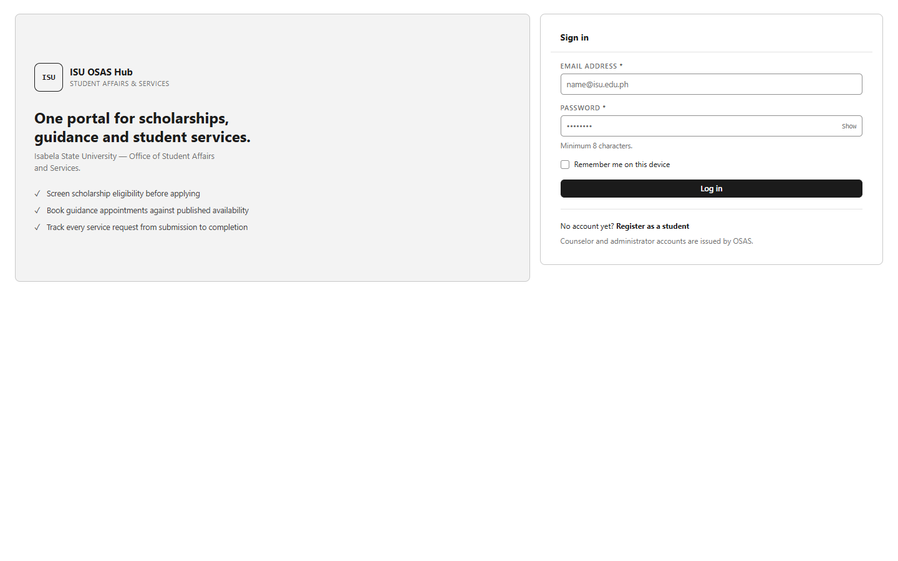

**Annotations**

1. Single column form; labels sit above inputs and errors appear under the field.
2. Failure message is generic — it never states whether the email or the password was wrong.
3. Remember-me checkbox is optional and defaults to off.
4. Login is throttled to 5 attempts per minute per client; the throttle message appears here.
5. There is no 'forgot password' link because no self-service reset route exists (GAP-05).
6. Primary action is the last control in the form; keyboard focus reaches it by tabbing.

**Responsive behaviour**

| Viewport | Layout behaviour |
| --- | --- |
| Desktop 1440 | Two columns: brand panel left, form card right, 45/55 split. |
| Tablet 1024 | Brand panel narrows; form card keeps a comfortable 420 px measure. |
| Mobile 390 | Single column; brand panel collapses to a compact banner above the form. |

### 3.2 WF-G-02 — Student registration

| Field | Value |
| --- | --- |
| Role | Guest |
| Route | `register` |
| Module | M01 |
| Requirements | FR-AUTH-04, FR-PROF-01, NFR-USA-02 |
| Source file | `shared/WF-G-02.html` |

**Purpose.** Create a student account and its linked student profile in one submission, then require email verification before any student screen opens.

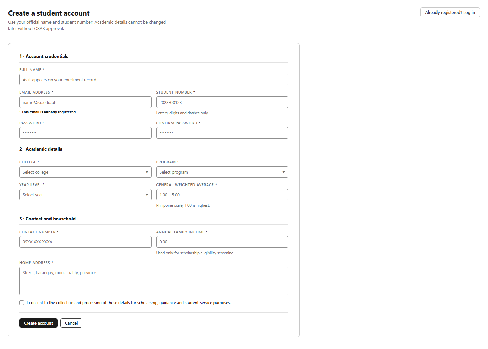

**Annotations**

1. Three sections: account credentials, academic details, and personal and financial details.
2. Student number is validated as unique, maximum 20 characters, letters/digits/dash only.
3. GWA accepts 1.00–5.00; family income accepts a non-negative amount with two decimals.
4. Password requires a confirmation field and a minimum of eight characters.
5. Privacy consent is mandatory; the submit button stays disabled until it is ticked.
6. Errors are field-level and previously entered values are preserved on redisplay.
7. On success the account is created but unusable until the OTP is verified (WF-G-03).

**Responsive behaviour**

| Viewport | Layout behaviour |
| --- | --- |
| Desktop 1440 | Two-column field grid inside a single centred form card (max 860 px). |
| Tablet 1024 | Grid remains two columns; card fills the content width. |
| Mobile 390 | Every field is full width and stacked in document order. |

### 3.3 WF-G-03 — Email verification (OTP)

| Field | Value |
| --- | --- |
| Role | Guest |
| Route | `verification.notice` |
| Module | M01 |
| Requirements | FR-AUTH-05, FR-AUTH-06, FR-AUTH-09, NFR-SEC-07 |
| Source file | `shared/WF-G-03.html` |

**Purpose.** Require a six-digit one-time passcode sent to the registered address before the student panel becomes reachable.

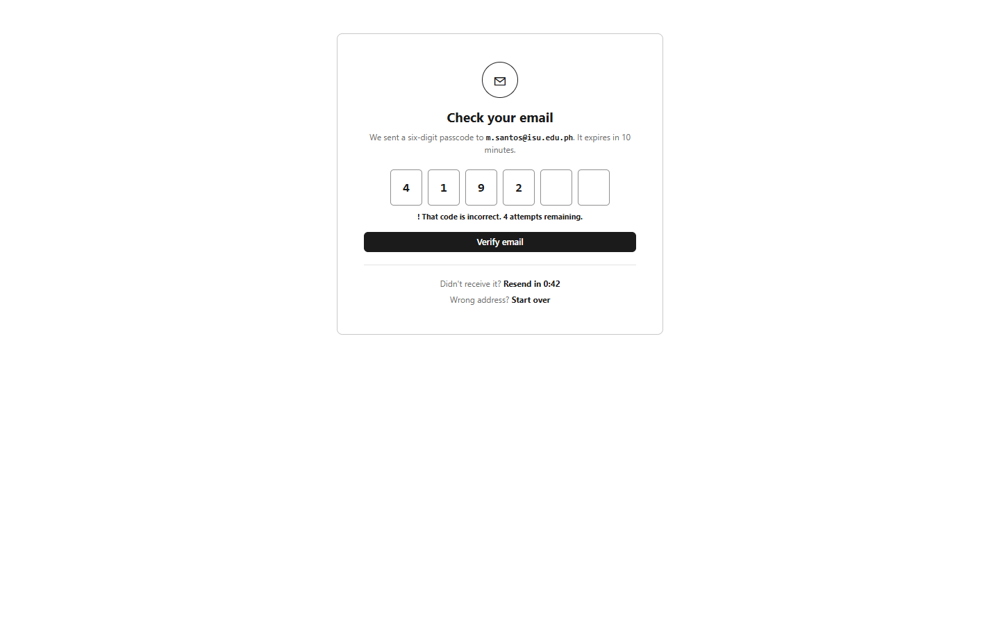

**Annotations**

1. Six single-character inputs that advance focus automatically and accept a pasted code.
2. The masked email address is shown so the user can confirm the destination.
3. Resend is disabled during the cooldown and shows the remaining seconds.
4. Consuming the code invalidates it; a wrong code increments the attempt counter.
5. After too many attempts the code is invalidated and a new one must be requested.
6. A 'wrong email?' escape hatch returns to registration but does not delete the account.

**Responsive behaviour**

| Viewport | Layout behaviour |
| --- | --- |
| Desktop 1440 | Centred card, 460 px wide, with the code inputs on one row. |
| Tablet 1024 | Same card, centred; inputs keep a 44 px touch target. |
| Mobile 390 | Card fills the width; inputs shrink but remain 38 px tall. |

### 3.4 WF-G-04 — Access denied and not found

| Field | Value |
| --- | --- |
| Role | Guest |
| Route | `— (errors/403, errors/404)` |
| Module | M02 |
| Requirements | FR-RBAC-02, NFR-SEC-03 |
| Source file | `shared/WF-G-04.html` |

**Purpose.** Refuse an unauthorised request without disclosing whether the record exists, and explain the refusal in plain language.

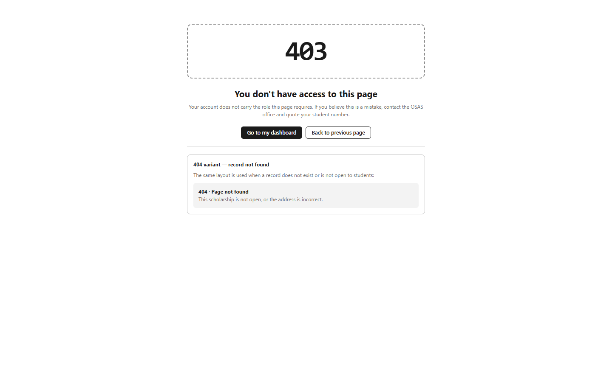

**Annotations**

1. 403 is returned when an authenticated user requests another role's route.
2. 404 is returned for a missing record and for a scholarship that is not open.
3. No record data is rendered on either page — no titles, identifiers or counts.
4. Recovery actions are limited to safe destinations for the current role.
5. The same template is used for both codes; only the heading and body text differ.

**Responsive behaviour**

| Viewport | Layout behaviour |
| --- | --- |
| Desktop 1440 | Centred block, max 560 px, vertically centred in the content area. |
| Tablet 1024 | Identical layout, slightly reduced type scale. |
| Mobile 390 | Full-width block with stacked actions. |

### 3.5 WF-G-05 — Notification centre

| Field | Value |
| --- | --- |
| Role | Student |
| Route | `notifications.index` |
| Module | M13 |
| Requirements | FR-APP-10, FR-GUID-12, FR-NOTIF-01, FR-NOTIF-02, FR-NOTIF-03, FR-NOTIF-04, FR-NOTIF-05, NFR-PERF-04, NFR-ACC-03 |
| Source file | `shared/WF-G-05.html` |

**Purpose.** List the signed-in user's notifications with category, read state and a safe link to the related record.

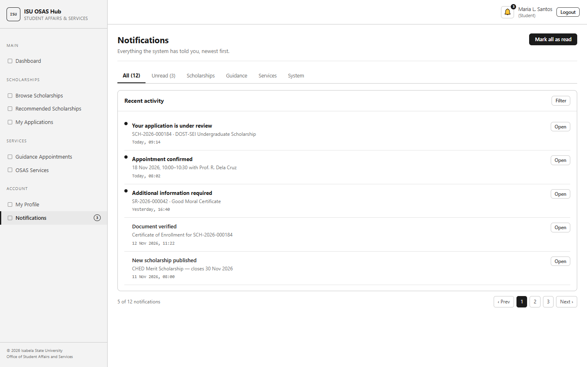

**Annotations**

1. Unread items are marked with a filled dot and bolder title; read items are plain.
2. Category filter separates scholarship, guidance, service and system notifications.
3. Mark-all-read is a single action next to the filter, not per row.
4. Each row links only to a record the user is permitted to open.
5. The top-bar badge and the sidebar counter both reflect the same unread count.
6. Empty state explains which event types will appear here.

**Responsive behaviour**

| Viewport | Layout behaviour |
| --- | --- |
| Desktop 1440 | Single column list at 860 px measure with a right-hand filter rail. |
| Tablet 1024 | Filter rail moves above the list as a horizontal filter bar. |
| Mobile 390 | List is full width; per-row action becomes an icon-sized button. |

### 3.6 WF-G-06 — Application shell (sidebar and top bar)

| Field | Value |
| --- | --- |
| Role | Student |
| Route | `— (layouts/app, components/navigation/*)` |
| Module | M16 |
| Requirements | FR-AUTH-03, FR-RBAC-03, FR-RBAC-06, FR-NOTIF-06, FR-SEARCH-01, FR-SEARCH-03, NFR-USA-01, NFR-MAINT-03, NFR-PORT-01, NFR-ACC-01, NFR-ACC-04 |
| Source file | `shared/WF-G-06.html` |

**Purpose.** Define the persistent frame shared by every authenticated page: a 264 px sidebar, a 60 px top bar, and a single main content region.

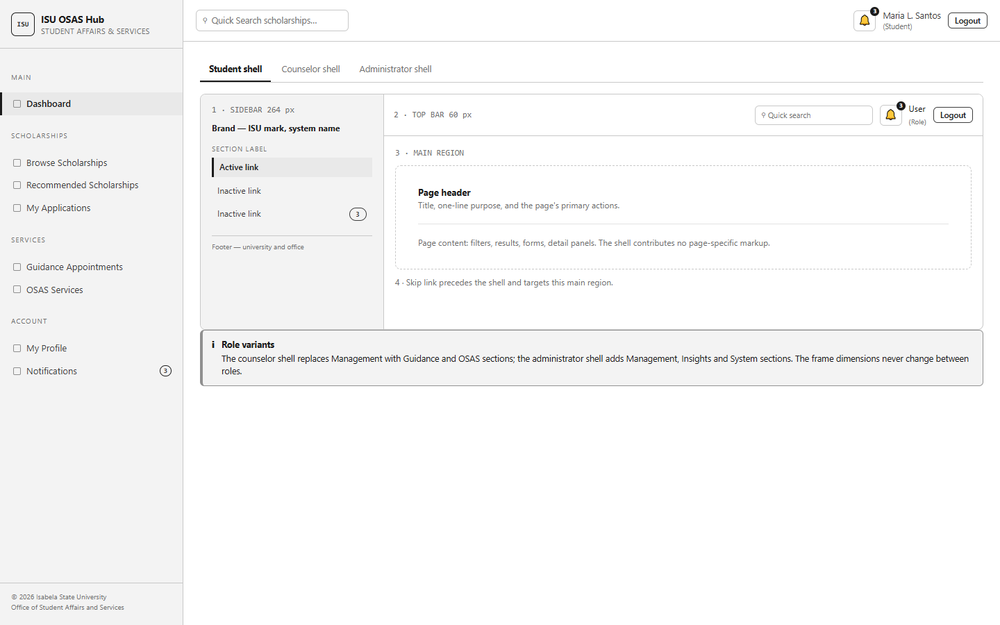

**Annotations**

1. Sidebar width is fixed at 264 px on desktop and holds role-appropriate links only.
2. Section labels group links; the active link carries a left rule and a filled background.
3. The notification count appears twice: on the sidebar link and on the top-bar bell.
4. Top bar carries the menu toggle (small screens), quick search, bell, user chip and logout.
5. Below 1024 px the sidebar leaves the flow and the menu toggle reveals it as a drawer.
6. A skip link precedes the shell so keyboard users can jump straight to main content.
7. Main content begins with a page header; the shell never renders page-specific actions.

**Responsive behaviour**

| Viewport | Layout behaviour |
| --- | --- |
| Desktop 1440 | Sidebar fixed at 264 px; content region 1176 px minus padding. |
| Tablet 1024 | Sidebar hidden; menu toggle in the top bar opens it as an overlay drawer. |
| Mobile 390 | Top bar reduces to toggle, bell and user; search moves into the page. |

<!-- pagebreak -->

## 4. Student screens

Screens reachable by an account holding the student role.

19 screens.

### 4.1 WF-S-01 — Student dashboard

| Field | Value |
| --- | --- |
| Role | Student |
| Route | `student.dashboard` |
| Module | M03, M09, M11, M12 |
| Requirements | FR-ENR-05, FR-ENR-06 |
| Source file | `student/WF-S-01.html` |

**Purpose.** Give the student one screen that answers: what can I apply for, what is happening to my applications, and what is scheduled next.

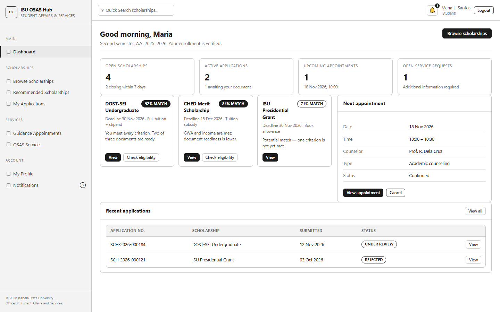

**Annotations**

1. Four summary tiles: open scholarships, active applications, upcoming appointments, open requests.
2. Enrollment banner appears only when verification is missing for the current term.
3. Recommended scholarships are ranked by match score and capped at three cards.
4. Upcoming appointments show date, time, counselor and status — never counselor notes.
5. Recent applications table carries the human-readable application number, not the database id.
6. Every tile and row links to the full screen; the dashboard itself is read-only.

**Responsive behaviour**

| Viewport | Layout behaviour |
| --- | --- |
| Desktop 1440 | Tiles in four columns; content grid of 2:1 with recommendations left. |
| Tablet 1024 | Tiles in two columns; the 2:1 split becomes stacked regions. |
| Mobile 390 | Single column; tiles stack; tables scroll horizontally inside their wrapper. |

### 4.2 WF-S-02 — My profile (view)

| Field | Value |
| --- | --- |
| Role | Student |
| Route | `student.profile.show` |
| Module | M03, M04, M05 |
| Requirements | FR-PROF-02, FR-PASS-03, FR-ENR-02 |
| Source file | `student/WF-S-02.html` |

**Purpose.** Show the student's own academic and personal record, the current enrollment verification state, and whether the profile is locked.

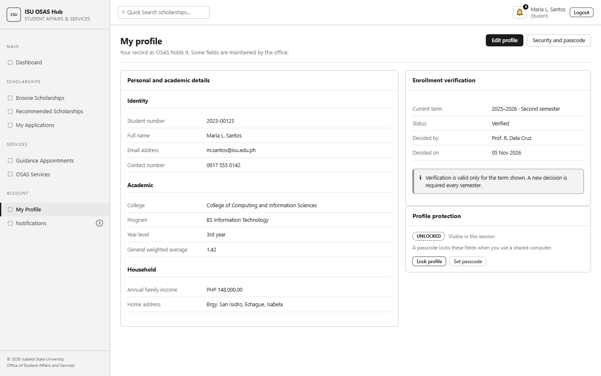

**Annotations**

1. Read-only. The only write actions are Edit profile, Lock, and Passcode settings.
2. Student number, college, program, year level and enrollment status are OSAS-managed.
3. Enrollment verification panel shows the latest term decision and its reason.
4. A locked profile hides field values until the passcode is entered.
5. Verification history is a short list; older terms remain visible but are not editable.
6. No passcode hash, password field or internal note is ever rendered here.

**Responsive behaviour**

| Viewport | Layout behaviour |
| --- | --- |
| Desktop 1440 | Two columns: identity and academic detail left, status panels right. |
| Tablet 1024 | Panels stack beneath the detail list. |
| Mobile 390 | Definition lists collapse to label-above-value pairs. |

### 4.3 WF-S-03 — Edit profile

| Field | Value |
| --- | --- |
| Role | Student |
| Route | `student.profile.edit` |
| Module | M03 |
| Requirements | FR-PROF-03 |
| Source file | `student/WF-S-03.html` |

**Purpose.** Let the student correct the four fields they own, while showing the OSAS-managed fields as read-only.

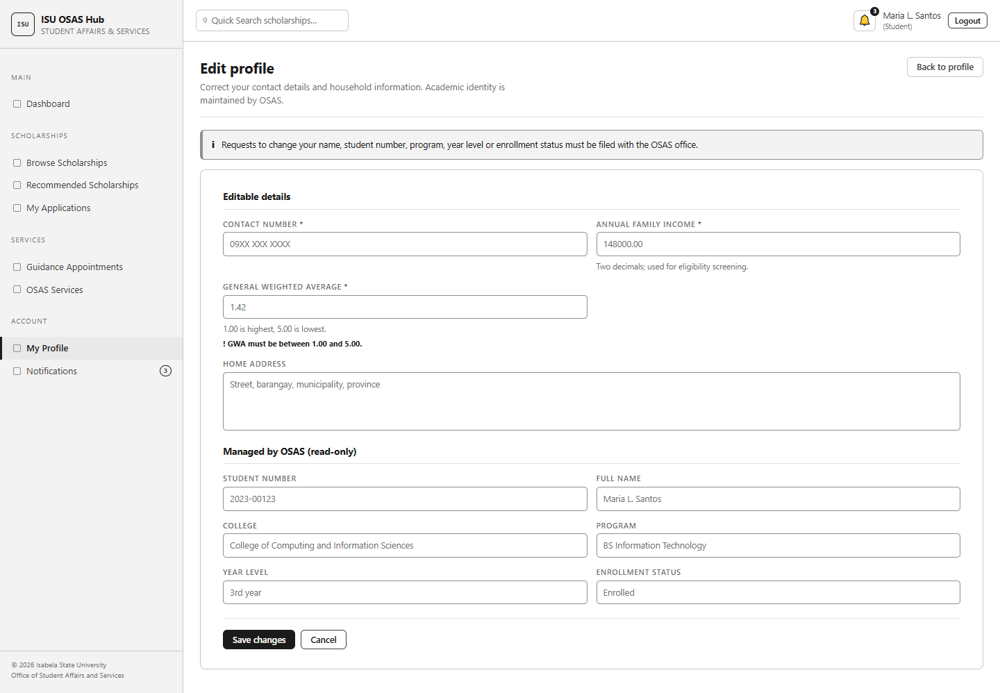

**Annotations**

1. Only contact number, address, GWA and family income are editable.
2. OSAS-managed fields are rendered disabled and labelled 'Managed by OSAS'.
3. Submitting a crafted change to a locked field is rejected server-side as well.
4. GWA is constrained to 1.00–5.00; income must be non-negative.
5. Validation messages appear under the offending field and values are preserved.
6. A passcode-protected profile must be unlocked before this form opens.

**Responsive behaviour**

| Viewport | Layout behaviour |
| --- | --- |
| Desktop 1440 | Two-column field grid in a max-820 px card. |
| Tablet 1024 | Two columns retained; help text wraps under each field. |
| Mobile 390 | Single column; disabled fields remain visually distinct. |

### 4.4 WF-S-04 — Profile security and passcode

| Field | Value |
| --- | --- |
| Role | Student |
| Route | `student.profile.security` |
| Module | M04 |
| Requirements | FR-PASS-01, FR-PASS-02, FR-PASS-03, NFR-SEC-05 |
| Source file | `student/WF-S-04.html` |

**Purpose.** Let the student set, change or remove a passcode that locks profile fields for the current session.

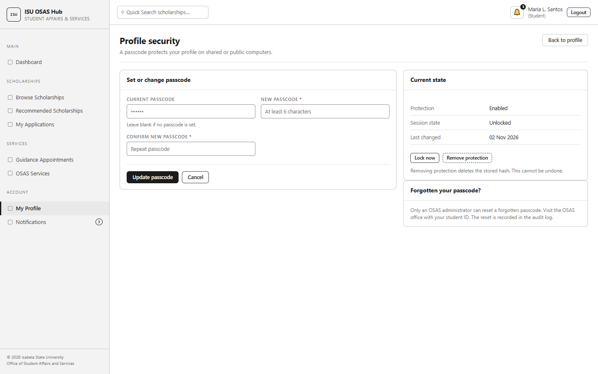

**Annotations**

1. Three states are shown: no passcode set, passcode set and unlocked, passcode set and locked.
2. Current passcode is required to change or remove an existing passcode.
3. The stored value is a one-way hash; the plaintext is never displayed or returned.
4. Unlock attempts are throttled and the remaining attempts are shown after a failure.
5. Removing protection is a destructive action and requires confirmation.
6. Losing the passcode requires an OSAS administrator to reset it (WF-A-06).

**Responsive behaviour**

| Viewport | Layout behaviour |
| --- | --- |
| Desktop 1440 | Two cards side by side: passcode form and current state. |
| Tablet 1024 | Cards stack, form first. |
| Mobile 390 | Single column; buttons become full width. |

### 4.5 WF-S-05 — Browse scholarships

| Field | Value |
| --- | --- |
| Role | Student |
| Route | `student.scholarships.index` |
| Module | M06, M16 |
| Requirements | FR-SCH-06, FR-SCH-07, FR-SEARCH-02 |
| Source file | `student/WF-S-05.html` |

**Purpose.** List every scholarship currently open and inside its application window, with filters and a stable sort order.

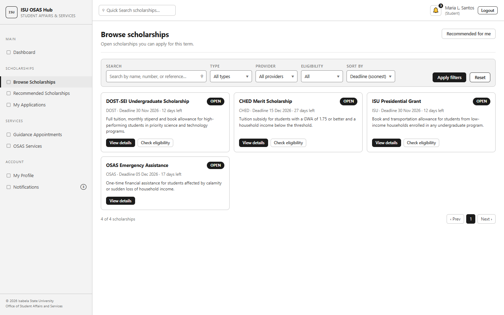

**Annotations**

1. Only scholarships with status open and a current date inside the window appear.
2. Filters: search term, scholarship type, provider, program, eligibility, sort order.
3. Sort options are deadline, name, newest and match score, matching the search service.
4. Each card shows deadline, award summary, provider and a match or eligibility hint.
5. Filter state is reflected in the URL so results can be shared or bookmarked.
6. Empty state explains that no scholarship matches and offers a filter reset.
7. Cards are keyboard-focusable and the whole card is one link target.

**Responsive behaviour**

| Viewport | Layout behaviour |
| --- | --- |
| Desktop 1440 | Three cards per row with a full-width filter bar above. |
| Tablet 1024 | Two cards per row; filters wrap onto two lines. |
| Mobile 390 | One card per row; filters collapse to a disclosure panel. |

### 4.6 WF-S-06 — Scholarship detail

| Field | Value |
| --- | --- |
| Role | Student |
| Route | `student.scholarships.show` |
| Module | M06, M09 |
| Requirements | FR-SCH-09, FR-APP-01, FR-APP-03 |
| Source file | `student/WF-S-06.html` |

**Purpose.** Present the full scholarship record, its document requirements, the student's eligibility summary, and the single action appropriate to their state.

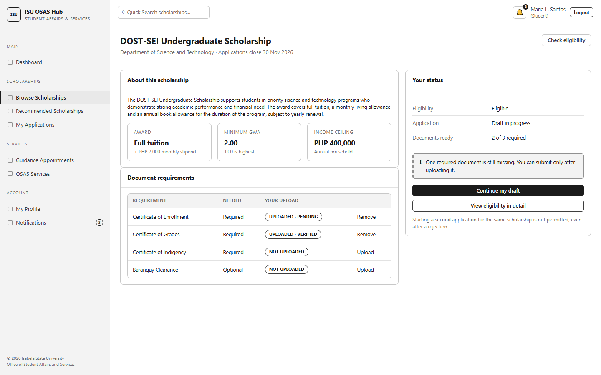

**Annotations**

1. A scholarship that is not open returns 404 — there is no draft preview for students.
2. Eligibility summary is a compact three-way verdict with a link to the full explanation.
3. Requirements table distinguishes required from optional and shows upload readiness.
4. The primary action changes with state: Apply, Continue draft, Submitted, Approved, Rejected.
5. Only one application per student per scholarship is ever possible (BR-09).
6. Award amount and provider are stated in full; no figure is illustrative on screen.

**Responsive behaviour**

| Viewport | Layout behaviour |
| --- | --- |
| Desktop 1440 | Two columns: narrative and requirements left, sticky action panel right. |
| Tablet 1024 | Action panel moves above the narrative as a summary strip. |
| Mobile 390 | Single column; requirements table scrolls horizontally. |

### 4.7 WF-S-07 — Eligibility preview

| Field | Value |
| --- | --- |
| Role | Student |
| Route | `student.scholarships.eligibility` |
| Module | M07 |
| Requirements | FR-ELIG-01, FR-ELIG-02, FR-ELIG-03, FR-ELIG-04 |
| Source file | `student/WF-S-07.html` |

**Purpose.** Explain, criterion by criterion, why the student is or is not eligible for a particular scholarship, without creating an application.

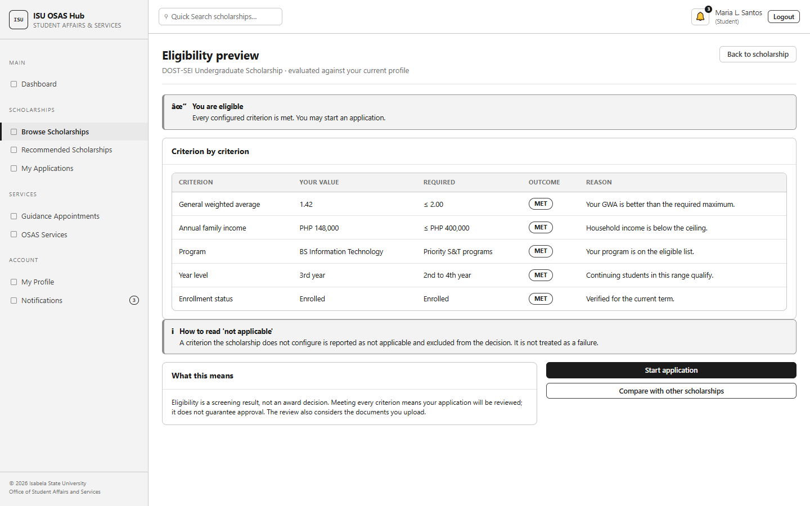

**Annotations**

1. One row per criterion: GWA, family income, program, year level, enrollment status.
2. Each row shows the student's value, the required value, the outcome and a reason sentence.
3. Outcomes are met, not met, or not applicable; an unconfigured criterion is never a failure.
4. The overall verdict is derived from the criteria, not computed separately.
5. The page is read-only and creates no record; it can be revisited freely.
6. A failed mandatory criterion states exactly what would need to change.

**Responsive behaviour**

| Viewport | Layout behaviour |
| --- | --- |
| Desktop 1440 | Verdict banner on top, criteria table full width, notes at the side. |
| Tablet 1024 | Criteria table keeps four columns; notes stack below. |
| Mobile 390 | Table becomes a stack of criterion cards, one per rule. |

### 4.8 WF-S-08 — Recommended scholarships

| Field | Value |
| --- | --- |
| Role | Student |
| Route | `student.scholarships.recommendations` |
| Module | M08 |
| Requirements | FR-MATCH-04, FR-MATCH-05 |
| Source file | `student/WF-S-08.html` |

**Purpose.** Rank scholarships for this student by weighted match score and separate eligible recommendations from potential matches.

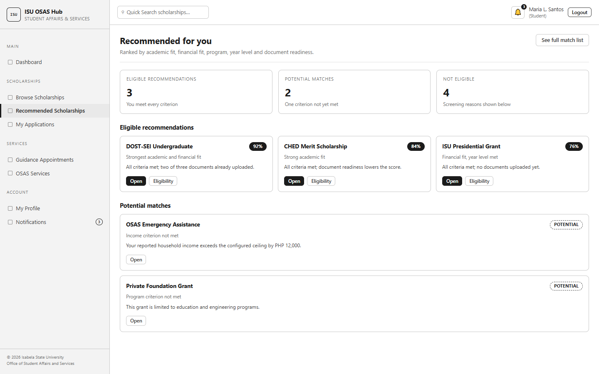

**Annotations**

1. Three groups: eligible recommendations, potential matches, and not eligible.
2. Each card states the match percentage and the single biggest reason for the rank.
3. Ranking is score descending, then deadline, then title, then identifier — stable across reloads.
4. Not-eligible items show the failing mandatory criteria instead of a low score.
5. Weights are administrator-configured; the student cannot change them.
6. The full match list (WF-S-09) exposes every factor for students who want detail.

**Responsive behaviour**

| Viewport | Layout behaviour |
| --- | --- |
| Desktop 1440 | Grouped sections, three cards per row, ranked left to right. |
| Tablet 1024 | Two cards per row; groups remain separate sections. |
| Mobile 390 | One card per row with the match badge inline in the title row. |

### 4.9 WF-S-09 — Full match list

| Field | Value |
| --- | --- |
| Role | Student |
| Route | `student.scholarships.matches` |
| Module | M08 |
| Requirements | FR-MATCH-01, FR-MATCH-05, FR-MATCH-06 |
| Source file | `student/WF-S-09.html` |

**Purpose.** Expose every scoring factor behind each recommendation so the ranking is inspectable rather than opaque.

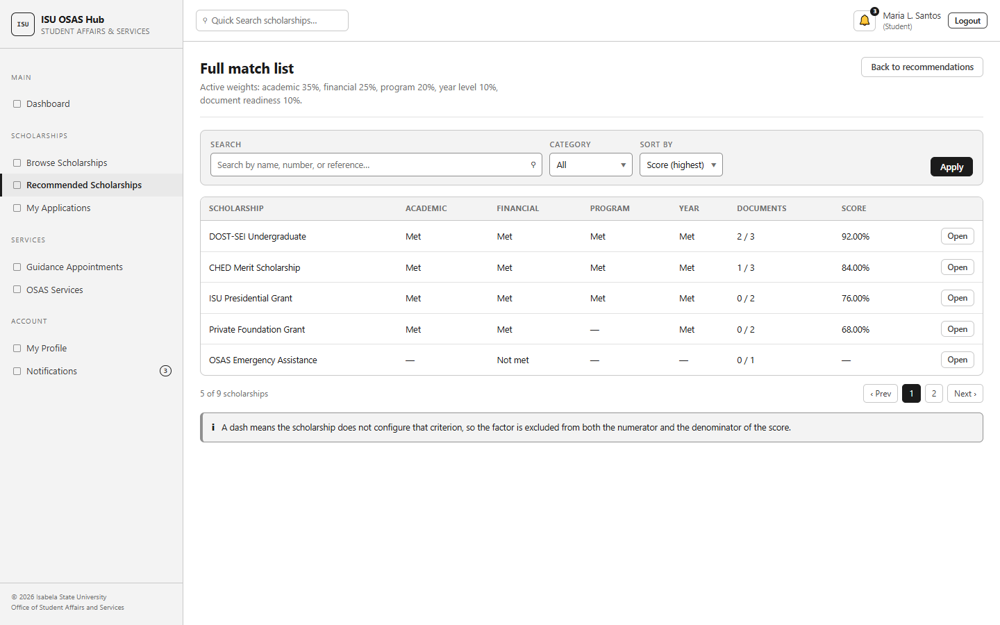

**Annotations**

1. Columns mirror the five factors: academic, financial, program, year level, documents.
2. Each factor cell shows met or not met; document readiness shows a fraction.
3. Total score is the weight-renormalised sum, displayed as a percentage.
4. Factors that do not apply are shown as a dash and excluded from the denominator.
5. Sorting by any column is permitted; the default order is score descending.
6. Weights in use are stated in the caption so the percentages are interpretable.

**Responsive behaviour**

| Viewport | Layout behaviour |
| --- | --- |
| Desktop 1440 | Wide table with all factor columns visible. |
| Tablet 1024 | Table scrolls horizontally; score column is pinned first. |
| Mobile 390 | Table becomes a per-scholarship factor card list. |

### 4.10 WF-S-10 — My applications

| Field | Value |
| --- | --- |
| Role | Student |
| Route | `student.applications.index` |
| Module | M09 |
| Requirements | FR-APP-02, NFR-USA-05, NFR-DATA-03 |
| Source file | `student/WF-S-10.html` |

**Purpose.** List every application the student has ever submitted or drafted, with the current status and the next action.

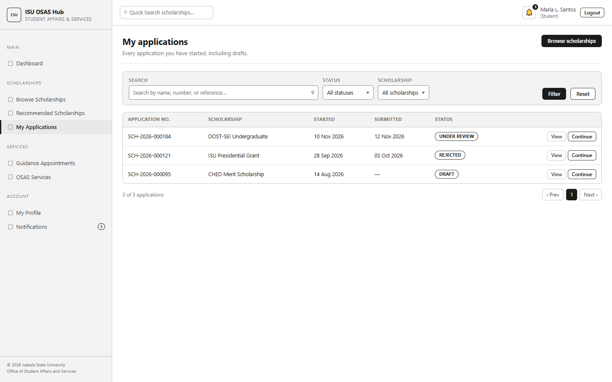

**Annotations**

1. Application number is shown in full and is the stable reference for any enquiry.
2. Status badges use the same vocabulary as the review queue and the timeline.
3. Draft rows expose 'Continue draft'; submitted rows expose 'View' only.
4. Rejected rows remain visible permanently because reapplication is blocked.
5. Pagination is server-side; the table never loads the full set.
6. Empty state links to the scholarship catalogue.

**Responsive behaviour**

| Viewport | Layout behaviour |
| --- | --- |
| Desktop 1440 | Full table with six columns and a per-row action. |
| Tablet 1024 | Submitted date column collapses into a secondary line under the scholarship. |
| Mobile 390 | Each application renders as a stacked card with status and action. |

### 4.11 WF-S-11 — Application detail and documents

| Field | Value |
| --- | --- |
| Role | Student |
| Route | `student.applications.show` |
| Module | M09, M10 |
| Requirements | FR-RBAC-05, FR-APP-04, FR-APP-05, FR-APP-09, FR-APP-11, FR-DOC-01, FR-DOC-02, FR-DOC-05, NFR-SEC-04, NFR-SEC-06 |
| Source file | `student/WF-S-11.html` |

**Purpose.** Show one application in full: its workflow position, its documents, its history, and the one action the student may take next.

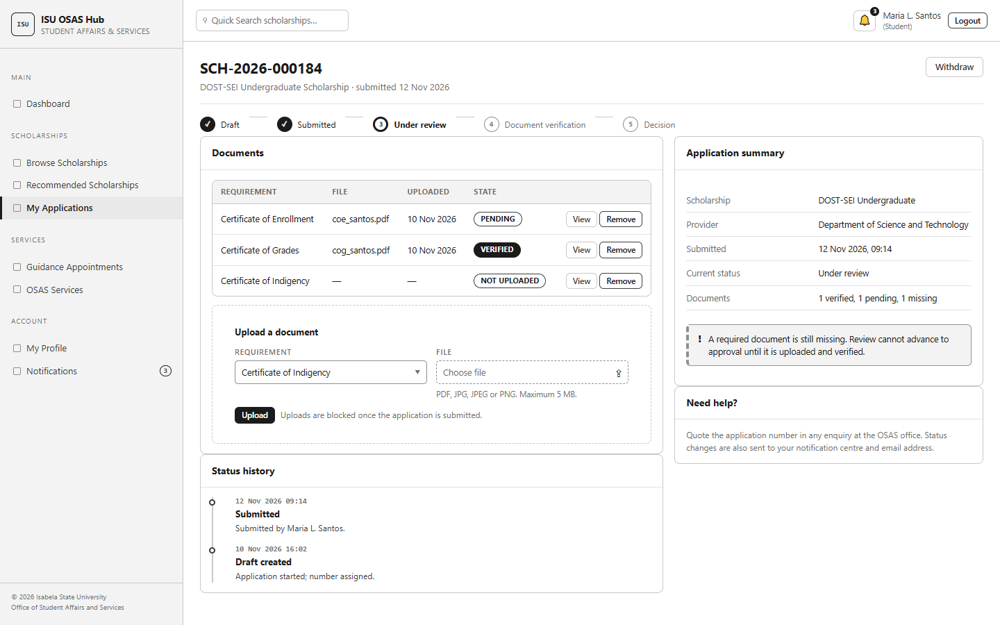

**Annotations**

1. Progress stepper reflects the state machine, not a generic four-step bar.
2. Upload controls are present only while the application is in draft.
3. Each uploaded file shows verification state and any rejection remarks verbatim.
4. Submit is refused while a required document is missing, with the reason listed.
5. Status history is append-only and shows actor, time and remarks.
6. Downloads stream through an authorised route; no direct file path is exposed.

**Responsive behaviour**

| Viewport | Layout behaviour |
| --- | --- |
| Desktop 1440 | Stepper full width, then 2:1 split of documents and sidebar. |
| Tablet 1024 | Stepper wraps to two lines; sidebar moves below documents. |
| Mobile 390 | Stepper becomes a vertical list; document rows become cards. |

### 4.12 WF-S-12 — Guidance counselors

| Field | Value |
| --- | --- |
| Role | Student |
| Route | `student.guidance.counselors` |
| Module | M11 |
| Requirements | FR-GUID-05 |
| Source file | `student/WF-S-12.html` |

**Purpose.** List counselors who have published availability so the student can choose who to book with.

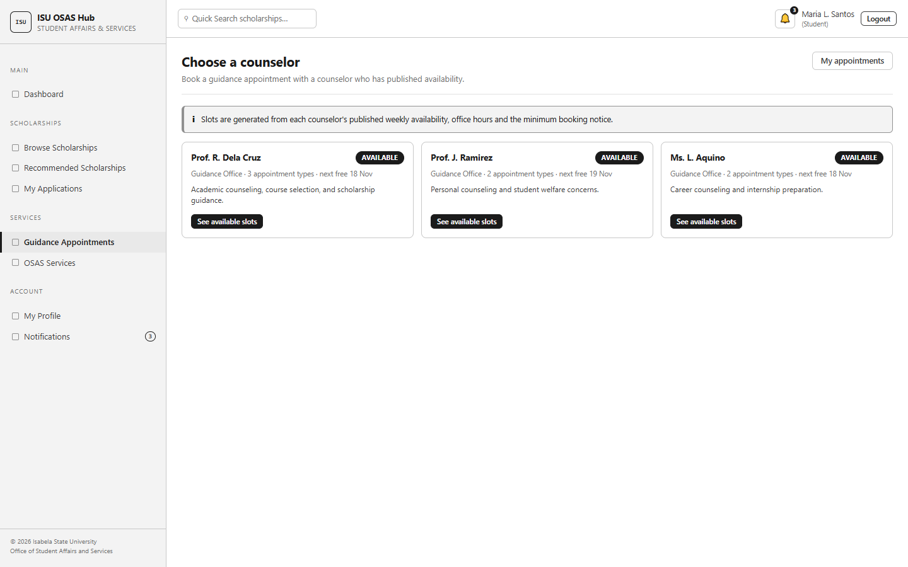

**Annotations**

1. Only counselors with at least one active availability block are listed.
2. Each card shows the counselor's name, the appointment types they offer, and next free day.
3. Choosing a counselor leads to slot selection (WF-S-13) with the counselor pre-selected.
4. A counselor with no published availability is omitted rather than shown as unavailable.
5. No counselor notes, caseload or internal remarks appear on this screen.

**Responsive behaviour**

| Viewport | Layout behaviour |
| --- | --- |
| Desktop 1440 | Three cards per row. |
| Tablet 1024 | Two cards per row. |
| Mobile 390 | One card per row; the whole card is one link target. |

### 4.13 WF-S-13 — Appointment slots and booking

| Field | Value |
| --- | --- |
| Role | Student |
| Route | `student.guidance.slots` |
| Module | M11 |
| Requirements | FR-GUID-06, FR-GUID-07, FR-GUID-08 |
| Source file | `student/WF-S-13.html` |

**Purpose.** Offer only slots that satisfy availability, office hours, booking notice, the booking horizon, and both counselor and student conflict rules.

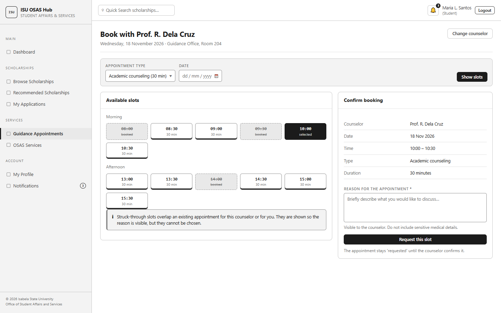

**Annotations**

1. Date picker is bounded before today and after the maximum future booking day.
2. Appointment type changes the slot duration and therefore the slot grid.
3. Conflicting slots are shown struck through rather than hidden, so the student sees why.
4. Submitting re-validates every rule inside a transaction; the UI is not the guard.
5. The reason field is required and is visible to the counselor.
6. A failed booking returns to this page with the specific conflict stated.

**Responsive behaviour**

| Viewport | Layout behaviour |
| --- | --- |
| Desktop 1440 | Slot grid four to six per row; booking form in a right-hand panel. |
| Tablet 1024 | Grid three per row; form moves below the grid. |
| Mobile 390 | Grid two per row; form stacks with full-width controls. |

### 4.14 WF-S-14 — My appointments

| Field | Value |
| --- | --- |
| Role | Student |
| Route | `student.guidance.appointments` |
| Module | M11 |
| Requirements | FR-GUID-07, FR-GUID-10, FR-GUID-12 |
| Source file | `student/WF-S-14.html` |

**Purpose.** List the student's guidance appointments across all statuses with the action available for each.

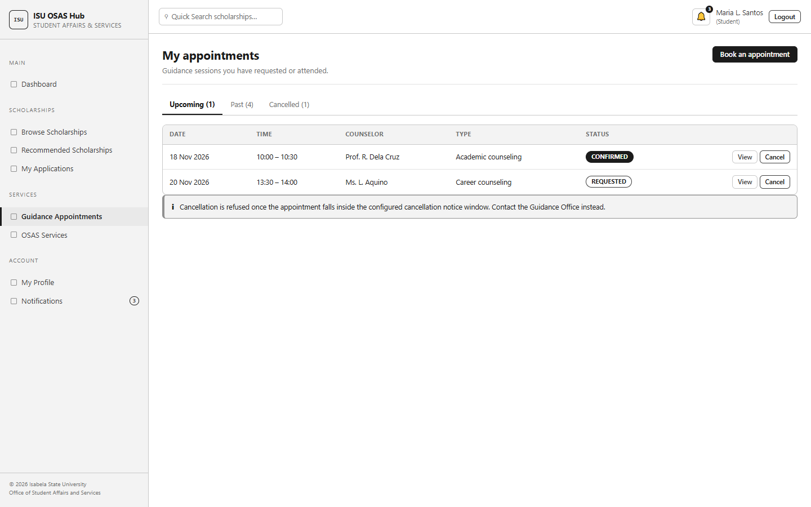

**Annotations**

1. Tabs separate upcoming, past and cancelled appointments without changing the URL.
2. Status vocabulary matches the appointment state machine exactly.
3. Cancel is offered only for requested or confirmed appointments outside the notice window.
4. A reminder indicator shows when the 24-hour reminder has been dispatched.
5. Historical appointments remain readable but expose no actions.

**Responsive behaviour**

| Viewport | Layout behaviour |
| --- | --- |
| Desktop 1440 | Table with date, time, counselor, type, status and action. |
| Tablet 1024 | Type column folds into the counselor cell. |
| Mobile 390 | Each appointment becomes a card with the status badge in the header. |

### 4.15 WF-S-15 — Appointment detail

| Field | Value |
| --- | --- |
| Role | Student |
| Route | `student.guidance.appointments.show` |
| Module | M11 |
| Requirements | FR-GUID-10, FR-GUID-14 |
| Source file | `student/WF-S-15.html` |

**Purpose.** Show one appointment in full and offer cancellation only when the notice window still allows it.

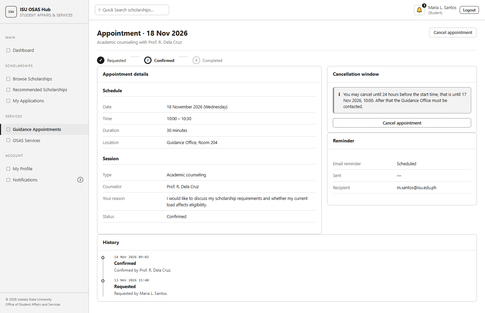

**Annotations**

1. Status stepper shows requested, confirmed, then completed or cancelled.
2. Cancellation notice window is stated in plain language with the exact cut-off time.
3. Rejection reason from the counselor is shown verbatim when present.
4. Student-visible notes only; counselor notes are never rendered to the student.
5. Reminder state is shown so the student knows whether an email was already sent.

**Responsive behaviour**

| Viewport | Layout behaviour |
| --- | --- |
| Desktop 1440 | Detail panel left, status and actions right. |
| Tablet 1024 | Action panel moves below the detail panel. |
| Mobile 390 | Single column with the status banner first. |

### 4.16 WF-S-16 — Service catalogue

| Field | Value |
| --- | --- |
| Role | Student |
| Route | `student.services.catalog` |
| Module | M12 |
| Requirements | FR-SVC-01 |
| Source file | `student/WF-S-16.html` |

**Purpose.** Present the active OSAS service types with their instructions and required attachments, and start a request.

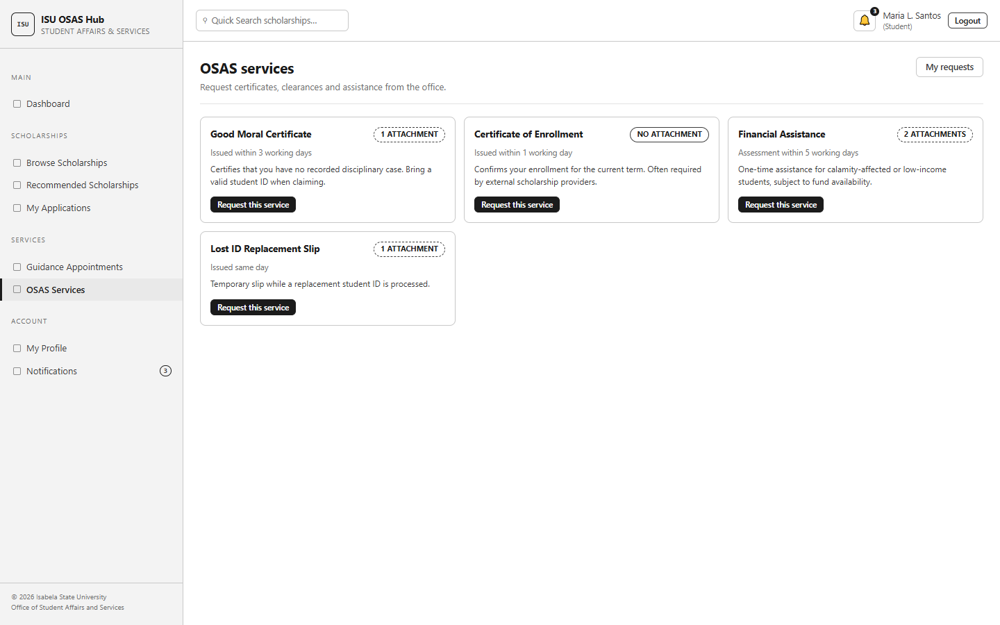

**Annotations**

1. Only service types flagged active are listed, in administrator-defined display order.
2. Each card states what the student must prepare before starting the request.
3. Required attachments are counted so the student knows the effort involved.
4. Starting a request opens the form with the service type pre-selected.
5. Instructions are shown in full; there is no hidden policy text.

**Responsive behaviour**

| Viewport | Layout behaviour |
| --- | --- |
| Desktop 1440 | Three cards per row. |
| Tablet 1024 | Two cards per row. |
| Mobile 390 | One card per row with the action pinned to the bottom. |

### 4.17 WF-S-17 — New service request

| Field | Value |
| --- | --- |
| Role | Student |
| Route | `student.services.create` |
| Module | M12 |
| Requirements | FR-SVC-03 |
| Source file | `student/WF-S-17.html` |

**Purpose.** Collect the service type, a description of at least ten characters, and the supporting documents required by that service.

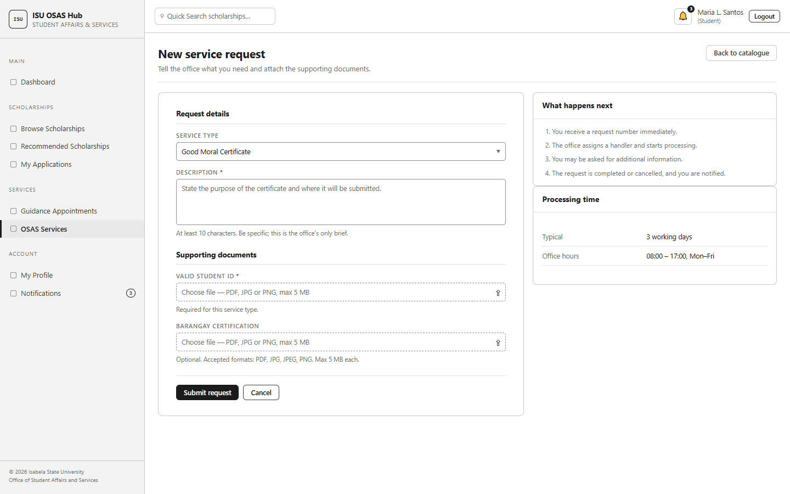

**Annotations**

1. Service type is pre-selected when arriving from the catalogue.
2. Description requires at least ten characters; the counter shows the remaining minimum.
3. Attachments are limited to PDF, JPG, JPEG and PNG at 5 MB each.
4. Required attachments are listed per the chosen service type's requirements.
5. Submitting generates a request number in the form SR-YYYY-NNNNNN.
6. The request is created with status submitted and the student is returned to detail.

**Responsive behaviour**

| Viewport | Layout behaviour |
| --- | --- |
| Desktop 1440 | Single form card at 860 px with a two-column field grid. |
| Tablet 1024 | Two columns retained; attachment rows wrap. |
| Mobile 390 | Single column; file pickers become full width. |

### 4.18 WF-S-18 — My service requests

| Field | Value |
| --- | --- |
| Role | Student |
| Route | `student.services.index` |
| Module | M12 |
| Requirements | FR-SVC-04, FR-SVC-05 |
| Source file | `student/WF-S-18.html` |

**Purpose.** List every request the student has raised, with its status, handler and date.

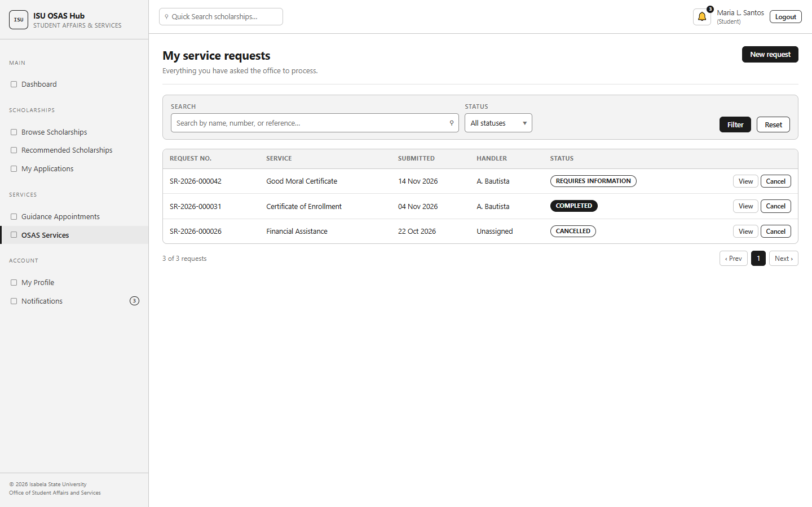

**Annotations**

1. Request number, service type, submission date, handler and status are always shown.
2. Status labels use the service-request vocabulary, including requires_information.
3. Only requests that can still change status expose a Cancel action.
4. The handler column may be blank while a request is unassigned.
5. Filters mirror those on the administrative queue for predictability.

**Responsive behaviour**

| Viewport | Layout behaviour |
| --- | --- |
| Desktop 1440 | Full table with five columns and row actions. |
| Tablet 1024 | Handler column folds into a secondary line. |
| Mobile 390 | Stacked cards with the status badge in the header. |

### 4.19 WF-S-19 — Service request detail

| Field | Value |
| --- | --- |
| Role | Student |
| Route | `student.services.show` |
| Module | M12 |
| Requirements | FR-SVC-05, FR-SVC-08, FR-SVC-09 |
| Source file | `student/WF-S-19.html` |

**Purpose.** Show one request, its documents, its status history, and any information the office still needs from the student.

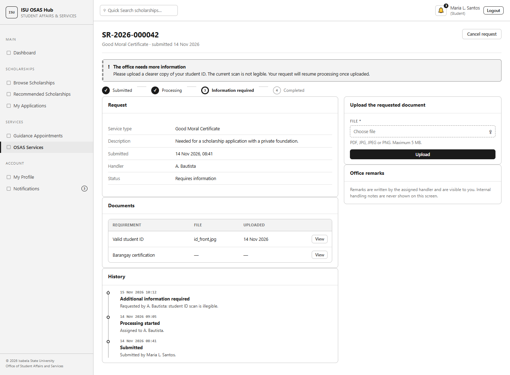

**Annotations**

1. An outstanding information request is surfaced as a prominent banner, not a hidden status.
2. Office remarks and internal remarks are separated; only the former is shown here.
3. Additional documents can be attached only while the request is non-terminal.
4. Status history is append-only with actor and timestamp.
5. Cancellation is offered only when the state machine still permits it.

**Responsive behaviour**

| Viewport | Layout behaviour |
| --- | --- |
| Desktop 1440 | Two-column layout: details and history left, actions right. |
| Tablet 1024 | Actions move under the details block. |
| Mobile 390 | Single column; the outstanding-action banner appears first. |

<!-- pagebreak -->

## 5. Counselor screens

Screens reachable by an account holding the counselor role.

6 screens.

### 5.1 WF-C-01 — Counselor dashboard

| Field | Value |
| --- | --- |
| Role | Counselor |
| Route | `counselor.dashboard` |
| Module | M11, M05, M12 |
| Requirements | FR-SVC-10 |
| Source file | `counselor/WF-C-01.html` |

**Purpose.** Give the counselor a triage view of what needs a decision today: pending appointment requests, today's confirmed sessions, and the enrollment and service-request items they are entitled to act on.

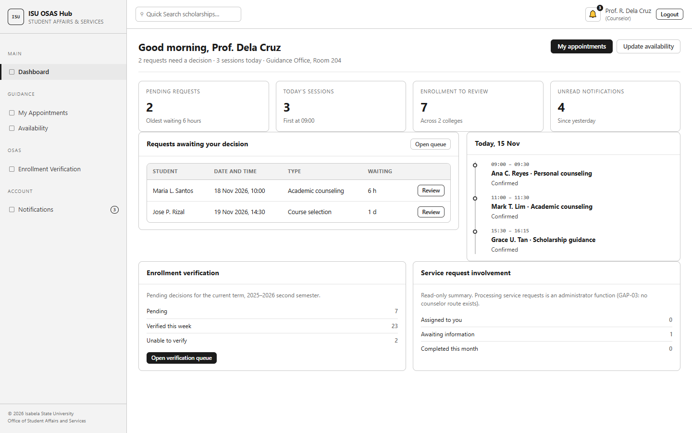

**Annotations**

1. Four tiles: pending requests, today's sessions, enrollment items awaiting a decision, and unread notifications.
2. The pending-request list is the only place a request can be confirmed or rejected, so it is placed above the fold.
3. Today's schedule is ordered by start time and shows student, type and status only.
4. Enrollment verification appears because counselors may verify enrollment alongside administrators (FR-RBAC-04); service-request counters are read-only here.
5. No student-identifying data is exposed beyond name, student number and the request the student chose to share.
6. Every panel links to the full queue; the dashboard itself performs no transitions.

**Responsive behaviour**

| Viewport | Layout behaviour |
| --- | --- |
| Desktop 1440 | Four tiles in one row; a 2:1 split of pending requests and today's schedule. |
| Tablet 1024 | Tiles fall to two columns; the split becomes stacked. |
| Mobile 390 | Single column; the pending list appears first, tiles last. |

### 5.2 WF-C-02 — Weekly availability

| Field | Value |
| --- | --- |
| Role | Counselor |
| Route | `counselor.guidance.availability` |
| Module | M11 |
| Requirements | FR-GUID-01, FR-GUID-02 |
| Source file | `counselor/WF-C-02.html` |

**Purpose.** Publish the recurring weekly blocks from which bookable appointment slots are generated, and mark a day unavailable without deleting its history.

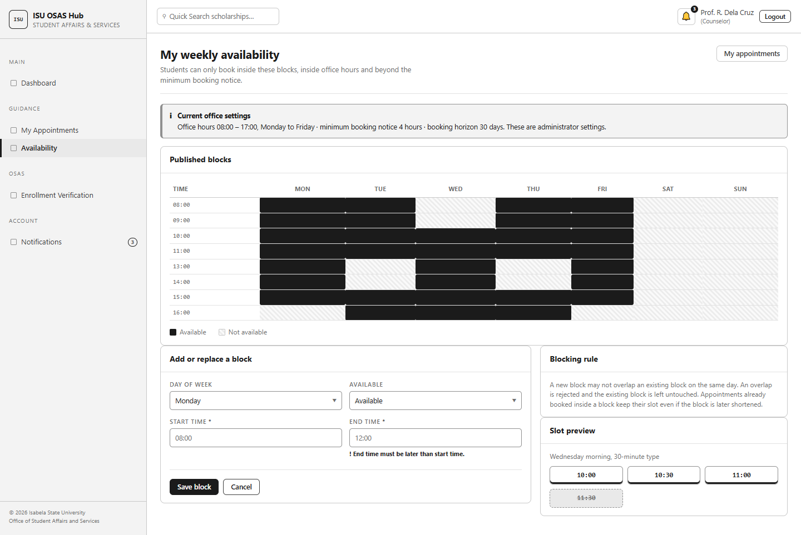

**Annotations**

1. One row per day of week (1 = Monday … 7 = Sunday), with a start time, an end time and an available flag.
2. Saving a block that overlaps another block for the same counselor is rejected with a field-level error.
3. End time must be later than start time; the pair is validated server-side too.
4. The preview column shows the resulting bookable slots so the effect of a change is visible before saving.
5. Office hours and minimum booking notice are administrator settings and cannot be changed here; they are shown as context.
6. Marking a day unavailable stops new bookings without deleting past appointments.

**Responsive behaviour**

| Viewport | Layout behaviour |
| --- | --- |
| Desktop 1440 | Seven-column grid with the editor form in a right-hand panel. |
| Tablet 1024 | Grid scrolls horizontally; editor moves above the grid. |
| Mobile 390 | Each day becomes a stacked row with its own start and end controls. |

### 5.3 WF-C-03 — Appointment queue

| Field | Value |
| --- | --- |
| Role | Counselor |
| Route | `counselor.guidance.appointments` |
| Module | M11 |
| Requirements | FR-GUID-09, FR-GUID-11, NFR-PERF-03 |
| Source file | `counselor/WF-C-03.html` |

**Purpose.** List every appointment belonging to this counselor, filtered by status, so a request can be reviewed without leaving the queue.

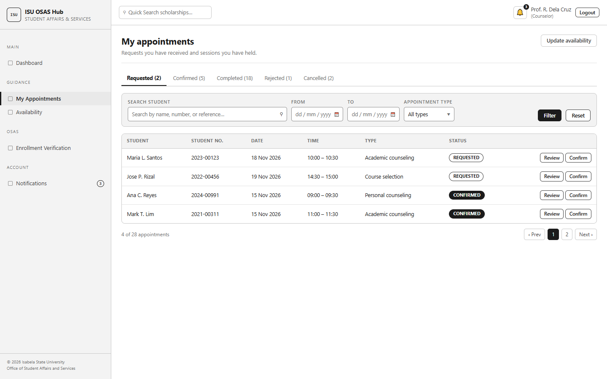

**Annotations**

1. Tabs follow the appointment state machine: requested, confirmed, completed, rejected and cancelled.
2. Only requested rows show Confirm and Reject; confirmed rows show Complete.
3. The queue is scoped to the signed-in counselor — another counselor's appointments are not reachable by changing the identifier.
4. Date range and student-name filters combine with the active tab.
5. Counts on each tab reflect the filtered set, not the global total.
6. Pagination is server-side, 15 rows per page.

**Responsive behaviour**

| Viewport | Layout behaviour |
| --- | --- |
| Desktop 1440 | Tabs, filter bar, then a table with seven columns. |
| Tablet 1024 | Type column folds under the student name. |
| Mobile 390 | Each appointment renders as a card; decisions become full-width buttons. |

### 5.4 WF-C-04 — Appointment detail and decisions

| Field | Value |
| --- | --- |
| Role | Counselor |
| Route | `counselor.guidance.appointments.show` |
| Module | M11 |
| Requirements | FR-GUID-09, FR-GUID-13 |
| Source file | `counselor/WF-C-04.html` |

**Purpose.** Review one appointment request with the student's stated reason, then confirm, reject with a required reason, or complete a confirmed session.

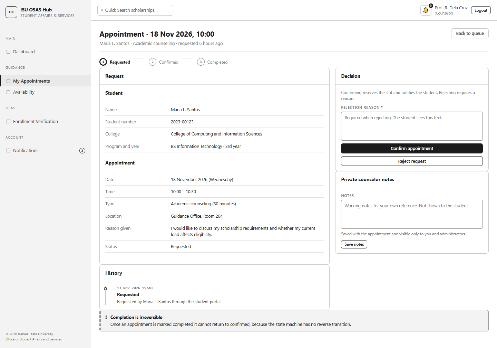

**Annotations**

1. Only transitions permitted by the state machine are rendered as actions.
2. Reject requires a written reason; the reason is shown to the student verbatim.
3. Confirm re-checks the slot for conflict before committing, so a stale page cannot double-book.
4. Complete is available only from confirmed, and stamps the completion in history.
5. Counselor notes are private working notes and are not visible to the student.
6. The student's submitted reason is read-only here.

**Responsive behaviour**

| Viewport | Layout behaviour |
| --- | --- |
| Desktop 1440 | Details left, decision panel and private notes right. |
| Tablet 1024 | Decision panel moves directly under the details. |
| Mobile 390 | Single column; decision buttons stack and stay full width. |

### 5.5 WF-C-05 — Enrollment verification queue

| Field | Value |
| --- | --- |
| Role | Counselor |
| Route | `enrollment-verifications.index` |
| Module | M05 |
| Requirements | FR-RBAC-04, FR-ENR-01, FR-ENR-04 |
| Source file | `counselor/WF-C-05.html` |

**Purpose.** Review the enrollment-verification records for the current term and open any record to record a decision.

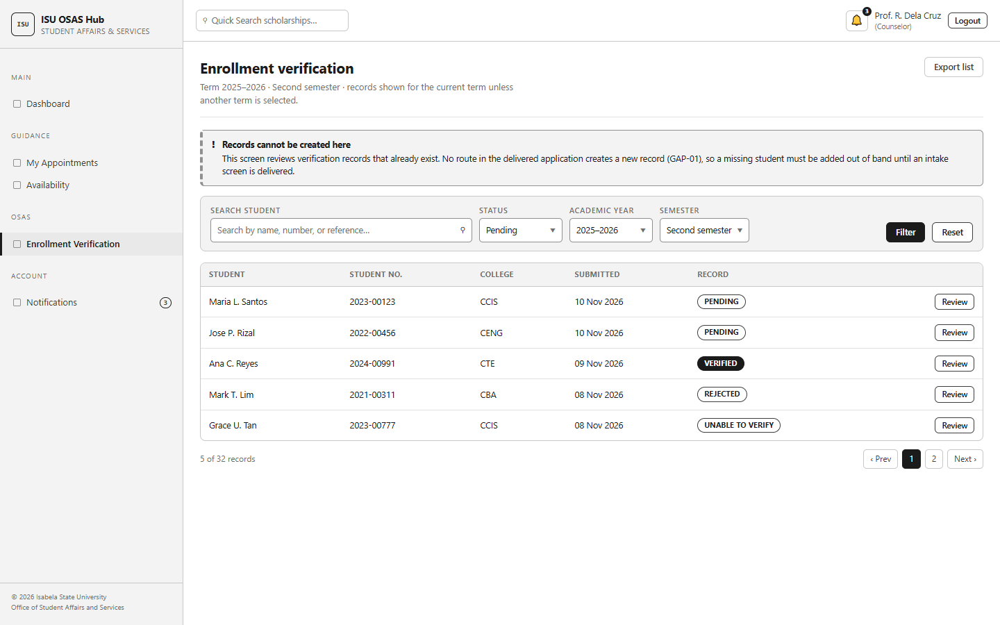

**Annotations**

1. Both counselors and administrators reach this screen; the queue is not scoped to the counselor's own students because no such relationship exists in the schema.
2. Status filter defaults to pending, because decided records need no action.
3. Current term is highlighted from configuration; other terms remain visible but are not actionable for the current gate.
4. The student's profile enrollment status is shown alongside the record status so a mismatch is visible.
5. GAP-01: no screen in the application creates these records. This queue reviews records that exist; it cannot create them.
6. Pagination is server-side with 20 rows per page.

**Responsive behaviour**

| Viewport | Layout behaviour |
| --- | --- |
| Desktop 1440 | Filter bar plus a six-column table. |
| Tablet 1024 | Term column folds into the student cell as a secondary line. |
| Mobile 390 | Rows become cards with the status badge in the header. |

### 5.6 WF-C-06 — Enrollment verification review

| Field | Value |
| --- | --- |
| Role | Counselor |
| Route | `enrollment-verifications.show` |
| Module | M05 |
| Requirements | FR-ENR-03 |
| Source file | `counselor/WF-C-06.html` |

**Purpose.** Record the enrollment decision for one student and term, with the reason that the student will act on.

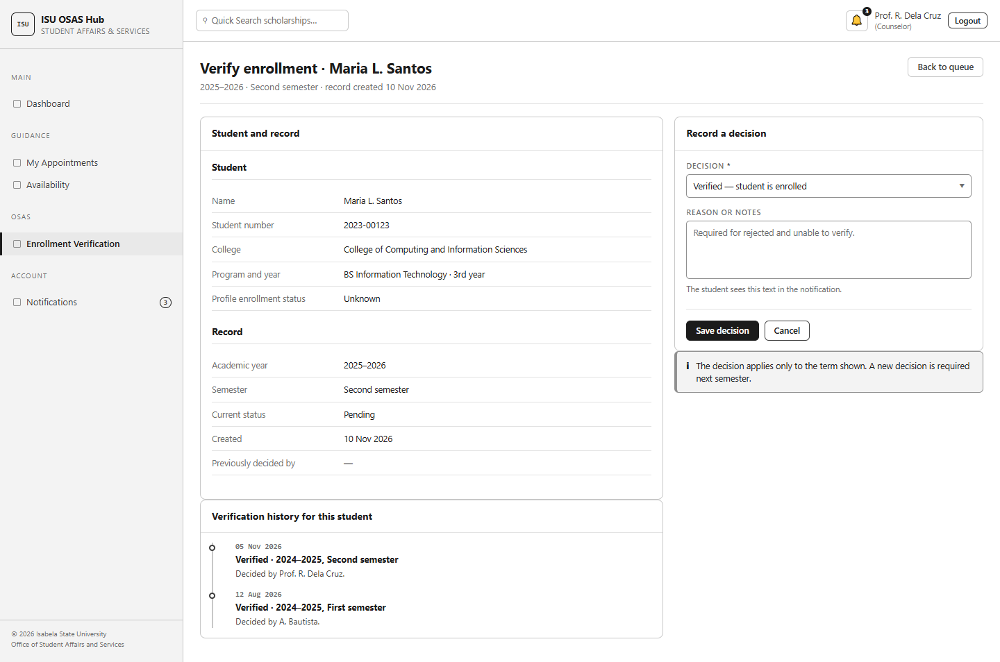

**Annotations**

1. Three outcomes: verified, rejected, unable to verify.
2. Notes are mandatory for rejected and unable to verify, and optional for verified.
3. Saving updates the record and the student's profile enrollment status in one transaction.
4. The decision is attributed to the signed-in user and stamped with a timestamp.
5. Verification is term-scoped: it satisfies the enrollment gate only for the configured academic year and semester.
6. The student is notified of the outcome, so the reason text is written for them.

**Responsive behaviour**

| Viewport | Layout behaviour |
| --- | --- |
| Desktop 1440 | Record summary left, decision form right. |
| Tablet 1024 | Decision form moves under the summary. |
| Mobile 390 | Single column with the student summary first. |

<!-- pagebreak -->

## 6. Administrator screens

Screens reachable by an account holding the admin role.

27 screens.

### 6.1 WF-A-01 — Administrator dashboard

| Field | Value |
| --- | --- |
| Role | Administrator |
| Route | `admin.dashboard` |
| Module | M03, M06, M09, M11, M12, M14 |
| Requirements | FR-ANLYT-01, NFR-PERF-01 |
| Source file | `admin/WF-A-01.html` |

**Purpose.** Summarise the health of every OSAS function on one screen so the administrator can see backlogs and volumes before opening an individual queue.

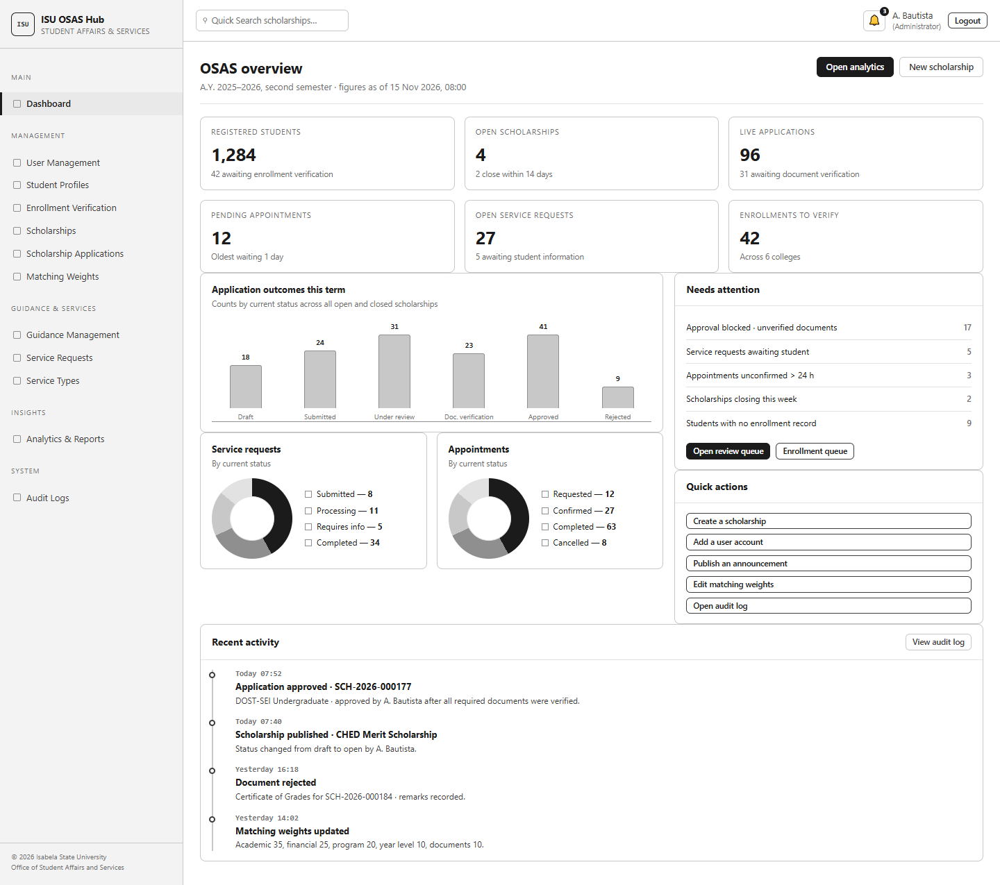

**Annotations**

1. Six summary tiles cover students, open scholarships, live applications, pending appointments, open service requests and enrollments awaiting verification.
2. Two charts summarise application outcomes and service-request status for the current term; both link to the corresponding analytics tab.
3. Each backlog row links directly to its queue with the relevant filter pre-applied.
4. All figures are computed by the analytics service with the same filters used on the analytics screens, so numbers never disagree.
5. The dashboard exposes no bulk actions; every change happens on the owning screen.
6. Quick actions cover the three most frequent administrative starts: a new scholarship, a new user and the review queue.

**Responsive behaviour**

| Viewport | Layout behaviour |
| --- | --- |
| Desktop 1440 | Six tiles in two rows of three, then a 2:1 split of charts and backlogs. |
| Tablet 1024 | Tiles in two columns; charts stack above backlog rows. |
| Mobile 390 | Single column; tiles become compact rows with the number right-aligned. |

### 6.2 WF-A-02 — User accounts

| Field | Value |
| --- | --- |
| Role | Administrator |
| Route | `admin.users.index` |
| Module | M03 |
| Requirements | FR-PROF-07, NFR-PERF-03 |
| Source file | `admin/WF-A-02.html` |

**Purpose.** List every account with its role and active state so the administrator can suspend, restore or edit access.

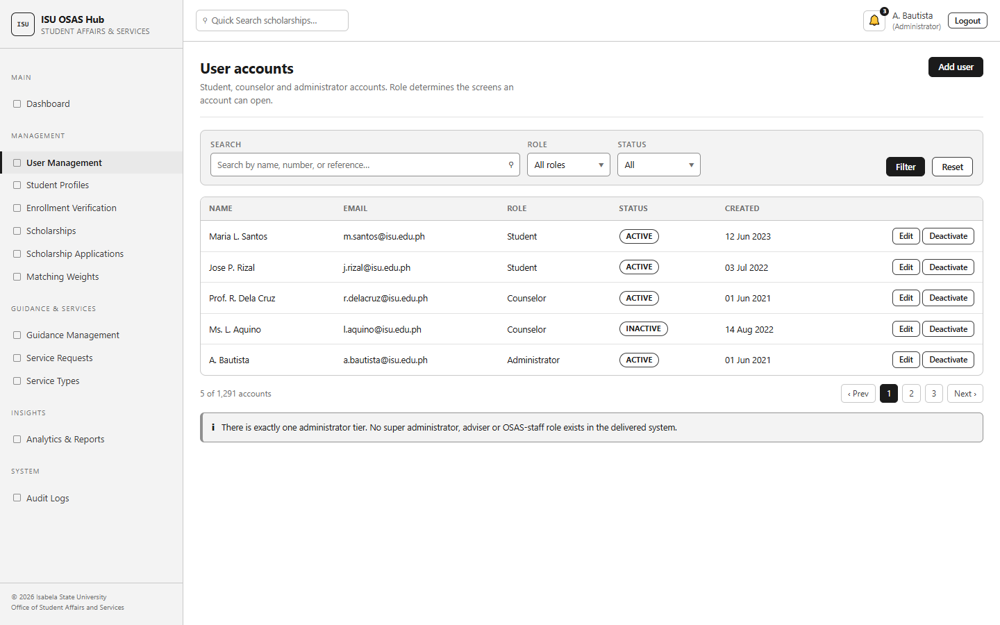

**Annotations**

1. Role filter is the primary control, because role determines which screens a user can reach.
2. Active state is a first-class column: an inactive account is refused at login even with correct credentials.
3. Only three roles exist — student, counselor and administrator. There is no super administrator tier.
4. Deactivation is a toggle, not a delete, so historical records keep a valid owner.
5. A user's own account cannot be deactivated from this screen (self-lockout guard).
6. Email addresses are shown in full here because this is an administrator-only screen.

**Responsive behaviour**

| Viewport | Layout behaviour |
| --- | --- |
| Desktop 1440 | Filter bar plus a six-column table with row actions. |
| Tablet 1024 | Created column folds into a secondary line under the email address. |
| Mobile 390 | Rows become cards; status and role badges share the header row. |

### 6.3 WF-A-03 — User create and edit

| Field | Value |
| --- | --- |
| Role | Administrator |
| Route | `admin.users.create / admin.users.edit` |
| Module | M03 |
| Requirements | FR-RBAC-01, FR-PROF-06 |
| Source file | `admin/WF-A-03.html` |

**Purpose.** Create an account with an explicit role, or change an existing account's name, email, role and active state.

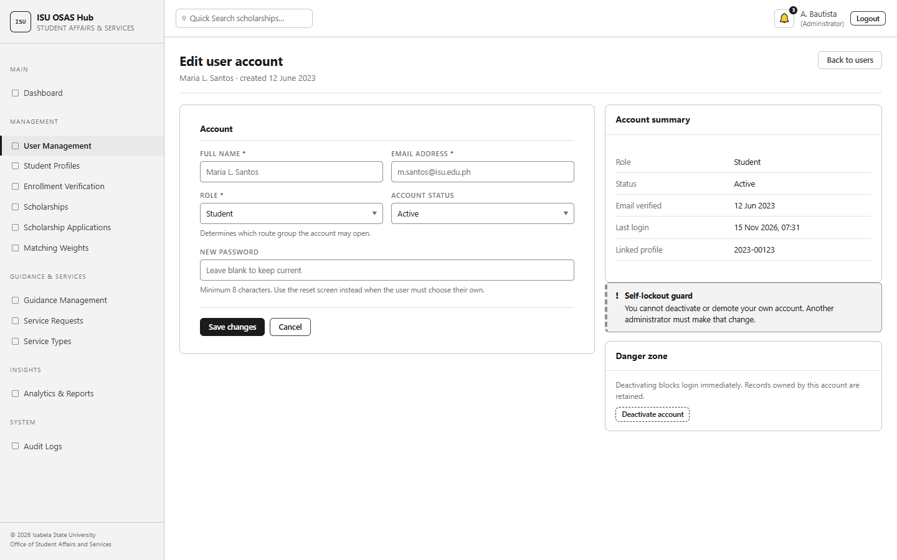

**Annotations**

1. Role is a required, explicit choice — it is never inferred from the email address.
2. Email must be unique across all accounts; the field reports a duplicate inline.
3. On create, an initial password is required and must be confirmed.
4. On edit, the password field is left blank and only replaced when filled, so editing a role does not silently reset a password.
5. Deactivating an account keeps every historical foreign-key reference intact.
6. Changing a student's role does not create or delete a student profile; that is done on the student profile screens.

**Responsive behaviour**

| Viewport | Layout behaviour |
| --- | --- |
| Desktop 1440 | Two-column field grid inside an 840 px card. |
| Tablet 1024 | Two columns retained. |
| Mobile 390 | Single column; the role and status controls stack last. |

### 6.4 WF-A-04 — Administrator-initiated password reset

| Field | Value |
| --- | --- |
| Role | Administrator |
| Route | `admin.users.reset-password` |
| Module | M01, M03 |
| Requirements | FR-AUTH-10, FR-PROF-08 |
| Source file | `admin/WF-A-04.html` |

**Purpose.** Let an administrator set a temporary password for a user who cannot sign in, without exposing or recovering the existing password.

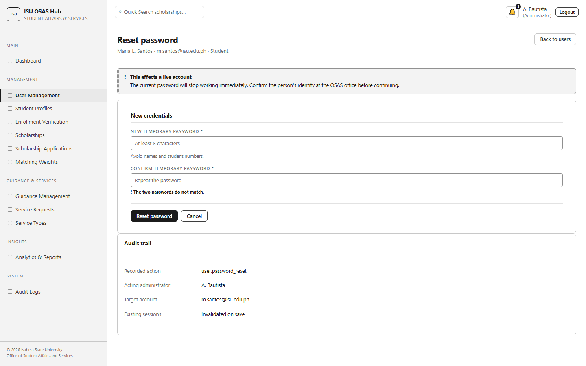

**Annotations**

1. This is the only password-recovery path: no self-service reset route exists (GAP-05).
2. The existing password is a one-way hash and can never be displayed.
3. The new password must be entered twice and meet the same minimum length as registration.
4. The action is recorded in the audit log with the acting administrator and the target account.
5. The user is not emailed automatically; the administrator hands over the temporary password through an agreed channel.
6. Session invalidation is explicit: the user must sign in again with the new password.

**Responsive behaviour**

| Viewport | Layout behaviour |
| --- | --- |
| Desktop 1440 | Narrow confirmation card, 560 px, centred. |
| Tablet 1024 | Same card, full content width. |
| Mobile 390 | Single column, buttons full width. |

### 6.5 WF-A-05 — Student profiles

| Field | Value |
| --- | --- |
| Role | Administrator |
| Route | `admin.student-profiles.index` |
| Module | M03, M05 |
| Requirements | FR-PROF-04 |
| Source file | `admin/WF-A-05.html` |

**Purpose.** List every student profile with academic identity, GWA, income and current enrollment status so records can be corrected and audited.

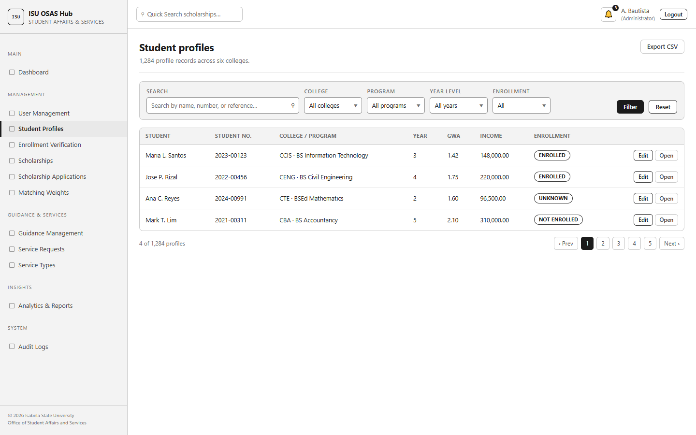

**Annotations**

1. Students are filtered by college, program, year level and enrollment status — the same facets used by eligibility rules.
2. Enrollment status is the profile-level mirror of the latest verification decision.
3. GWA and family income are shown because they drive eligibility; both are administrator-editable.
4. A student with no verification record is distinguishable from one with a pending record.
5. The list is read-only except for the per-row Edit action.
6. Bulk export is offered because colleges request roster extracts.

**Responsive behaviour**

| Viewport | Layout behaviour |
| --- | --- |
| Desktop 1440 | Filter bar with five controls, then a seven-column table. |
| Tablet 1024 | Program folds under college; income column is hidden. |
| Mobile 390 | Cards with name, program, GWA, income and status. |

### 6.6 WF-A-06 — Student profile detail

| Field | Value |
| --- | --- |
| Role | Administrator |
| Route | `admin.student-profiles.show` |
| Module | M03, M04, M05, M07 |
| Requirements | FR-PROF-05, FR-PASS-04 |
| Source file | `admin/WF-A-06.html` |

**Purpose.** Show one student's complete record, including enrollment outcome, passcode state and the eligibility inputs the system actually uses.

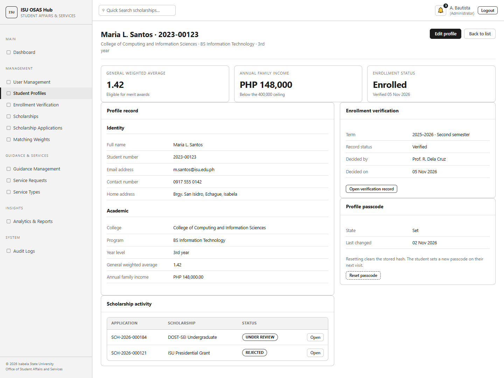

**Annotations**

1. Contact and household details are shown only to administrators; a counselor never reaches this screen.
2. Passcode state is shown as set or not set; the hash is never displayed.
3. Resetting a forgotten passcode clears the hash and requires the student to set a new one; the action is audited.
4. The enrollment panel links to the verification record for the current term.
5. Eligibility inputs are labelled so an administrator can see exactly which fields feed scholarship screening.
6. Every change is made through the edit screen, not inline, so validation is shared.

**Responsive behaviour**

| Viewport | Layout behaviour |
| --- | --- |
| Desktop 1440 | Three-column summary strip, then a 2:1 split of details and status. |
| Tablet 1024 | Status panels stack under the detail sections. |
| Mobile 390 | Definition lists collapse to label above value. |

### 6.7 WF-A-07 — Student profile edit

| Field | Value |
| --- | --- |
| Role | Administrator |
| Route | `admin.student-profiles.edit` |
| Module | M03 |
| Requirements | FR-PROF-05 |
| Source file | `admin/WF-A-07.html` |

**Purpose.** Correct any field of a student profile, including the academic identity and enrollment status that students cannot change themselves.

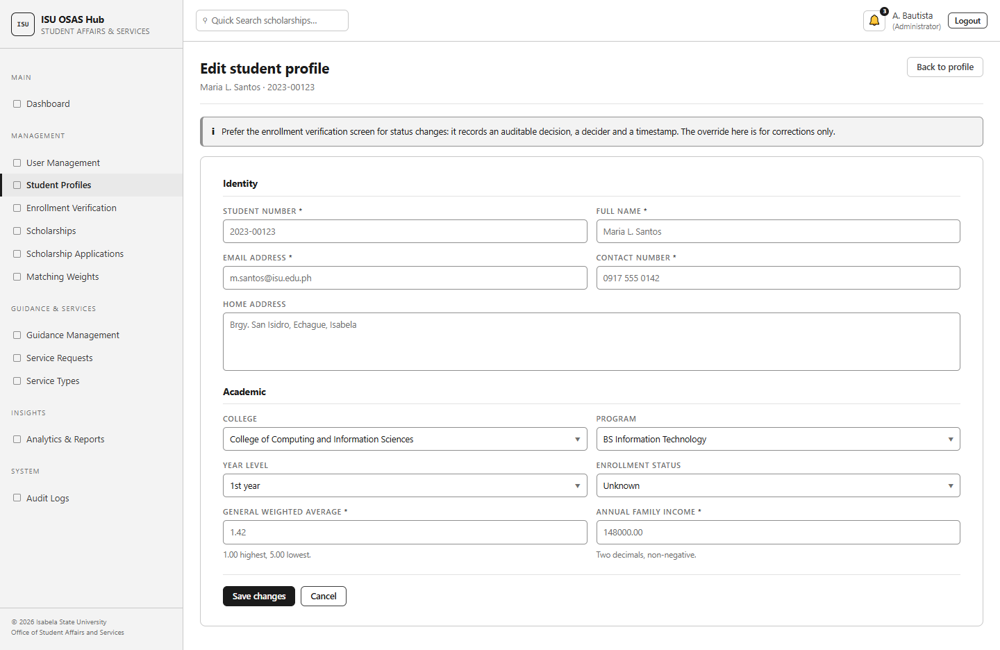

**Annotations**

1. Every field on this form is editable, unlike the student-facing edit screen.
2. Student number must remain unique across all profiles.
3. GWA is constrained to 1.00–5.00 and income to a non-negative decimal; a change immediately affects eligibility previews.
4. Enrollment status here is a manual override; the verification screen is the auditable path and is preferred.
5. Changes are audited with before and after values.
6. The student is not notified automatically of an administrative correction.

**Responsive behaviour**

| Viewport | Layout behaviour |
| --- | --- |
| Desktop 1440 | Three grouped sections in a two-column grid. |
| Tablet 1024 | Two columns retained; long text fields span both. |
| Mobile 390 | Single column; section headings become sticky separators. |

### 6.8 WF-A-08 — Scholarships

| Field | Value |
| --- | --- |
| Role | Administrator |
| Route | `admin.scholarships.index` |
| Module | M06 |
| Requirements | FR-SCH-03, FR-SCH-04, FR-SCH-08 |
| Source file | `admin/WF-A-08.html` |

**Purpose.** Manage the scholarship catalogue: create, publish, close, archive and announce a scholarship, and reach its document requirements.

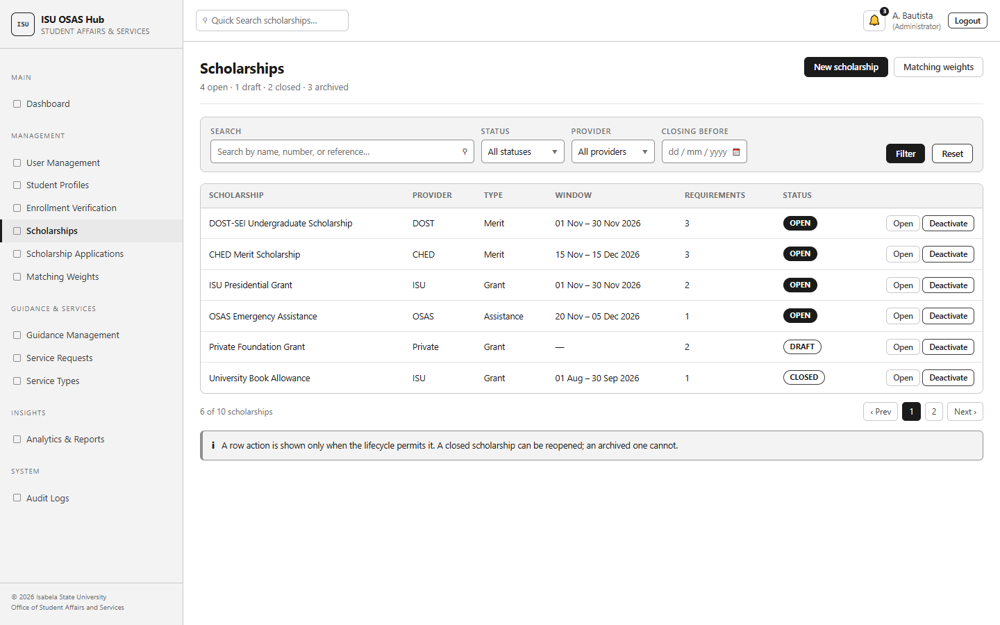

**Annotations**

1. Status is grouped into draft, open, closed and archived, matching the lifecycle constants.
2. An open scholarship is visible to students only while today sits inside the application window; the window is shown next to the status.
3. Publish, deactivate and archive are row actions, each guarded by the lifecycle rules in force.
4. Announcement sends a notification only to students currently eligible for that scholarship.
5. The requirements count links to the requirements manager for that scholarship.
6. Archiving hides the scholarship from students but leaves historical applications intact.

**Responsive behaviour**

| Viewport | Layout behaviour |
| --- | --- |
| Desktop 1440 | Filter bar plus a seven-column table. |
| Tablet 1024 | Provider folds under the title; window becomes a secondary line. |
| Mobile 390 | Cards grouped by status with a status-coloured edge. |

### 6.9 WF-A-09 — Scholarship create and edit

| Field | Value |
| --- | --- |
| Role | Administrator |
| Route | `admin.scholarships.create / admin.scholarships.edit` |
| Module | M06 |
| Requirements | FR-SCH-01, FR-SCH-02 |
| Source file | `admin/WF-A-09.html` |

**Purpose.** Define a scholarship's identity, its eligibility thresholds, its eligible programs and year levels, and its application window.

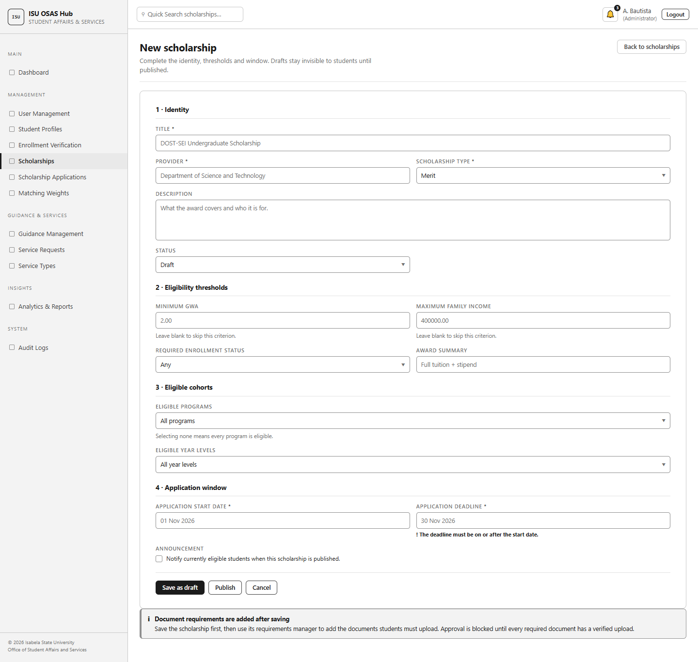

**Annotations**

1. Four sections: identity, eligibility thresholds, eligible cohorts, and schedule.
2. Every threshold is optional; a blank threshold means that criterion is not applied and is reported to students as not applicable.
3. Deadline must be on or after the start date, validated on both fields.
4. Programs and year levels are multi-selects; selecting none means all are eligible.
5. Status is chosen explicitly — saving as draft keeps the scholarship invisible to students.
6. Saving never publishes automatically; publication is a separate, audited action.

**Responsive behaviour**

| Viewport | Layout behaviour |
| --- | --- |
| Desktop 1440 | Two-column grid, sections separated by rules, sticky save bar. |
| Tablet 1024 | Two columns retained; multi-selects become full width. |
| Mobile 390 | Single column; save and cancel become a fixed bottom bar. |

### 6.10 WF-A-10 — Scholarship requirements manager

| Field | Value |
| --- | --- |
| Role | Administrator |
| Route | `admin.scholarships.requirements.index` |
| Module | M06, M10 |
| Requirements | FR-SCH-05 |
| Source file | `admin/WF-A-10.html` |

**Purpose.** Maintain the ordered list of documents a scholarship demands, and whether each one is required or optional.

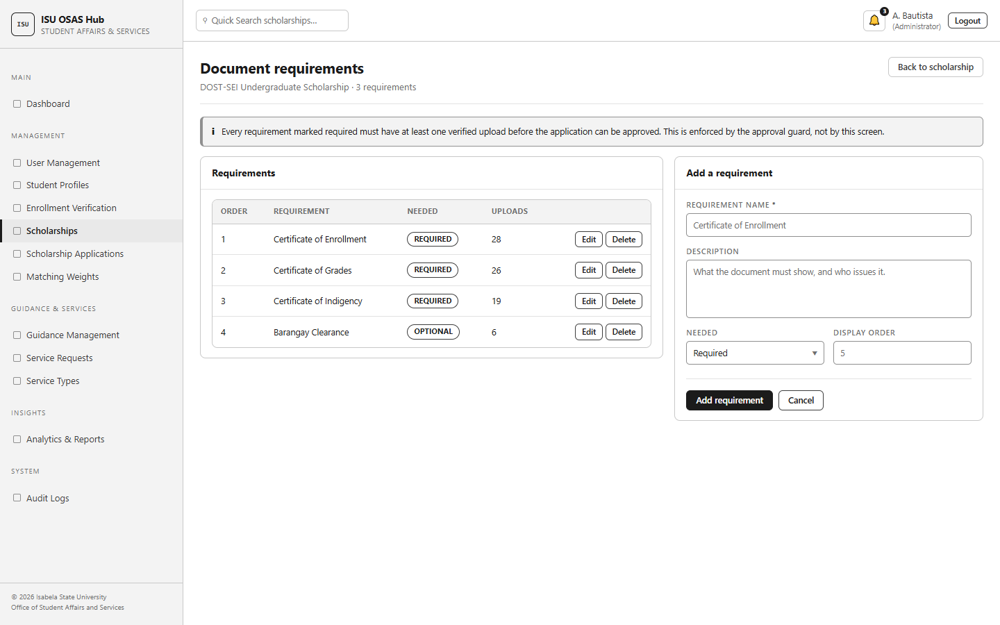

**Annotations**

1. Each requirement has a name, an optional description, a required flag and a display order.
2. Display order controls the order students see on the application and the upload form.
3. A requirement marked required participates in the approval guard; an optional one never blocks approval.
4. Requirements can be edited while the scholarship is draft or open, but removing one that already has uploads warns first.
5. The count of uploaded documents per requirement is shown so the effect of removal is visible.
6. Deleting a requirement does not delete the scholarship; it only removes the demand.

**Responsive behaviour**

| Viewport | Layout behaviour |
| --- | --- |
| Desktop 1440 | Requirements table left, add form right. |
| Tablet 1024 | Add form moves above the table. |
| Mobile 390 | Each requirement becomes a card with reorder and delete actions. |

### 6.11 WF-A-11 — Matching weights

| Field | Value |
| --- | --- |
| Role | Administrator |
| Route | `admin.scholarship-matching.weights.edit` |
| Module | M08 |
| Requirements | FR-MATCH-02, FR-MATCH-03 |
| Source file | `admin/WF-A-11.html` |

**Purpose.** Set the five weights that drive recommendation ranking, with a hard requirement that they total 100.

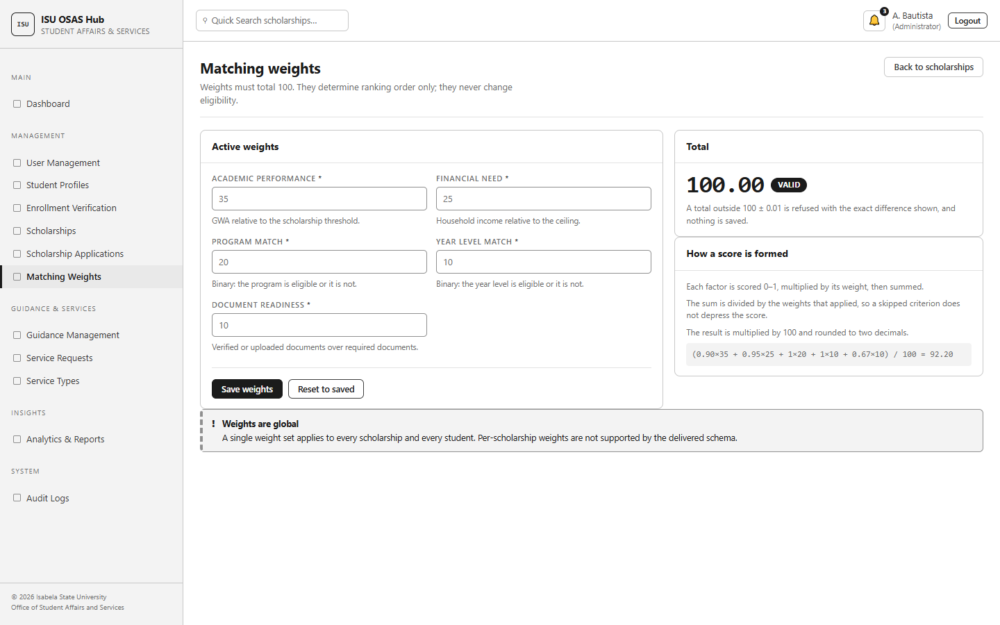

**Annotations**

1. Five weights: academic, financial, program, year level and document readiness.
2. The live total is displayed and must equal 100, with a tolerance of 0.01; otherwise saving is refused.
3. Only one weight set is active at a time; saving supersedes the previous set.
4. The change is attributed to the signed-in administrator and time-stamped.
5. Weights affect ranking order, never eligibility — an ineligible scholarship stays ineligible whatever the weights.
6. A worked example shows how a 92% score is produced from the entered weights.

**Responsive behaviour**

| Viewport | Layout behaviour |
| --- | --- |
| Desktop 1440 | Weight form left with a live total badge, explanation right. |
| Tablet 1024 | Explanation stack moves below the form. |
| Mobile 390 | Weights become full-width rows with numeric steppers. |

### 6.12 WF-A-12 — Application review queue

| Field | Value |
| --- | --- |
| Role | Administrator |
| Route | `admin.scholarship-applications.index` |
| Module | M09, M10 |
| Requirements | FR-APP-06, NFR-PERF-02, NFR-USA-03 |
| Source file | `admin/WF-A-12.html` |

**Purpose.** List applications across all scholarships so the administrator can triage by status, age and document readiness.

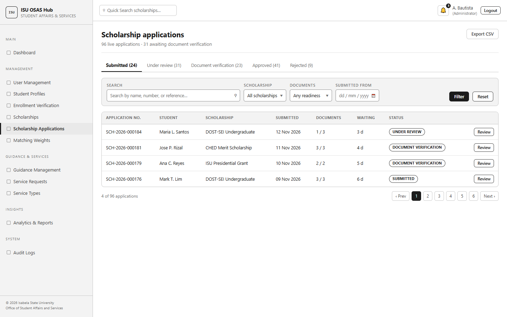

**Annotations**

1. Status tabs mirror the application state machine exactly, including draft.
2. Document readiness is shown as verified over required, because that is the approval-blocking condition.
3. Days waiting is derived from the timestamp of the last status change.
4. Scholarship, status and date filters combine; the search box matches application number or student name.
5. Rows are sorted oldest-first within a status so nothing starves.
6. The queue performs no transitions; every decision happens on the detail screen.

**Responsive behaviour**

| Viewport | Layout behaviour |
| --- | --- |
| Desktop 1440 | Tabs, filters, then an eight-column table. |
| Tablet 1024 | Scholarship folds under the application number. |
| Mobile 390 | Cards with the application number, student, readiness and status. |

### 6.13 WF-A-13 — Application review detail

| Field | Value |
| --- | --- |
| Role | Administrator |
| Route | `admin.scholarship-applications.show` |
| Module | M09, M10 |
| Requirements | FR-APP-07, FR-APP-08, FR-APP-09, FR-DOC-03, FR-DOC-04, NFR-USA-06, NFR-REL-03 |
| Source file | `admin/WF-A-13.html` |

**Purpose.** Review one application, verify or reject each document, and advance the workflow only along transitions the state machine permits.

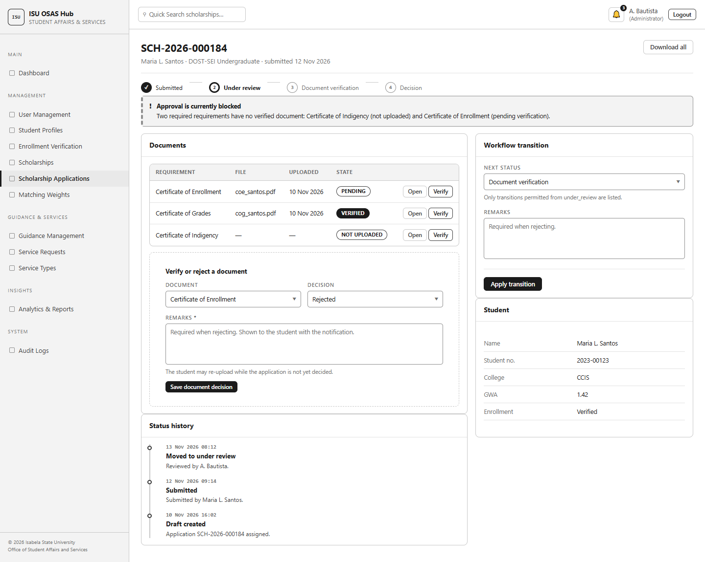

**Annotations**

1. The transition control offers only the targets allowed from the current state.
2. Approval is refused while any required requirement lacks a verified document, and the refusal lists each blocking requirement.
3. Document actions are verify and reject; rejection requires remarks that the student sees.
4. Documents are opened through an authorised stream, never a direct storage path.
5. Rejection of the application requires remarks; the requirement is enforced server-side as well.
6. The history panel is append-only and is the audit record for the decision.

**Responsive behaviour**

| Viewport | Layout behaviour |
| --- | --- |
| Desktop 1440 | Stepper and header, then a 2:1 split of documents and decision panel. |
| Tablet 1024 | Decision panel moves under the documents table. |
| Mobile 390 | Single column; each document becomes a card with verify and reject. |

### 6.14 WF-A-14 — Guidance appointment types

| Field | Value |
| --- | --- |
| Role | Administrator |
| Route | `admin.guidance.types` |
| Module | M11 |
| Requirements | FR-GUID-03 |
| Source file | `admin/WF-A-14.html` |

**Purpose.** Maintain the catalogue of appointment types, their default duration and the order in which students see them.

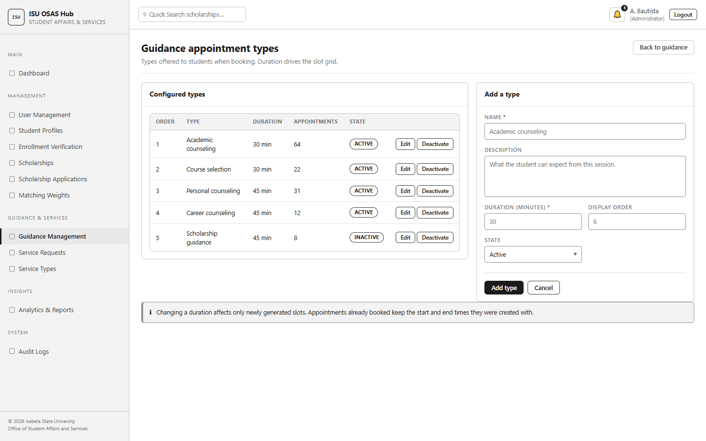

**Annotations**

1. Each type has a name, a description, a duration in minutes, an active flag and a display order.
2. Duration is what the slot generator uses; changing it changes future slot grids but not existing appointments.
3. An inactive type disappears from the student booking form but remains on historical appointments.
4. Display order controls the order in the type selector, not the slot order.
5. A type with existing appointments cannot be deleted, only deactivated.
6. Duration must be a positive number of minutes within the office day.

**Responsive behaviour**

| Viewport | Layout behaviour |
| --- | --- |
| Desktop 1440 | Table left, create form right. |
| Tablet 1024 | Form moves above the table. |
| Mobile 390 | Each type becomes a card with edit and deactivate actions. |

### 6.15 WF-A-15 — Guidance scheduling settings

| Field | Value |
| --- | --- |
| Role | Administrator |
| Route | `admin.guidance.settings` |
| Module | M11 |
| Requirements | FR-GUID-04 |
| Source file | `admin/WF-A-15.html` |

**Purpose.** Set the office hours, default duration, minimum booking notice, cancellation notice and booking horizon used by the slot generator.

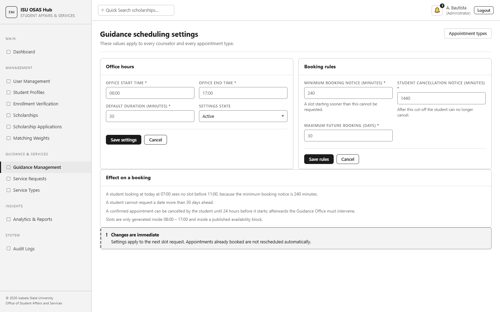

**Annotations**

1. Office start must precede office end; both are time values on a 24-hour clock.
2. Default duration applies when an appointment type does not specify one.
3. Minimum booking notice prevents a student booking a slot a few minutes ahead.
4. Cancellation notice is the cut-off after which the student must contact the office.
5. Booking horizon caps how far ahead a slot can be requested.
6. Only one active settings row applies; saving supersedes the previous configuration.

**Responsive behaviour**

| Viewport | Layout behaviour |
| --- | --- |
| Desktop 1440 | Two setting cards side by side, save bar beneath. |
| Tablet 1024 | Cards stack vertically in the order they affect a booking. |
| Mobile 390 | Single column with the derived effect shown under each field. |

### 6.16 WF-A-16 — Guidance oversight

| Field | Value |
| --- | --- |
| Role | Administrator |
| Route | `admin.guidance.appointments` |
| Module | M11 |
| Requirements | FR-GUID-11 |
| Source file | `admin/WF-A-16.html` |

**Purpose.** Give the administrator a read-only view of every appointment across all counselors for monitoring and reporting.

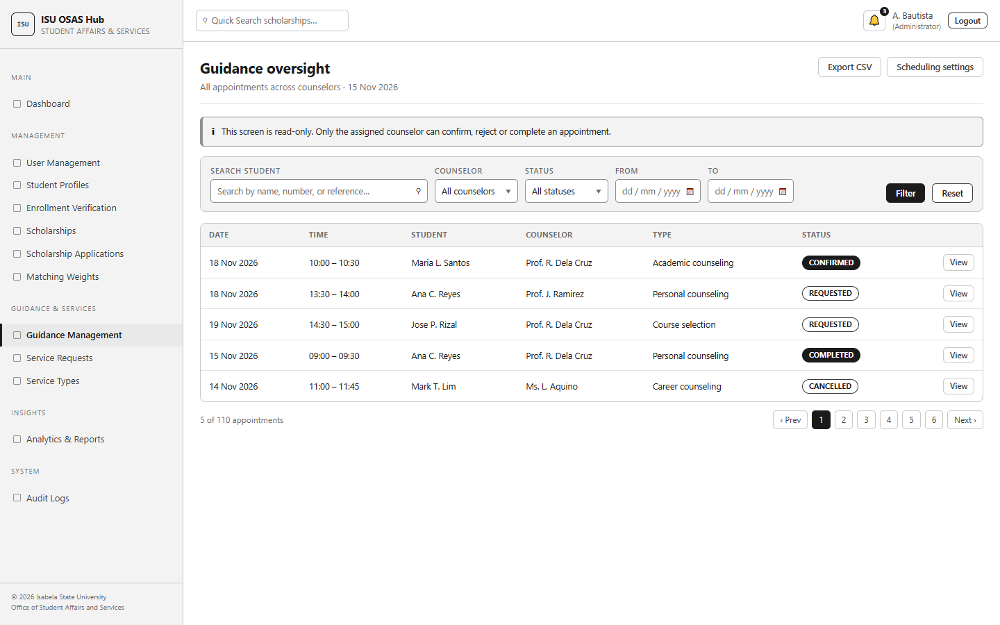

**Annotations**

1. Unlike the counselor queue, this list is not scoped to one counselor.
2. Filters cover counselor, status, appointment type and date range.
3. The administrator does not confirm, reject or complete appointments; those decisions belong to the assigned counselor (GAP-08: administrative view is read-only).
4. Counselor notes are not rendered here; they remain private to the counselor.
5. Volume and no-show patterns are visible through status counts, not per-student commentary.
6. Export is offered for reporting; the export uses the same filters as the view.

**Responsive behaviour**

| Viewport | Layout behaviour |
| --- | --- |
| Desktop 1440 | Filter bar plus a seven-column table. |
| Tablet 1024 | Type folds under the counselor name. |
| Mobile 390 | Cards ordered by date, with status and counselor in the header. |

### 6.17 WF-A-17 — Guidance oversight detail

| Field | Value |
| --- | --- |
| Role | Administrator |
| Route | `admin.guidance.appointments.show` |
| Module | M11 |
| Requirements | FR-GUID-11 |
| Source file | `admin/WF-A-17.html` |

**Purpose.** Show one appointment in full for oversight, including its decision history, without offering any state change.

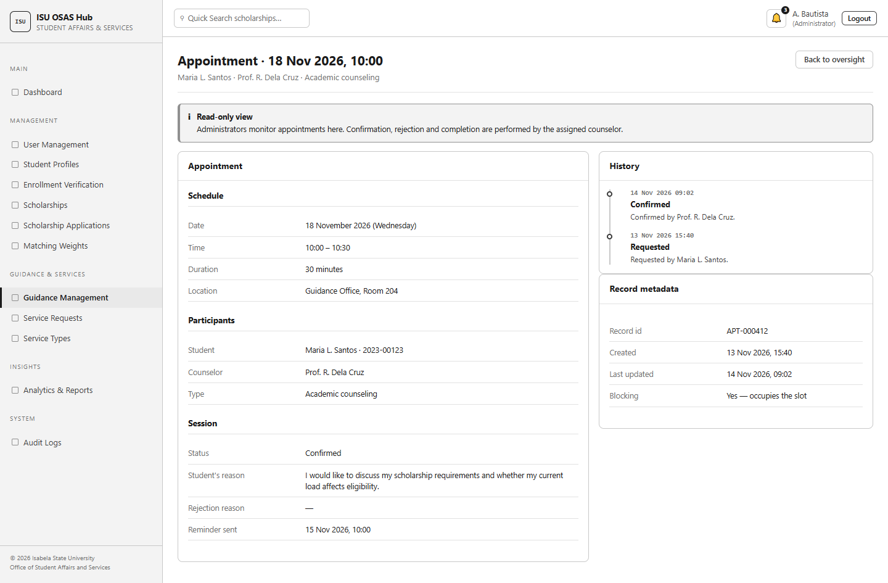

**Annotations**

1. Every field is read-only; there is no decision form on this screen.
2. The student's stated reason is visible; the counselor's private notes are not.
3. Rejection or cancellation reasons are shown because the student has already seen them.
4. History records actor, timestamp and remarks, matching the audit record.
5. The reminder timestamp is shown so a missing reminder is diagnosable.
6. An explicit banner states that oversight is read-only, so the absence of buttons is not mistaken for a permission fault.

**Responsive behaviour**

| Viewport | Layout behaviour |
| --- | --- |
| Desktop 1440 | Details left, metadata and history right. |
| Tablet 1024 | Metadata moves below the details. |
| Mobile 390 | Single column; status banner first. |

### 6.18 WF-A-18 — Service types

| Field | Value |
| --- | --- |
| Role | Administrator |
| Route | `admin.service-types.index` |
| Module | M12 |
| Requirements | FR-SVC-02 |
| Source file | `admin/WF-A-18.html` |

**Purpose.** Maintain the OSAS service catalogue: what students can request, the instructions they see, and the attachments each service demands.

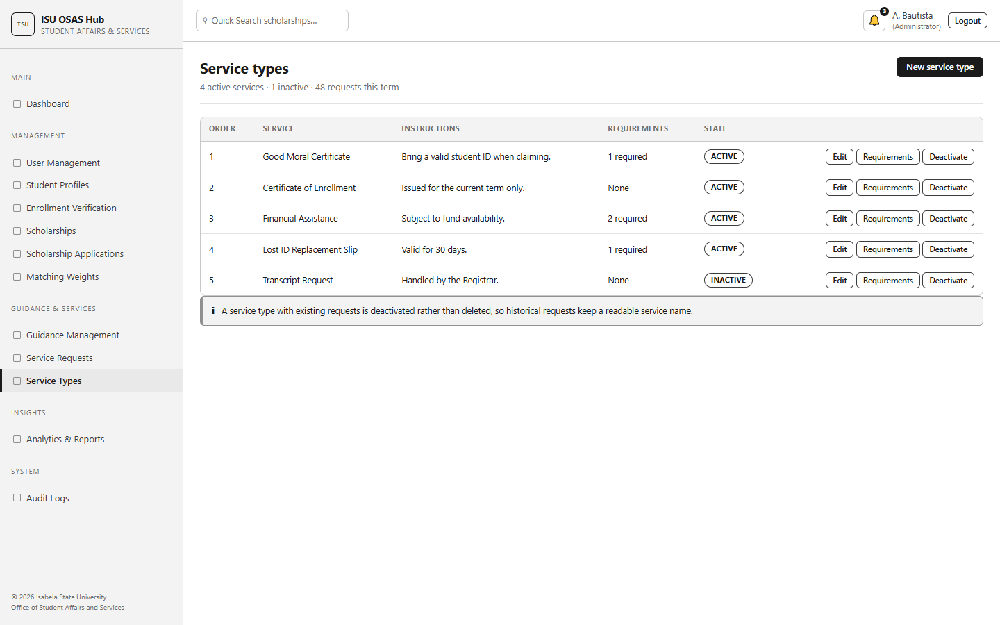

**Annotations**

1. Each type has a name, description, instructions, active flag, display order and a set of requirements.
2. Only active types appear in the student catalogue, ordered by display order.
3. The instructions field is shown verbatim to students, so it is written for them.
4. Requirement count is shown per type so the attachment burden is visible.
5. A type with existing requests cannot be deleted, only deactivated.
6. Display order is edited here, not by drag and drop, so the order is explicit and auditable.

**Responsive behaviour**

| Viewport | Layout behaviour |
| --- | --- |
| Desktop 1440 | Table with a requirements column and row actions. |
| Tablet 1024 | Instructions preview folds into a tooltip-style secondary line. |
| Mobile 390 | Cards with the requirement count as a badge. |

### 6.19 WF-A-19 — Service type create and edit

| Field | Value |
| --- | --- |
| Role | Administrator |
| Route | `admin.service-types.create / admin.service-types.edit` |
| Module | M12 |
| Requirements | FR-SVC-02 |
| Source file | `admin/WF-A-19.html` |

**Purpose.** Define a service type, its student-facing instructions and the ordered attachments a request must supply.

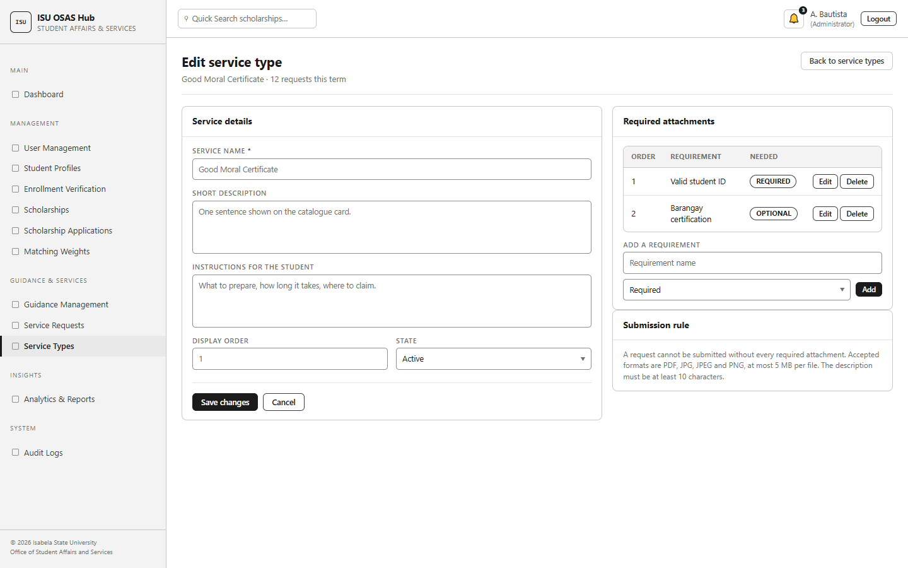

**Annotations**

1. Name, description and instructions are all student-visible text.
2. Instructions are displayed on the catalogue card and again on the request form.
3. Requirements are ordered; the order determines how attachments are requested.
4. A requirement marked required is enforced at submission time.
5. Deactivating hides the service from students without affecting open requests.
6. Display order places the service in the catalogue; lower numbers appear first.

**Responsive behaviour**

| Viewport | Layout behaviour |
| --- | --- |
| Desktop 1440 | Identity form left, requirements manager right. |
| Tablet 1024 | Requirements manager moves below the identity form. |
| Mobile 390 | Single column; each requirement is an edit-and-delete row. |

### 6.20 WF-A-20 — Service request queue

| Field | Value |
| --- | --- |
| Role | Administrator |
| Route | `admin.student-service-requests.index` |
| Module | M12 |
| Requirements | FR-SVC-06 |
| Source file | `admin/WF-A-20.html` |

**Purpose.** List all service requests so unassigned and stalled requests can be found and opened for processing.

**Annotations**

1. Tabs follow the request vocabulary: submitted, processing, requires information, completed and cancelled.
2. Handler is shown so unassigned requests are visible at a glance.
3. Filtering by service type and date range matches the student-side filter labels.
4. Requests requiring further information from the student are counted prominently.
5. The queue is sorted oldest-first within the active tab to prevent starvation.
6. No bulk transition is offered; each decision is made on the detail screen.

**Responsive behaviour**

| Viewport | Layout behaviour |
| --- | --- |
| Desktop 1440 | Tabs, filters, six-column table. |
| Tablet 1024 | Service type folds under the request number. |
| Mobile 390 | Cards with request number, service, handler and status. |

### 6.21 WF-A-21 — Service request detail and assignment

| Field | Value |
| --- | --- |
| Role | Administrator |
| Route | `admin.student-service-requests.show` |
| Module | M12 |
| Requirements | FR-SVC-06, FR-SVC-07, NFR-USA-04 |
| Source file | `admin/WF-A-21.html` |

**Purpose.** Process one request: assign a handler, read the student's documents, record remarks and advance the request along a permitted transition.

**Annotations**

1. Assigning a handler and changing status are separate controls because they are separate decisions.
2. Remarks are mandatory when moving to requires_information or completed; the form states this before submission.
3. Student-visible remarks and internal remarks are separate fields; the student never sees the internal field.
4. Only transitions permitted by the request state machine are listed.
5. Attachments are downloadable through an authorised route; no storage path is shown.
6. Completion and cancellation stamp a timestamp and the acting user.

**Responsive behaviour**

| Viewport | Layout behaviour |
| --- | --- |
| Desktop 1440 | Details and documents left, processing panel right. |
| Tablet 1024 | Processing panel moves below the documents. |
| Mobile 390 | Single column; status and handler actions come first. |

### 6.22 WF-A-22 — Audit log

| Field | Value |
| --- | --- |
| Role | Administrator |
| Route | `admin.audit-logs.index` |
| Module | M15 |
| Requirements | FR-AUDIT-01, FR-AUDIT-02, FR-AUDIT-03, FR-AUDIT-05, NFR-SEC-08 |
| Source file | `admin/WF-A-22.html` |

**Purpose.** Provide a searchable, append-only record of security-relevant and state-changing actions, filterable by actor, action and module.

**Annotations**

1. Columns are time, actor, action, module, record and IP address.
2. Filters cover date range, actor, action and module; the search box matches the record description.
3. The log is read-only: no row can be edited or deleted from any screen.
4. Login failures, blocked inactive logins, password resets and workflow transitions are all recorded.
5. Record identifiers are shown but are not links, because the target may since have been deleted or moved out of scope.
6. Retention is a database concern; the screen does not offer pruning.

**Responsive behaviour**

| Viewport | Layout behaviour |
| --- | --- |
| Desktop 1440 | Filter bar plus a six-column table. |
| Tablet 1024 | IP address folds under the actor. |
| Mobile 390 | Cards with action, actor and timestamp; description wraps. |

### 6.23 WF-A-23 — Audit log detail

| Field | Value |
| --- | --- |
| Role | Administrator |
| Route | `admin.audit-logs.show` |
| Module | M15 |
| Requirements | FR-AUDIT-04 |
| Source file | `admin/WF-A-23.html` |

**Purpose.** Show one audit entry in full, including the request context captured with it.

**Annotations**

1. All captured context is shown: actor, action, module, record type and id, description, IP address, user agent and timestamp.
2. The description is displayed as stored, without interpretation.
3. The entry cannot be modified or deleted; there are no actions on this screen.
4. Related entries for the same record can be listed to reconstruct a sequence.
5. A missing or deleted target record is stated plainly rather than shown as an error.
6. IP address and user agent are shown because they are part of the security record.

**Responsive behaviour**

| Viewport | Layout behaviour |
| --- | --- |
| Desktop 1440 | Definition list left, related entries right. |
| Tablet 1024 | Related entries move below. |
| Mobile 390 | Single column, label above value. |

### 6.24 WF-A-24 — Analytics overview

| Field | Value |
| --- | --- |
| Role | Administrator |
| Route | `admin.analytics.index` |
| Module | M14 |
| Requirements | FR-ANLYT-01, FR-ANLYT-05, FR-ANLYT-06 |
| Source file | `admin/WF-A-24.html` |

**Purpose.** Present volume and outcome metrics across scholarships, guidance and services for a chosen period, with an export of the same filtered dataset.

**Annotations**

1. The period filter is the primary control and applies to every figure on the screen.
2. Summary cards are counts, not rates, so they can be reconciled with the queues.
3. Tabs switch between the three analytical views without losing the period filter.
4. Export produces exactly the dataset on screen for the active period and tab.
5. Charts are descriptive only; no forecasting is claimed.
6. An invalid range is refused with an explicit message rather than silently defaulting.

**Responsive behaviour**

| Viewport | Layout behaviour |
| --- | --- |
| Desktop 1440 | Period filter bar, four cards, then two charts side by side. |
| Tablet 1024 | Cards in two columns; charts stack. |
| Mobile 390 | Single column; charts scroll horizontally where a series is dense. |

### 6.25 WF-A-25 — Analytics — scholarships

| Field | Value |
| --- | --- |
| Role | Administrator |
| Route | `admin.analytics.scholarships` |
| Module | M14 |
| Requirements | FR-ANLYT-02 |
| Source file | `admin/WF-A-25.html` |

**Purpose.** Break application volume and outcomes down by scholarship, provider and status for the selected period.

**Annotations**

1. The same period filter as the overview applies and is carried in the URL.
2. Table rows are scholarships; columns are volume, and counts per status.
3. Counts per status sum to the volume for that scholarship.
4. Provider grouping is available because providers request their own reports.
5. No student-level data appears on this screen; it is aggregate only.
6. Export matches the table exactly.

**Responsive behaviour**

| Viewport | Layout behaviour |
| --- | --- |
| Desktop 1440 | Chart above, full-width table below. |
| Tablet 1024 | Table scrolls horizontally; scholarship column pinned. |
| Mobile 390 | One card per scholarship with status counts as a compact grid. |

### 6.26 WF-A-26 — Analytics — guidance

| Field | Value |
| --- | --- |
| Role | Administrator |
| Route | `admin.analytics.guidance` |
| Module | M14 |
| Requirements | FR-ANLYT-03 |
| Source file | `admin/WF-A-26.html` |

**Purpose.** Show appointment volume and outcomes by type, counselor and status for the selected period.

**Annotations**

1. Outcome split reflects the appointment state machine: requested, confirmed, completed, rejected, cancelled.
2. Counselor breakdown supports workload review; it contains no per-student detail.
3. Type breakdown shows which services students actually use.
4. Cancellation rate is derived and labelled as derived, not stored.
5. The period filter is shared with the other analytics tabs.
6. Export matches the on-screen table.

**Responsive behaviour**

| Viewport | Layout behaviour |
| --- | --- |
| Desktop 1440 | Two charts side by side, then a counselor table. |
| Tablet 1024 | Charts stack; table scrolls horizontally. |
| Mobile 390 | One chart at a time with the table rendered as cards. |

### 6.27 WF-A-27 — Analytics — student services

| Field | Value |
| --- | --- |
| Role | Administrator |
| Route | `admin.analytics.services` |
| Module | M14 |
| Requirements | FR-ANLYT-04 |
| Source file | `admin/WF-A-27.html` |

**Purpose.** Show service-request volume by service type and status, including the proportion that needed further information.

**Annotations**

1. Volume is grouped by service type, then split by current status.
2. The requires_information count is highlighted because it represents work waiting on a student, not on the office.
3. Median handling time is shown only where the sample is large enough to be meaningful.
4. The period filter is shared with the other analytics tabs.
5. No handler-level performance ranking is produced; the data is operational, not evaluative.
6. Export matches the on-screen table.

**Responsive behaviour**

| Viewport | Layout behaviour |
| --- | --- |
| Desktop 1440 | Bar chart above a five-column table. |
| Tablet 1024 | Table scrolls horizontally. |
| Mobile 390 | One card per service type with status counts. |

<!-- pagebreak -->

## 7. Responsive evidence

The annotations above describe the intended reflow. The captures below are the evidence that the same HTML file produces it, without a second implementation. Each image is the full page at the stated width.

### 7.1 WF-G-01 at 1024 px

The registration and login layout at 1024 px: the brand panel narrows and the form keeps a readable measure.

### 7.2 WF-G-01 at 390 px

The same screen at 390 px: single column, brand banner above the form, full-width primary action.

### 7.3 WF-S-01 at 390 px

The student dashboard at 390 px: tiles stack, cards become rows, and the applications table becomes one card per application.

### 7.4 WF-S-13 at 390 px

Slot booking at 390 px: two slots per row, with the booking form stacked beneath the grid.

### 7.5 WF-A-12 at 390 px

The review queue at 390 px: the table restacks with each column labelled, so no field is lost.

### 7.6 WF-C-04 at 1024 px

Appointment review at 1024 px: the sidebar collapses to a menu toggle and the decision panel sits beside the request.

### 7.7 WF-A-09 at 1024 px

Scholarship authoring at 1024 px: the two-column field grid is retained inside the reclaimed width.

<!-- pagebreak -->

## 8. Coverage, omissions and open items

### 8.1 Module coverage

Each row names the screens where that module's work is primarily performed. A module's requirements can also surface on shared screens — a search result page carries records from several modules, for example — so this table is the map of purpose, not the complete trace. The traceability matrix holds the complete requirement-to-screen links, and the build checks that every screen named here is linked to at least one requirement of the module it is listed under.

<!-- widths: 10,28,62 -->
| Module | Scope | Screens |
| --- | --- | --- |
| M01 | Authentication and sessions | WF-G-01, WF-G-02, WF-G-03, WF-A-04 |
| M02 | Authorisation and error handling | WF-G-04 |
| M03 | User and student profile management | WF-A-02, WF-A-03, WF-A-05, WF-A-06, WF-A-07, WF-S-02, WF-S-03 |
| M04 | Profile passcode protection | WF-S-04, WF-A-06 |
| M05 | Enrollment verification | WF-C-05, WF-C-06, WF-S-02 |
| M06 | Scholarship management | WF-A-08, WF-A-09, WF-A-10, WF-S-05, WF-S-06 |
| M07 | Eligibility evaluation | WF-S-07 |
| M08 | Weighted matching and recommendations | WF-A-11, WF-S-08, WF-S-09 |
| M09 | Scholarship applications | WF-S-10, WF-S-11, WF-A-12, WF-A-13 |
| M10 | Document upload and verification | WF-S-11, WF-A-13 |
| M11 | Guidance appointments | WF-S-12, WF-S-13, WF-S-15, WF-C-02, WF-C-04, WF-A-14, WF-A-15, WF-A-16, WF-A-17 |
| M12 | Student service requests | WF-S-16, WF-S-17, WF-S-18, WF-S-19, WF-C-01, WF-A-18, WF-A-19, WF-A-20, WF-A-21 |
| M13 | Notifications | WF-G-05 |
| M14 | Analytics and reporting | WF-A-01, WF-A-24, WF-A-25, WF-A-26, WF-A-27 |
| M15 | Audit logging | WF-A-22, WF-A-23 |
| M16 | Search and application shell | WF-G-06, WF-S-05 |

Two further screens belong to the guidance module but are cited by no requirement: `WF-S-14` (a student's own appointments) and `WF-C-03` (the counselor's appointment queue). They are drawn because their routes exist and because the detail screens they lead to cannot be reached otherwise. Section 5.1 of the traceability matrix records the missing citation as an open item rather than a defect in the screen.

### 8.2 Features with no screen, and why

A wireframe was **not** drawn for the following capabilities because the delivered application has no route or handler for them. Drawing a screen would imply a capability that a reviewer could not then find in the code.

| Missing capability | Evidence | Where it is recorded |
| --- | --- | --- |
| Self-service password reset | No reset-request or reset-password route; only an administrator-initiated reset exists | GAP-05, FR-AUTH-10, WF-A-04 |
| Creating an enrollment verification record | No route writes the table; a queue and a decision screen exist but no intake | GAP-01, SM-05, WF-C-05 |
| Counselor processing of service requests | Service-request routes are administrator-only | GAP-03, UC-28 |
| Administrator confirming or completing appointments | Oversight is read-only | GAP-08, WF-A-16 |
| Adviser endorsement | No adviser role, gate or transition | CF-01 in the SRS |
| Super administrator tier | One flat administrator role, no hierarchy | CF-03 in the SRS |

### 8.3 Where the wireframes and the code intentionally differ

Two differences are deliberate and are not defects:

1. **The sidebar breakpoint is drawn at 1024 px inclusive.** The application's stylesheet switches at 1024 px, so a 1024 px browser may still show the sidebar depending on the browser's box model. The wireframe treats 1024 px as tablet and collapses the sidebar, which is the intended reading of the tablet capture.
2. **Table restacking is a wireframe device.** The delivered tables scroll horizontally on narrow screens. The wireframe restacks rows with column labels so that every field remains visible in a static review document. The high-fidelity mockups reuse the same device, so the two design sets stay comparable; both are drawn at 1024 px and 390 px from the same page specification.

<!-- pagebreak -->

## 9. Reproduction

1. `python documentation/_tools/build_wireframes.py` regenerates all 58 HTML files, the index page and `_manifest.csv`.
2. `node documentation/_tools/shoot_wireframes.cjs documentation/Wireframes documentation/Wireframes/export` regenerates every screenshot at 1440, 1024 and 390 px.
3. `python documentation/_tools/build_wireframes_doc.py` regenerates this document and its DOCX.

The build fails loudly if a page identifier is duplicated or if the count for any role group differs from the registry, so a dropped screen cannot pass silently.
